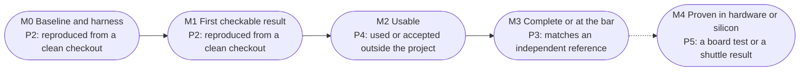
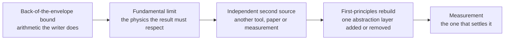
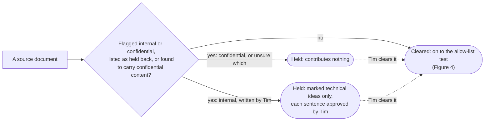
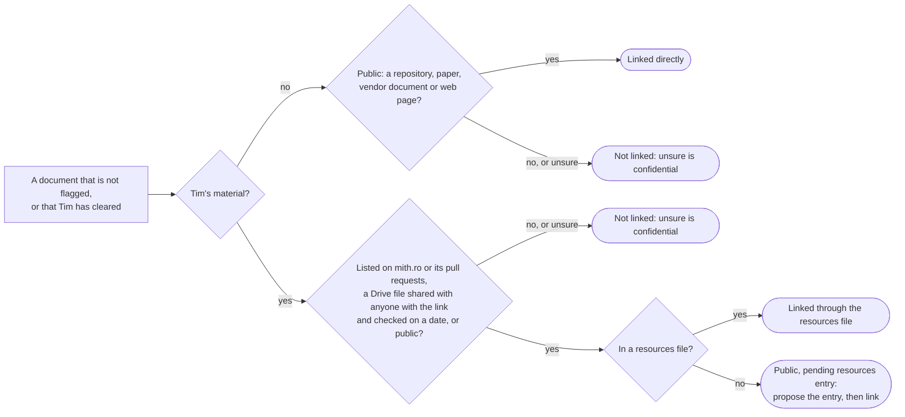

# Guidelines for item documents

The hit list is Tim's list of open-silicon projects worth doing ([README.md](README.md)); Tim is Tim Ansell (GitHub [mithro](https://github.com/mithro)), whose idea the list is and whose design documents, talks and experiments are the record most items rest on. Every item has a document at `projects/<id>.md`, mirrored as a [living doc](#living-doc) ([SYNC.md](SYNC.md)). This file is the contract for those documents, written for the agents and people who write them and the reviewers who check them: what each must contain, how claims are sourced, what is allowed to be published, and when a document is done. [TEMPLATE.md](TEMPLATE.md) is the skeleton to fill in. [PROCESS.md](PROCESS.md) is how a document is written, reviewed and iterated with AI agents and with Tim.

The documents are public. They are written for frontier AI models and for people, in that order. Their job is to turn a one-paragraph idea into a brief an agent can plan and start executing from, without first having to ask the person who had the idea, and to distil what Tim has already worked out so nobody rediscovers it. Every part of a document is written for a stranger who has only that part, little time, no one to ask, and no reason to take anyone's word for anything, Tim's included ([section 1, One principle](#1-one-principle)). A writer starts with the sixteen hard rules ([section 0, The sixteen hard rules](#0-the-sixteen-hard-rules)) and the [source pack](#source-pack) ([PROCESS.md Step 0, Source pack](PROCESS.md#step-0-source-pack)).

*Status of this file: draft 4, 2026-10-21, in progress. Drafts 1 to 3 and their reviews are listed in the [revision history](#revision-history); draft 4 applies the findings of five reviews of draft 3, each read from the reader's situation, in committed rounds. What still breaks the file's own rules is recorded in the self-application audit ([PROCESS.md section 13, The guideline files obey their own rules](PROCESS.md#13-the-guideline-files-obey-their-own-rules)).*

## 0. The sixteen hard rules

Given to every writer with the template. Sections [1, One principle](#1-one-principle), [2, Principles](#2-principles) and [9, References](#9-references) explain them; sections [3, Structure of an item document](#3-structure-of-an-item-document) to [7, Definition of done](#7-definition-of-done) are the rules in full, and the glossary ([8, Glossary](#8-glossary)) defines the words.

1. **Pack only.** Write from the [source pack](#source-pack) only; a claim not in the pack goes into the pack, with its source, before it is used.
2. **Source or status.** Every claim links to its source, or carries one sanctioned status ([5.4, Claim statuses](#54-claim-statuses)), or both where the status is `(as of YYYY-MM)` on a linked state-of-the-art claim; a bare `Unknown` or `estimate` is not a status. Never invent: write `None found (searched: …)`, `Unknown (settled by: …)` or `Not applicable (…)`.
3. **Nothing from memory.** Never cite a paper, repository or document from memory; resolve it with a tool and copy the identifier.
4. **Tim's material through the allow-list.** Link Tim's material only through the allow-list ([5.1, Link allow-list](#51-link-allow-list)). A document flagged internal or confidential, or listed as held back, is not linked until Tim clears it, and the clearance date is recorded in the resources entry. Internal material gives technical ideas only, marked, with no title or fragment. Confidential material gives nothing.
5. **Nothing private.** From private material, nothing about partners, funding, customers, contacts, contractors, grant or contract terms, internal programme names or prices, and no quotation. In full:
    - A price comes only from a public price list ([4.10, Needs beyond AI processes](#410-needs-beyond-ai-processes)), never from a vendor's quote.
    - Public facts about public partners and quotations of public documents are allowed ([5.3, Naming](#53-naming), [4.7, What Tim has already worked out](#47-what-tim-has-already-worked-out)).
    - No AI company, product or sponsor in the document's own words (a cited title is quoted as published).
    - Never which organisation asked for the list.
6. **Tim's claims checked.** Attribute to Tim only what you read in his documents, and say what you read. Invent no position for him, and check his claims as you would anyone else's.
    - A claim of his, from a document, a thread answer or a doc comment, carries the status `(Tim's claim, YYYY-MM; checked: <how> | not checked)` ([5.4, Claim statuses](#54-claim-statuses)) and never stands as fact.
7. **An oracle per workstream.** Every workstream has an [oracle](#oracle) with a [negative control](#negative-control) and stated blind spots; fit is derived from the [binding constraint](#binding-constraint) (none, oracle, access, compute, knowledge or decision), never asserted.
8. **M1 on public resources.** [M1, First checkable result](#m1-first-checkable-result) needs only what [4.9, Work plan and milestones](#49-work-plan-and-milestones) allows it (public resources, no-cost vendor FPGA editions where hard rule 16 allows them, at most one board, nothing under a non-disclosure agreement); every Needs line names only what exists at the time of writing or is produced by an earlier rung.
9. **Dated and classed.** Every state-of-the-art claim carries `(as of YYYY-MM)`; every tool carries a status word from [5.5, Status of tools and projects](#55-status-of-tools-and-projects) and its [licence class](#licence-class) ([open-source](#open-source), [source-available](#source-available) or [proprietary](#proprietary)) from [5.6, Licences](#56-licences).
10. **Numbers from a source.** Dates, numbers and counts come from a named source, or are marked `(estimate)` with what will replace them.
11. **The template's form.** Use the template's form exactly. In full:
    - the template's headings, order and bold [lead-ins](#lead-in);
    - after each lead-in, the first sentence is the conclusion;
    - three or more parallel things are a list, things with the same attributes a table, a structure a diagram with a caption ([6.7, Readability and presentation](#67-readability-and-presentation));
    - data is never a paragraph ([L29, data written as prose](PROCESS.md#appendix-b-the-lint-toolscheckpy));
    - a table cell holds one fact ([L30, stuffed table cells](PROCESS.md#appendix-b-the-lint-toolscheckpy));
    - every [guidance line](#guidance-line) deleted, and no generated section written.
12. **One entry, full names, links.** One reference entry per paper and repository; every mention names what it points to; everything that can be linked is linked. In full:
    - Each paper and each repository has one reference entry (identifier, licence, status, contents), under Start here (Key papers, Projects and code).
    - Every other mention names it in full, as every pointer does, for a reader who arrives mid-document ([6.8, Words: pointers, terms and second readings](#68-words-pointers-terms-and-second-readings)); the first mention in each `##` section links to the same target ([6.9, Links](#69-links)).
    - Coin no term; replace or pin every word with a second meaning ([6.8, Words: pointers, terms and second readings](#68-words-pointers-terms-and-second-readings)).
    - Link every section, id, item, tool, paper, term and file that can be linked ([6.9, Links](#69-links)).
13. **Within the band.** Keep the document within 3,000 to 6,000 words, counted as [6.2, Length](#62-length) says (the hand-written part, link addresses, table separator rows and column bars removed; the [lint](#the-lint) warns outside the band and fails above 7,000), and the summary within 60 to 120 words.
14. **No outside contact.** Never, from an [item thread](#item-thread), open an issue or pull request in another project, write to Tim's files, or contact anyone outside the project; a person named in `DECISIONS.md` owns and opens any upstream contribution ([5.8, Upstream contributions](#58-upstream-contributions)).
15. **Unsure is not published.** When unsure whether something is allowed to be published, it is not: ask in the private [packet](#the-packet) ([PROCESS.md 6.1, The packet](PROCESS.md#61-the-packet)), never in the document, which carries at most `Unknown (settled by: a question to Tim, YYYY-MM-DD)` and no description of the material.
16. **Open tools only.** Every workstream, oracle and milestone can be done with open-source tools alone; no rung needs a [proprietary](#proprietary) tool, licence or result. In full:
    - Two exceptions, set by Tim on 2026-10-22: vendor FPGA tools, run to produce reference bitstreams and device data for bitstream documentation ([bitstream-atlas](projects/bitstream-atlas.md)); and the sign-off tooling a FinFET tape-out needs (Tim named EUV FinFET tape-outs; the list plans only a pre-EUV FinFET run, [NODES.md](NODES.md)).
    - Benchmarks test open tools against themselves: changes and performance over time, ideas evaluated, and corpora AI can learn and generalise from; never open against proprietary ([4.9, Work plan and milestones](#49-work-plan-and-milestones)).
    - A proprietary tool may appear as dated context in State of the art, in a line ([principle 13](#22-working)); the [lint](#the-lint) fails one named in the plan sections outside the two exceptions.

## 1. One principle

**The principle.** Every part of a document is written for a stranger who has only that part. That stranger has little time, no one to ask, and no reason to take anyone's word for anything, Tim's included.

The stranger is one of three readers: an AI agent handed the document as its brief; a person deciding whether to point people, compute or money at the item; or a domain expert who wants to check the claims, contribute, or disagree. All three can arrive through a link to a heading rather than from the top, and the documents are written as if they always do. None can reach the person who had the idea, and no document depends on their doing so. So whatever a reader needs to understand a sentence, to find the next thing, and to check a claim has to be in that sentence, in its section, or one link away.

Everything else in this file follows from that:

| Corollary | What it requires of a document | Where the rules are |
| --- | --- | --- |
| Each part stands alone | A term is defined where it is used | [6.8, Words: pointers, terms and second readings](#68-words-pointers-terms-and-second-readings) |
| Each part stands alone | A pointer names what it points to | [6.8, Words: pointers, terms and second readings](#68-words-pointers-terms-and-second-readings), [6.9, Links](#69-links) |
| Each part stands alone | Everything that can be linked is linked | [6.9, Links](#69-links) |
| Each part stands alone | A sentence has one reading | [6.8, Words: pointers, terms and second readings](#68-words-pointers-terms-and-second-readings) |
| Claims are checked, not believed | Every claim carries a source or a status | [5.4, Claim statuses](#54-claim-statuses) |
| Claims are checked, not believed | No single source, person or tool is trusted alone | [2, Principles](#2-principles); [4.9, Work plan and milestones](#49-work-plan-and-milestones) (Cross-checks) |
| Claims are checked, not believed | A key result climbs a [verification ladder](#verification-ladder) | [4.9, Work plan and milestones](#49-work-plan-and-milestones) (Cross-checks) |
| Claims are checked, not believed | A claim that breaks physics is wrong until shown otherwise | [2, Principles](#2-principles) |
| The reader's time is respected | A reader who stops after the summary, or after the [skim path](#skim-path), still has the gist | [6.7, Readability and presentation](#67-readability-and-presentation) |
| The reader's time is respected | The first sentence after each [lead-in](#lead-in) is the conclusion | [6.7, Readability and presentation](#67-readability-and-presentation) |
| The reader's time is respected | The form of each element shows the shape of its content | [6.7, Readability and presentation](#67-readability-and-presentation) |
| An agent can start | The goal is written as acceptance criteria | [4.2, Goal](#42-goal) |
| An agent can start | Every workstream has an [oracle](#oracle) | [4.9, Work plan and milestones](#49-work-plan-and-milestones) |
| An agent can start | Start here names the first task, its check and the access to ask for | [4.14, Start here](#414-start-here) |
| Open is argued, not assumed | Each document says, for its own item, why doing the work closed would not produce the breakthrough | [4.5, Why it must be open](#45-why-it-must-be-open) |
| Open is argued, not assumed | Open means anyone can reproduce and replicate the result and change what produced it | [4.5, Why it must be open](#45-why-it-must-be-open) |
| Open is argued, not assumed | A licence that only looks open is named as such | [4.5, Why it must be open](#45-why-it-must-be-open), [4.6, State of the art](#46-state-of-the-art) |
| This file obeys its own rules | [GUIDELINES.md](GUIDELINES.md), [TEMPLATE.md](TEMPLATE.md) and [PROCESS.md](PROCESS.md) are held to every check they set | [7, Definition of done](#7-definition-of-done); [PROCESS.md 13, The guideline files obey their own rules](PROCESS.md#13-the-guideline-files-obey-their-own-rules) |
| This file obeys its own rules | They are reviewed from the reader's situation, not the writer's | [PROCESS.md 13, The guideline files obey their own rules](PROCESS.md#13-the-guideline-files-obey-their-own-rules) |
| This file obeys its own rules | What still breaks is recorded in the self-application audit until the count is zero | [PROCESS.md 13, The guideline files obey their own rules](PROCESS.md#13-the-guideline-files-obey-their-own-rules) |

**What a document is for.** A document is three things: an agent's brief, a decider's case, and Tim's record distilled.
1. *The brief.* It turns a one-paragraph idea into a brief an agent can plan and start executing from, without asking the person who had the idea.
2. *The case.* It makes the case for the item to a person who decides.
3. *The record.* It distils what Tim has already worked out, in design documents, talks, experiments and dead ends, so that nobody rediscovers it. Tim's record is the richest source most items have, and it is a source: mined in full, attributed exactly, and checked like any other ([principle 7, Distil Tim's record, and check it](#21-checking)).

Where the record runs out, the document asks him targeted questions and folds the answers in as his claims, with what was done to check them.

**The tests of a finished document.** Four readers give four tests: the agent, the five-minute reader, the stranger and the opponent. [PROCESS.md 5.1, Core panel for the canaries](PROCESS.md#51-core-panel-for-the-canaries) runs each.

1. *The agent.* Having read nothing else, it can state the goal as acceptance criteria, name the first task with its oracle and where the result lands, list the access it needs and the role that holds it, name the items upstream and downstream, and say why the work must be open.
    - The [agent digest](#agent-digest) at the top of [4.14, Start here](#414-start-here) carries the first four; [4.5, Why it must be open](#45-why-it-must-be-open) carries the fifth.
2. *The five-minute reader.* Reading only the skim path, they can give the seven answers of the gist, both defined in [6.7, Readability and presentation](#67-readability-and-presentation).
3. *The stranger in the middle.* Arriving at any section from a link, they can resolve every term, id and pointer in it from that section and the [glossary](#8-glossary), and reach each thing it refers to in one click.
4. *The opponent.* Reading each sentence that states a number, a capability, a requirement or a prohibition as uncharitably as possible, they find no second reading, and they can check every claim from what it links to, or see from its status why it cannot yet be checked.

## 2. Principles

The principles are the reasons behind the rules of sections [4, Section requirements](#4-section-requirements) to [6, Style and mechanics](#6-style-and-mechanics). Each gives the claim, the reason behind it, and where a document applies it. Several rest on claims about the world (that published results often fail to reproduce; that the open tools are slow). Those are claims like any other: their evidence is in [section 9, References](#9-references), and each item's document re-checks them for its own tools and sources rather than inheriting them.

**Working assumption.** The work is done by an organisation with effectively unlimited [AI processes](#ai-processes). No document costs tokens, rations agent runs or picks a smaller AI model to save money; what a document accounts for is everything else that can bind: the [oracle](#oracle), access to hardware and [foundries](#foundry), other compute (simulation hours, graphics processors), knowledge, decisions and people.

### 2.1 Checking

Principles 1 to 7, numbered across [section 2](#2-principles) and cited elsewhere as "principle n"; each states the claim, its *Reason*, and under *In the document* what it requires of an item document.

1. **Every claim has a source or a status.**
    - *Reason:* A reader who cannot see where a number, a date, "nobody has done X" or "tool Y cannot Z" comes from cannot check it, and the writer's own memory is not a source ([section 9, References](#9-references), entry 11, Walters and Wilder 2023).
    - *In the document:* Each such claim links to where it comes from or carries exactly one of the statuses in [5.4, Claim statuses](#54-claim-statuses); nothing is cited from memory; a paper, repository or document is resolved with a citation tool ([5.10, Citations and links](#510-citations-and-links)) and its identifier copied. The claim audit in [PROCESS.md Step 5, Revise and audit](PROCESS.md#step-5-revise-and-audit) samples it.
2. **No single source is trusted, and no single person.**
    - *Reason:* Simulators have bugs. Published results fail to reproduce, highly cited ones included. Companies have lied ([section 9, References](#9-references), entries 1, 2 and 10: Ioannidis 2005, Herklotz and Wickerson 2020, Contag et al. 2017). Tools and AI models change yearly, so even a correct claim carries a date.
        - [Tim](#tim)'s documents, answers and rulings are sources like any other: attributed exactly and checked.
    - *In the document:*
        - Every decision number (a number in the [Acceptance test](#42-goal), a [Done when](#49-work-plan-and-milestones) line, [Metric and baseline](#49-work-plan-and-milestones) or [Shots on goal](#43-why-it-is-high-value)) has two independent sources (produced by different people with different tools or data) or a bound the writer computed.
        - A number measured inside the loop, by the writer, the executor, the referee or an auditor, is one source.
        - It becomes a baseline, an expected value or a decision number when a second run by a different agent, from a fresh clone at the same pins, agrees within the tolerance; both runs are rows in the [source pack](#source-pack).
        - Every tool result that matters has a second route to it.
        - The sources a key result rests on are listed with their known failure modes ([4.9, Work plan and milestones, Cross-checks](#49-work-plan-and-milestones)).
        - What Tim worked out is reported with what was read and what was checked ([4.7, What Tim has already worked out](#47-what-tim-has-already-worked-out)).
3. **Physics bounds everything.**
    - *Reason:* A claim that breaks a fundamental limit is wrong until shown otherwise, and a result that contradicts an established one or beats the best published result is an extraordinary claim that needs extraordinary proof.
    - *In the document:*
        - A headline figure is checked against a fundamental limit and a back-of-the-envelope estimate before it is believed.
        - The [verification ladder](#verification-ladder) names the bound and the limit for each key result ([4.9, Work plan and milestones, Cross-checks](#49-work-plan-and-milestones)).
        - An extraordinary claim needs [proof level](#proof-level) [P3, agrees with an independent reference](#491-proof-levels) plus the first-principles rebuild rung of the ladder ([4.9.1, Proof levels](#491-proof-levels)).
4. **Every check is a proxy for physics, and every rule has a reason.**
    - *Reason:* A design-rule check, a circuit-simulation (SPICE) model, a timing check or a layout-versus-schematic comparison is a fast stand-in (fast in intent, even when slow in practice) for a question about manufacturing, manufacturing yield (the share of working dies), device physics or non-ideal conditions.
        - Each design rule in such a check exists for a reason, often unrecorded ([section 9, References](#9-references), entry 3, Wong 2005), and the reason might or might not matter for a given use.
        - Without the reason nobody can say when the design rule is allowed to be relaxed, and a simulator accurate and fast enough could replace the proxy.
    - *In the document:*
        - Every oracle names the physical question it stands in for (or what it checks directly, where it is not a proxy) and where the reason for each of its rules is recorded, or `Unknown (settled by: …)` ([4.9, Work plan and milestones](#49-work-plan-and-milestones), the Oracle lines).
        - The [process design kit](#process-design-kit-pdk) (PDK) consistency audit workstream that [4.9, Work plan and milestones](#49-work-plan-and-milestones) requires of PDK items records the reason behind each rule.
        - The fundamental-limit rung of the verification ladder is the direct check the proxy approximates ([4.9, Work plan and milestones, Cross-checks](#49-work-plan-and-milestones)).
5. **Rebuild and compare.**
    - *Reason:* The check this file relies on most (a design choice, not a measured ranking) is an independent reconstruction from first principles, compared against the existing result, with a layer of abstraction added or removed where that separates or combines concerns more cleanly.
    - *In the document:* The verification ladder names the rebuild for each key result ([4.9, Work plan and milestones, Cross-checks](#49-work-plan-and-milestones)).
6. **Rough first, accurate when it matters, effort in proportion.**
    - *Reason:* A fast answer settles many questions, and the verification a result gets is set in proportion to the cost of its being wrong.
    - *In the document:* Each key quantity has a fast path and an accurate path used when the answer carries weight: Fast and accurate paths and the Effort rule ([4.9, Work plan and milestones, Cross-checks](#49-work-plan-and-milestones)).
7. **Distil Tim's record, and check it.**
    - *Reason:* A reader learns what was worked out without opening the links; nothing is attributed to a document the writer has not read, no position is invented for Tim, and his claims are checked like anyone else's.
    - *In the document:* Design documents, talks, experiments and dead ends are paraphrased or briefly quoted in the body with attribution, not only listed at the end, and each of his claims carries what was done to check it, or the status that says it could not be ([4.7, What Tim has already worked out](#47-what-tim-has-already-worked-out), [4.13, Questions for Tim](#413-questions-for-tim)).

### 2.2 Working

8. **Oracles first.**
    - *Reason:* Work suits AI agents when the result can be checked without a person: a design-rule check, a layout-versus-schematic comparison, a circuit simulation, formal equivalence checking (a proof that two designs behave the same), a reference tool, hardware. Work with no oracle is where agents are weakest.
    - *In the document:* Every workstream names its oracle and what the oracle cannot see, and work with no oracle is flagged ([4.9, Work plan and milestones](#49-work-plan-and-milestones); [hard rule 7, An oracle per workstream](#0-the-sixteen-hard-rules)).
9. **Harness and benchmarks before the tool.**
    - *Reason:* The open tools in this field run slower than the proprietary ones and have few users ([section 9, References](#9-references), entries 4 and 5), and some are poorly written (the writer's judgement, made per tool in [4.6, State of the art](#46-state-of-the-art)).
        - A simulator with excellent fundamentals can spend most of its time recomputing values whose inputs have not changed (entry 6).
        - A test suite and a benchmark let a tool be replaced with confidence, and replacement can be the only way to reach the iteration speed agents allow.
    - *In the document:* Speed and quality per tool and the replace-or-build-on decision ([4.6, State of the art](#46-state-of-the-art)); the "[Harness](#harness), benchmarks and tool speed" workstream, with its share of the work stated, because keeping up with the iteration speed AI allows and verifying what it produces costs real effort in every item ([4.9, Work plan and milestones](#49-work-plan-and-milestones)).
10. **More attempts beat better guesses.**
    - *Reason:* Learning comes from the number of attempts and from lower barriers to trying, not from deciding in advance what is worth trying: a thousand times more attempts at a tenth of the success rate is at most a hundred times more results ([section 9, References](#9-references), entry 7, Brown et al. 2024).
    - *In the document:* Where an oracle exists, the plan gates attempts on it rather than on judgement; where none exists, building one comes first ([principle 8, Oracles first](#22-working)); [Shots on goal](#shots-on-goal) ([4.3, Why it is high value](#43-why-it-is-high-value)); universal access argued in [4.5, Why it must be open](#45-why-it-must-be-open).
11. **If it were easy it would be done, and bad solutions outlive their reasons.**
    - *Reason:* Every item has a reason it has not already happened (a missing oracle, closed data, no money, no developer time, or nobody's job), and inertia and sunk cost keep worse solutions alive long after better ones exist.
        - A past attempt that stopped is not a failed idea until the record shows the idea failed.
        - Tim's claim that most of his stopped for resources, software developer time above all, carries `(Tim's claim, 2026-10; not checked)` until the item documents test it per dead end in [4.7, What Tim has already worked out](#47-what-tim-has-already-worked-out).
        - Whether agents supply that time depends on an oracle gating the work ([principle 8, Oracles first](#22-working); the evidence is in [section 9, References](#9-references)).
    - *In the document:* The real reason is named under Why not already done and Why now ([4.3, Why it is high value](#43-why-it-is-high-value)); Past and parallel efforts ([4.6, State of the art](#46-state-of-the-art)); each dead end classed as the idea or the resources, with the evidence ([4.7, What Tim has already worked out](#47-what-tim-has-already-worked-out)).
12. **Honest about limits.**
    - *Reason:* A case for agents that hides what they cannot do for this item (physical access, legal judgement, tacit foundry knowledge, decisions, getting changes merged) sends agents to work the item has already said they cannot do.
    - *In the document:* What agents cannot do and what has to be true for the case that agents change the work to hold ([4.8, What frontier models change](#48-what-frontier-models-change), [4.11, Unknowns, blockers and risks](#411-unknowns-blockers-and-risks)).
13. **The bar is physics and what agent-scale work needs, never the proprietary result.**
    - *Reason:* [Proprietary](#proprietary) tools and results are closed to the debugging and optimisation agents could do and licensed per seat ([section 9, References](#9-references), entry 15, Acharya and Mehta 2022), so they cannot serve work in which agents write code, debug, optimise and use compute at scale; they are what proprietary development built, and this list is trying to do better.
    - *In the document:*
        - Proprietary tools and results appear as dated context, in a line each, never as the target, and no rung runs one outside the two exceptions of [hard rule 16, Open tools only](#0-the-sixteen-hard-rules).
        - The bar an item sets itself is the physical limit, the first-principles bound, and what agent-scale work needs (iteration time, cost per attempt, reproducibility, no licence gate, the freedom to change the tool): The bar to clear ([4.6, State of the art](#46-state-of-the-art)); Metric and baseline ([4.9, Work plan and milestones](#49-work-plan-and-milestones)).

### 2.3 Writing

14. **Specific beats general.**
    - *Reason:* "Large, mechanical, checkable work that suits agents" is the thesis of the whole list; a sentence that would survive unchanged in another item's document adds nothing to it.
    - *In the document:* Name the tool, the family, the [process node](#process-node), the pull request, the number; each document shows which work, checked by which oracle, at what scale ([6.1, Voice](#61-voice) carries the rule).
15. **Open is a requirement, argued per item.**
    - *Reason:* Before anything can be changed it has to be understood, and this file's test of understanding is that the result is reproduced from what is published and replicated independently.
        - So open means that every input, tool and step needed to reproduce and replicate a result is available to anyone, under a licence that allows it to be studied, changed and redistributed.
        - A [source-available](#source-available) licence (the Business Source License and its relatives), a delayed or partial release, or data and models (AI or device) published without what generated them is not open.
    - *In the document:* Each document explains, for its own item, why doing the work closed does not produce the breakthrough and what open has to mean for it, and says so wherever it meets a licence that only looks open ([4.5, Why it must be open](#45-why-it-must-be-open)); the [licence class](#licence-class) of every tool in [4.6, State of the art](#46-state-of-the-art).
16. **Write so an agent can start.**
    - *Reason:* An agent that has to ask the person who had the idea before it can begin has not been given a brief.
    - *In the document:* The document ends with a Start here section an agent can act on at once: what to read, what to reproduce, the first tasks with oracles, the access to request, the known dead ends ([4.14, Start here](#414-start-here)).
17. **Dated and checked.**
    - *Reason:* A stale fact misleads where a missing one only leaves a gap, and a link that has rotted takes its evidence with it ([section 9, References](#9-references), entry 19, Klein et al. 2014).
    - *In the document:* State-of-the-art claims carry `(as of YYYY-MM)`; every link is fetched before [landing](#landing); a missing fact is written as `None found (searched: …)` or `Unknown (settled by: …)`, never papered over ([5.4, Claim statuses](#54-claim-statuses), [5.10, Citations and links](#510-citations-and-links)).
18. **Public and safe.**
    - *Reason:* The repository is public, some of Tim's material is confidential or belongs to others, and a published file is copied and archived beyond recall ([section 9, References](#9-references), entry 19, Klein et al. 2014).
    - *In the document:* Only links that pass [5.1, Link allow-list](#51-link-allow-list); technical ideas only, with no partners, funding, customers, contacts or prices from private material; AI described generically in the document's own words, with no AI company, product or sponsor named (a cited title is quoted as published), and never who asked for the list ([5, Sources, provenance and confidentiality](#5-sources-provenance-and-confidentiality)).
19. **One home per fact.**
    - *Reason:* A fact with one home can be found and corrected; copies drift apart as each is edited, which the audit of this file found in its own copies ([PROCESS.md 13, The guideline files obey their own rules](PROCESS.md#13-the-guideline-files-obey-their-own-rules)).
    - *In the document:* Each required element has exactly one section ([3, Structure of an item document](#3-structure-of-an-item-document)); other sections point to it, with a link, and never restate it.
20. **Generated sections are generated.**
    - *Reason:* A hand-written copy of generated text drifts from [`items.json`](items.json) and is overwritten at the next build.
    - *In the document:* The id prefix of the title, "Where it sits", "Resources" and "Related items" come from [`items.json`](items.json) through [`tools/build.py`](tools/build.py); relationship changes are proposed for [`items.json`](items.json), never written into the document ([6.4, Title and the generated tail](#64-title-and-the-generated-tail)).
21. **Words that cannot be misread.**
    - *Reason:* A stranger who arrives in the middle has no one to ask, and a word with two readings is read the wrong way by some readers, so the rule assumes the worst case.
    - *In the document:* Terms of the field are defined where they are used or replaced by plain words; no term is coined; a word with a second meaning is replaced or pinned; every pointer names what it points to; everything that can be linked is linked ([6.8, Words: pointers, terms and second readings](#68-words-pointers-terms-and-second-readings), [6.9, Links](#69-links)).

## 3. Structure of an item document

The hand-written sections sit between the title and the [generated tail](#generated-tail). [`tools/build.py`](tools/build.py) keeps the file's own title, adds the `<id>: ` prefix, strips the three generated sections wherever they are and re-appends them at the end. The template therefore ends with "Start here" and no generated headings ([section 6.4, Title and the generated tail](#64-title-and-the-generated-tail)).

| Order | Section | Home of |
| --- | --- | --- |
| 0 | `# <item id>: <item title>` | The stable id (generated) and the title (hand-written, kept by [`tools/build.py`](tools/build.py)). |
| 1 | Summary and status line (no heading) | What the item is in three to five sentences; which draft this is and who has reviewed it. |
| 2 | Goal | The end state as deliverables, the acceptance test, the [two-ways framing](#two-ways-framing), out of scope. |
| 3 | Why it is high value | The pain today, why not already done, who is waiting, why now, [shots on goal](#shots-on-goal). |
| 4 | What success unlocks | Needs first, unlocks on the list, cross-checks with other items, shared [harness](#harness), beyond the list, compounding effects. |
| 5 | Why it must be open | The counterfactual, the strongest case against open, why closed does not deliver, what open must mean here. |
| 6 | State of the art | Open tools with [licence class](#licence-class), speed and quality; [the bar to clear](#46-state-of-the-art); research results; past and parallel efforts; what is missing or to be replaced. |
| 7 | What Tim has already worked out | His proposals, numbers, experiments, dead ends and framing, per document read; where the record runs out. |
| 8 | What frontier models change | Why faster, why better, what has to be true, and in two sentences what people still do. |
| 9 | Work plan and milestones | Workstreams, the summary table, milestones, the dependency diagram, the metric and baseline, lead times, cross-checks; the parts are in [4.9, Work plan and milestones](#49-work-plan-and-milestones). |
| 10 | Needs beyond AI processes | Compute, licences, hardware, data, access, people, money, time: cost, lead time, who could provide it. |
| 11 | Unknowns, blockers and risks | Expertise barriers, hard blockers, and the risks of the approach (the [plausible-but-wrong risk](#plausible-but-wrong-risk) first), each with its check. |
| 12 | Unanswered technical questions | Every technical question and known unknown anyone could take up, each with how to settle it, which workstream it blocks and who could take it. |
| 13 | Questions for Tim | Where the written record runs out. Transient. |
| 14 | Start here | The [agent digest](#agent-digest), then the brief: read, reproduce, first tasks, access to request, dead ends, key papers, projects and code. |
| 15 to 17 | Where it sits; Resources; Related items | Generated from [`items.json`](items.json). |

What happens to the sections the existing documents have (as of 2026-10, before any is rewritten to these guidelines):

| Section (as of 2026-10) | What happens | Where |
| --- | --- | --- |
| Goal | Stays; gains "Out of scope" | [4.2, Goal](#42-goal) |
| Why it is high value | Stays, restructured | [4.3, Why it is high value](#43-why-it-is-high-value) |
| State of the art | Stays; gains The bar to clear and the "Past and parallel efforts" table | [4.6, State of the art](#46-state-of-the-art) |
| [Process design kit](#process-design-kit-pdk) (PDK) consistency audit and generated docs (in [shadow-pdks](projects/shadow-pdks.md), [drc-forge](projects/drc-forge.md), [tcad-twin](projects/tcad-twin.md), [cell-foundry](projects/cell-foundry.md), [cloud-fab](projects/cloud-fab.md)) | Becomes a workstream in "Work plan and milestones" | [4.9, Work plan and milestones](#49-work-plan-and-milestones) |
| Open questions | Becomes "Unanswered technical questions"; questions only Tim can answer move to "Questions for Tim" | [4.12, Unanswered technical questions](#412-unanswered-technical-questions), [4.13, Questions for Tim](#413-questions-for-tim) |
| Sources | Dissolves: its links are cited where they are used | [5.10, Citations and links](#510-citations-and-links) |
| Where it sits; Resources; Related items | Unchanged (generated) | [6.4, Title and the generated tail](#64-title-and-the-generated-tail) |

`resources/<id>.md` keeps its role as the raw link collection. "Start here" is the curated subset with a reason for each entry. A new link found while writing goes into the resources file first, with the sharing check of [section 5.1, Link allow-list](#51-link-allow-list), through the [routed change](#routed-change) ([PROCESS.md 12, What agents are allowed to do on their own](PROCESS.md#12-what-agents-are-allowed-to-do-on-their-own)); the document links it only after that.

## 4. Section requirements

Each block gives the purpose, the required elements, what to avoid, and where it helps an illustrative example. Required elements are written as **bold lead-ins** at the start of the paragraph or list that carries them, with the exact words shown, so a reader and the [lint](#the-lint) can find them. Where a block says "as sub-headings", the bold names in its list are `###` sub-headings, as the template shows, and the [lead-ins](#lead-in) inside them are the ones the template shows in bold. An element with nothing to say is not omitted: it carries one of the [sanctioned empty values](#sanctioned-empty-value) of [section 5.4, Claim statuses](#54-claim-statuses).

An item listed under **Avoid.**, when found, is a finding of severity minor unless a rule elsewhere sets a higher one ([PROCESS.md 5.4, Severity](PROCESS.md#54-severity)).

Length is governed by one document band ([section 6.2, Length](#62-length)), not by per-section bands. After each lead-in the first sentence states the element's conclusion, and the form of each element (prose, list, table, block or diagram) follows the shape of its content ([section 6.7, Readability and presentation](#67-readability-and-presentation)); pointers and terms follow [section 6.8, Words: pointers, terms and second readings](#68-words-pointers-terms-and-second-readings).

All examples in this section are **illustrative**. Their figures were verified on 2026-10-21 against the sources named; a writer re-verifies before reuse and never copies the sentences.

### 4.1 Summary and status line

**Purpose.** Let a skimming reader decide in one minute whether to read on. The minute is a design budget, not a measurement. The summary is the first depth of reading ([6.7, Readability and presentation](#67-readability-and-presentation)) and stands alone.

**Required.** One paragraph of three to five sentences, 60 to 120 words, then the status line. The paragraph sits directly under the title and says what the item produces, who uses it, what is broken (as of the date in the status line), and the one-line case for AI agents. The status line follows, in exactly this grammar:

`*Status: <draft N | stable draft | reviewed>, YYYY-MM-DD. AI review panel: <personas, comma-separated, or none yet>. Human review: <none | Tim, YYYY-MM-DD>. Questions for Tim: <N>. This document was drafted and reviewed with AI agents; the AI review panel is not a human review, and the Human review entry is the only record of one.*`

*draft N* means the document is still in the loop; *stable draft* means the loop's exit condition holds but Tim has not approved; *reviewed* is written only after Tim has approved the document ([PROCESS.md 4, Exit condition](PROCESS.md#4-exit-condition)). The last sentence is fixed text so that no reader mistakes an AI [persona](#persona) for a human reviewer. Its wording changed on 2026-10-21 (round 22) because the earlier one, "human review is recorded here", read two ways; [L4](PROCESS.md#appendix-b-the-lint-toolscheckpy) reads the grammar from this line, so the lint follows a wording change.

**Avoid.** Repeating the title. Adjectives in place of facts.

### 4.2 Goal

**Purpose.** Define "done" so precisely that two people would agree whether it has been reached.

**Required.** Four lead-ins, in this order.
- **Deliverables.** The artefacts that will exist (a database, a cell library or a software library, a tool, a corpus, a chip) with their essential properties (coverage, accuracy, speed, licence).
- **Acceptance test.** How someone would check the goal is met, with numbers where they exist. Where the number is not yet known, `Unknown (settled by: <the M0 measurement or decision>)`.
- **Framing.** The [two-ways framing](#two-ways-framing) in the writer's own words: which layer ([process design kit](#process-design-kit-pdk) (PDK), tooling, IP blocks, proof in silicon), which function (interface, computation, storage) and where this item moves work along the [manual-to-generator axis](#manual-to-generator-axis). The generated "Where it sits" line carries the tags; the Goal explains them.
- **Out of scope.** Three to six things this item deliberately does not do, each with the item or candidate that does.

**Avoid.** Goals that are activities ("improve the [design-rule check](#design-rule-check-drc) (DRC)") instead of end states. Goals with no way to check them.

**Example (illustrative).** A goal for an open design-rule checker, in the section's lead-ins.
- *Deliverables:* an open DRC engine that checks a [reticle](#reticle)-sized layout (about 26 x 33 mm) at a stated [process node](#process-node) in under one hour on a stated cluster; for every open PDK, one test layout per design rule with a passing and a failing case; and a record per design rule stating why it exists, with a public source.
- *Acceptance test:* the engine's violation list matches a reference checker's on pinned public [shuttle](#shuttle) designs, with every difference explained; the per-rule suite covers every design rule in the [rule decks](#rule-deck) of [SKY130](https://github.com/google/skywater-pdk) (SkyWater, 130 nm), [GF180MCU](https://github.com/google/gf180mcu-pdk) (GlobalFoundries, 180 nm) and [SG13G2](https://github.com/IHP-GmbH/IHP-Open-PDK), the 130 nm kit with bipolar transistors of the Leibniz Institute for High Performance Microelectronics (IHP).
- *Where a number comes from:* "every rule" is the count taken from each rule deck's files at [M0, Baseline and harness](#m0-baseline-and-harness).

**Example (weak).** "Make open DRC fast and reliable enough for real designs."

### 4.3 Why it is high value

**Purpose.** Make the case before any work is done.

**Required.** Five lead-ins, in this order.
- **The pain today.** What takes how long, what is missing, what people do instead (pay for a licence, give up, use a closed tool), with sources or statuses.
- **Why not already done.** The real obstacle, since an obvious solution would already be in use: cost, access, a missing [oracle](#oracle), the scale of the tedium, software developer time, inertia, or the sunk cost that keeps a worse solution alive. Name it; "nobody thought of it" is not an answer.
- **Who is waiting.** The users and projects blocked by this, on this list and outside it.
- **Why now.** One or two sentences naming which of the three framings applies, and what changed so that the obstacle above no longer holds.
    - The framings: *easy now with AI*, *unlocks other tasks*, *accelerates a kind of work or iteration*, with a clause on the move along the [manual-to-generator axis](#manual-to-generator-axis) that the Goal's Framing describes.
    - What changed: AI-model capability, compute price, a new open PDK, a licence.
    - The mechanisms belong to [section 4.8, What frontier models change](#48-what-frontier-models-change); do not argue them here.
- **Shots on goal.** How many attempts (designs, runs, [tapeouts](#tapeout), tests) per month the item makes possible against the number as of the status-line date, and the cost of one attempt before and after, with sources or `(estimate)` with what replaces it.
    - A thousand times the attempts at a tenth of the success rate is at most a hundred times the results ([section 9, References](#9-references), entry 7, Brown et al. 2024); say which side of that trade this item is on.

The dependency order of the list (what this item needs first, what it is a prerequisite for) lives in [section 4.4, What success unlocks](#44-what-success-unlocks) and the [agent digest](#agent-digest), not here; the move along the [manual-to-generator axis](#manual-to-generator-axis) is owned by the Goal's **Framing**.

**Avoid.** Hype. Claims about [proprietary](#proprietary) tools without a public source. Restating the Goal.

### 4.4 What success unlocks

**Purpose.** Show where the item sits in the list's dependency order and how success compounds.

**Required.** Six lead-ins, in this order.
- **Needs first.** The items this one depends on, each with what it must deliver first. Each must be listed under this item in [`items.json`](items.json)'s `related` map.
- **Unlocks on this list.** The items that become possible, cheaper or faster, each with the mechanism in a sentence. Each must be in `related` for this item; a missing relationship is proposed for [`items.json`](items.json) through the [routed change](#routed-change) ([PROCESS.md 12, What agents are allowed to do on their own](PROCESS.md#12-what-agents-are-allowed-to-do-on-their-own)), never added to the document first.
- **Cross-checks with.** The items whose results check this item's results and vice versa (a simulated value against a measured one, an open tool's output against a [scoreboard](#scoreboard) run, a generated rule against a shuttle result), each with the quantity compared and the agreement expected. Each must be in `related`.
- **Shared harness.** The test suites and benchmarks this item shares with other items, and which item owns each.
- **Beyond the list.** Products, research, education, communities this enables.
- **Compounding.** Corpora and test suites that grow, data that future AI models learn from, work that becomes continuous (re-run on every tool change) instead of one-off.

**Avoid.** Repeating "Why it is high value". "Enables innovation".

### 4.5 Why it must be open

**Purpose.** Open and universally accessible is a requirement for the breakthrough, not a preference. The section argues it for this item specifically.

**Required.** Five lead-ins, in this order, and the mechanism table.
- **The closed version.** One or two sentences naming the closed tools or results that exist for this goal as dated context (the one line each under The bar to clear in [4.6, State of the art](#46-state-of-the-art) owns the description) and stating that their existence has not closed the gap: they cannot be reproduced, changed or run at agent scale.
- **The counterfactual.** Two sentences: what happens if this work is done closed, or not at all.
- **The strongest case against open.** The best argument that a closed or proprietary route would serve better here, and why it fails for this item.
- **Why closed does not deliver.** At least two of the mechanisms in the table below, applied with the item's specifics, each labelled *empirical* (with a citation), *contractual* (with the clause and its date, stated as a question per [5.9, Vendor terms](#59-vendor-terms)), *normative* (said so) or *argued* (a reasoned case with no measurement, saying what would measure it).
- **What open means here.** Open means a licence per artefact, enough published to reproduce and replicate the result, a public test suite, consent for any vendor or [foundry](#foundry) data, the clean-room rule where a PDK is touched, and no licence that only looks open. Each as an entry:
  - the licence per artefact ([5.6, Licences](#56-licences) gives the defaults);
  - what has to be published for anyone to reproduce the result (inputs, tools, versions, steps) and to replicate it (enough of the method to rebuild it independently);
  - the public test suite;
  - whose consent any vendor or foundry data needs;
  - the [clean-room](#clean-room) rule where the item touches a PDK ([5.7, Clean-room rule for PDK items](#57-clean-room-rule-for-pdk-items));
  - the licences that only look open, which this item must not build on or be mistaken for ([source-available](#source-available) and business-source licences, delayed or partial releases, models (AI or device) or data without their generating inputs), each named with the tool or project that carries it.

| Mechanism | What closed breaks | Usual label |
| --- | --- | --- |
| Reproducibility | A result on closed tools cannot be re-run or checked by others | empirical |
| Replicability | Nobody outside can rebuild the method independently and compare | empirical |
| Composability | Agents and people can only fix, extend and chain tools whose source they can change | empirical or normative |
| Legal scale | Proprietary tools are priced and written per seat; whether their terms permit automated runs at scale is a question stated per tool ([5.9, Vendor terms](#59-vendor-terms)) | contractual |
| Universal access | Any student, company or country can use an open result; a closed one is rationed | normative |
| Accumulation | Open material survives when copied and archived under persistent identifiers; closed material can vanish with its owner, and nobody outside can copy it first | empirical for the rot; argued for the vanishing |
| AI itself | AI models learn from and act on open data and tools, so open work is what future AI models will be good at | empirical for the mechanism; argued for future AI models |
| Supportability | Users can fix what they depend on | normative |

The usual label is the kind of support each mechanism most often has; the label in a document is given per use, from the evidence the document actually has.

**Avoid.** A paragraph that could be pasted into another item unchanged. Arguing that open is nicer; argue that it is necessary.

**Example (illustrative, for a field-programmable gate array (FPGA) item).** The closed version and one mechanism, in the section's lead-ins.
- *The closed version:* the vendor's tools carry the [bitstream](#bitstream) format of every part they support, sealed inside them; that seal is the gap, and a closed documentation effort would recreate it.
- *Why closed does not deliver, composability (empirical):* the [Project X-Ray](https://github.com/f4pga/prjxray-db) database (the open documentation of the Xilinx 7-series bitstream format) is published under CC0 (the Creative Commons public-domain dedication), which is why [nextpnr-xilinx](https://github.com/openXC7/nextpnr-xilinx) (the nextpnr [place-and-route](#place-and-route) port for Xilinx parts) could build its 7-series [FPGA assembly](#fpga-assembly-fasm) (FASM) path on it without a per-tool deal.

### 4.6 State of the art

**Purpose.** Say exactly where the field stands. The work then starts from the frontier and not from a blank page.

**Required.** Five sub-headings, in a fixed order. They are, in order:
- **Open-source tools and projects.** Each named and linked, as a bullet whose first line is `- **<Tool>**: <status>, as of <YYYY-MM>` (the [5.5, Status of tools and projects](#55-status-of-tools-and-projects) vocabulary, so the lint can read it), followed by one nested line per attribute:
  - its [licence class](#licence-class) and licence name ([5.6, Licences](#56-licences));
  - what it can do for this goal, and what it cannot;
  - its speed: runtime on a stated input, or `Unknown (settled by: …)`, and whether it recomputes values whose inputs have not changed;
  - its quality: tests, continuous integration, releases, user base;
  - whether the item builds on it or replaces it;
  - its reference entry (status, licence, contents) lives under "Projects and code" in [4.14, Start here](#414-start-here), and the link here points at the same target.
- **The bar to clear.** The item measures itself against the physical limit and against what agent-scale work needs; the proprietary results are dated context, never the target. The three parts:
    - the physical limit and the first-principles bound for the key quantity (the [Verification ladder](#verification-ladder) in [4.9, Work plan and milestones](#49-work-plan-and-milestones) carries the working);
    - what agent-scale work needs from a tool or result (iteration time, cost per attempt, reproducibility, no licence gate, the freedom to change it), as numbers where the Metric and baseline of [4.9, Work plan and milestones](#49-work-plan-and-milestones) has them;
    - as dated context in one line each, the proprietary tools or results that exist for this goal and the licence terms that keep them from agent-scale use; they are what proprietary development built, never the target, and the document does not dwell on them;
    - a part with no public figure: `None found (searched: <where>, <date>)`.
- **Research results.** The papers or theses that established the methods, each resolved through a search tool with a one-line statement of what it showed. The project's paper trackers are the first place to look ([PROCESS.md Step 0, Source pack](PROCESS.md#step-0-source-pack)).
- **Past and parallel efforts.** A table: `| Effort | Years | What it did | Why it stopped, or where it stands | Link |`.
    - Earlier open efforts at this goal and parallel efforts under way, with links (repositories, pull requests, branches, threads).
    - The reason they stopped as far as it is known: funding ended, maintainers left, the approach was too heavy, a vendor changed its tools, the result was never merged. Name projects and decisions, not people's failings.
    - Where the reason is not known, `Unknown (settled by: asking <role> or reading <link>)`.
- **What is missing.** One list: the specific gaps between the open state and the Goal. Then the lead-in **Replace or build on.** Which existing tools the item builds on and which it replaces, with the reason (speed, quality, licence, maintainability) and the test suite or benchmark that makes the replacement safe.

**Avoid.** Undated claims. Tools listed without what they lack or without their licence class. Praise. A proprietary result treated as the goal. A citation that was not resolved with a search tool.

**Example (illustrative, status entry).** Two counts of SKY130 design rules, with the counting method and what was not found.
- *Documentation:* the `periphery-rules.rst` file in the [SkyWater PDK](https://github.com/google/skywater-pdk) repository carries 546 distinct `layer.N` design-rule identifiers, counted as the unique matches of the regular expression `\b[a-z]+[0-9]*\.[0-9]+[a-z]?\b` (commit 7198cf6 of 2023-05-29, cloned 2026-10-21).
    - The count depends on the grouping rule and is re-done per rule deck: a stricter pattern with no digit in the layer name (`\b[a-z]+\.[0-9]+[a-z]?\b`) gives 451, and a looser one that takes any word character (`\b\w+\.\d+[a-z]?\b`) gives 706.
- *Shuttle precheck:* the deck `sky130A_mr.drc` (the [rule deck](#rule-deck) a shuttle runs before accepting a design) carries 279 live `.output(` calls (282 with three commented out) naming 261 distinct design-rule identifiers (commit 0941bdc of 2024-09-14, cloned 2026-10-21), 18 of them named by more than one call.
    - Counted by parsing the first string argument of every call, with two parsers that agree. 136 of the calls put that argument on the next line, so a line-by-line pattern finds 132 and is wrong; the first draft of this example carried that number.
- *Per-rule tests:* `None found (searched: the two repositories' READMEs, 2026-10-21)`. The [IHP SG13G2 PDK](https://github.com/IHP-GmbH/IHP-Open-PDK) does ship a regression-test harness with [golden results](#golden-results) (reference outputs taken as correct), marked for developers only, and notes that some rules have not been verified or tested.

### 4.7 What Tim has already worked out

**Purpose.** Capture the knowledge in Tim's design docs, talks, experiments and notes before it is lost. Nothing in them is then rediscovered. This is the section that distinguishes these documents from a survey, and the one Tim approves before a document is called reviewed.

**Required.** Six lead-ins, in this order.
- **Documents.** For each relevant public document or talk of his (from `resources/<id>.md` and the mith.ro design-doc index): its title linked, what the writer read (`read in full` or `summary only`), and the **specific proposals, decisions and numbers** it contains, paraphrased or briefly quoted.
    - A document the writer has not read at least in summary does not appear; a `summary only` entry carries only what the summary says.
- **Experiments and results.** What was tried, what was measured, what it showed.
- **Dead ends.** Approaches he tried or considered and why they were dropped, with the reason classed as *resources* (developer time, money, hardware, access) or *the idea* (it did not work, and what showed that). Three rules apply:
    - Tim's claim that most of his dead ends stopped for lack of resources, mostly software developer time, and not because the idea failed, carries `(Tim's claim, 2026-10; not checked)` until the item documents test it, one dead end at a time, in this section;
    - agents can supply that time where an oracle gates the work ([principle 8, Oracles first](#22-working)), so a resource-stopped dead end is a candidate first task where it is [fit A](#fit) and is cross-referenced from Start here;
    - these are his; community dead ends belong in [4.6, State of the art](#46-state-of-the-art) and practical traps in [4.14, Start here](#414-start-here).
- **Framing inherited.** The choices the item inherits (the [two-ways framing](#two-ways-framing), the [manual-to-generator axis](#manual-to-generator-axis), the "[stepping stones](#stepping-stones)" view).
- **From unpublished notes.** Technical ideas from material that cannot be linked ([section 5.2, Material outside the allow-list](#52-material-outside-the-allow-list)), each sentence marked `(from Tim's unpublished notes)`, with no link, title, title fragment, partner, figure or name.
    - Tim approves these sentences before the [landing](#landing) that first carries them; every landing runs [L18, the approval list](PROCESS.md#appendix-b-the-lint-toolscheckpy) against the list of sentences he has approved (a private file, given to the lint as `--signoff FILE`) ([PROCESS.md Step 5, Revise and audit](PROCESS.md#step-5-revise-and-audit)).
- **Where the written record runs out.** The specific points the documents do not settle. These become the "Questions for Tim" entries.

**Avoid.** Inventing positions for Tim. Attributing community results to him or his to the community. Listing links without content. Carrying content from a title.

**Example (illustrative, document entry).** One of Tim's documents, with what was read and what it proposes.
- *Document:* Tim's [Design Rule Check (DRC) Testing](https://docs.google.com/document/d/18z-FBJHni6qt1WR_tF6bbRHfQydKcFMAVnuj4Ixbj90/edit) (read in full; work in progress, last updated early 2023).
- *Proposes:* one test per [layout file](#layout-file-gds) (GDS), each rule with pass and fail cases; the verdicts: a pass case that fails DRC is a false positive, a fail case that passes is a false negative; interacting rules need specific tests around them; a density rule as the worked example.
- *Where the record runs out:* its fuzz, torture and performance headings are empty.

### 4.8 What frontier models change

**Purpose.** Explain why frontier AI models could do this work faster and better than people. Say what has to be true for that to hold, and what people still do.

**Required.** Four lead-ins, in this order; no table.
- **Why faster.** The mechanisms that apply, each justified with the item's specifics.
    - Parallel execution of skilled-but-mechanical units (how many units, from a counted source or `(estimate)` with what replaces it).
    - Closed-loop iteration against an automated oracle (which oracle, the latency of one iteration).
    - Design-space search where evaluation is automated (how big the space is).
    - Reading the entire record (which record).
    - Cheap re-execution whenever a tool changes.
- **Why better.** Where people fail on this item: the work spans silos few people combine (name them); the work is too tedious to finish (what has been left unfinished); expertise is scarce in the open community (which); people sample the literature, an AI model can cross-reference all of it.
- **What has to be true.** The preconditions for the case that agents change the work, and which of them rest on current AI-model capability or price.
    - The preconditions: an oracle exists or must be built first; the inputs are public; the work decomposes into independent units; a person can supply X.
    - Which of these rest on current AI-model capability or price, with the month, so the plan is re-checked when they change.
- **What people still do.** Two sentences on the parts of this item that stay with people (physical access, decisions, merges, legal judgement) and how an agent supports them, then a pointer to [section 4.11, Unknowns, blockers and risks](#411-unknowns-blockers-and-risks), which owns the itemised blockers and the [plausible-but-wrong risk](#plausible-but-wrong-risk).

No human baseline, agent rate or duration is estimated. What is stated is the structural difference (how many units can run in parallel, the oracle's latency per iteration, the absence of a licence gate), each from a counted or sourced number or `Unknown (settled by: …)`; `(estimate)` is allowed only where [5.4, Claim statuses](#54-claim-statuses) says, for a count of units or attempts. There is no table in this section. The per-workstream oracle, access, knowledge and fit live in the workstream blocks and the summary table of [section 4.9, Work plan and milestones](#49-work-plan-and-milestones); this section argues from them.

**Avoid.** "Agents can do this" with no mechanism. Capability claims not tied to an oracle. Hiding the work that stays with people.

**Example (illustrative).** The units and the oracle for a per-rule test suite, with the weak spot named.
- *Why faster, the units:* the SKY130 periphery rule document lists 546 design-rule identifiers (as of 2026-10-21, counted by the regular expression given in the [4.6, State of the art](#46-state-of-the-art) example), and each needs a passing and a failing layout.
- *Why faster, the oracle:* [KLayout](https://github.com/KLayout/klayout), the open-source layout editor and design-rule checker, decides in one run whether a small layout violates a rule (`Unknown (settled by: timing one run at M0 for the pinned rule deck and machine)`), so each case is an independent unit that an agent can propose, run and fix with no person in the loop.
- *Why it stopped:* in this illustration people stopped early because the task is skilled but repetitive and nobody was paid to finish it.
- *What has to be true:* the oracle is weaker for the design-rule *reasons*. An AI model can read the lithography and device literature and propose why a spacing rule exists, but the proposal needs a public source or measured data, which makes it a partial oracle until [tcad-twin](projects/tcad-twin.md) exists.

**Example (weak).** "This is well-specified, repetitive work that suits AI agents."

### 4.9 Work plan and milestones

**Purpose.** Name the core pieces of work and define how progress and success are measured. This is not a project plan; it is enough for an agent to build one.

**Required.** Six sub-headings in a fixed order. They are Workstreams, Summary table, Milestones (with Dependencies as a lead-in inside it), Metric and baseline, Lead times and Cross-checks; the [proof levels](#proof-level) of [4.9.1, Proof levels](#491-proof-levels) serve the Milestones.

**Workstreams.** Three to eight, numbered W1 upward, one block each. The form of a block:

```
**W1 <name>.** Produces: <artefact>. Needed because: <why the Goal needs it>.
- Oracle: <what decides>.
  - Stands in for: <the physical or manufacturing question this check is a proxy for, or "direct: <what it decides itself>"; for a rule deck, where the reason for each rule is recorded, or Unknown (settled by: …)>.
  - Reference: <where the expected answer comes from>.
  - Pass: <criterion>.
  - Latency: <per unit>.
  - Negative control: <a case that must fail, showing the oracle can fail>.
  - Blind spots: <what it cannot catch>.
- Access: <public | no-cost EULA | paid licence | NDA | membership | remote hardware | on-site hardware or lab | money | partner>, with what exactly.
- Knowledge: <public record | spread across silos | tacit | unknown>, with what exactly.
- Units: <how many independent units; the cap and what sets it>.
- Binding constraint: <none | oracle | access | compute | knowledge | decision>, because <reason>.
- Lands in: <repository or project>.
  - Contribution rules: <link or "this project's repository">.
  - Contribution gate: <what its maintainers require>.
- Fit: <A | B | C | D>, because <the binding constraint, from the line above>.
- Lead time: <none, or the name of the wait listed under Lead times>.
- Depends on: <workstreams, items, resources>.
- Suite quality (required for a workstream that produces a checker or a test suite; omitted otherwise): <share of deliberately broken inputs it catches, measured from M1>.
```

**Stands in for.** One line, at most 25 words. It names the physical or manufacturing question the check is a proxy for, or reads `direct` with what the check decides itself. Where no oracle in the document is a proxy, one sentence after the Workstreams lead-in says so and each block's line reads `Stands in for: direct`.

Fit is derived from the lines above it, never asserted:

| Fit | Derived when the Binding constraint line says | Who does what (as of 2026-10) |
| --- | --- | --- |
| A | none, or compute (the oracle is automated, access is public, units are many) | Agents do it; compute is requested under Needs beyond AI processes |
| B | access | Agents do it once the access is granted |
| C | knowledge, or decision | An agent drafts, a person decides |
| D | oracle, where the oracle is a person's judgement or a physical measurement | A person does it, an agent supports |

The Binding constraint line sets the fit; the Oracle line is its reason. An oracle that is a person's judgement on an agent's draft is the constraint `decision` (fit C); one that only a person's measurement or hands can produce is the constraint `oracle` (fit D).

A workstream whose oracle does not exist yet is split: building the oracle is its own workstream, with its own fit. A workstream whose parts would take different fit values is split into workstreams that each take one value. A workstream whose product is a checker or a test suite also fills the `Suite quality:` line, required for it and omitted otherwise, with the quality metric of the suite itself: the share of deliberately broken inputs it catches (its mutation score), measured from [M1, First checkable result](#m1-first-checkable-result) on.

For PDK-layer items ([shadow-pdks](projects/shadow-pdks.md), [drc-forge](projects/drc-forge.md), [tcad-twin](projects/tcad-twin.md), [cell-foundry](projects/cell-foundry.md), [cloud-fab](projects/cloud-fab.md)) one workstream is **PDK consistency audit and generated docs**. Its clauses are: every view of every [standard cell](#standard-cell) agrees; rule decks match the layer maps and the written rules; the reason for each design rule is recorded with its source, or marked `Unknown (settled by: …)`; documentation is generated from the PDK data. The block states which clauses apply to this item and why the others do not.

Every item has a workstream **Harness, benchmarks and tool speed**, or says in one line why it does not need one. It builds the [M0](#m0-baseline-and-harness) harness; owns the benchmarks and test suites that let a tool be replaced with confidence; profiles where the existing tools spend their time, which is often recomputing values whose inputs have not changed; and carries the replace-or-build-on decisions of [4.6, State of the art](#46-state-of-the-art). Its benchmarks run open tools against themselves ([hard rule 16, Open tools only](#0-the-sixteen-hard-rules)): each change and release tracked over time, ideas evaluated against the current best open result, and the runs kept as corpora AI can learn and generalise from. Its share of the work is stated honestly: keeping up with the iteration speed AI allows, and verifying what it produces, costs real effort in every item.

**Summary table.** One row per workstream, derived from the blocks: `| # | Workstream | Oracle | Access | Units | Binding constraint | Fit |`. This is the only table of its kind in the document.

**Milestones.** A ladder of at least four rungs, each a block of seven lines. The lines are Done when, Evidence, Proof, Needs, Completes, Fit and Gate, in that order:
- *Done when*: measurable: a number, a passing suite, a public artefact.
- *Evidence*: what will exist and where.
- *Proof*: the level required ([section 4.9.1, Proof levels](#491-proof-levels)).
- *Needs*: only things that exist at the time of writing or are produced by an earlier rung, by name.
- *Completes*: the workstream ids (W1, W2 and so on) the rung finishes or advances.
- *Fit*: the least favourable fit among the workstreams the rung needs.
- *Gate*: who or what decides the rung is reached.

#### M0 Baseline and harness

Reproduce the current open state and build the oracle: the harness, the benchmark, the reference results, the counts.

#### M1 First checkable result

A narrow but real end-to-end win. Its *Needs* are public resources, no-cost vendor FPGA editions where [hard rule 16, Open tools only](#0-the-sixteen-hard-rules) allows them, and at most one named board sold to the public at a listed price, which is the only paid item; nothing under a non-disclosure agreement (NDA).

#### M2 Usable

Someone outside the project uses it for real work.

#### M3 Complete or at the bar

The Goal's coverage target, or the bar to clear of [4.6, State of the art](#46-state-of-the-art), met.

#### M4 Proven in hardware or silicon

Named for [P5](#491-proof-levels), the proof level its evidence reaches. Where it applies, with three extra lines: *Hardware* (board, shuttle, lab), *Test plan* (what is measured, how, against what), *What silicon returns and when* (the data, the turnaround, what a failure would mean). Where it does not apply: `Not applicable (<why>)`.

M4 applies exactly when some workstream has a silicon or physical oracle, a hardware access value, or a money value for a shuttle run or a lab. The rungs:



*Figure 1: The milestone ladder with the default [proof level](#proof-level) of each rung, left to right; a rounded box is a state the work reaches, never an activity; an arrow means "reached before"; the dashed arrow marks [M4, Proven in hardware or silicon](#m4-proven-in-hardware-or-silicon) as conditional. M4 applies exactly when some workstream has a silicon or physical oracle, a hardware access value, or a money value for a shuttle run or a lab. The proof levels are kinds of evidence, not a scale: [M3](#m3-complete-or-at-the-bar) asks for [P3](#491-proof-levels), a lower number than [M2](#m2-usable)'s [P4](#491-proof-levels).*

Where a rung touches silicon or hardware before [M4](#m4-proven-in-hardware-or-silicon), the *Needs* line says so.

**Dependencies.** One diagram, drawn from the blocks and from nothing else. It has a node per workstream and per milestone, and an arrow from each node to what depends on it, taken from the `Depends on` and `Completes` lines. The caption names the longest chain to [M3, Complete or at the bar](#m3-complete-or-at-the-bar) and any lead time on it. The lint checks that the node ids are exactly the document's W and M ids and that every arrow comes from those lines ([L23, diagram ids](PROCESS.md#appendix-b-the-lint-toolscheckpy)); the form of the diagram and of its caption follow [6.7, Readability and presentation](#67-readability-and-presentation).

**Metric and baseline.** Each number that tracks progress carries six parts, each on its own line. The parts are its name, formula and unit, its tolerance, a guardrail, its baseline, where it is measured, and its target; several numbers when the Goal has several deliverables. The template's form:
- its name, formula and unit, with the population and denominator ("design rules with both cases, over the design-rule count taken from the rule deck's files");
- the tolerance that counts as success, written before anything is measured;
- one *guardrail* metric that fails if the primary is gamed (coverage without a mutation score is gamed by trivial tests; speed without a violation-list match is gamed by skipping rules);
- the *baseline* as of the status-line date, as a median and range over a stated number of runs with pinned versions (tool commit, PDK release, benchmark tag, machine), or `Unknown (settled by: M0)`;
- where it is measured (the scoreboard item that scores it, otherwise a script committed at [M0](#m0-baseline-and-harness));
- the target.

Measurement items also state the instrument's coverage, repeatability and agreement with a reference.

**Lead times.** The waits that no effort shortens, each from a named source. They lie between the start of the work and [M3](#m3-complete-or-at-the-bar), and before [M4](#m4-proven-in-hardware-or-silicon) where it applies (a shuttle cycle, a lab queue, a licence approval); a wait with no source is `Unknown (settled by: …)`. Each workstream's Lead time line names one of these waits, or none. No estimate of how long the work itself takes or how much code it needs: such numbers are guesses the reader cannot check, and nothing in the plan turns on them.

**Cross-checks.** The verification behind the plan, as four lead-ins.
- **Sources and failure modes.** A table `| Source | Trusted for | Known failure mode | Independent check |` for the sources the item's key results rest on (a simulator, a vendor datasheet, a paper, a tracker row, a measurement). No single source is trusted ([2.1, Checking](#21-checking)); the table says what would catch each one being wrong.
- **Verification ladder.** For each key result or headline number, the five rungs, and which are in place.
    - The rungs: the back-of-the-envelope bound the writer computed; the fundamental limit it must respect; the independent second source; the first-principles rebuild that would reproduce it, with the layer of abstraction added or removed to make the comparison clean; and the measurement that settles it.
    - Say which rungs are in place and which milestone builds the rest.
- **Fast and accurate paths.** For each key quantity, the rough method that answers in minutes and the accurate method used when it matters, with the cost of each and when each is used.
- **Effort rule.** How much verification each class of result gets, in proportion to the consequence of its being wrong.



*Figure 2: The [verification ladder](#verification-ladder) every key result climbs, left to right from the rung the writer can do at the desk to the one that settles it; a box is a rung with what supplies it; an arrow means "then". A key result climbs every rung that is in place, and the plan says which milestone builds the rest.*

#### 4.9.1 Proof levels

Each milestone's *Proof* line names the level its evidence must reach.

| Level | Meaning | Default for |
| --- | --- | --- |
| P0 | Stated; no artefact. | No rung |
| P1 | An artefact exists and its author ran it; logs are in the repository. | No rung |
| P2 | Reproduced from a clean checkout by continuous integration or by a second agent, with versions pinned. | M0, M1 |
| P3 | Agrees with an independent reference (a second open engine, a published result, a measurement) with every difference explained. | M3 |
| P4 | Used or accepted outside the project: merged upstream, used by another project, or cited. | M2 |
| P5 | Proven in hardware or silicon: a board test or a shuttle result. | M4 |

The levels are kinds of evidence, not a scale: [P4, used outside the project](#491-proof-levels) does not imply [P3, agrees with an independent reference](#491-proof-levels), and a Proof line names every level the rung needs. The *Default for* column gives the level each rung needs by default; a document that departs from a default says why. A result that contradicts an established one, or a headline figure that beats the best published result, open or proprietary, is an extraordinary claim: it needs [P3](#491-proof-levels) with an independent reference and the first-principles rung of the verification ladder before it is stated as a result.

**Avoid.** Milestones that are activities ("investigate X") rather than states. Milestones with no evidence. *Needs* lines naming things that neither exist at the time of writing nor come from an earlier rung. A plan so detailed it will be wrong next month.

**Example (illustrative, M1 for an FPGA item).** A rung in the seven-line form, and why the next family is a later rung.
- **M1 One open [bitstream](#bitstream) for a part of the 7-series FPGA family.**
    - Done when: a small system on chip (SoC) with integrated main memory, built with [Yosys](https://github.com/YosysHQ/yosys) (the open-source logic synthesis suite), [nextpnr-xilinx](https://github.com/openXC7/nextpnr-xilinx) and the [Project X-Ray](https://github.com/f4pga/prjxray) FASM path, boots on a named commodity board and passes its self-test.
    - Evidence: bitstream, build log and board log in the repository, rebuilt by continuous integration.
    - Proof: P2.
    - Needs: the board; the [Project X-Ray](https://github.com/f4pga/prjxray-db) database (CC0); the no-cost vendor edition that covers the part, for reference bitstreams only.
    - Completes: W1 (the database); advances W2 (the tool flow).
    - Fit: B.
    - Gate: the self-test passes on the continuous-integration hardware a second time.
- *Why UltraScale+ is a later rung:* as of 2026-10 [nextpnr-xilinx](https://github.com/openXC7/nextpnr-xilinx)'s UltraScale+ support goes through [RapidWright](https://github.com/Xilinx/RapidWright) (AMD's open-source framework over the Vivado device database) for the database, and through RapidWright plus the vendor tool for the bitstream; the open FASM path covers 7-series only.

**Example (weak milestone).** "M1: good UltraScale+ coverage."

### 4.10 Needs beyond AI processes

**Purpose.** List everything the work needs other than AI processes. A sponsor then knows the ask and an agent knows what to request.

**Required.** A table with one row per concrete need and seven columns. The columns:

`| Kind | What exactly | Why | Who could provide it | Cost | Lead time | What can proceed without it |`

Kinds (a missing kind is a finding where the item needs it; the reviewer judges):

| Kind | Examples |
| --- | --- |
| Compute, other than AI processes | Processor hours, memory, a cluster, graphics processors (GPUs) for simulation |
| Software licences | Only the two exceptions of [hard rule 16, Open tools only](#0-the-sixteen-hard-rules): vendor FPGA tools for bitstream documentation, and sign-off tools for a FinFET tape-out; the end-user licence agreement (EULA) question stated, not answered |
| Hardware | Boards, test chips, probe stations, oscilloscopes, a board farm |
| Data | Measured silicon, vendor documentation, golden results (reference outputs taken as correct) from reference tools, benchmark designs |
| Access | Foundry PDKs under NDA, shuttle slots, standards-body membership, maintainers willing to merge |
| People | Domain reviewers, a legal opinion, a lab, a person to author upstream contributions |
| Money | Shuttle runs, boards |
| Time | Shuttle cadence, fab turnaround, lab queues |

- *Cost* is an order of magnitude with a public price list linked, or `Unknown (settled by: …)`; never a quote or a figure from private material.
- *Lead time* is the wait no effort shortens, named as under Lead times in [4.9, Work plan and milestones](#49-work-plan-and-milestones).

AI processes are not a need: the work is assumed to be done by an organisation with effectively unlimited AI processes ([section 2, Principles](#2-principles), Working assumption), so nothing in the table costs tokens or rations agent runs.

Then two lead-ins in prose: **Licence questions.** The questions stated, not answered (does this EULA allow benchmarking, redistribution of outputs, thousands of automated runs), per [section 5.9, Vendor terms](#59-vendor-terms). **Clean room.** For PDK-layer items, how the rule of [section 5.7, Clean-room rule for PDK items](#57-clean-room-rule-for-pdk-items) applies to this item, and the declaration each contributor of rule values or device parameters makes that they have not read the confidential equivalent (or the role that collects it); for others, `Not applicable (<why>)`.

**Avoid.** Vendor quotes, prices from private documents, named contacts. Leaving out the licence question for vendor tools.

### 4.11 Unknowns, blockers and risks

**Purpose.** Say what is unknown, what could stop the work, and where deep expertise is needed.

**Required.** Three sub-headings in a fixed order. Technical unknowns with a path to an answer belong to [4.12, Unanswered technical questions](#412-unanswered-technical-questions), which owns them. The sub-headings:
- **Expertise barriers.** The knowledge that defeats people because it is spread across domains, locked inside companies, or held by a few retiring experts; for each, how a frontier AI model gets through it (reading everything, combining silos, proposing and testing hypotheses) and how its answer is validated.
- **Hard blockers.** Legal (EULAs, the United States (US) Digital Millennium Copyright Act (DMCA), NDAs, export control), physical (needs silicon or a lab), economic (needs money), social (needs a vendor, a foundry, a standards body, a maintainer).
    - For each: what an AI cannot do about it, what it can do (prepare, plan, de-risk), and the mitigation or the question to put to a person.
- **Risks of the approach.** Each way the work could succeed on paper and fail in practice, with the check that catches it; the [plausible-but-wrong risk](#plausible-but-wrong-risk) always comes first. In order:
    - first, always, **the plausible-but-wrong risk**: the specific way this item's AI-produced output could look right and be wrong (an invented rule reason, a parser that passes its own tests, a benchmark that games itself) and the check that catches it;
    - then, each a finding where it applies to the item: contamination of an open PDK with confidential data, including through an agent's own recall of material it has seen; a benchmark that measures the wrong thing; a result that depends on one tool version; a speed claim measured on an easy input.

**Avoid.** Hiding the hard blockers. Listing risks with no check.

### 4.12 Unanswered technical questions

**Purpose.** List the technical questions and known unknowns anyone could take up. This section owns them; no other section lists unanswered technical questions.

**Required.** Each question as a labelled list, in the template's form. The labels: how it could be settled (an experiment, a measurement, a search, a prototype); which workstream it blocks, if any; and who could take it (an agent with public resources, or a role).

**Avoid.** Questions only Tim can answer (they go in [4.13, Questions for Tim](#413-questions-for-tim)). Questions already answered in the body.

### 4.13 Questions for Tim

**Purpose.** Capture precisely where the written record runs out. Tim's answers can then be folded in with the least effort on his side.

**Required.** At most five questions, most valuable first, at most 300 words in all. The most valuable question is the one whose answer changes the most text. Each: `**Q:** <one line, answerable in a line>. **Context:** <what the record says and does not say>. **Assumed for now:** <the draft's assumption>. **Changes if different:** <which sections move>.`

Each question is also put to Tim with the question tool in the item's thread, as a one-line question with two to four options and the draft's assumption as the recommended option ([PROCESS.md 6.2, The questions list](PROCESS.md#62-the-questions-list)); a question that exists only in this section has not been asked. What happens to a question:

| When | What happens |
| --- | --- |
| Tim answers (with the question tool, in the item's thread, or as a comment in the [living doc](#living-doc)) | The answer goes into the body as his claim, with the [5.4, Claim statuses](#54-claim-statuses) status, and the question is removed |
| Tim parks the question | It moves to [4.12, Unanswered technical questions](#412-unanswered-technical-questions) with that note |
| Unanswered, for the first seven days | The body uses the assumption and links the question here; no status mark is written yet |
| Seven days pass with no answer | The question keeps its assumption, marked `(assumed; unanswered since YYYY-MM-DD)`, dated the day of asking, and the loop continues ([PROCESS.md 6.4, Defaults on silence](PROCESS.md#64-defaults-on-silence)) |
| The section is empty | It is deleted and the status line reads `Questions for Tim: 0` |

The mark is never written on the day of asking: its date is the day the question was asked, and the mark is first written seven days later. A mark dated the document's own draft date is a finding for the claim auditor ([PROCESS.md Step 5, Revise and audit](PROCESS.md#step-5-revise-and-audit)).

**Avoid.** Questions the public record answers. Open-ended questions.

### 4.14 Start here

**Purpose.** The brief an agent (or a new contributor) acts on. The document ends with this, followed only by the generated sections.

**Required.** Eight sub-headings, in this order: the agent digest, then seven.
- **Agent digest.** At most 150 words in seven fixed lines; an executor who reads only these lines must be able to begin.
    - The lines: `Goal:` (as three tests), `First task:`, `Oracle:`, `Lands in:`, `Ask a person for:`, `Upstream / downstream:` (item ids), `Stop rule:`.
    - The stop rule is the cap on one first attempt, in wall-clock minutes of one agent run, and what to report when it is reached; a cap, not an estimate of the work.
- **Read first.** Three to six documents in reading order, one line each on why and an approximate size, every one read by the writer and recorded as read in the [source pack](#source-pack).
- **Reproduce first.** One existing result to reproduce before anything else, so that the harness and the oracle are proven, as the labelled list the template gives, one line each.
    - The labels: Source, Pin, Environment, Flow, Corpus, Expected value, Runtime, Time box, Known-good and known-bad cases, Failure report.
    - The expected value says at what level two results count as the same (decoded configuration bits, a canonical netlist, a normalised layout); never raw file bytes unless the format is shown to be deterministic.
    - The corpus is named by what enumerates it (a directory at a commit, a dataset file) with its count; the reproduction runs every specimen, with the expected value per specimen.
    - A sample is drawn only when the whole corpus exceeds the time box, by a stated method, and is reported as N of M, never as the corpus. The specimens a README chooses to show are the author's selection, not the corpus.
    - The tool flow is linked rather than pasted where it would rot; the time box is a cap on one attempt in wall-clock minutes of one agent run, not an estimate of the work; the known-good and known-bad cases show that the oracle itself was checked.
    - If nothing suitable exists: `None found (searched: <where>, <date>)` and the [M0](#m0-baseline-and-harness) task that creates it.
- **First tasks.** Three to five tasks an agent can start as of the status-line date, each a numbered entry in the template's form, with the nested lines Produce, Oracle, Inputs, Workstream (`W<n>`), Fit (`A`) and Lands in.
    - All are fit A; a task that needs access is not a first task. The executor's test ([PROCESS.md 5.3, The executor's two-part test](PROCESS.md#53-the-executors-two-part-test)) is the check.
- **Ask a person for.** The access from [section 4.10, Needs beyond AI processes](#410-needs-beyond-ai-processes) an agent must request for the first milestones, and the role that holds it, never a named contact.
- **Known dead ends.** Specific traps from past attempts (a tool version that breaks, a standard-cell definition that is invalid, an approach that does not scale), each with a link. If none are known: `None found (searched: <where>, <date>)`.
- **Key papers.** At most fifteen papers or theses, fewer if fewer resolve, each resolved through a search tool, with its identifier and a line on why it matters.
    - The identifier is the digital object identifier (DOI) or the arXiv identifier, or its id in [OpenAlex](https://openalex.org/), the open index of scholarly works, where it has neither.
    - Each paper has its one reference entry here; other sections name it by author and year and link to the same identifier ([6.9, Links](#69-links)).
- **Projects and code.** The repositories and branches to start from, including abandoned ones with unmerged work, each with its status ([section 5.5, Status of tools and projects](#55-status-of-tools-and-projects)), its licence, and what is in it. Each repository has its one reference entry here; other sections name it in full and link to the same target ([6.9, Links](#69-links)).

**Avoid.** Commands that will rot (link the project's own instructions). Papers from memory. A reading list without reasons. Duplicating the paper and project lists in other sections.

## 5. Sources, provenance and confidentiality

The repository is public. These rules are not optional; the [lint](#the-lint) ([`tools/check.py`](tools/check.py), specified in [PROCESS.md Appendix B, The lint, `tools/check.py`](PROCESS.md#appendix-b-the-lint-toolscheckpy)) enforces the ones it can once it lands, and the compliance review checks the rest. The [working folder](#working-folder) side of these rules (where the private material lives, how flags are recorded) is in the project's private workflow notes, not here.

### 5.1 Link allow-list

**Three ways in.** A link to Tim's material needs one of three grounds, recorded in a resources file. The grounds: (a) listed on [mith.ro](https://mith.ro) or in that site's pull requests; (b) a Google Drive file shared with "anyone with the link", checked on a stated date; (c) public: a repository, a paper, a vendor document, a public web page. Every link to Tim's material enters a document only through `resources/<id>.md` or [`resources/misc.md`](resources/misc.md), where the sharing check is recorded; the lint rejects a Drive link in `projects/` that is not in a resources file ([L9, Drive links](PROCESS.md#appendix-b-the-lint-toolscheckpy)).

**Precedence.** An internal, confidential or held-back flag overrides a resources entry until Tim clears it. A document flagged internal or confidential in the project's working notes, or listed as held back, is not linked even if a resources file lists it; the clearance date is recorded in the resources entry (public) and the ruling in `DECISIONS.md` in the [working folder](#working-folder). A public document not yet in any resources file is a third status, `public, pending resources entry`: the entry is proposed first, the link follows.

**Sharing clears the link, not the content.** The allow-list test decides the link; the sensitivity test decides what is taken. The sensitivity test is applied to the content, not to the flag alone. A Drive document shared with anyone with the link can still carry [foundry](#foundry)-derived data, vendor material received under conditions or a non-disclosure marking; the sharing setting is evidence of what Tim chose to share, not of what the foundry or vendor allowed.

A writer who finds such content in a document that carries no flag treats the document as confidential ([5.2, Material outside the allow-list](#52-material-outside-the-allow-list): unsure counts as confidential), takes nothing from it, records the hold in the resources entry and puts the document to Tim on a decision card.



*Figure 3: The sensitivity test, applied before the allow-list test to the document's flag and to its content; the plain box is the document under test, the diamond is the test, a rounded box is an outcome; an arrow means "then", with its condition on the label, and a dashed arrow is Tim's clearance, dated in the resources entry. A confidential document contributes nothing, an internal document written by Tim contributes marked technical ideas only ([5.2, Material outside the allow-list](#52-material-outside-the-allow-list)), and unsure counts as confidential.*



*Figure 4: The allow-list test of [5.1, Link allow-list](#51-link-allow-list), applied to a document that passed the sensitivity test; the plain box is the document under test, diamonds are the tests in the order they are applied, rounded boxes are outcomes; an arrow means "then", with its condition on the label. A link to Tim's material enters only through a resources file, any other public source is linked directly, and whatever is unsure is not linked.*

### 5.2 Material outside the allow-list

**Three sensitivity classes.** Every source gets one of three classes before a word is written. The classes:

- **Confidential** (government-marked or limited-sharing material, anything under a non-disclosure agreement (NDA), [foundry](#foundry)-derived data, third-party reports, proposals or quotes received under conditions, anything read under conditions): contributes **nothing** to any repository file, not even an idea.
- **Internal and written by Tim**: contributes **technical ideas only**, each sentence marked `(from Tim's unpublished notes)`, with no link, title, title fragment, partner, figure or name, and each sentence approved by Tim before the [landing](#landing) that first carries it.
    - Every landing runs [L18, the approval list](PROCESS.md#appendix-b-the-lint-toolscheckpy) against the list of sentences he has approved (a private file, given to the lint as `--signoff FILE`).
- **Unsure** is treated as confidential.

From internal or confidential material, never carry over partners, funding, pricing, quotes, customers, contacts, contractors, grant amounts, contract terms or internal programme names, and never quote it, even as an example. If a public version would be valuable, ask for one in the private [packet](#the-packet) ([PROCESS.md 6.1, The packet](PROCESS.md#61-the-packet)), never in the document.

### 5.3 Naming

- **AI generically.** Write "frontier AI models" or "AI agents". No AI company, product or sponsor is named, and the document never says who asked for the list.
    - A project, tool or paper whose own name collides with an AI company's or product's name is named as published, with what it is at its first use in each section, so that no reader takes it for the company.
- **People.** Name public contributors for their public work (a core's author, a tool's maintainer, a paper's authors), by the names they use publicly. Never name contacts, contractors, reviewers or staff from internal documents.
    - [Tim](#tim) is named in the roles the template gives him (the status line, Questions for Tim, a contribution gate that is his review), since the list is his and public; under Ask a person for, the role is named, not the person ([4.14, Start here](#414-start-here)).
- **Projects.** Use current names, with the former name once where readers might know it ("[F4PGA](https://github.com/chipsalliance/f4pga), the open field-programmable gate array (FPGA) toolchain project, formerly SymbiFlow").
- **Credit.** Prior work is credited to the project or paper that did it, in the section where it is used.

### 5.4 Claim statuses

**A link, a status, or both.** Every claim links to its source, carries one status, or both. Both is allowed only where the status is `(as of YYYY-MM)` on a linked state-of-the-art claim. A bare `Unknown` or `estimate`, without its bracket, is not a status. Nothing else is allowed in a landed document.

| Status | Meaning | Survives landing |
| --- | --- | --- |
| `(as of YYYY-MM)` | A state-of-the-art claim, true when checked. Required on every tool status and "nobody has done X". | yes |
| `(estimate)` | The writer's order-of-magnitude figure, with what replaces it ("to be measured at [M0, Baseline and harness](#m0-baseline-and-harness)"); only for a count of units or attempts | yes |
| `None found (searched: <where>, <date>)` | A required element with nothing to report, after a named search. | yes |
| `Unknown (settled by: <what>)` | A fact nobody has, with the measurement, experiment or question that settles it. | yes |
| `Not applicable (<why>)` | A required element that does not apply to this item. | yes |
| `(from Tim's unpublished notes)` | An idea from an internal document of Tim's ([5.2, Material outside the allow-list](#52-material-outside-the-allow-list)), after his approval. | yes, once approved |
| `(Tim's claim, YYYY-MM; checked: <how> \| not checked)` | A statement from Tim's documents, answers or comments, with what was done to check it | yes |
| `(assumed; unanswered since YYYY-MM-DD)` | A Questions-for-Tim default, written when seven days pass unanswered, dated the day of asking ([4.13, Questions for Tim](#413-questions-for-tim)); wherever the body uses it. | yes, until answered |
| `(unverified)` | A claim the writer could not check. | no: verified, rewritten as `Unknown (settled by: …)`, or deleted before landing |
| `(staging note; not re-checked)` | A fact taken from the project's working notes rather than a public source. | no: traced to a public source or deleted |
| `[S<n>]` | A claim id pointing into the [source pack](#source-pack) ([PROCESS.md Step 1, Draft](PROCESS.md#step-1-draft)). | no: stripped at landing |

Two scopes the table cannot hold: `(estimate)` is never used for how long the work, a step or a run takes, or for code size ([4.8, What frontier models change](#48-what-frontier-models-change)); `not checked` survives only in [4.7, What Tim has already worked out](#47-what-tim-has-already-worked-out), in answers folded in from [4.13, Questions for Tim](#413-questions-for-tim), and in [section 9, References](#9-references) of this file.

The month in `(Tim's claim, YYYY-MM; …)` is the date the document, answer or comment carries. Where it carries none, it is the month the document was read, and its entry in the resources file says so.

A negative claim ("no open [process design kit](#process-design-kit-pdk) (PDK) has a complete per-rule suite") is a claim like any other: it carries `(as of YYYY-MM)` and names where the writer looked.

**A computed number carries no status of its own.** Its status is its inputs' statuses, so `(computed)` is not written. A number the writer derived from cited inputs (a bound, a product, a ratio) shows its arithmetic with the inputs' links or claim ids: `546 identifiers [S15] × 2 layouts each = 1,092 test layouts` ([6.7, Readability and presentation](#67-readability-and-presentation), a count carries its method). `(estimate)` is written only where an input is one; a computed bound is one of a decision number's two sources ([principle 2, No single source is trusted, and no single person](#21-checking)).

### 5.5 Status of tools and projects

**One status word per tool.** Each tool, project or repository carries one status word. The word comes from the age of its last commit or release at the as-of month: active, quiet, inactive, archived or moved; where more than one applies, archived wins, then moved, then the age word. The words:

| Status | Meaning |
| --- | --- |
| active | A commit or release within the six months before the as-of month |
| quiet | The last commit or release more than six and at most twelve months before the as-of month |
| inactive | The last commit or release more than twelve months before the as-of month |
| archived | Marked read-only by its owners |
| moved | A successor is named, with the link |

The as-of month is stated on each entry, or once at the head of a list when it applies to every entry in it. The age word comes from the last commit date of a clone of the repository; archived and moved come from the hosting site's page, read through the fetch tool, which is one source: an entry that rests on it alone says so ([PROCESS.md Step 0, Source pack](PROCESS.md#step-0-source-pack)).

**Counts from the hosting site.** They carry their method and date. A count of open pull requests, issues, stars or contributors comes from the site's page or its application programming interface (API) ([6.7, Readability and presentation](#67-readability-and-presentation): a count carries its method). Where the panel's sandbox reaches neither, the writer cites what a clone shows (merged commits with their dates and authors) and leaves the count out, since no reviewer could check it.

### 5.6 Licences

**Defaults per artefact.** The document states, under "What open means here", which licences the work will carry. Defaults, departed from with a reason: contributions to an existing project under that project's licence; new code under Apache-2.0 (this repository's licence) or the Internet Systems Consortium (ISC) licence where the surrounding ecosystem uses it; data and documentation under CC0 or CC-BY-4.0 (the Creative Commons licences); a test suite is software and takes a software licence.

**Licence classes.** Every tool, dataset and result named in a document carries one of three classes. The classes:

| Class | Meaning | Examples |
| --- | --- | --- |
| [open-source](#open-source) | Anyone is allowed to study, change and redistribute it; for software, a licence on the Open Source Initiative's list | Apache-2.0, ISC, CERN-OHL-P-2.0 for software and hardware; CC0, CC-BY-4.0 for data and documentation |
| [source-available](#source-available) | The source can be read, but the licence limits who is allowed to use or change it, for what, or from when | The Business Source License and its relatives; "open core"; a model or data set released without what produced it |
| [proprietary](#proprietary) | Closed | Vendor tools and their outputs under an end-user licence agreement (EULA) |

CC0 and CC-BY-4.0 are not on the Open Source Initiative's list ([opensource.org/licenses](https://opensource.org/licenses), as of 2026-10) and count as open here for data and documentation only; CERN-OHL counts in its 2.0 variants (P, S and W). Only open-source counts as open in the sense of [4.5, Why it must be open](#45-why-it-must-be-open). A source-available licence is named as such wherever the document meets it. Nothing the item delivers needs a source-available or proprietary component to be built or run; a proprietary tool is allowed to serve as an [oracle](#oracle) or a reference during the work, named as such ([4.9, Work plan and milestones](#49-work-plan-and-milestones), the Reference lines).

**The licence file is the source.** A tool's licence is read from the licence file of its repository. The file is read at the cloned commit, and the licence is named by its identifier on the Software Package Data Exchange (SPDX) licence list, linked to the licence text ([ISC](https://spdx.org/licenses/ISC.html)). A README, a package index or memory is not a source for a licence.

**Mixed and conflicting licences.** A repository with parts under different terms is listed by part. The parts are named with their licences (sources under ISC; vendor-tool outputs under the vendor's terms), and the class of the whole, for the use the document makes of it, is the class of the part it uses. Two licence files in one repository that disagree are reported as a conflict with both named and linked; the class is the more restrictive until the maintainers answer, and the question goes to [4.12, Unanswered technical questions](#412-unanswered-technical-questions).

### 5.7 Clean-room rule for PDK items

**Public sources only.** Rule values, device parameters and process descriptions come only from public sources, each cited. That covers design-rule values and reasons, device parameters and manufacturing-process descriptions in open [rule decks](#rule-deck) and open PDKs. Nobody writes them from memory of material under NDA. A person who has signed a foundry NDA covering a related manufacturing process reviews open work for plausibility only and contributes no values. A proxy PDK is derived from public papers, public PDKs and measurement, and its document says which. Foundry rule decks under NDA are never read in, copied, used as a reference, or named as the source of a reason.

### 5.8 Upstream contributions

**A person owns every upstream contribution.** An agent never contacts another project; a named person opens every contribution. An agent working an item never opens an issue or pull request in another project, posts on its lists or chats, or submits to a standards body; the person named in `DECISIONS.md` as the owner of that contribution opens it. The rules per project:
- Each workstream's `Lands in` line names the project and links its contribution rules, and the Contribution gate line names what the maintainers require.
- Where a project forbids AI-authored commits or AI co-author lines, the work stays in this project's repositories until a person authors the contribution. [Verilog to Routing](https://github.com/verilog-to-routing/vtr-verilog-to-routing) (VTR), the open-source FPGA [place-and-route](#place-and-route) flow, does in its [contribution rules](https://github.com/verilog-to-routing/vtr-verilog-to-routing/blob/master/CONTRIBUTING.md) (as of 2026-10): AI assistants as aids, no AI co-author lines, and a person authors and signs each commit.
- Where a project requires a Developer Certificate of Origin line on each commit (`git commit -s`; [OpenROAD](https://github.com/The-OpenROAD-Project/OpenROAD), the open-source digital place-and-route flow, does in its [contribution rules](https://github.com/The-OpenROAD-Project/OpenROAD/blob/master/CONTRIBUTING.md), as of 2026-10), only a person gives it.
- Where a project asks that quality-of-results claims be shown on more than one design (OpenROAD's [contribution rules](https://github.com/The-OpenROAD-Project/OpenROAD/blob/master/CONTRIBUTING.md) do, as of 2026-10), the evidence is prepared that way before anything is proposed.

### 5.9 Vendor terms

**The question, not the conclusion.** Vendor terms arise only under the two exceptions of [hard rule 16, Open tools only](#0-the-sixteen-hard-rules). State the legal question and what others have done in public; give no legal conclusion. The question has the form: does this EULA permit reverse engineering, redistribution, benchmarking, automated runs at scale.

### 5.10 Citations and links

**Resolved before cited.** A paper is cited only after a search tool returns it. The title, year and digital object identifier (DOI) or arXiv identifier (or the id in [OpenAlex](https://openalex.org/), the open index of scholarly works, where it has neither) are copied from the result. The resolution protocol:

1. Query the exact title.
2. On no result, try a second index.
3. A match is uncertain until the first author, the year and the venue agree.
4. A different title or year is a different work.
5. Cite the version of record where one exists, then the arXiv version.
6. Cite a dataset's DOI separately from its paper.
7. Record any correction, addendum, retraction or published critique.

| Object | Cited or linked only after |
| --- | --- |
| A paper | The protocol above |
| A repository | It is fetched and its status read |
| A design doc of Tim's | It is listed in a resources file ([5.1, Link allow-list](#51-link-allow-list)) |
| Any link | It was fetched on the audit date, and again at landing when a day or more has passed |

A broken link is removed or replaced, never left; "unreachable from this sandbox" is a status to record, never a pass. Invented or unverifiable references are a blocker in review.

### 5.11 Provenance in the text

**Whose claim it is.** Every claim shows whether it is Tim's, the field's, or the writer's. The reader must be able to tell what is Tim's prior work, what is the state of the art elsewhere, and what is the writer's synthesis or estimate: "Tim's `[<document title>](<allow-listed link>)` proposes", "as of 2026-10, [KLayout](https://github.com/KLayout/klayout), the open-source layout editor and design-rule checker, …", "(estimate)". An `(unverified)` claim has three fates before landing ([5.4, Claim statuses](#54-claim-statuses)): verified and linked; rewritten as `Unknown (settled by: …)`, with the question listed under Unanswered technical questions or, where only Tim can settle it, under Questions for Tim; or deleted.

## 6. Style and mechanics

### 6.1 Voice

**Direct and factual.** Plain English, short sentences, the third person, numbers with units and sources. Links carry descriptive text, there is no hype, and closed source is "proprietary". The rules, with the advice marked:

- Plain English and short sentences (the limits are in [6.7, Readability and presentation](#67-readability-and-presentation); the rest of this list is advice); British spelling (characterise, artefact, licence), which the existing item documents mix (as of 2026-10) and are brought to as they are rewritten.
- The voice of the existing documents: direct, factual, no hype, no first person. Tim is referred to by name, in the third person.
- Numbers with units and sources. "About" for rounded figures.
- Links inline with descriptive text, never bare web addresses in prose.
- No marketing adjectives. If a sentence would survive in any other item's document unchanged, it is too general.
- Closed-source tools, data, [rule decks](#rule-deck) and manufacturing processes are *[proprietary](#proprietary)*, never "commercial": [open-source](#open-source) software is sold too, so "commercial" says nothing about openness; *vendor* names the company that sells them.
- The form of each element (prose, list, table, block or diagram) follows [6.7, Readability and presentation](#67-readability-and-presentation); the choice of words, the definition of terms and the form of pointers follow [6.8, Words: pointers, terms and second readings](#68-words-pointers-terms-and-second-readings).

### 6.2 Length

**One band.** The whole document is 3,000 to 6,000 words. The [lint](#the-lint) warns outside the band and fails above 7,000. The count is `wc -w` over the hand-written part (from the line after the title to the line before the generated "Where it sits"), after removing the address part of every link, the separator rows of tables and the column bars (`|`) of table rows, so that a table costs no more words than the prose it replaces. Lists and table cells count. The summary (60 to 120 words) and "Questions for Tim" (at most 300 words) are the only per-section limits.

**The upper end is a ceiling, not a goal.** A document is as long as its sourced content needs, within the band. When a draft is over, repetition, restated pointers and generalities go first. A sourced row or a paper is cut only with a line in the writer's notes saying what was cut and what the argument lost; a source the argument does not need goes to the resources file, not to the bin.

**The required blocks come first.** They are not what is cut to fit. The workstream blocks of [4.9, Work plan and milestones](#49-work-plan-and-milestones) and the tool entries of [4.6, State of the art](#46-state-of-the-art) are the dense part of the band. On the second canary's draft 2 (2026-10-21, link addresses removed), six workstream blocks took 1,139 words and six tool entries 770, together 27% of 7,006 words; a writer plans the prose around them from the first draft.

### 6.3 Headings and lead-ins

**The template's headings and lead-ins, exactly.** Headings and lead-ins are exactly the template's, in the template's order. Headings are `##`; sub-headings are `###`, also in the template's order. Questions for Tim is the one `##` section that is absent when empty ([4.13, Questions for Tim](#413-questions-for-tim)); every other heading is present. The bold [lead-ins](#lead-in) named in [section 4, Section requirements](#4-section-requirements) are present with the exact words shown. The lint checks the heading set, the order and the lead-ins.

### 6.4 Title and the generated tail

**The title is kept; the tail is generated.** Line 1 is kept as it is; the generated tail is never written by hand. Line 1 is `# <item id>: <item title>`, unchanged for an existing item; the three generated sections and the change log are never written by hand. The rules:
- The title line is `# <item id>: <item title>` and is line 1; nothing sits above it. No heading ends in whitespace, because trailing whitespace changes the heading's anchor ([6.9, Links](#69-links)) and [L1](PROCESS.md#appendix-b-the-lint-toolscheckpy) fails on it.
- For an existing item the title is the current file's first line, unchanged; for a new item it is the `title` field of the item's [`items.json`](items.json) entry, which holds the title without the id prefix.
- [`tools/build.py`](tools/build.py) reads the title after the id prefix (or the whole line, where the prefix is missing) and writes the line back as `# <item id>: <item title>`. So the writer writes the line, the prefix is normalised and never invented, and the title stays as it is in the current file.
    - A title change is made together with the [`items.json`](items.json) title through the [routed change](#routed-change) ([PROCESS.md 12, What agents are allowed to do on their own](PROCESS.md#12-what-agents-are-allowed-to-do-on-their-own)).
- The hand-written document ends with [4.14, Start here](#414-start-here); [`tools/build.py`](tools/build.py) appends the three generated sections (Where it sits, Resources, Related items: the [generated tail](#generated-tail)) after it. They are not written, not even as empty headings, because [`build.py`](tools/build.py) strips and re-appends them and an empty trailing heading survives as a duplicate.
- A change log never goes in an item document; it lives in the item's sub-folder of the [working folder](#working-folder) as `draft-<n>.changes.md`, where n is the draft number of the status line.
    - The status line of [4.1, Summary and status line](#41-summary-and-status-line) records the draft number and the reviews and is not a change log.
    - [GUIDELINES.md](GUIDELINES.md) is the exception: the revision history at its end records the changes to all three guideline files ([GUIDELINES.md](GUIDELINES.md), [PROCESS.md](PROCESS.md) and [TEMPLATE.md](TEMPLATE.md)).

### 6.5 Guidance lines and placeholders

**Guidance lines and placeholders are removed.** Every guidance line in the template starts with `> *` and ends with `*`. Documents never use that form for anything else, so the lint can reject any line matching `^>\s*\*`. Placeholders (`YYYY-MM-DD`, `<id>`, `<Title>`, `<name>`, `…`, `TODO`) are rejected the same way.

### 6.6 Markers that do not survive

**Working-draft markers are removed.** `(unverified)`, `(staging note; not re-checked)`, `(thin: needs research)` and `[S<n>]` claim ids are working-draft markers. The lint fails a [landing](#landing) that contains any of them ([section 5.4, Claim statuses](#54-claim-statuses)).

### 6.7 Readability and presentation

A reader has to get at a dense document quickly, or its density is wasted, so the rules below hold. The documents are dense by design: each distils a body of work into a few thousand words.
- a person must be able to skim a document and come away with most of its value and the gist without reading every part;
- every means the medium offers (headings, lead-ins, lists, tables, labelled blocks, diagrams, captions, ids, links, the glossary, the digest) is used to make understanding fast;
- the principles below say what that requires, and the checkable form of each is its box in [section 7, Definition of done](#7-definition-of-done);
- the familiar failures (a paragraph that belongs in a list; a list that belongs in a table; a table cell stuffed with text that belongs in columns; a description that belongs in a diagram; a diagram made unclear by overlap, colour, sizing, missing units or the wrong amount of detail) are instances of these principles, not the whole test;
- the readability and clarity reviewer ([brief A.14, Readability and clarity reviewer](PROCESS.md#appendix-a-reviewer-briefs)) checks every document against the principles, and the mechanical cases are caught by the lint checks [L20, form limits](PROCESS.md#appendix-b-the-lint-toolscheckpy), [L21, collision words](PROCESS.md#appendix-b-the-lint-toolscheckpy), [L22, acronyms](PROCESS.md#appendix-b-the-lint-toolscheckpy), [L23, diagram ids](PROCESS.md#appendix-b-the-lint-toolscheckpy), [L29, data written as prose](PROCESS.md#appendix-b-the-lint-toolscheckpy) and [L30, stuffed table cells](PROCESS.md#appendix-b-the-lint-toolscheckpy) ([PROCESS.md Appendix B, The lint, `tools/check.py`](PROCESS.md#appendix-b-the-lint-toolscheckpy)).

**Three depths of reading, each complete.** A reader stops at one of three depths, and each depth stands alone.

| Depth | What is read | What the reader comes away with |
| --- | --- | --- |
| One minute | The title and the [summary](#41-summary-and-status-line) | What the item produces, for whom, what is broken, why AI agents change what is possible for it |
| Five minutes | The [skim path](#skim-path), at most 1,250 words | The gist, the seven answers listed under **The gist** below |
| The full read | Everything | The evidence: sources, numbers, unanswered questions |

**The skim path.** The path is at most 1,250 words, five minutes at 250 words a minute. A five-minute reader reads, in order, the title and summary, every heading, every bold lead-in with the first sentence after it, every table's header row and first column, every diagram with its caption, and the [agent digest](#agent-digest). So the first sentence after a lead-in is at most 15 words. Both figures are defaults of a question put to Tim on 2026-10-21, unanswered ([revision history, round 9c](#revision-history)); the mark of [5.4, Claim statuses](#54-claim-statuses) follows once seven days pass. `python3 tools/check.py --skim` prints the path and its length; [L26, the skim budget](PROCESS.md#appendix-b-the-lint-toolscheckpy) warns past either limit. Both limits are ceilings, not goals.

**The gist.** A five-minute reader comes away with seven answers. The answers: what the item produces and for whom, why it matters, what it unlocks, how the work is cut up and checked, what it needs beyond [AI processes](#ai-processes), the biggest risk, and the first task. The [skim test](#skim-test) asks for exactly these ([section 1, One principle](#1-one-principle), the five-minute reader; [section 7, Definition of done](#7-definition-of-done); [PROCESS.md brief A.14, Readability and clarity reviewer](PROCESS.md#appendix-a-reviewer-briefs)).

The skim path is a defined thing: `python3 tools/check.py --skim` prints it ([PROCESS.md Appendix B, The lint, `tools/check.py`](PROCESS.md#appendix-b-the-lint-toolscheckpy)). The writer reads it before the [panel](#review-panel); the reviewer reads it first, alone, writes down what they take the item to be, then reads the rest and reports where the skim path misled them (the skim test, [brief A.14, Readability and clarity reviewer](PROCESS.md#appendix-a-reviewer-briefs)). Everything not on the skim path is evidence and detail for the reader who wants it.

**The first sentence is the conclusion.** After each bold lead-in, the first sentence states what the element concludes. The conclusion is the number, the decision, the name, the answer. What follows supports it. A skimmer reads first sentences, so a conclusion at the end of a paragraph is missed and a paragraph that opens with background has buried its point.

**The sentence is on the lead-in's line.** A list, table or diagram follows the sentence and never replaces it. The skim path carries only the lead-in's line, so a lead-in followed directly by a list puts nothing on it: the first canary's path printed eleven lead-ins with nothing after them ([MODELS.md 3.4, Step 2: twelve personas at two tiers](MODELS.md#34-step-2-twelve-personas-at-two-tiers)). [TEMPLATE.md](TEMPLATE.md) shows the sentence's place after each list-shaped lead-in. A milestone block is the exception: its Done when line is its conclusion, and `--skim` prints it on the path; [L26, the skim budget](PROCESS.md#appendix-b-the-lint-toolscheckpy) warns on a lead-in with nothing after it.

**Form follows the shape of the content.** Each kind of content has a form that shows its shape. Prose is the default form and the hardest to skim, so the form of each element is chosen on purpose:

| The content is | Its form is | The form to avoid |
| --- | --- | --- |
| An argument, a reason or a judgement | Prose: short paragraphs, one idea each | A list of fragments that hides the reasoning |
| Three or more parallel things | A list, one per line | A paragraph that strings them together with "and" and semicolons |
| Several things that each carry the same attributes | A table: one row per thing, one column per attribute, the unit in the header | A list whose entries repeat the same labels; a table cell that holds a paragraph |
| One thing with many attributes | A labelled block, in the template's form where it gives one (the workstream and milestone blocks) | A one-row table; a table cell holding several facts |
| Several things whose shared attributes are each a sentence or more | One labelled block per thing, the labels in the same order (the principles, the reference entries, the briefs) | A table whose cells hold paragraphs |
| Structure: a flow of steps, a dependency, a hierarchy, a ladder, a tiling, a timeline, a layout | A diagram with a caption that says what it shows | Prose the reader has to draw for themselves |
| Numbers to compare | A table with the unit in the header; a chart when the trend is the point | Numbers scattered through sentences |
| A fact used in several places | One home, pointed to from elsewhere ([principle 19, One home per fact](#23-writing)) | The fact restated, drifting between copies |

**Data is a list or a table, never a paragraph.** A paragraph carries an argument; data goes in a list or a table. This is Tim's direction of 2026-10-22. Data here means:
- numbers a reader may compare (values, counts, percentages, dates);
- several things named one after another;
- the same attributes given for several things.

The test is what the reader will do with it. A reader who will look a value up, compare two values or tick items off needs a list or a table; a reader who must follow a reason needs prose. A sentence may cite one or two numbers in support of an argument. Five numbers, or a run of named things, is a table or a list with the argument in one sentence above it. [L29, data written as prose](PROCESS.md#appendix-b-the-lint-toolscheckpy) warns on the signs it can count:

| Sign, in one paragraph or list item | Warns at | Write instead |
| --- | --- | --- |
| Numbers | 5 or more | A table, the unit in the header |
| Semicolons | 3 or more | A list, one entry per line |
| Inline enumeration: (1), (2) | 2 or more | A numbered list |
| Items in a series in one sentence | 5 or more | A list |
| `Label: value` pairs | 3 or more | A table or a labelled block |

An example, from the README of 2026-10-22, before:

> Tim splits them into five groups: 180/130nm bulk on 200mm wafers for low-volume, high-mix work; 65–40nm bulk, traditionally the best cost per transistor; 28/22nm bulk, its slow replacement and loved by analog; pre-EUV FinFET ...; and EUV FinFET, where the price per transistor stopped falling and which this list does not target.

After: one sentence, then the table.

> Tim splits them into five groups, and the list targets the first four:
>
> | Group | Why it matters |
> | --- | --- |
> | 180/130nm bulk, 200mm wafers | Low-volume, high-mix work |
> | 65–40nm bulk | Traditionally the best cost per transistor |
> | ... | ... |

**One unit of form carries one unit of content.** A unit that holds more has no boundaries a skimmer can see. That is what is wrong with the stuffed table cell. The lint warns past the limits it can count (the Checked by column); a warning is a finding the [merger](PROCESS.md#1-roles) accepts or rejects ([PROCESS.md Step 3, Merge](PROCESS.md#step-3-merge)).

| Unit of form | Carries | Limit | Checked by |
| --- | --- | --- | --- |
| Sentence | One idea | 60 words | [L19, sentence length, heading case and "commercial"](PROCESS.md#appendix-b-the-lint-toolscheckpy) |
| Paragraph | One point and its support | 120 words or six sentences¹ | [L20, form limits](PROCESS.md#appendix-b-the-lint-toolscheckpy) |
| List item | One thing | 60 words | [L20, form limits](PROCESS.md#appendix-b-the-lint-toolscheckpy) |
| Table cell | One fact | 12 words² | [L30, stuffed table cells](PROCESS.md#appendix-b-the-lint-toolscheckpy) |
| Diagram node | One thing | 15 nodes per diagram³ | [Brief A.14, Readability and clarity reviewer](PROCESS.md#appendix-a-reviewer-briefs) |
| Diagram edge | One relation | 15 nodes per diagram³ | [Brief A.14, Readability and clarity reviewer](PROCESS.md#appendix-a-reviewer-briefs) |
| Diagram | One question | One per caption | [L20, form limits](PROCESS.md#appendix-b-the-lint-toolscheckpy)⁴ |

1. Whichever comes first.
2. And no bracketed aside or second clause; [L20, form limits](PROCESS.md#appendix-b-the-lint-toolscheckpy) also warns on a cell over 25 words.
3. Split or layered beyond that.
4. L20 checks that a caption is present; the reviewer checks that it asks one question.

**Everything that carries information is labelled.** Every number has its unit and its source or status. Every table has a header row, with the unit in the column header rather than repeated in the cells. Every diagram has a caption that says what it shows and what its shapes and arrows mean; every axis has its unit; every node has a label, and every edge has one unless the caption gives one meaning to every unlabelled arrow; every colour has a stated meaning or no role. A reader who arrives at a table or a figure knows what they are looking at without the prose around it.

**A count carries its method.** The method, what was counted and its commit or date are stated. A second method that fails differently checks the first (a parser against a pattern, a second grouping pattern), and two methods that disagree are both reported; the [4.6, State of the art](#46-state-of-the-art) example shows the form.

**Detail is matched to the reader's question.** Each table and diagram answers one question at the level of detail that question needs. Every box of a forty-step flowchart answers nothing at a glance; three boxes labelled input, step and output say nothing at all. The level is set by what the reader will do with the answer: decide, start or check. What does not belong goes to a second figure or a table; what is not worth a reader's glance is left out.

**The same thing looks the same everywhere.** One name, one column order and one shape per kind of thing. Consistency lets a reader reuse in the next section what they learned in the last. In full:
- one name per concept, within a document and across the list (the glossary's names);
- the same column order in every table of a kind;
- the ids [W1](#49-work-plan-and-milestones) (the first workstream), [M2, Usable](#m2-usable) and [P3, agrees with an independent reference](#491-proof-levels) written as they are in the blocks;
- the same shape and colour for the same kind of thing in every diagram;
- the fixed lead-ins.

**A visual property means something or is uniform.** Size, colour, position, line weight and emphasis each encode one variable or are uniform. Uniform means the same for every element of a kind. Overlapping text, colour as decoration, boxes sized by how much text happened to be there, whole sentences in bold: each makes the form say something the writer did not mean (a lead-in or an entry head is allowed to be a sentence, because it is uniform for its kind). A box drawn by the repository host's renderer takes the size of its label, so labels are kept short and alike in length.

Colour is never the only channel for a meaning, because of printed pages, colour-blind readers and the dark theme of the [living doc](#living-doc).

**Render and look.** Every diagram is rendered as the reader will see it, and looked at. Rendered on the repository page and in the living doc; looked at for overlaps, clipped or unreadable labels, arrows through boxes and type too small to read, because source that reads well can render badly. The rendering (with [`tools/render-diagrams.py`](tools/render-diagrams.py), which writes one image per diagram) and the looking are part of the reviewer's brief ([brief A.14, Readability and clarity reviewer](PROCESS.md#appendix-a-reviewer-briefs)).

**Navigation is the price of density.** Readers can arrive through a link to a heading rather than from the top. That readers skim and arrive mid-page is documented ([section 9, References](#9-references), entry 9, Liu 2005). They find their way by the fixed structure ([section 3, Structure of an item document](#3-structure-of-an-item-document)), the summary at the top, the digest at the end, the lead-ins, the ids, and pointers that name what they point to ([6.8, Words: pointers, terms and second readings](#68-words-pointers-terms-and-second-readings)). "One home per fact" ([principle 19, One home per fact](#23-writing)) is a navigation rule as much as a correctness rule: a fact with one home can be found and corrected; a restated fact drifts.

**Diagrams in practice.** One source, two renderings.

| Where | Form |
| --- | --- |
| The repository file | A [Mermaid](#mermaid) block (the text-to-diagram language the [repository host renders](https://docs.github.com/en/get-started/writing-on-github/working-with-advanced-formatting/creating-diagrams)) and one italic caption line, in the form given under the table |
| The living doc | The doc's own diagram block with the same caption, drawn from the Mermaid |

The caption line is `*Figure <n>: <what it shows>; <what the shapes and arrows mean>; <the finding the reader should take away>.*`. The [Mermaid](#mermaid) in the file is the source of truth; a change made on the doc's side is carried back to it by hand ([SYNC.md](SYNC.md)). The living doc's rules for drawings, which are these four, apply there:

- the title states the finding;
- the same fill for the same kind of box;
- type no smaller than the body text;
- connectors never across a box.

Due in every document: the Dependencies diagram of [4.9, Work plan and milestones](#49-work-plan-and-milestones). Due where the form table above calls for one: a tool pipeline, a [verification ladder](#verification-ladder), how the item's neighbours connect. A diagram shows only what the document states: no invented numbers, steps or parts.

### 6.8 Words: pointers, terms and second readings

References carry full details, jargon is reduced, no term is made up, and words are chosen against their everyday meanings, because readers arrive in the middle without the first part and read a sentence in every way except the intended one wherever there is room.

**Every pointer is self-contained.** A reader who arrives at a heading from a link has read nothing before it. A pointer therefore names what it points to in full, in the sentence where it is used:

| Pointing to | Write | Never |
| --- | --- | --- |
| A paper | The authors and year with what it established: "Smith and Lee (2023), who measured X on Y (Key papers)" | "the paper above"; "[3]"; "Smith et al." alone |
| A tool or project | Its name and what it is, at its first use in each `##` section: "[KLayout](https://github.com/KLayout/klayout), the open-source layout editor and design-rule checker" | A bare name the reader might not know |
| A workstream or milestone | Its id and its name: "[W2](#49-work-plan-and-milestones), the [harness](#harness) workstream"; "[M1](#m1-first-checkable-result), the first checkable result" | "[W2](#49-work-plan-and-milestones)" alone, outside the blocks and the summary table |
| Another item on the list | Its id and what it is: "[drc-forge](projects/drc-forge.md), the open design-rule-check engine" | The id alone |
| A section of this file or of the document | Its number and its name: "[section 4.9, Work plan and milestones](#49-work-plan-and-milestones)" | A number alone |
| A number | The number with its unit, its baseline and its source or status | "50% faster"; "1,500" |

The reference entry (authors, year, identifier, licence, contents) lives in one place ([hard rule 12, One entry, full names, links](#0-the-sixteen-hard-rules)); every other mention is a full name, plus where the details are, and the first mention in each `##` section links to the same target ([6.9, Links](#69-links)).

**Terms of the field are reduced, then defined where they stay.** Where a plain phrase loses nothing, it replaces the term. A term that stays is defined in a few words at its first use in each `##` section, or linked to the glossary ([section 8, Glossary](#8-glossary)).

An acronym is written out at its first use in each `##` section, as the phrase followed by the acronym in parentheses. After that, design-rule check (DRC), process design kit (PDK), field-programmable gate array (FPGA) and the other acronyms more common than their phrase are used as acronyms, and the rest are written out every time. An acronym with a second expansion in the field or in daily use (the table below) is written out every time, except IP, which is used after IP block at its first use in the section. AI is the one acronym never written out: the documents use it as a word.

Two places use an acronym bare: a cited title or venue name, quoted as published, and the revision history, which names it as an acronym.

**Nested acronyms and links.** An expansion that contains an acronym writes that acronym out first. So field-programmable gate array (FPGA) assembly (FASM) where neither has appeared in the section, and FPGA assembly (FASM) after FPGA has. A link to a glossary entry is not a writing-out; the reader who lands in the section sees only what is on the page.

**A licence identifier is a name.** A licence is named by its Software Package Data Exchange (SPDX) identifier. The identifier, from the SPDX licence list, is linked to the licence text at its first use in each section ([MIT](https://spdx.org/licenses/MIT.html)); the class and the source of a licence are set by [5.6, Licences](#56-licences). [L22, acronyms](PROCESS.md#appendix-b-the-lint-toolscheckpy) skips them.

**No invented terms.** A document uses the field's own name for a thing. Where the field has none, the document describes the thing in plain words rather than coining a name. The only coined terms the documents use are the ones this file defines in the glossary ([section 8, Glossary](#8-glossary)), with exactly those meanings; a document introduces no term, label, nickname or acronym of its own, and names nothing after the project or a person.

**A word with a second meaning is replaced or pinned.** The specific word replaces it, or its first use in the section pins the meaning. Many words mean one thing in this field and another in daily use or in a neighbouring field, so where a reader could take a second meaning the document does one or the other. The table lists the collisions met most often; the lint checks [L21, collision words](PROCESS.md#appendix-b-the-lint-toolscheckpy) and [L22, acronyms](PROCESS.md#appendix-b-the-lint-toolscheckpy) warn on each occurrence and the reviewer judges whether the context pins it. The template's fixed headings, lead-ins and block labels are exempt: they are the documents' own vocabulary, set by this file, and the checks skip them.

**Context answers a warning, not spelling.** A collision-word warning is answered by a specific word or by pinning context. Hyphenating the word (design-rule, shuttle-run, regression-test) or swapping in a synonym that loses the meaning games the lint and leaves the second reading in place; [L21, collision words](PROCESS.md#appendix-b-the-lint-toolscheckpy) reads the hyphenated form as the word.

| Word | Meaning | Write instead |
| --- | --- | --- |
| gate | a milestone's Gate line: who or what decides the rung is reached | the Gate line |
| gate | a condition a licence or a project sets on use or contribution | licence condition, contribution condition |
| gate | a check that blocks a landing | the check by name: the lint, the claim audit, the compliance check |
| open | open source | open-source |
| open | open to anyone | publicly available |
| open | an open circuit | open-circuit |
| open | an unanswered question | unanswered |
| open | reproducible, replicable and changeable by anyone (this file's sense) | open, defined at its first use in the section |
| open-source | a licence the Open Source Initiative approves | open-source |
| open-source | code that can merely be read | [source-available](#source-available), or public |
| free | no cost | no-cost |
| free | free to study, change and share | open-source |
| commercial | closed source | proprietary |
| commercial | sold or paid for | paid, sold |
| model | an AI model | AI model, model tier |
| model | a transistor or device model | device model, circuit-simulation (SPICE) model |
| model | a simulation model | simulation model |
| model | a mental model | the plain phrase |
| cell | a standard cell | [standard cell](#standard-cell) |
| cell | a memory bit cell | bit cell |
| cell | a table cell | table cell |
| packet | the once-per-iteration post to Tim | the packet ([section 8, Glossary](#8-glossary)) |
| packet | a hand-over between agents | the draft and its change log, by name |
| pass | a test result | passes, passed |
| pass | one trip round the loop | iteration |
| pass | a research or review run | run |
| process | a manufacturing process | the named process, or [process node](#process-node) |
| process | a procedure | procedure |
| process | a running program | program |
| process | a process design kit, pinned by the pair | process design kit |
| node | a process node | process node |
| node | a graph node | graph node |
| node | a circuit node | net |
| node | a machine | machine |
| corner | a process-voltage-temperature corner | process corner |
| corner | a geometric corner | corner of the die |
| yield | the share of working dies | manufacturing yield |
| yield | to give | gives |
| rule | a design rule | design rule, rule deck |
| rule | a lint rule | check |
| rule | a rule of thumb | rule of thumb |
| rule | a rule of these guidelines | hard rule N, or the section named |
| deck | a [rule deck](#rule-deck) | rule deck |
| deck | a slide deck | slides |
| flow | a tool flow | tool flow |
| flow | a flow of data or control | data flow, control flow |
| regression | a regression test | regression test |
| regression | a slowdown | slowdown |
| regression | a statistical fit | fit to the data |
| significant | statistically significant | the test and its result |
| significant | important | important |
| device | a transistor | transistor |
| device | a chip | chip |
| device | a board | board |
| library | a cell library | cell library |
| library | a software library | software library |
| slack | timing slack | timing slack |
| slack | spare time | spare time |
| closure | timing closure | timing closure |
| closure | a settled question | settled |
| sign-off | the signoff checks | signoff checks |
| sign-off | approval | approval |
| unit | a number's unit of measure | unit, with the quantity |
| unit | a unit of form or of content ([6.7, Readability and presentation](#67-readability-and-presentation)) | unit of form, unit of content |
| unit | a unit of work ([units of work](#units-of-work)) | unit of work |
| design | the activity | designing |
| design | the artefact | the design (the chip, the block) |
| design | a design rule or a process design kit, pinned by the pair | design rule, process design kit |
| [oracle](#oracle) | the check that decides a result (this file's term) | oracle, defined at its first use in the section |
| oracle | the company | never |
| fit | the A to D suitability (this file's term) | Fit: A, defined at its first use in the section |
| fit | a curve fit | curve fit |
| fit | fitting within | fits within |
| harness | the test harness (this file's term) | harness, defined at its first use in the section |
| AI processes | AI agents and their model calls (this file's term) | AI processes, defined at its first use in the section |
| landing | merging to main and mirroring the living doc (this file's term) | landing, defined at its first use in the section |
| landing | arriving at a page or section | arriving |
| tier | a size class of AI model (this file's term) | model tier (at its first use in the section), tier N (after it) |
| tier | any other ranking | class, level, rank |
| [shuttle](#shuttle) | a multi-project wafer run | shuttle run, with "multi-project wafer" at its first use |
| may | permission | allowed to |
| may | possibility | might |
| can | ability | can |
| can | permission | allowed to |
| should | a rule | must |
| should | advice | is better, with the reason |
| must | a requirement | must (only for requirements) |
| only, all, not | depends on placement | next to the word it limits |
| up to | a maximum | at most |
| up to | a range | the range, with both ends |
| faster, better, N times | relative to what | the baseline, the unit and the number |
| recently, currently, now | when | a date, or `(as of YYYY-MM)` |
| it, this, which | which referent | the noun again |
| PR | pull request | pull request |
| PR | place and route | [place and route](#place-and-route) |
| IP | IP blocks | IP block at its first use in the section, then IP |
| IP | internet protocol | internet protocol |
| DFT | design for test | design for test |
| DFT | discrete Fourier transform | discrete Fourier transform |
| PV | physical verification | physical verification |
| PV | photovoltaic | photovoltaic |
| FF | flip-flop | flip-flop |
| FF | the fast-fast corner | fast-fast corner |
| FF | fill factor | fill factor |
| CI | continuous integration | continuous integration |
| CI | confidence interval | confidence interval |
| DSP | digital signal processing | digital signal processing |
| DSP | a DSP block | DSP block, defined |

**Assume the hostile reading.** A sentence with a number, a capability, a requirement or a prohibition has one reading. For each such sentence the writer asks what else it could mean and rewrites until it has one. The usual rooms for a second reading:

- a pronoun with two possible referents;
- "only", "all" or "not" placed loosely;
- a comparison without its baseline;
- a percentage without its base;
- a range that does not say whether its ends are included;
- a list that does not say whether its items are alternatives or all required;
- a negative that reads as a positive;
- a unit left to be assumed (seconds or milliseconds; per design rule or per rule deck);
- a precision not stated ("1,500" against "about 1,500");
- an acronym with two expansions.

The reviewer's test is to read each such sentence as an opponent would and quote the second reading ([brief A.14](PROCESS.md#appendix-a-reviewer-briefs)).

### 6.9 Links

Links are cheap; a reader's search is not. A document links everything a reader might want to go to, at the place where they would want to go:

| What | Link target | How often |
| --- | --- | --- |
| A section of this file or of the document ("[4.10, Needs beyond AI processes](#410-needs-beyond-ai-processes)") | The heading's anchor | Every mention |
| An id: a workstream ([W2](#49-work-plan-and-milestones)), a milestone ([M1](#m1-first-checkable-result)), a [proof level](#proof-level) ([P3](#491-proof-levels)), a lint check ([L20](PROCESS.md#appendix-b-the-lint-toolscheckpy)), a brief ([A.14](PROCESS.md#appendix-a-reviewer-briefs)) | The sub-heading or section that defines it | Every mention outside the block that defines it; the first mention in a section also carries its name ("[M1](#m1-first-checkable-result), the first checkable result") |
| Another item ([`drc-forge`](projects/drc-forge.md)) | `<id>.md` from an item document (the documents share the `projects/` folder); `projects/<id>.md` from a file at the repository root | The first mention in each `##` section, with what the item is |
| A tool or project | Its home page or repository, the same target as its reference entry under Projects and code | The first mention in each `##` section |
| A paper | Its identifier's resolver page, the digital object identifier (DOI) or arXiv link, the same target as its reference entry under Key papers | The first mention in each `##` section |
| A term of the field | Its [glossary](#8-glossary) entry (one heading per term), or the sentence that defines it | The first mention in each `##` section, unless defined there |
| A file ([`items.json`](items.json), [`tools/build.py`](tools/build.py), [SYNC.md](SYNC.md)) | The file | Every mention |

Three easings: a section mentioned again inside the same `##` section is allowed to be its number alone, linked; a range or list of ids ("L20 to L25", "hard rules 4, 5 and 6") is linked once as a whole, without names; and the revision history names sections and ids bare, so [L25, unlinked ids](PROCESS.md#appendix-b-the-lint-toolscheckpy) warnings on it are expected.

Link text is the name of the thing, never "here" or "this". An internal link points at a heading that exists: the lint fails on one that does not ([L24, internal links](PROCESS.md#appendix-b-the-lint-toolscheckpy)) and warns on a section number or id left unlinked ([L25, unlinked ids](PROCESS.md#appendix-b-the-lint-toolscheckpy)); the claim audit checks both as well ([PROCESS.md Step 5, Revise and audit](PROCESS.md#step-5-revise-and-audit)). Heading anchors are the repository host's: the heading in lower case, punctuation and markup removed, spaces as hyphens, so `### 4.10 Needs beyond AI processes` is `#410-needs-beyond-ai-processes`; a heading text that repeats gets `-1`, `-2` and so on, which matters where a lead-in heading repeats ([section 9, References](#9-references), entry 21). How these links carry into the living doc is in [SYNC.md](SYNC.md).

## 7. Definition of done

Copied into the [working folder](#working-folder) for each iteration and ticked before [landing](#landing), one box per check. The exit condition for the loop is in [PROCESS.md 4, Exit condition](PROCESS.md#4-exit-condition).

**Structure.** The skeleton is complete and clean.
- [ ] All hand-written sections present, in order ([section 3, Structure of an item document](#3-structure-of-an-item-document); [6.3, Headings and lead-ins](#63-headings-and-lead-ins)).
- [ ] Every [guidance line](#guidance-line) and placeholder removed ([6.5, Guidance lines and placeholders](#65-guidance-lines-and-placeholders)).
- [ ] No generated heading in the file ([6.4, Title and the generated tail](#64-title-and-the-generated-tail)).
- [ ] Summary of 60 to 120 words ([4.1, Summary and status line](#41-summary-and-status-line)).
- [ ] Status line in the [4.1, Summary and status line](#41-summary-and-status-line) grammar; its question count matches the Questions for Tim section.

**Goal and value.** The end state and the case for it are in their required elements.
- [ ] Goal has Deliverables, Acceptance test, Framing and Out of scope ([4.2, Goal](#42-goal)).
- [ ] Why it is high value has The pain today, Why not already done, Who is waiting, Why now (naming which of the three framings applies and what changed) and [Shots on goal](#shots-on-goal) ([4.3, Why it is high value](#43-why-it-is-high-value)).
- [ ] What success unlocks names only items in `related` for this item under Needs first, Unlocks on this list and Cross-checks with; Shared [harness](#harness) is present ([4.4, What success unlocks](#44-what-success-unlocks)).

**Open.** The openness argument is made for this item ([4.5, Why it must be open](#45-why-it-must-be-open)).
- [ ] The closed version, The counterfactual and The strongest case against open are present.
- [ ] Why closed does not deliver has at least two labelled mechanisms.
- [ ] What open means here states the licence per artefact, what must be published to reproduce and to replicate, and names the licences that only look open ([5.6, Licences](#56-licences)).

**State of the art.** The survey is dated, classed and sourced ([4.6, State of the art](#46-state-of-the-art)).
- [ ] The five sub-headings are present.
- [ ] Every status carries the [5.5, Status of tools and projects](#55-status-of-tools-and-projects) vocabulary and an as-of month.
- [ ] Every tool entry states its [licence class](#licence-class), speed and quality.
- [ ] The bar to clear has its three parts.
- [ ] The efforts table has a link per row.
- [ ] What is missing ends with Replace or build on.

**Tim's record.** What Tim worked out is read, attributed and checked. The home is [4.7, What Tim has already worked out](#47-what-tim-has-already-worked-out).
- [ ] Lists only documents read, marks what was read, marks unpublished ideas.
- [ ] Each claim of Tim's carries the `(Tim's claim, YYYY-MM; checked: …)` status with what was done to check it, or `not checked` where [5.4, Claim statuses](#54-claim-statuses) allows it.
- [ ] Ends with Where the written record runs out.

**Frontier models.** The case that agents change the work is argued from counted numbers. The home is [4.8, What frontier models change](#48-what-frontier-models-change).
- [ ] Why faster, Why better, What has to be true and What people still do are present, argued from counted or sourced numbers, with no estimated rate or duration (`(estimate)` only as [5.4, Claim statuses](#54-claim-statuses) allows); no table.

**Work plan.** The plan is checkable: blocks, milestones, metric, cross-checks ([4.9, Work plan and milestones](#49-work-plan-and-milestones)).
- [ ] Three to eight workstream blocks, each with every line.
- [ ] The summary table matches the blocks.
- [ ] [M0, Baseline and harness](#m0-baseline-and-harness) to [M3, Complete or at the bar](#m3-complete-or-at-the-bar) ([M4, Proven in hardware or silicon](#m4-proven-in-hardware-or-silicon) or `Not applicable`) each have Done when, Evidence, Proof, Needs, Completes, Fit and Gate.
- [ ] [M1, First checkable result](#m1-first-checkable-result) needs nothing beyond what its rung in [4.9, Work plan and milestones](#49-work-plan-and-milestones) allows.
- [ ] Harness, benchmarks and tool speed is a workstream or is declined with a reason.
- [ ] Dependencies is present and matches the blocks.
- [ ] Metric and baseline has a formula, a guardrail and a pinned baseline or `Unknown (settled by: M0)`.
- [ ] Lead times is present, with a source per wait.
- [ ] Cross-checks has Sources and failure modes, [Verification ladder](#verification-ladder), Fast and accurate paths and Effort rule.
- [ ] Every decision number ([Acceptance test](#42-goal), [Done when](#49-work-plan-and-milestones), [Metric and baseline](#49-work-plan-and-milestones), [Shots on goal](#43-why-it-is-high-value)) has two independent sources or a computed bound ([principle 2, No single source is trusted, and no single person](#21-checking)).

**Needs, unknowns, questions.** The asks, the blockers and the unanswered questions each carry their check.
- [ ] Needs beyond AI processes has the seven-column table, Licence questions and [Clean room](#clean-room) (`Not applicable` for items that do not touch a [process design kit](#process-design-kit-pdk) (PDK)) ([4.10, Needs beyond AI processes](#410-needs-beyond-ai-processes)).
- [ ] Unknowns, blockers and risks has its three lists, the [plausible-but-wrong risk](#plausible-but-wrong-risk) first, each risk with its check, each blocker with its question ([4.11, Unknowns, blockers and risks](#411-unknowns-blockers-and-risks)).
- [ ] Unanswered technical questions each have a way to settle them and a taker ([4.12, Unanswered technical questions](#412-unanswered-technical-questions)).
- [ ] Questions for Tim: at most five, at most 300 words, each in the [4.13, Questions for Tim](#413-questions-for-tim) form, or the section is absent.

**Start here.** An agent can begin from the brief ([4.14, Start here](#414-start-here)).
- [ ] The seven-line [agent digest](#agent-digest) and the seven sub-headings after it.
- [ ] Reproduce first is pinned, with a known-good and a known-bad case.
- [ ] Every paper resolved, with one reference entry under Key papers; every repository fetched, with status and licence, with one reference entry under Projects and code; every other mention names it in full, and the first mention in each `##` section links to the same target ([6.9, Links](#69-links)).
- [ ] Every first task fit A in the [4.14, Start here](#414-start-here) form.

**Sources and safety.** Nothing is linked, named or carried that the rules forbid.
- [ ] No Drive link outside the allow-list; no held-back or flagged document ([5.1, Link allow-list](#51-link-allow-list)).
- [ ] No AI company, product or sponsor named in the document's own words; no prices, contacts, partners or figures from private material ([5.2, Material outside the allow-list](#52-material-outside-the-allow-list); [5.3, Naming](#53-naming)).
- [ ] No [working-draft markers](#working-draft-marker) ([6.6, Markers that do not survive](#66-markers-that-do-not-survive)).

**Readability and words.** A skimmer gets the gist and a stranger resolves every pointer.
- [ ] Word count within 3,000 to 6,000, counted as [6.2, Length](#62-length) says (the hand-written part, link addresses, table separator rows and column bars removed).
- [ ] Skim test passed: the [skim path](#skim-path) read alone gives the seven answers of the gist ([6.7, Readability and presentation](#67-readability-and-presentation)).
- [ ] After every [lead-in](#lead-in) the first sentence, on the lead-in's line, is the conclusion ([6.7, Readability and presentation](#67-readability-and-presentation)).
- [ ] No paragraph that strings three or more parallel things together; no data written as prose, so every [L29, data written as prose](PROCESS.md#appendix-b-the-lint-toolscheckpy) warning is fixed or answered in the merge record; no list whose items repeat the same labels; no table cell holding more than one fact, so every [L30, stuffed table cells](PROCESS.md#appendix-b-the-lint-toolscheckpy) warning is fixed or answered; no flow of steps, dependency or hierarchy described in prose ([6.7, Readability and presentation](#67-readability-and-presentation)).
- [ ] No sentence that would survive unchanged in another item's document ([6.1, Voice](#61-voice)).
- [ ] Every diagram rendered and looked at on the repository page and in the [living doc](#living-doc) ([6.7, Readability and presentation](#67-readability-and-presentation)).
- [ ] Every pointer names what it points to; every term of the field defined at its first use in its section or linked to the glossary; no coined term outside the glossary ([6.8, Words: pointers, terms and second readings](#68-words-pointers-terms-and-second-readings)).
- [ ] No word from the [6.8, Words: pointers, terms and second readings](#68-words-pointers-terms-and-second-readings) table in an ambiguous sense; every sentence stating a number, a capability, a requirement or a prohibition has one reading.
- [ ] Links ([6.9, Links](#69-links)): every section reference, id, item, tool, paper, term and file linked; every internal link resolves to a heading.

**Landing.** The mechanics of landing ran. They are in [6.4, Title and the generated tail](#64-title-and-the-generated-tail) and [PROCESS.md Step 6, Land and ask](PROCESS.md#step-6-land-and-ask).
- [ ] [`tools/build.py`](tools/build.py) run from the repository root (it rewrites every item file, [README.md](README.md) and [docs.json](docs.json) from [items.json](items.json)); the living doc mirrored per [SYNC.md](SYNC.md).

## 8. Glossary

Short definitions of the terms the documents use. A document defines each at its first use in every section where it appears, or links here ([6.8, Words: pointers, terms and second readings](#68-words-pointers-terms-and-second-readings)); these are the only coined terms the documents are allowed to use. One heading per term, in alphabetical order, so that a link to a term lands on its definition; a heading names the acronym after the phrase where the term has one.

### Agent digest

the seven fixed lines at the top of Start here that an agent can begin from ([4.14, Start here](#414-start-here)).

### AI processes

the running of AI agents and their AI-model calls, assumed unlimited ([section 2, Principles](#2-principles), Working assumption); never costed, rationed or listed as a need.

### Allow-list test

the second test applied to a source, Figure 4 of [5.1, Link allow-list](#51-link-allow-list): whether and how it is linked.

### Application-specific integrated circuit (ASIC)

a chip manufactured for one design.

### arXiv identifier

the persistent number of an arXiv preprint (2310.01798), cited where a paper has no digital object identifier ([5.10, Citations and links](#510-citations-and-links)).

### Attribution and absence classes

the two kinds of claim the audit checks in full rather than by sample: a sentence that attributes work or a view to Tim, and a sentence that says nobody has done something ([PROCESS.md Step 5, Revise and audit](PROCESS.md#step-5-revise-and-audit)).

### The bar to clear

what an item measures itself against: the physical limit, the first-principles bound, and what agent-scale work needs; never a proprietary result ([4.6, State of the art](#46-state-of-the-art)). The acceptance test of [4.2, Goal](#42-goal) is met or failed, never "the bar".

### Binding constraint

the one thing (the oracle, access, compute other than AI processes, knowledge or a decision) that limits a workstream most ([4.9, Work plan and milestones](#49-work-plan-and-milestones)).

### Bitstream

the configuration data of a field-programmable gate array (FPGA), loaded into its configuration memory to set the fabric's logic, routing and input and output; a part that holds it in volatile memory reloads it at every power-up.

### Bring-up

the first power-on and test of new hardware or silicon.

### Canary

one of the first two item documents through the loop, written to test these guidelines before the rest ([PROCESS.md 10.2, Pilot on the first canary](PROCESS.md#102-pilot-on-the-first-canary)); what they showed about model tiers is in [MODELS.md](MODELS.md).

### CC0

the Creative Commons public-domain dedication; with CC-BY-4.0, the default licence for data and documentation ([5.6, Licences](#56-licences)).

### CC-BY-4.0

the Creative Commons attribution licence, version 4.0; with CC0, the default licence for data and documentation ([5.6, Licences](#56-licences)).

### Claim id

the `[S<n>]` tag a sourced sentence carries in a draft, naming the row of the [source pack](#source-pack) that supports it; stripped before a [landing](#landing) ([PROCESS.md Step 1, Draft](PROCESS.md#step-1-draft)).

### Claim status

one of the sanctioned markers a claim carries instead of a link: `(as of YYYY-MM)`, `(estimate)`, `None found (searched: …)`, `Unknown (settled by: …)`, `Not applicable (…)`, `(from Tim's unpublished notes)`, `(Tim's claim, YYYY-MM; checked: …)` ([5.4, Claim statuses](#54-claim-statuses)).

### Clean room

work done only from public sources by people who have not seen the confidential equivalent; required of process design kit (PDK) items ([section 5.7, Clean-room rule for PDK items](#57-clean-room-rule-for-pdk-items)).

### Corpus

the set of specimens a result is reproduced on, named by what enumerates it (a directory at a commit, a dataset file) and its count ([4.14, Start here](#414-start-here), Reproduce first).

### Decision number

a number a plan turns on: in the Acceptance test, a Done when line, Metric and baseline or Shots on goal ([principle 2, No single source is trusted, and no single person](#21-checking)).

### Deny list

the private list of documents, names and phrases that never appear in a repository file, read by the lint's `--deny` option and by the compliance checker ([5.2, Material outside the allow-list](#52-material-outside-the-allow-list)).

### Design exchange format (DEF)

the file format for the physical design of a chip or block at any stage from floorplan to routed: die area, rows, pins, standard-cell instances with their positions, nets and, once routed, wires.

### Design-rule check (DRC)

the signoff check that a layout obeys every design rule of its manufacturing process, width, spacing, antenna and density rules among them.

### Digital Millennium Copyright Act (DMCA)

the 1998 United States (US) act that amended US copyright law, adding among other things the anti-circumvention rules of its section 1201; whether that section reaches a given reverse-engineering step is a question stated per [5.9, Vendor terms](#59-vendor-terms), never a conclusion.

### Digital object identifier (DOI)

the persistent identifier of a published work (any object can carry one), resolved at doi.org; the identifier a paper is cited by ([5.10, Citations and links](#510-citations-and-links)).

### Electronic design automation (EDA)

the tools that design, simulate and check chips.

### Embedded field-programmable gate array (eFPGA)

an FPGA fabric embedded as a block inside an [application-specific integrated circuit](#application-specific-integrated-circuit-asic) (ASIC).

### End-user licence agreement (EULA)

the terms a vendor's tool is used under ([5.9, Vendor terms](#59-vendor-terms)).

### Fake or proxy process design kit (PDK)

an open PDK for a [process node](#process-node) with no real open kit, realistic enough to design against.

### Field-programmable gate array (FPGA)

a chip whose logic is configured after manufacture by a [bitstream](#bitstream).

### Fit

how well a workstream suits AI agents, derived from its binding constraint: A, nothing or compute binds and agents do it; B, only access is missing; C, knowledge or a decision binds and a person decides; D, the oracle is a person or a measurement and a person executes ([4.9, Work plan and milestones](#49-work-plan-and-milestones)).

### Foundry

the company that manufactures chips on its own manufacturing process to the designs its customers send; its [PDK](#process-design-kit-pdk) is how it tells designers what the process can make.

### FPGA assembly (FASM)

the text format with one line per feature a bitstream sets, written by place and route and turned into a bitstream by a tool that knows the device's bitstream format.

### FPGA interchange format

an open format for FPGA device resources and [netlists](#netlist) so tools and device databases can be mixed.

### Generated tail

the three sections ("Where it sits", "Resources", "Related items") that [`tools/build.py`](tools/build.py) appends from [`items.json`](items.json) ([6.4, Title and the generated tail](#64-title-and-the-generated-tail)).

### The gist

the seven answers a five-minute reader comes away with, listed in [6.7, Readability and presentation](#67-readability-and-presentation).

### Golden results

reference outputs taken as correct, against which a tool's output is compared.

### Guardrail metric

a second metric that fails when the primary metric is gamed ([4.9, Work plan and milestones](#49-work-plan-and-milestones), Metric and baseline).

### Guidance line

a template line in the form `> *…*`, deleted as the document is written ([6.5, Guidance lines and placeholders](#65-guidance-lines-and-placeholders)).

### Halo

the margin added around each tile when a layout is checked in tiles, so that a design rule which looks across a tile edge sees the shapes on both sides; a halo narrower than the design rule's distance gives wrong results at the seam.

### Harness

the scripts, benchmarks, reference results and checks that run a tool and decide whether its output is right; built at [M0, Baseline and harness](#m0-baseline-and-harness) ([4.9, Work plan and milestones](#49-work-plan-and-milestones)).

### The hit list

the list of open-silicon projects worth doing, described in [README.md](README.md), with one item document each.

### Item

one entry on the hit list, with its id ([`drc-forge`](projects/drc-forge.md)), its `projects/<id>.md` document and its living doc.

### Item thread

the thread in the project chat that writes one item's document ([PROCESS.md 1, Roles](PROCESS.md#1-roles)).

### Landing

merging an iteration's `projects/<id>.md` to the main branch and mirroring it to the living doc, after the audit ([PROCESS.md Step 6, Land and ask](PROCESS.md#step-6-land-and-ask)); a push to the thread's branch is not a landing.

### Layout file (GDS)

the GDS stream format (GDSII), the layout file handed to a foundry at tapeout: the polygons, paths and labels of every layer, in a hierarchy of cells.

### Layout-versus-schematic (LVS)

the signoff check that a layout implements its schematic: the netlist extracted from the layout is compared with the schematic netlist, device by device and net by net.

### Lead-in

the bold words that open a required element, in the template's exact wording ([6.3, Headings and lead-ins](#63-headings-and-lead-ins)).

### Liberty

the file format for the timing and power data of a [standard cell](#standard-cell) library (a `.lib` file), read by synthesis and timing analysis.

### Library exchange format (LEF)

the file format for the abstracts of a [standard cell](#standard-cell) library (the size, pins and blockages of each standard cell) and the routing layers, read by place and route.

### Licence class

open-source, source-available or proprietary ([5.6, Licences](#56-licences)).

### The lint

[`tools/check.py`](tools/check.py), the script that runs the checks of [PROCESS.md Appendix B, The lint](PROCESS.md#appendix-b-the-lint-toolscheckpy) on a document.

### Living doc

the editable copy of a document outside the repository, mirrored per [SYNC.md](SYNC.md).

### Manual-to-generator axis

the shift, running through every item, from artefacts made by hand to artefacts that are generated, audited and re-run on every change.

### Mermaid

the [text-to-diagram language](https://github.com/mermaid-js/mermaid) that the repository host [renders in markdown files](https://docs.github.com/en/get-started/writing-on-github/working-with-advanced-formatting/creating-diagrams) ([6.7, Readability and presentation](#67-readability-and-presentation)).

### Milestone

a rung of the ladder in the Work plan, M0 to M4, defined by a measurable state, not an activity ([M0, Baseline and harness](#m0-baseline-and-harness) to [M4, Proven in hardware or silicon](#m4-proven-in-hardware-or-silicon)).

### Model tier

a size class of AI model used for a step, named generically as tier 1 (largest) to tier 4 (smallest) ([PROCESS.md section 10, Model tiers](PROCESS.md#10-model-tiers)); what each tier did on the canaries, and the assignment of steps to tiers, are in [MODELS.md](MODELS.md).

### Multi-project wafer (MPW)

see [shuttle](#shuttle).

### Mutation score

the share of deliberately introduced defects (mutants) in a program or a layout that a test suite detects; the guardrail that keeps coverage honest ([4.9, Work plan and milestones](#49-work-plan-and-milestones), Metric and baseline).

### Negative control

a case the oracle must reject, run to show the oracle can fail.

### Netlist

the list of components and the connections between them that a synthesis tool produces and a place-and-route tool consumes.

### Non-disclosure agreement (NDA)

the contract that keeps material confidential; material under one contributes nothing ([5.2, Material outside the allow-list](#52-material-outside-the-allow-list)).

### Open

in this file's sense, reproducible and replicable by anyone, under a licence that lets them study, change and redistribute what produced the result ([4.5, Why it must be open](#45-why-it-must-be-open)); in every other sense the documents write open-source, source-available, public or free, as the case is.

### Open artwork system interchange standard (OASIS)

the newer layout file format, more compact than GDS.

### Open-source

released under a licence that lets anyone study, change and redistribute it; for software, one on the Open Source Initiative's list ([5.6, Licences](#56-licences)).

### Open-washing

calling something open when its licence, data or procedure does not let others reproduce it, change it and redistribute it; named wherever a document meets it ([4.5, Why it must be open](#45-why-it-must-be-open), [5.6, Licences](#56-licences)).

### OpenAlex id

the work id of [OpenAlex](https://openalex.org/), the open index of scholarly works, cited where a paper has neither a digital object identifier nor an arXiv identifier.

### The opponent

the reviewer of [brief A.17, The opponent](PROCESS.md#appendix-a-reviewer-briefs), who reads every sentence for a second reading and every claim for whether it can be checked.

### Oracle

an automated check that says whether a result is right, with known blind spots.

### The packet

the once-per-iteration post to Tim: the questions, the sentences awaiting approval, the proposed changes ([PROCESS.md 6.1, The packet](PROCESS.md#61-the-packet)).

### Parasitic extraction (PEX)

the signoff step that computes the resistances and capacitances, coupling capacitances among them, that a layout's wires add, written out as parasitics for timing analysis and simulation.

### Persona

a reviewer brief given to a sub-agent, named for the reader it stands in for ([PROCESS.md Appendix A, Reviewer briefs](PROCESS.md#appendix-a-reviewer-briefs)).

### Phase-locked loop (PLL)

a circuit that generates a clock locked in phase to a reference, used to multiply a clock frequency or to clean a clock.

### Physical layer (PHY)

the physical layer of an interface and the circuit that implements it, driving and receiving the signals on the wire or over the air between the link logic and the medium.

### Place and route

the step that gives each cell or logic block a position (place) and wires the connections between them (route), in a chip tool flow or an FPGA tool flow.

### Plausible-but-wrong risk

the specific way an item's AI-produced output could look right and be wrong, always the first risk listed ([4.11, Unknowns, blockers and risks](#411-unknowns-blockers-and-risks)).

### Power, performance and area (PPA)

the three figures a chip design, and the tool flow and manufacturing process that produced it, are judged by.

### Precheck

the design-rule check a [shuttle](#shuttle) program runs on a submitted design before accepting it, with a [rule deck](#rule-deck) of its own that is smaller than the full rule document ([4.6, State of the art](#46-state-of-the-art): 261 identifiers against 546); passing it shows that the design rules in that deck hold, not that every design rule does.

### Process design kit (PDK)

the files a [foundry](#foundry) gives designers (design rules, device models, standard cells) for one manufacturing process.

### Process node

a named generation of a manufacturing process, such as 130 nm or 28 nm; the name is a label for the generation, not a measured length.

### Proof level

[P0, stated](#491-proof-levels) to [P5, proven in hardware or silicon](#491-proof-levels), the kind of evidence behind a milestone; kinds, not a scale ([section 4.9.1, Proof levels](#491-proof-levels)).

### Proprietary

closed source, whether or not sold; the documents never write "commercial" for it ([6.1, Voice](#61-voice)).

### Proxy check

a check such as a design-rule check or a circuit-simulation (SPICE) run that stands in for a question about physics or manufacturing; every design rule in it has a reason, which decides when it is allowed to be relaxed ([principle 4, Every check is a proxy for physics](#21-checking)).

### Quality of results (QoR)

the figures a tool flow is judged by, power, performance and area among them.

### The question tool

the decision card a thread puts to Tim in the project chat: one question, two to four options, the default marked as recommended; every question to Tim goes through it ([4.13, Questions for Tim](#413-questions-for-tim), [PROCESS.md 6, Asking Tim](PROCESS.md#6-asking-tim)).

### Radio frequency (RF)

the signals and circuits at the frequencies of radio waves, wireless transmission among their uses.

### Replicable

an independent rebuild of the method, by other people with their own tools, gets a consistent result ([4.5, Why it must be open](#45-why-it-must-be-open)).

### Repository thread

the thread that owns the repository's shared files and merges the branches ([PROCESS.md 1, Roles](PROCESS.md#1-roles)).

### Reproducible

anyone can re-run the published inputs, tools and steps and get the same result ([4.5, Why it must be open](#45-why-it-must-be-open)).

### Reticle

the largest area one exposure can print, about 26 x 33 mm ([section 9, References](#9-references), entry 18, Zhu et al. 2025); the largest die one exposure can print.

### Review panel

the set of reviewer personas run on a draft: the core panel for the canaries, the standard panel after them, the lighter panel after Tim's turn ([PROCESS.md 5, Reviews](PROCESS.md#5-reviews)).

### Roles of the loop

writer, reviewers, merger, claim auditor, executor, compliance checker, referee and coordinator, defined in [PROCESS.md 1, Roles](PROCESS.md#1-roles); each of these words in this file means the role there.

### Routed change

a change to a file an item thread does not own ([`items.json`](items.json), `tools/`, [`SYNC.md`](SYNC.md), [`README.md`](README.md), a resources file), proposed in the packet and routed through the coordinator to the repository thread ([PROCESS.md 12, What agents are allowed to do on their own](PROCESS.md#12-what-agents-are-allowed-to-do-on-their-own)).

### Rule deck

the executable form of a PDK's design rules for one checker.

### Sanctioned empty value

`None found (searched: …)`, `Unknown (settled by: …)` or `Not applicable (…)`, the three claim statuses a required element carries when there is nothing to say ([5.4, Claim statuses](#54-claim-statuses)).

### Scoreboard

the benchmark item that measures progress for others ([fpga-scoreboard](projects/fpga-scoreboard.md), [asic-scoreboard](projects/asic-scoreboard.md)).

### Self-application audit

the check that the guideline files obey the rules they set ([PROCESS.md 13, The guideline files obey their own rules](PROCESS.md#13-the-guideline-files-obey-their-own-rules); [brief A.18, Self-application auditor](PROCESS.md#appendix-a-reviewer-briefs)).

### Sensitivity test

the first test applied to a source, Figure 3 of [5.1, Link allow-list](#51-link-allow-list): confidential, internal or neither.

### Shots on goal

the number of attempts an item makes possible per unit time; many more attempts at a lower success rate can mean many more results ([4.3, Why it is high value](#43-why-it-is-high-value); [principle 7](#21-checking)).

### Shuttle

a multi-project wafer (MPW) run shared by many designs, each paying for its share of the wafer; the low-cost way to get a small design made.

### Skim path

what a five-minute reader sees; its elements are listed in [6.7, Readability and presentation](#67-readability-and-presentation) and printed by `python3 tools/check.py --skim`.

### Skim test

the first test of [brief A.14, Readability and clarity reviewer](PROCESS.md#appendix-a-reviewer-briefs): the reviewer reads the skim path alone, writes down what the item is, then reads the rest and reports where the skim path misled them ([6.7, Readability and presentation](#67-readability-and-presentation)).

### Source-available

readable source under a licence that restricts use, change or redistribution, or opens only after a delay, such as the Business Source License; not open ([5.6, Licences](#56-licences)).

### Source pack

the file of sourced claims a draft is written from ([PROCESS.md Step 0, Source pack](PROCESS.md#step-0-source-pack)).

### SPICE

Simulation Program with Integrated Circuit Emphasis: the family of circuit simulators descended from the Berkeley program of that name, and the device model formats they read; a circuit-simulation (SPICE) model is a device model in one of those formats.

### Specimen

one member of a [corpus](#corpus): a bitstream, a layout, a netlist or a test case that a reproduction runs ([4.14, Start here](#414-start-here)).

### Standard cell

a pre-designed logic gate or storage element (a gate, a flip-flop) of fixed height, so a tool can place cells in rows; a cell library is the set a process offers.

### Standard parasitic exchange format (SPEF)

the file format for extracted parasitics, the resistances and capacitances of a routed layout, read by timing analysis.

### Static timing analysis (STA)

the signoff check that every path in the chip meets its timing constraints, computed from the netlist, the cell timing data and the parasitics without simulating it.

### Stepping stones

Tim's view that each open layer makes the next one possible: open PDKs make open tools possible, open tools make open IP blocks possible `(Tim's claim, 2026-10; not checked)`; stated in his public document of that name, listed in [`resources/misc.md`](resources/misc.md).

### Stop rule

the cap on tool calls or wall-clock minutes in an agent's brief, after which the agent writes a [stub report](#stub-report) and stops ([PROCESS.md 11, Skills and tools by step](PROCESS.md#11-skills-and-tools-by-step)).

### The stranger

the reviewer of [brief A.16, The stranger in the middle](PROCESS.md#appendix-a-reviewer-briefs), who reads five sections drawn at random and the glossary, nothing else.

### Stub report

the short report an agent writes when it reaches its stop rule or a tool call fails: what it did, where it stopped, what it did not do ([PROCESS.md 12, What agents are allowed to do on their own](PROCESS.md#12-what-agents-are-allowed-to-do-on-their-own)).

### Synopsys design constraints (SDC)

the file format for timing constraints: clocks, input and output delays and timing exceptions.

### System on chip (SoC)

a processor with its memory and peripherals on one die.

### Tapeout

sending a finished design to a foundry for manufacture.

### Technology computer-aided design (TCAD)

simulation of the manufacturing-process steps and the resulting devices.

### The template

[TEMPLATE.md](TEMPLATE.md), at the repository root, the skeleton every item document is written in: the headings, the lead-ins, the labelled blocks and the guidance lines.

### Tim

Tim Ansell (GitHub [mithro](https://github.com/mithro)), whose idea the hit list is and whose design documents, talks and experiments are the record most items rest on; the one human reviewer ([4.7, What Tim has already worked out](#47-what-tim-has-already-worked-out)).

### Two-ways framing

the README's two ways of reading the list: by what a chip does (interface, computation, storage) and by what you need to build one (PDK, tooling, IP blocks, then proof in silicon).

### Units of work

the independent pieces a workstream splits into, which set how many agents can work in parallel ([4.9, Work plan and milestones](#49-work-plan-and-milestones)).

### Unsupported rate

in the claim audit, the number of checked claims the source pack does not support, divided by the number checked; zero is required for the attribution and absence classes before a landing ([PROCESS.md Step 5, Revise and audit](PROCESS.md#step-5-revise-and-audit)).

### Verification ladder

the rungs a key result climbs, from a back-of-the-envelope bound through a fundamental limit, an independent source and a first-principles rebuild to a measurement ([4.9, Work plan and milestones](#49-work-plan-and-milestones), Cross-checks).

### Word band

the 3,000 to 6,000 words an item document stays within ([6.2, Length](#62-length)).

### Working-draft marker

`(unverified)`, `(staging note; not re-checked)`, `(thin: needs research)` or a `[S<n>]` claim id; allowed in a draft, never in a landed document ([6.6, Markers that do not survive](#66-markers-that-do-not-survive)).

### Working folder

`hitlist-work/` in the project's shared files, outside the repository, with one sub-folder per item for its drafts, reviews, pack and notes ([PROCESS.md 2, Where the work lives](PROCESS.md#2-where-the-work-lives)).

### Workstream

one of three to eight pieces of work in the Work plan, numbered W1 upward, which can depend on others, each with its oracle, access, knowledge and fit ([4.9, Work plan and milestones](#49-work-plan-and-milestones)).

## 9. References

The evidence behind the claims about the world that [section 2, Principles](#2-principles) and the sections it points at rest on. Each is a claim, not a ruling: an item document that relies on one re-checks it for its own tools and sources. Each entry gives the claim with the principle or section it serves, the evidence with one source per line and what that source established, and the status from [5.4, Claim statuses](#54-claim-statuses). The sources were resolved with a search tool on 2026-10-21 and carry their identifier; the audit they come from, with the quotations, is `hitlist-guidelines/reviews/draft3-claims.md` in the [working folder](#working-folder).

1. **Published results often fail to reproduce, highly cited ones included** ([principle 2, No single source is trusted, and no single person](#21-checking)).
    - *Evidence:*
        - [Ioannidis 2005, Contradicted and Initially Stronger Effects in Highly Cited Clinical Research, JAMA, DOI 10.1001/jama.294.2.218](https://doi.org/10.1001/jama.294.2.218): of 49 highly cited clinical studies, 16% were later contradicted and 16% had reported stronger effects than later studies found.
        - [Open Science Collaboration 2015, Estimating the reproducibility of psychological science, Science, DOI 10.1126/science.aac4716](https://doi.org/10.1126/science.aac4716): 36% of the replications passed the statistical test that 97% of the originals had passed.
        - [Stodden, Seiler and Ma 2018, An empirical analysis of journal policy effectiveness for computational reproducibility, PNAS, DOI 10.1073/pnas.1708290115](https://doi.org/10.1073/pnas.1708290115): the findings of 26% of a sample of 204 Science papers could be reproduced.
    - *Status:* `(as of 2026-10)`; supported in three fields, none of them electronic design automation (EDA); re-checked per item for its own sources.
2. **Simulators and the tools built on them have bugs that change results** ([principle 2, No single source is trusted, and no single person](#21-checking)).
    - *Evidence:*
        - [Herklotz and Wickerson 2020, Finding and Understanding Bugs in FPGA Synthesis Tools, FPGA, DOI 10.1145/3373087.3375310](https://doi.org/10.1145/3373087.3375310): every synthesis tool tested but one produced [netlists](#netlist) that differ from the design; eleven bugs reported.
        - [Xu et al. 2024, SIMTAM: Generation Diversity Test Programs for FPGA Simulation Tools Testing Via Timing Area Mutation, ACM TODAES, DOI 10.1145/3705730](https://doi.org/10.1145/3705730): 16 bugs reported in the Icarus Verilog and Vivado timing simulators, 10 confirmed.
        - [Ren et al. 2026, SpiceFuzz: LLM-Based Fuzzing for Spice Circuit Simulator Tools Bug Detection, ACM TODAES, DOI 10.1145/3797154](https://doi.org/10.1145/3797154): 12 bugs reported in ngspice and LTspice, 7 confirmed.
        - The [Verilator `Changes` file](https://github.com/verilator/verilator/blob/master/Changes) and the [ngspice `ChangeLog`](https://github.com/ngspice/ngspice/blob/master/ChangeLog): the projects' own records of fixes for wrong simulation results (read 2026-10-21).
    - *Status:* `(as of 2026-10)`; supported; an item document cites the record of each tool it uses.
3. **Design rules and compact models stand in for physical and manufacturing constraints; each design rule has a reason, often unrecorded** ([principle 4, Every check is a proxy for physics, and every rule has a reason](#21-checking)).
    - *Evidence:*
        - [Wong 2005, Some Thoughts on the IC Design-Manufacture Interface, IEEE Design & Test of Computers, DOI 10.1109/mdt.2005.70](https://doi.org/10.1109/mdt.2005.70): design rules as the compromise between designers and high-yield manufacturing, with circuit-simulation (SPICE) models complementing them.
        - [Shauly 2022, Layout Design Rules: Definition, Setting, and Scaling, in Design Rules in a Semiconductor Foundry, CRC Press, DOI 10.1201/9781003311720-1](https://doi.org/10.1201/9781003311720-1): rules deliver the process and manufacturing limitations to the designer.
        - [Ghaida and Gupta 2012, DRE: A Framework for Early Co-Evaluation of Design Rules, Technology Choices, and Layout Methodologies, IEEE Transactions on Computer-Aided Design, DOI 10.1109/tcad.2012.2192477](https://doi.org/10.1109/tcad.2012.2192477): the ways design rules are defined are "largely unsystematic and empirical".
        - [Roesch and Hamada 2008, Measuring IC Layout Effects on Quality and Reliability, IEEE CSICS, DOI 10.1109/csics.2008.16](https://doi.org/10.1109/csics.2008.16): layout rules "can sometimes appear arbitrary"; the data behind specific rules recovered by measurement.
        - [Sheu, Scharfetter, Ko and Jeng 1987, BSIM: Berkeley short-channel IGFET model for MOS transistors, IEEE JSSC, DOI 10.1109/jssc.1987.1052773](https://doi.org/10.1109/jssc.1987.1052773): a compact model as a numerical approximation that preserves device physics.
    - *Status:* `(as of 2026-10)` for the stand-in; the sources say rules are set empirically and their reasons often go unrecorded, which is why the [process design kit](#process-design-kit-pdk) (PDK) audit workstream ([4.9, Work plan and milestones](#49-work-plan-and-milestones)) records them.
4. **The open tools in this field run slower and give worse quality of results than the [proprietary](#proprietary) tools they are measured against** ([principle 9, Harness and benchmarks before the tool](#22-working)).
    - *Evidence:*
        - [Freitas et al. 2025, Using open source EDA tools in ASICs for HEP: A mixed comparison, Journal of Instrumentation, DOI 10.1088/1748-0221/20/12/p12022](https://doi.org/10.1088/1748-0221/20/12/p12022): 53% more area and 118% more power on one block with the open tool flow.
        - [Chupilko, Kamkin and Smolov 2021, Survey of Open-source Flows for Digital Hardware Design, IVMEM, DOI 10.1109/ivmem53963.2021.00008](https://doi.org/10.1109/ivmem53963.2021.00008): the proprietary tools reach higher clock frequencies.
        - [Khadilkar, Sanaullah and Margala 2023, Quantifying the Gap between Open-Source and Vendor FPGA Place and Route Tools, IEEE HPEC, DOI 10.1109/hpec58863.2023.10363505](https://doi.org/10.1109/hpec58863.2023.10363505): a gap in utilisation, run time and circuit speed.
        - [Rovinski 2022, Towards Free, Open, and Ubiquitous Hardware Design, PhD dissertation, University of Michigan, DOI 10.7302/4742](https://doi.org/10.7302/4742): "lagging EDA tool performance", with tool-flow runtime dominated by detailed routing and synthesis.
    - *Status:* `(as of 2026-10)`; supported for quality of results, partly for runtime (the published figures are mostly area, power and clock frequency); re-checked per item in [4.6, State of the art](#46-state-of-the-art).
5. **The open tools in this field have few users** ([principle 9, Harness and benchmarks before the tool](#22-working)).
    - *Evidence:* none found.
    - *Status:* `None found (searched: OpenAlex, alphaXiv, 2026-10-21)`; per tool the claim is `Unknown (settled by: a count of contributors, downloads and forum size in 4.6, State of the art)`.
6. **A tool can spend most of its time recomputing values whose inputs have not changed** ([principle 9, Harness and benchmarks before the tool](#22-working)).
    - *Evidence:*
        - [Huang and Wong 2015, OpenTimer: A high-performance timing analysis tool, ICCAD, DOI 10.1109/iccad.2015.7372666](https://doi.org/10.1109/iccad.2015.7372666): incremental timing gives an order-of-magnitude speedup over timers that recompute everything (indirect evidence).
    - *Status:* `Unknown (settled by: profiling each tool in the Harness, benchmarks and tool speed workstream)` ([4.9, Work plan and milestones](#49-work-plan-and-milestones)).
7. **More attempts at a lower success rate give more results where an [oracle](#oracle) gates them** ([principle 10, More attempts beat better guesses](#22-working)).
    - *Evidence:*
        - [Brown et al. 2024, Large Language Monkeys: Scaling Inference Compute with Repeated Sampling, arXiv:2407.21787](https://arxiv.org/abs/2407.21787): where answers can be verified, coverage grows over four orders of magnitude of samples (SWE-bench Lite from 15.9% with one sample to 56% with 250) and plateaus without a verifier.
        - [Chen et al. 2021, Evaluating Large Language Models Trained on Code, arXiv:2107.03374](https://arxiv.org/abs/2107.03374): 28.8% of problems solved with one sample, 70.2% with 100.
        - [Li et al. 2022, Competition-level code generation with AlphaCode, Science, DOI 10.1126/science.abq1158](https://doi.org/10.1126/science.abq1158): millions of generated programs filtered to ten submissions.
    - *Status:* `(as of 2026-10)`; supported; the gain is less than linear in the attempts (coverage grows about log-linearly), so "a hundred times the results" in [principle 10, More attempts beat better guesses](#22-working) and [4.3, Why it is high value](#43-why-it-is-high-value) is an upper bound.
8. **Most of Tim's stopped attempts stopped for resources, not because the idea failed** ([principle 11, If it were easy it would be done, and bad solutions outlive their reasons](#22-working)).
    - *Evidence:*
        - Tim's statement of 2026-10-21, checked per dead end in [4.7, What Tim has already worked out](#47-what-tim-has-already-worked-out).
        - The public analogue does not transfer: [Coelho and Valente 2017, Why modern open source projects fail, ESEC/FSE, DOI 10.1145/3106237.3106246](https://doi.org/10.1145/3106237.3106246): of 104 failed popular open-source projects, 18 cite lack of time and 47 competition or obsolescence.
    - *Status:* `(Tim's claim, 2026-10; not checked)`; each item document tests it per dead end in [4.7, What Tim has already worked out](#47-what-tim-has-already-worked-out), and the share is `Unknown (settled by: the dead-end classing of the first item documents)`.
9. **A reader who skims gets most of a well-formed document's value, and readers arrive mid-document through links** ([6.7, Readability and presentation](#67-readability-and-presentation), [6.8, Words: pointers, terms and second readings](#68-words-pointers-terms-and-second-readings)).
    - *Evidence:*
        - [Liu 2005, Reading behavior in the digital environment, Journal of Documentation, DOI 10.1108/00220410510632040](https://doi.org/10.1108/00220410510632040): screen reading is browsing, scanning, keyword spotting, non-linear and selective.
        - [Weinreich et al. 2008, Not quite the average: An empirical study of Web use, ACM Transactions on the Web, DOI 10.1145/1326561.1326566](https://doi.org/10.1145/1326561.1326566): browsing is rapid even on pages with substantial content, which calls for designs that allow cursory reading.
        - [Piccardi et al. 2023, A Large-Scale Characterization of How Readers Browse Wikipedia, ACM Transactions on the Web, DOI 10.1145/3580318](https://doi.org/10.1145/3580318): most reading paths are a single page reached from outside.
    - *Status:* `(as of 2026-10)` for skimming as the dominant mode; "most of the value" is a design claim whose oracle is the [skim test](#skim-test) ([PROCESS.md brief A.14, Readability and clarity reviewer](PROCESS.md#appendix-a-reviewer-briefs)); how often readers arrive mid-document is `Unknown (settled by: repository and [living doc](#living-doc) traffic by heading)`.
10. **Companies have lied about technical results** ([principle 2, No single source is trusted, and no single person](#21-checking)).
    - *Evidence:*
        - [Oldenkamp, van Zelm and Huijbregts 2016, Valuing the human health damage caused by the fraud of Volkswagen, Environmental Pollution, DOI 10.1016/j.envpol.2016.01.053](https://doi.org/10.1016/j.envpol.2016.01.053): about nine million cars with cheating emission tests.
        - [Contag et al. 2017, How They Did It: An Analysis of Emission Defeat Devices in Modern Automobiles, IEEE Symposium on Security and Privacy, DOI 10.1109/sp.2017.66](https://doi.org/10.1109/sp.2017.66): the defeat devices found by reverse engineering, at two manufacturers.
    - *Status:* `(as of 2026-10)`; supported by one well-documented class of case, which is all an existence claim needs.
11. **Citations from memory are unreliable** ([principle 2, No single source is trusted, and no single person](#21-checking); [hard rule 3, Nothing from memory](#0-the-sixteen-hard-rules)).
    - *Evidence:*
        - [Walters and Wilder 2023, Fabrication and errors in the bibliographic citations generated by ChatGPT, Scientific Reports, DOI 10.1038/s41598-023-41032-5](https://doi.org/10.1038/s41598-023-41032-5): 55% of the citations from one 2023 AI model and 18% from another were fabricated.
        - [Bhattacharyya et al. 2023, High Rates of Fabricated and Inaccurate References in ChatGPT-Generated Medical Content, Cureus, DOI 10.7759/cureus.39238](https://doi.org/10.7759/cureus.39238): 47% fabricated and 46% inaccurate.
        - [Loftus 2005, Planting misinformation in the human mind: A 30-year investigation of the malleability of memory, Learning & Memory, DOI 10.1101/lm.94705](https://doi.org/10.1101/lm.94705): human memory is malleable too.
    - *Status:* `(as of 2026-10)`; supported for 2023 AI models, which is why the rule is "not a source" rather than a ranking.
12. **Work with no oracle is where agents are weakest** ([principle 8, Oracles first](#22-working)).
    - *Evidence:*
        - [Huang et al. 2024, Large Language Models Cannot Self-Correct Reasoning Yet, ICLR, arXiv:2310.01798](https://arxiv.org/abs/2310.01798): self-correction without external feedback does not help and can make results worse.
        - Brown et al. 2024 (entry 7): gains plateau without a verifier.
    - *Status:* `(as of 2026-10)`; supported in the weaker form "iteration without an external check gains little"; measured on 2023 and 2024 AI models.
13. **Inertia and sunk cost keep worse solutions alive long after better ones exist** ([principle 11, If it were easy it would be done, and bad solutions outlive their reasons](#22-working)).
    - *Evidence:*
        - [Kahneman, Knetsch and Thaler 1991, Anomalies: The Endowment Effect, Loss Aversion, and Status Quo Bias, Journal of Economic Perspectives, DOI 10.1257/jep.5.1.193](https://doi.org/10.1257/jep.5.1.193): the evidence for a preference for the current state.
        - [Samuelson and Zeckhauser 1988, Status quo bias in decision making, Journal of Risk and Uncertainty, DOI 10.1007/bf00055564](https://doi.org/10.1007/bf00055564).
        - [Arkes and Blumer 1985, The psychology of sunk cost, Organizational Behavior and Human Decision Processes, DOI 10.1016/0749-5978(85)90049-4](https://doi.org/10.1016/0749-5978(85)90049-4).
    - *Status:* `(as of 2026-10)`; supported for individual decisions; that the biases keep worse tools in use in organisations is `Unknown (settled by: a study of tool replacement in organisations)`.
14. **Agents supply the developer time that stopped attempts lacked, where an oracle gates the work** ([principle 11, If it were easy it would be done, and bad solutions outlive their reasons](#22-working); [4.7, What Tim has already worked out](#47-what-tim-has-already-worked-out)).
    - *Evidence:*
        - [Peng, Kalliamvakou, Cihon and Demirer 2023, The Impact of AI on Developer Productivity: Evidence from GitHub Copilot, arXiv:2302.06590](https://arxiv.org/abs/2302.06590): 55.8% faster on one isolated, well-specified task; the authors work for the tool's vendor.
        - [Becker, Rush, Barnes and Rein 2025, Measuring the Impact of Early-2025 AI on Experienced Open-Source Developer Productivity, arXiv:2507.09089](https://arxiv.org/abs/2507.09089): a randomised trial of 16 experienced developers on their own repositories, 19% slower with the tools.
    - *Status:* `(as of 2026-10)`; contradicted as a general fact by the randomised trial; holds where an oracle gates the work (entry 7), which is how the principle and [4.7, What Tim has already worked out](#47-what-tim-has-already-worked-out) state it.
15. **Per-seat licences and end-user licence agreements do not allow thousands of agents to run the work** ([principle 13, The bar is physics and what agent-scale work needs, never the proprietary result](#22-working); [4.5, Why it must be open](#45-why-it-must-be-open)).
    - *Evidence:*
        - [Acharya and Mehta 2022, Performance Analysis of RTL to GDS-II Flow in Opensource Tool Qflow and Commercial Tool Cadence Encounter for Synchronous FIFO, IEEE EDKCON, DOI 10.1109/edkcon56221.2022.10032906](https://doi.org/10.1109/edkcon56221.2022.10032906): the proprietary tool "requires a high-cost license".
    - *Status:* the licence gate is supported; the prohibition is `None found (searched: OpenAlex, alphaXiv, 2026-10-21; no vendor EULA opened from the writing sandbox)` and is stated as a question per tool ([5.9, Vendor terms](#59-vendor-terms)).
16. **The Business Source License and its relatives are [source-available](#source-available), not open** ([principle 15, Open is a requirement, argued per item](#23-writing); [5.6, Licences](#56-licences)).
    - *Evidence:*
        - [SPDX License List, BUSL-1.1](https://spdx.org/licenses/BUSL-1.1.html): not approved by the Open Source Initiative; the grant covers non-production use only until the Change Date, at most four years after first distribution.
    - *Status:* `(as of 2026-10)`; supported (the licence text itself).
17. **Open-source software is sold too** ([6.1, Voice](#61-voice)).
    - *Evidence:*
        - [GNU General Public License v3.0, section 4](https://spdx.org/licenses/GPL-3.0-only.html): "You may charge any price or no price for each copy that you convey".
        - [Apache License 2.0, section 9](https://spdx.org/licenses/Apache-2.0.html): "You may choose to offer, and charge a fee for, acceptance of support, warranty, indemnity, or other liability obligations".
    - *Status:* `(as of 2026-10)`; supported (the licence texts themselves).
18. **A reticle is about 26 x 33 mm** ([4.2, Goal](#42-goal) example; [section 8, Glossary](#8-glossary)).
    - *Evidence:*
        - [Zhu et al. 2025, Theseus: Exploring Efficient Wafer-Scale Chip Design for Large Language Models, IEEE Transactions on Computer-Aided Design, DOI 10.1109/tcad.2025.3566297](https://doi.org/10.1109/tcad.2025.3566297): "the reticle limit, defined as 26 mm by 33 mm, or 858 mm2", citing a secondary web page.
    - *Status:* `(as of 2026-10)`; one source, which cites a secondary page; a lithography scanner's data sheet would settle it.
19. **Open material survives when copied and archived under persistent identifiers; pasted links and commands rot** ([4.5, Why it must be open](#45-why-it-must-be-open), Accumulation; [4.14, Start here](#414-start-here)).
    - *Evidence:*
        - [Klein et al. 2014, Scholarly Context Not Found: One in Five Articles Suffers from Reference Rot, PLoS ONE, DOI 10.1371/journal.pone.0115253](https://doi.org/10.1371/journal.pone.0115253): one in five articles in science, technology and medicine suffers reference rot; seven in ten of those with web references.
        - [Zittrain, Albert and Lessig 2014, Perma: Scoping and Addressing the Problem of Link and Reference Rot in Legal Citations, Legal Information Management, DOI 10.1017/s1472669614000255](https://doi.org/10.1017/s1472669614000255): more than 70% of the web addresses cited in the Harvard Law Review no longer lead to the cited information.
    - *Status:* `(as of 2026-10)`; supported for rot and for archiving as the remedy; that closed material vanishes with its owner is `Unknown (settled by: a count of closed tools whose source survived their vendor)`, and the table in [4.5, Why it must be open](#45-why-it-must-be-open) labels it argued.
20. **AI models learn from and act on open data and tools, so open work is what future AI models will be good at** ([4.5, Why it must be open](#45-why-it-must-be-open), AI itself; [4.4, What success unlocks](#44-what-success-unlocks), Compounding).
    - *Evidence:*
        - [Kandpal, Deng, Roberts, Wallace and Raffel 2023, Large Language Models Struggle to Learn Long-Tail Knowledge, ICML, arXiv:2211.08411](https://arxiv.org/abs/2211.08411): a 176-billion-parameter AI model's accuracy rises from 25% to above 55% as the relevant pre-training documents go from 10 to 10,000.
        - Chen et al. 2021 (entry 7): one code-writing AI model trained on 54 million public repositories.
    - *Status:* `(as of 2026-10)` for the mechanism on 2022-era AI models; the conclusion about future AI models is `Unknown (settled by: the same measurement on each new model generation)`, and the table in [4.5, Why it must be open](#45-why-it-must-be-open) labels it argued.
21. **Heading anchors on the repository host are the heading in lower case, punctuation and markup removed, spaces as hyphens, with a numbered suffix on a repeated heading** ([6.9, Links](#69-links)).
    - *Evidence:*
        - [GitHub Docs, Basic writing and formatting syntax, section "Section links"](https://docs.github.com/en/get-started/writing-on-github/getting-started-with-writing-and-formatting-on-github/basic-writing-and-formatting-syntax#section-links) (its source file in the github/docs repository, read 2026-10-21): letters to lower case, spaces to hyphens, markup removed, a duplicate heading given "a hyphen and an auto-incrementing integer".
    - *Status:* `(as of 2026-10)`; supported (the host's own documentation).
22. **Colour is never the only channel for a meaning** ([6.7, Readability and presentation](#67-readability-and-presentation)).
    - *Evidence:*
        - [W3C Web Content Accessibility Guidelines, success criterion 1.4.1, Use of Color](https://www.w3.org/WAI/WCAG21/Understanding/use-of-color.html) (its source file in the w3c/wcag repository, read 2026-10-21): "Color is not used as the only visual means of conveying information".
        - [Birch 2012, Worldwide prevalence of red-green color deficiency, Journal of the Optical Society of America A, DOI 10.1364/josaa.29.000313](https://doi.org/10.1364/josaa.29.000313): about 8% of men and 0.4% of women of European descent.
    - *Status:* `(as of 2026-10)`; supported.
23. **F4PGA was formerly SymbiFlow** ([5.3, Naming](#53-naming) example).
    - *Evidence:*
        - [chipsalliance/f4pga, `docs/index.rst`](https://github.com/chipsalliance/f4pga/blob/main/docs/index.rst) (read 2026-10-21): "formerly known as SymbiFlow".
    - *Status:* `(as of 2026-10)`; supported (the project's own documentation).
24. **The SKY130 periphery rule document carries 546 distinct design-rule identifiers, and the [shuttle](#shuttle) precheck deck 279 live output calls naming 261** ([4.6, State of the art](#46-state-of-the-art) and [4.8, What frontier models change](#48-what-frontier-models-change) examples).
    - *Evidence:*
        - [google/skywater-pdk, `docs/rules/periphery-rules.rst`](https://github.com/google/skywater-pdk/blob/main/docs/rules/periphery-rules.rst) (109,085 bytes at commit 7198cf6 of 2023-05-29, cloned 2026-10-21): the sorted unique matches of the regular expression `\b[a-z]+[0-9]*\.[0-9]+[a-z]?\b` number 546; the stricter and the looser pattern of the [4.6, State of the art](#46-state-of-the-art) example give 451 and 706.
        - [efabless/mpw_precheck, `checks/tech-files/sky130A_mr.drc`](https://github.com/efabless/mpw_precheck/blob/main/checks/tech-files/sky130A_mr.drc) (53,154 bytes at commit 0941bdc of 2024-09-14, cloned 2026-10-21): 279 live calls of `.output(` whose first string arguments name 261 distinct rule identifiers, by a parser that skips the three calls inside `#` comments (282 and 262 with them); a line-by-line pattern gives 132, because 136 calls carry the argument on the next line.
    - *Status:* `(as of 2026-10-21)`; reproduced from the files at the commits named, which a shallow clone pins. The first draft of the precheck count, 132, was the pattern error; the first [canary](#canary) document found it by re-counting with a parser. Its second, 262, counted three commented-out calls, found by the canary's research and recounted for round 25.
25. **The SG13G2 PDK of the Leibniz Institute for High Performance Microelectronics (IHP) ships a design-rule-check regression harness with golden (reference) results, marked for developers, and says its residual rules are unverified** ([4.6, State of the art](#46-state-of-the-art) example).
    - *Evidence:*
        - [IHP-GmbH/IHP-Open-PDK, `ihp-sg13g2/libs.tech/klayout/tech/drc/testing/README.md`](https://github.com/IHP-GmbH/IHP-Open-PDK/blob/main/ihp-sg13g2/libs.tech/klayout/tech/drc/testing/README.md) (read 2026-10-21): "Golden Results (For Developers Only)"; `run_regression.py`.
        - [IHP-GmbH/IHP-Open-PDK, `ihp-sg13g2/libs.tech/klayout/tech/drc/README.md`](https://github.com/IHP-GmbH/IHP-Open-PDK/blob/main/ihp-sg13g2/libs.tech/klayout/tech/drc/README.md) (read 2026-10-21): the residual rules "have not been verified or tested".
        - The institute's English name: [OpenAlex institution I92894754](https://openalex.org/I92894754) (Research Organization Registry id 0489gab80, read 2026-10-21) lists it as "Leibniz Institute for High Performance Microelectronics"; a web-search snippet of the institute's own imprint page agrees (the institute's site is not reachable from the writing sandbox).
    - *Status:* `(as of 2026-10)`; supported (the project's own files; the name from two sources).
26. **Verilog to Routing (VTR) forbids AI-authored commits and AI co-author lines and requires that a person author and sign each commit; OpenROAD requires a Developer Certificate of Origin line on each commit and asks that quality-of-results claims be shown on more than one design** ([5.8, Upstream contributions](#58-upstream-contributions)).
    - *Evidence:*
        - [verilog-to-routing/vtr-verilog-to-routing, `CONTRIBUTING.md`, section "AI-Assisted Contributions"](https://github.com/verilog-to-routing/vtr-verilog-to-routing/blob/master/CONTRIBUTING.md) (read 2026-10-21): "Humans author commits and pull requests - not AI tools."; "Do not use AI-generated author/co-author lines"; AI assistants allowed as aids; no formal Developer Certificate of Origin.
        - [The-OpenROAD-Project/OpenROAD, `CONTRIBUTING.md`](https://github.com/The-OpenROAD-Project/OpenROAD/blob/master/CONTRIBUTING.md) (read 2026-10-21): "Every commit must include a DCO sign-off (`git commit -s`)."; "Be skeptical of QoR improvements claimed from a single design."
    - *Status:* `(as of 2026-10)`; supported (the projects' own files).
27. **The Project X-Ray database is published under CC0 (the Creative Commons public-domain dedication), and nextpnr-xilinx built its 7-series [field-programmable gate array (FPGA) assembly](#fpga-assembly-fasm) (FASM) path on it** ([4.5, Why it must be open](#45-why-it-must-be-open) example).
    - *Evidence:*
        - [f4pga/prjxray-db, `README.md`](https://github.com/f4pga/prjxray-db/blob/master/README.md) (read 2026-10-21): "released under the very permissive CC0 1.0 Universal".
        - [openXC7/nextpnr-xilinx, `README.md`](https://github.com/openXC7/nextpnr-xilinx/blob/master/README.md) (read 2026-10-21): the xc7 tool flow uses Project X-Ray database generation and FASM [bitstream](#bitstream) generation.
    - *Status:* `(as of 2026-10)`; supported (the projects' own files).

## Revision history

- **Draft 4, 2026-10-21 (in progress).** Applies the findings of five reviews of draft 3, each run from the reader's situation (the stranger, the readability and clarity reviewer, the self-application auditor, the opponent and the claim auditor), merged with one decision each in the working folder (`hitlist-guidelines/reviews/findings-draft3.md`), in committed rounds:
  - Round 1a, truth:
    - Lint checks and tools that do not exist yet are marked proposed.
    - [PROCESS.md Appendix B](PROCESS.md#appendix-b-the-lint-toolscheckpy) describes the lint as it is and [PROCESS.md Appendix C, Changes needed elsewhere](PROCESS.md#appendix-c-changes-needed-elsewhere) the changes.
    - The claim that the files pass every check they set replaced by the audit record.
    - Two links that pointed at the wrong file's section fixed.
    - Three estimates removed.
    - "Open technical questions" renamed "Unanswered technical questions" and "Open tools and projects" "Open-source tools and projects".
    - "continuous integration" and "IP block" written out.
    - "sensitivity" for sources, "tier" for models only.
  - Round 1b, contradictions:
    - One reference entry per paper and repository, every other mention linked to it.
    - [hard rules 4, 5, 6, 7, 8, 13, 14 and 15](#0-the-sixteen-hard-rules) reworded to match the sections they summarise.
    - The `(Tim's claim, YYYY-MM; checked: …)` status.
    - Fit derived from the Binding constraint line.
    - Proof levels as kinds.
    - The stop rule as a cap.
    - [M1, First checkable result](#m1-first-checkable-result)'s one paid board.
    - [M3, Complete or at the bar](#m3-complete-or-at-the-bar) "Complete or at the bar".
    - No bare `Unknown` or `estimate`.
    - Land and push defined.
    - Decision numbers named.
    - CC0 and CC-BY-4.0 placed.
    - Avoid items given a severity.
    - The executor's blind test extended.
  - Round 2, the skim path:
    - The principle as a lead-in and in the opening.
    - A bold name on each hard rule.
    - The gist in the depths table.
    - One sentence after every lead-in.
    - The rules of [5.1](#51-link-allow-list) to [5.11](#511-provenance-in-the-text) and [6.1](#61-voice) to [6.6](#66-markers-that-do-not-survive) opened with a lead-in.
    - The four reader tests named.
    - PROCESS.md's exit condition, severities and agent permissions given lead-ins and a table.
    - The [PROCESS.md 5.1, Core panel for the canaries](PROCESS.md#51-core-panel-for-the-canaries) heading shortened.
  - Round 3, words:
    - Tim, the hit list and the template introduced in each file's opening.
    - Glossary entries for the files' own terms (landing, the lint, canary, AI processes, routed change, the panels, stub report, deny list, working-draft marker, word band, generated tail, plausible-but-wrong risk, the packet, the working folder, the threads) and for the acronyms (FPGA, ASIC, SoC, EDA, SPICE, RF, EULA, NDA, DMCA, DOI, CC0).
    - Every acronym written out at its first use per section.
    - "Needs beyond AI processes".
    - `DECISIONS.md` and the working folder by name.
    - "design rule" wherever that is meant.
    - "pointer" kept for cross-references and "link" for the rest.
    - Golden results, tapeout, bring-up, Mermaid and formal equivalence checking defined.
  - Round 4, links:
    - Every section number, id, tool, term and file linked at its first mention in each `##` section with the name of what it points to, by two scripts in the working folder (one for ids and section numbers, one for glossary terms) and by hand.
    - Ranges of ids ("L1 to L19") stay bare.
    - Each box of the definition of done links the rule it checks.
    - The section numbers in the reviewer briefs linked.
    - Tool mentions link to each project's repository with what the project is. The repository links were verified on 2026-10-21 through the repositories' raw files, because github.com pages answer 403 from the writing sandbox.
    - openalex.org did not resolve from the sandbox, so its four links were not fetched (the scholarly-index connector answers, which shows the service, not the page).
  - Round 5, form:
    - The principles as claim, reason and "In the document" lines.
    - The corollary table one row per requirement.
    - The fate of the existing documents' sections as a table.
    - The long lead-ins of 4.5, 4.6 and 4.9 as a conclusion and a nested list.
    - The proof defaults as a column.
    - 5.8, 6.4 and the opening of 6.7 as lists.
    - The reviewer briefs as three labelled lines (You are, Check, Report) with A.14's five tests numbered.
    - The revision history as nested lists.
    - The mechanism table's usual label.
    - 4.14 points at the template's forms for Reproduce first and First tasks.
    - The template's three longest guidance lines split in two or three.
  - Round 6, collision words:
    - Every use of a word from the [6.8, Words: pointers, terms and second readings](#68-words-pointers-terms-and-second-readings) table outside its "Write instead" phrase replaced or pinned: may, should, up to, free, yield, sign-off, now and today, node, cell, process, model, device, flow, deck, library, regression.
    - [PROCESS.md 12, What agents are allowed to do on their own](PROCESS.md#12-what-agents-are-allowed-to-do-on-their-own) renamed from "What agents may do on their own".
    - The lint check [L18, the approval list](PROCESS.md#appendix-b-the-lint-toolscheckpy) renamed from "the sign-off file".
    - The collision table gains rows for this file's own terms (open, AI processes, landing, rule, tier) and exempts the template's fixed headings, lead-ins and block labels.
    - The template's Rungs line renamed "Rungs in place" and the Access line's "free EULA" renamed "no-cost EULA".
    - Questions for Tim are put with the question tool in the item's thread, with the default as the recommended option ([4.13, Questions for Tim](#413-questions-for-tim); Tim's ruling of 2026-10-21).
  - Round 7, figures:
    - Every diagram read left to right (the process loop top to bottom), two lines per milestone node, and every caption says what its shapes and arrows mean.
    - The link decision drawn as two figures: the sensitivity test, then the allow-list test, with a link to Tim's material entering only through a resources file.
    - The verification ladder's rungs described without a duration.
    - The template's dependency figure with milestones as rounded boxes and the arrows taken from the Depends on and Completes lines.
    - PROCESS.md Figure 1 names the actor of every step, routes an audit item that needs a source back to Step 4, and shows a paused document becoming a stable draft when the exit condition holds.
  - Round 8, evidence:
    - [section 9, References](#9-references) filled from the claim audit of draft 3: twenty-seven entries as labelled blocks (claim, evidence one source per line, status) in place of a seven-row table with empty cells.
    - The claims the audit weakened reworded where they are used: the writer's memory is "not a source"; "a hundred times the results" is an upper bound; readers "can arrive" mid-document; the one-minute skim is a design budget.
    - Also: the Legal scale, Accumulation and AI itself rows of the 4.5 table carry their real support; the FPGA example's unchecked clause removed; "AI changes that" in 4.7 conditioned on an oracle.
    - The SKY130 counts carry the regular expression and the date; the precheck deck's counts corrected to what the file holds; the absence claim about per-rule tests marked `None found`.
    - VTR's human-authorship rule and the host's anchor rules for markup and repeated headings added.
    - Not fetched from the writing sandbox: doi.org, arxiv.org, spdx.org, docs.github.com, w3.org and github.com pages; the identifiers were resolved through the scholarly-index connector on 2026-10-21 and the licence texts, documentation sources and project files were read through raw.githubusercontent.com.
  - Round 9a, landed tools:
    - The lint checks [L20](PROCESS.md#appendix-b-the-lint-toolscheckpy) to [L25](PROCESS.md#appendix-b-the-lint-toolscheckpy), `--skim`, `tools/render-diagrams.py` and the changes to L3, L6, L11, L13, L14, L16, L19, L21 and L22 landed on main on 2026-10-21, so "proposed" and "until it lands" are gone; [PROCESS.md Appendix B](PROCESS.md#appendix-b-the-lint-toolscheckpy) describes `tools/check.py` at commit 0416e26 and [PROCESS.md Appendix C](PROCESS.md#appendix-c-changes-needed-elsewhere) records what is done and what stays open.
    - [PROCESS.md 13](PROCESS.md#13-the-guideline-files-obey-their-own-rules) names the checks that apply to the guideline files: L19 to L22, L24 and L25.
    - The living docs are filled with every same-file link rewritten to the doc's own URL, which [SYNC.md](SYNC.md) and `tools/doc-markdown.py` now say and do ([PROCESS.md Appendix C](PROCESS.md#appendix-c-changes-needed-elsewhere), item 4).
    - The branch reset onto main, where rounds 1a to 8 had landed as their own commits.
  - Round 9b, the second panel (the stranger, the self-application auditor and the readability and clarity reviewer, merged in `hitlist-guidelines/reviews/findings-draft4.md`):
    - Sections 5.2 and 10.1 of PROCESS.md open with a sentence; 6.4 names the generated sections; 2.1 names its principles and links the decision numbers; every "entry n" citation carries its author and year.
    - Every "(principle n)" tag in [section 9, References](#9-references) links the principle by name; every lint check has a name in [PROCESS.md Appendix B](PROCESS.md#appendix-b-the-lint-toolscheckpy); [6.9, Links](#69-links) gains three easings (a later mention in the same section, a range of ids, the revision history).
    - Twenty-six claims with no source reworded to claim less or pointed at their entry; Tim's dead-end claim marked `not checked` until the item documents test it; cited titles are quoted as published and the AI-naming rule governs the documents' own words.
    - One rule for how often a paper or tool is linked ([6.9, Links](#69-links)); one scope for `(estimate)` ([5.4, Claim statuses](#54-claim-statuses)); one home each for the skim path and the M1 constraint; "argued" added to the labels of the table in [4.5, Why it must be open](#45-why-it-must-be-open).
    - Eight coined terms given glossary entries and six replaced by plain words; about forty terms linked or defined at their first use; "land" kept for merging only.
    - The longest units split: the Appendix B introduction, [PROCESS.md 13](PROCESS.md#13-the-guideline-files-obey-their-own-rules) item 1, The bar to clear, Dead ends and Risks of the approach as lists.
    - Counts from the self-application audit of round 8 (`hitlist-guidelines/reviews/draft4-selfapp-opus.md`): 108 units over the form limits (90 in draft 3), 27 unlinked section numbers, 26 claims with no entry, 16 coined terms outside the glossary, 0 unresolved internal links among 1,099; the next audit re-counts after this round.
    - `tools/check.py` at 0416e26 on this text, applicable checks only: L19 32 sentences over 60 words; L20 85 units over the limits; L21 196 collision-word lines; L22 131 bare acronyms; L25 48 bare ids (definitions, examples, this history); L12 15 and L18 7 on text quoting a marker. Round 10 takes the form units and bare acronyms.
  - Round 9c, the readability and clarity reviewer (15 findings, merged in the same file) and the checker fixes of 3ce729b:
    - The skim path has a size: at most 1,250 words, with 15-word first sentences, put to Tim on a card on 2026-10-21 and unanswered. The path and the gist are one sentence each in [6.7, Readability and presentation](#67-readability-and-presentation); section 1, section 7, the glossary and brief A.14 point there.
    - A guideline file's own skim path is its opening block, hard rules and headings ([PROCESS.md 13](PROCESS.md#13-the-guideline-files-obey-their-own-rules)).
    - Sixteen lead-ins whose first sentence ended in a colon carry their conclusion; PROCESS.md's roles open with the duty, every step opens with a lead-in, and the panel table sits under section 5.
    - The limits table says which check counts each limit; a paragraph limit is 120 words or six sentences, whichever comes first; the inactive status names its noun and the statuses their order.
    - "open" keeps this file's sense; unresolved and unanswered are written as such; rows for gate, packet, pass and unit in the [6.8](#68-words-pointers-terms-and-second-readings) table; Step 7 is Tim's turn and a trip round the loop an iteration.
    - Glossary entries for the roles, the question tool, claim id, stop rule, unsupported rate, the attribution and absence classes, foundry, process node, standard cell, place and route and netlist.
    - Figures 1 to 4 here and Figure 1 of PROCESS.md redrawn: proof levels spelled out, the sensitivity test's three outcomes, the allow-list test's fourth question, the reviewer in Step 5, a finding at the end of each caption; the drawing rules allow label-sized boxes and unlabelled arrows the caption explains.
    - [PROCESS.md Appendix B](PROCESS.md#appendix-b-the-lint-toolscheckpy) describes check.py at 3ce729b, the four false positives fixed; Appendix C item 2 records what stays open.
    - check.py at 3ce729b on this text, applicable checks only: L19 32 sentences over 60 words; L20 87 units over the limits; L21 222 collision-word lines; L22 131 bare acronyms; L25 51 bare ids (definitions, examples, this history); L12 and L18 none. Round 10 takes the form units and bare acronyms.
    - Not fetched from the writing sandbox, in addition to the hosts listed under round 8: docs.google.com, mith.ro and opensource.org.
  - Round 10, form units and acronyms (findings R-F11 and R-F12, merged in the same file), in three commits:
    - The first sentence after every lead-in is a conclusion of at most 15 words; the six examples are blocks with a lead-in each ([4.2](#42-goal), [4.5](#45-why-it-must-be-open), [4.6](#46-state-of-the-art), [4.7](#47-what-tim-has-already-worked-out), [4.8](#48-what-frontier-models-change) and [4.9](#49-work-plan-and-milestones)).
    - Every list item, paragraph and table cell is within the limits of [6.7](#67-readability-and-presentation): a long item is a first sentence with sub-bullets; [PROCESS.md Appendix B](PROCESS.md#appendix-b-the-lint-toolscheckpy) is a list, one entry per check; [4.13](#413-questions-for-tim) and [PROCESS.md 10.3](PROCESS.md#103-working-hypothesis) carry tables.
    - Hard rule 12 keeps its number, with its four parts as sub-bullets, instead of becoming two rules.
    - Acronyms are written out at their first use in each `##` section as the phrase followed by the acronym, and [6.8](#68-words-pointers-terms-and-second-readings) names the three places that use one bare; the glossary's field terms are linked at their first mention in a section.
    - [PROCESS.md 13](PROCESS.md#13-the-guideline-files-obey-their-own-rules) lists the warnings expected on a guideline file; [PROCESS.md Appendix C](PROCESS.md#appendix-c-changes-needed-elsewhere) item 2 routes two checker changes (quoted titles and venues; the 6.8 rows).
    - check.py at ec06277 on this text, applicable checks only: L19 and L20 none; L21 242 collision-word lines (mostly "design", "rule", "process" and "tier", which the table leaves to the reviewer); L25 54 bare ids (definitions, examples, this history); L26 the two path-budget lines.
    - L22 74 bare acronyms: 27 glossary definitions, 32 reference entries, 10 in this history, 3 template forms, 2 rows of 6.8. Round 11 takes the glossary.
  - Round 11, the glossary and the milestones (finding R-F7, deferred from round 9c):
    - [Section 8, Glossary](#8-glossary) has one `###` heading per term, in alphabetical order, with the acronym after the phrase; the grouped entries (the signoff checks, the file formats, the identifiers, the licences, the analog terms) are one entry each: 120 entries from 103.
    - Every glossary link lands on its entry (323 links in the three files), and the milestones are headings in [4.9](#49-work-plan-and-milestones) that their links land on ([M0, Baseline and harness](#m0-baseline-and-harness) to [M4, Proven in hardware or silicon](#m4-proven-in-hardware-or-silicon)).
    - check.py at ec06277 on this text, applicable checks only: L19 and L20 none; L21 246 collision-word lines; L22 47 bare acronyms (32 reference entries, 10 in this history, 3 template forms, 2 rows of 6.8); L25 50 bare ids (definitions, examples, this history); L26 the two path-budget lines.
  - Round 12, the checker at 6579fd5, which skips quoted titles, the text of links to other sites and every words-table row for its acronym (the two changes [PROCESS.md Appendix C](PROCESS.md#appendix-c-changes-needed-elsewhere) item 2 routed, now done):
    - [PROCESS.md Appendix B](PROCESS.md#appendix-b-the-lint-toolscheckpy) describes the result; the warnings [PROCESS.md 13](PROCESS.md#13-the-guideline-files-obey-their-own-rules) expects from L22 are the template's fixed forms and this history alone.
    - Thirteen glossary definitions written in round 11 were checked by a sub-agent against public sources (`hitlist-guidelines/reviews/glossary-defs-check.md`): the DMCA entry was wrong (the act amends copyright law; it is not the law), and the signoff checks, DEF, GDS, bitstream, FASM, PPA, RF, PHY and DOI entries were imprecise; all thirteen are rewritten, and the IHP name is confirmed.
    - check.py at 6579fd5 on this text, applicable checks only: L19 and L20 none; L21 251 collision-word lines; L22 19 bare acronyms (16 in this history, 3 template forms); L25 52 bare ids (definitions, examples, this history); L26 the two path-budget lines.
  - Round 13, the first canary's findings on the guidelines (the [drc-forge](projects/drc-forge.md) document at Step 0):
    - The precheck-deck count in the [4.6, State of the art](#46-state-of-the-art) example was wrong: 262 distinct identifiers, not 132, because the first count ran a line-by-line pattern over calls that span lines. Both counts in the example now carry their method, a second method and the commit, and [6.7, Readability and presentation](#67-readability-and-presentation) asks that of every counted number.
    - [5.1, Link allow-list](#51-link-allow-list): sharing clears the link, not the content; a document found to carry confidential content is held whatever its flag or sharing setting says.
    - [PROCESS.md Step 0](PROCESS.md#step-0-source-pack) names a shallow clone as the route to a repository, which pins the commit; [5.5, Status of tools and projects](#55-status-of-tools-and-projects) takes the age word from the clone and marks a status read from the hosting site alone; [PROCESS.md 12](PROCESS.md#12-what-agents-are-allowed-to-do-on-their-own) makes the output-file check part of every brief.
    - The IHP name has a second source ([section 9, References](#9-references), item 25).
    - check.py at 6579fd5 on this text, applicable checks only: L19 and L20 none; L21 251 collision-word lines; L22 19 bare acronyms (16 in this history, 3 template forms); L25 53 bare ids (definitions, examples, this history); L26 the two path-budget lines.
  - Round 14, the second canary's observations (the [bitstream-atlas](projects/bitstream-atlas.md) document, through Step 2):
    - [6.8, Words: pointers, terms and second readings](#68-words-pointers-terms-and-second-readings): an expansion that contains an acronym writes it out first; a glossary link is not a writing-out; a licence identifier is a name, linked to the licence text, and [5.6, Licences](#56-licences) makes the licence file the source (a small-tier extraction had named two licences from elsewhere, both wrongly).
    - [6.7, Readability and presentation](#67-readability-and-presentation): the skim path counts a table's header row and first column, because the four required tables alone took about 500 of the 1,250 words; the two checker changes are routed in [PROCESS.md Appendix C](PROCESS.md#appendix-c-changes-needed-elsewhere) item 2.
    - [5.3, Naming](#53-naming): a name that collides with an AI company's is used as published, with what it is; [4.14, Start here](#414-start-here) and the template: the expected value of Reproduce first says at what level two results count as the same.
    - [PROCESS.md 7](PROCESS.md#7-findings-format-and-rubric): the rubric has twelve criteria, not six; [PROCESS.md 5.4](PROCESS.md#54-severity): severity calibration; [PROCESS.md 9](PROCESS.md#9-literature-the-paper-trackers): the trackers' columns differ and a row without an identifier is resolved; [brief A.5](PROCESS.md#appendix-a-reviewer-briefs): an unstated comparison level is a guess or a stall.
    - check.py at 6579fd5 on this text, applicable checks only: L19 and L20 none; L21 252 collision-word lines; L22 19 bare acronyms (16 in this history, 3 template forms); L25 54 bare ids (definitions, examples, this history); L26 the two path-budget lines.
  - Round 15, the checker at ed05d58, which skips licence identifiers and counts a table as its header row and first column on the skim path (the two changes round 14 routed, now done):
    - The skim paths are 4,065 words for this file, 1,144 for PROCESS.md and 451 for TEMPLATE.md, so only this file is over the budget; the interim acceptances in [6.7, Readability and presentation](#67-readability-and-presentation) and [6.8, Words: pointers, terms and second readings](#68-words-pointers-terms-and-second-readings) are removed, and [PROCESS.md Appendix B](PROCESS.md#appendix-b-the-lint-toolscheckpy) describes the result.
    - check.py at ed05d58 on this text, applicable checks only: L19 and L20 none; L21 254 collision-word lines; L22 19 bare acronyms (16 in this history, 3 template forms); L25 55 bare ids (definitions, examples, this history); L26 this file's path-budget line.
  - Round 16, the first canary's Step 1 findings (four drafts, one per tier, from one frozen pack):
    - All four drafts landed within 1% of the 6,000-word ceiling and of the skim budget, cutting sources to fit, so [6.2, Length](#62-length) and [6.7, Readability and presentation](#67-readability-and-presentation) say the limits are ceilings, not goals, and what goes first when a draft is over.
    - One draft hyphenated collision words to quiet the lint; [6.8, Words: pointers, terms and second readings](#68-words-pointers-terms-and-second-readings) says context answers the warning, not spelling. One draft dropped its claim ids because the lint fails them; [PROCESS.md Step 1](PROCESS.md#step-1-draft) says the ids stay until landing and the lint runs on a stripped copy.
    - Two checker changes are routed in [PROCESS.md Appendix C](PROCESS.md#appendix-c-changes-needed-elsewhere) item 2: a `--draft` flag, and [L21, collision words](PROCESS.md#appendix-b-the-lint-toolscheckpy) reading hyphenated collision words as the word.
    - check.py at ed05d58 on this text, applicable checks only: L19 and L20 none; L21 256 collision-word lines; L22 19 bare acronyms (16 in this history, 3 template forms); L25 56 bare ids (definitions, examples, this history); L26 this file's path-budget line.
  - Round 17, the checker at ff51d20 (the two changes round 16 routed, now done):
    - `--draft` accepts claim ids and the writer's-notes block and leaves both out of every count, so [PROCESS.md Step 1](PROCESS.md#step-1-draft) says a draft is linted with it, and [PROCESS.md Appendix B](PROCESS.md#appendix-b-the-lint-toolscheckpy) describes the flag.
    - [L21, collision words](PROCESS.md#appendix-b-the-lint-toolscheckpy) reads a hyphenated form as the word, as [6.8, Words: pointers, terms and second readings](#68-words-pointers-terms-and-second-readings) now says; on the three files that is 16 more collision-word lines, read by the reviewer like the rest.
    - check.py at ff51d20 on this text, applicable checks only: L19 and L20 none; L21 273 collision-word lines; L22 19 bare acronyms (16 in this history, 3 template forms); L25 57 bare ids (definitions, examples, this history); L26 this file's path-budget line.
  - Round 18, the second canary's findings at its audit (2026-10-21):
    - Its drafts 1 and 2 carried no claim ids and no panel reviewer said so; [PROCESS.md Step 2](PROCESS.md#step-2-review-panel) now admits a draft only with its ids in place, [brief A.6](PROCESS.md#appendix-a-reviewer-briefs) reports their count, and a lint count under `--draft` is routed in [PROCESS.md Appendix C](PROCESS.md#appendix-c-changes-needed-elsewhere) item 2.
    - Its small-tier executor ran one specimen the README chose and passed, where four of eight fail; [4.14, Start here](#414-start-here) adds the Corpus line (every specimen, or a stated sample reported as N of M) and [PROCESS.md 5.3](PROCESS.md#53-the-executors-two-part-test) runs it.
    - A number measured in the loop is one source until a second agent's run from a fresh clone agrees ([principle 2](#21-checking)), as its audit did; the required blocks are not cut to fit the band, with the second canary's measurement in [6.2, Length](#62-length).
    - [Model-tier](#model-tier) observations go to `MODELS.md` ([PROCESS.md 10.2](PROCESS.md#102-pilot-on-the-first-canary)); [PROCESS.md 10.3](PROCESS.md#103-working-hypothesis) moves the executor test and licence judgement off the smallest tier.
    - check.py at ff51d20 on this text, applicable checks only: L19 and L20 none; L21 277 collision-word lines; L22 19 bare acronyms (16 in this history, 3 template forms); L25 58 bare ids (definitions, examples, this history); L26 this file's path-budget line.
  - Round 19, the second canary merger's list for the guidelines (its `findings-1.md`, Part 4, the eleven items not yet taken):
    - [5.3, Naming](#53-naming): Tim is named in his roles; a colliding name is checked against the pack before it is flagged ([brief A.6](PROCESS.md#appendix-a-reviewer-briefs)). [4.9, Work plan and milestones](#49-work-plan-and-milestones): the Binding constraint line sets the fit; the Stands in for line is one line, `direct` where the oracle is.
    - [5.4, Claim statuses](#54-claim-statuses): the month of a Tim's-claim status. [5.5, Status of tools and projects](#55-status-of-tools-and-projects): a count from the hosting site carries its method, or is left out where the panel cannot reach the site. [5.6, Licences](#56-licences): mixed and conflicting licences.
    - [Glossary](#8-glossary): corpus and specimen; the bar to clear is not the acceptance test. [PROCESS.md Step 3](PROCESS.md#step-3-merge): a second signature inside one merge run. [PROCESS.md 10.2](PROCESS.md#102-pilot-on-the-first-canary): the executor test at two tiers runs the same specimens. Two lint candidates are routed ([PROCESS.md Appendix C](PROCESS.md#appendix-c-changes-needed-elsewhere), item 2).
    - check.py at ff51d20 on this text, applicable checks only: L19 and L20 none; L21 278 collision-word lines; L22 19 bare acronyms (16 in this history, 3 template forms); L25 59 bare ids (definitions, examples, this history); L26 this file's path-budget line.
  - Round 20, [MODELS.md](MODELS.md), the first version, and the lint at 853cfcd:
    - [MODELS.md](MODELS.md): what each model tier did on the two canaries and the assignment of steps to tiers, as [PROCESS.md 10.2](PROCESS.md#102-pilot-on-the-first-canary) promised; a guideline file under [PROCESS.md 13](PROCESS.md#13-the-guideline-files-obey-their-own-rules), mirrored as a living doc. The glossary entries for model tier and canary point at it.
    - [6.8, Words](#68-words-pointers-terms-and-second-readings): `tier N` is allowed once model tier is defined in the section; a rule of a rule deck is written rule deck.
    - [PROCESS.md Appendix B](PROCESS.md#appendix-b-the-lint-toolscheckpy) describes check.py at 853cfcd: the claim-id count under `--draft`, the converse check in [L23](PROCESS.md#appendix-b-the-lint-toolscheckpy) and the new [L27](PROCESS.md#appendix-b-the-lint-toolscheckpy); [PROCESS.md Appendix C](PROCESS.md#appendix-c-changes-needed-elsewhere) has nothing open for the lint. [PROCESS.md 10.2](PROCESS.md#102-pilot-on-the-first-canary) and [10.3](PROCESS.md#103-working-hypothesis) point at MODELS.md.
    - check.py at 853cfcd on this text, applicable checks only: L19 and L20 none; L21 276 collision-word lines; L22 19 bare acronyms (16 in this history, 3 template forms); L25 60 bare ids (definitions, examples, this history); L26 this file's path-budget line; L27 none.
  - Round 21, truth: [PROCESS.md Appendix B](PROCESS.md#appendix-b-the-lint-toolscheckpy) says what [L27](PROCESS.md#appendix-b-the-lint-toolscheckpy) checks for `estimate` (one bracket missing, never the bare word, which the reviewer checks), as the [repository thread](#repository-thread) described 853cfcd.
    - check.py at 853cfcd on this text, applicable checks only: L19 and L20 none; L21 277 collision-word lines; L22 19 bare acronyms (16 in this history, 3 template forms); L25 61 bare ids (definitions, examples, this history); L26 this file's path-budget line; L27 none.
  - Round 22, the first canary's merge record ([MODELS.md 3.4](MODELS.md#34-step-2-twelve-personas-at-two-tiers)) and the five items it routed:
    - [5.4, Claim statuses](#54-claim-statuses): a computed number carries no status of its own and shows its arithmetic; `(computed)` is not a status.
    - [6.7, Readability and presentation](#67-readability-and-presentation): a lead-in's first sentence is on its line and a list follows it, because the skim path carries only that line; [TEMPLATE.md](TEMPLATE.md) shows the place after nine list-shaped lead-ins; the lint warning is routed ([PROCESS.md Appendix C](PROCESS.md#appendix-c-changes-needed-elsewhere)).
    - [4.1, Summary and status line](#41-summary-and-status-line): the status line's fixed sentence reworded, because "human review is recorded here" read two ways; [L4](PROCESS.md#appendix-b-the-lint-toolscheckpy) follows it (routed).
    - [Glossary](#8-glossary): halo, mutation score, precheck.
    - [6.8, Words](#68-words-pointers-terms-and-second-readings): the design and process rows allow the pinned pairs design rule and process design kit, so the lint stops flagging a word its pair already pins; the first canary's merger rejected most of 129 such warnings by hand.
    - [PROCESS.md Step 1](PROCESS.md#step-1-draft): a claim id is one capital letter and a number, never a letter suffix; the lint check is routed.
    - check.py at 853cfcd on this text, applicable checks only: L19 and L20 none; L21 263 collision-word lines; L22 19 bare acronyms (16 in this history, 3 template forms); L25 62 bare ids (definitions, examples, this history); L26 this file's path-budget line; L27 none.
  - Round 24, the lint at f254a3c: the three changes round 22 routed landed, [PROCESS.md Appendix B](PROCESS.md#appendix-b-the-lint-toolscheckpy) describes them and [Appendix C](PROCESS.md#appendix-c-changes-needed-elsewhere) closes them; [PROCESS.md Appendix A](PROCESS.md#appendix-a-reviewer-briefs) gives each brief its first sentence on the lead-in's line, as [6.7](#67-readability-and-presentation) asks and the new [L26](PROCESS.md#appendix-b-the-lint-toolscheckpy) checks.
    - The path-budget line of [L26](PROCESS.md#appendix-b-the-lint-toolscheckpy) now also fires on [PROCESS.md](PROCESS.md): the eighteen sentences put the lint's count at 1,397 words against the 1,250 budget; [PROCESS.md 13](PROCESS.md#13-the-guideline-files-obey-their-own-rules) records it as expected, because the briefs are read by lookup.
    - check.py at f254a3c on this text, applicable checks only: L19 and L20 none; L21 263 collision-word lines; L22 19 bare acronyms (16 in this history, 3 template forms); L25 63 bare ids (definitions, examples, this history); L26 this file's path-budget line; L27 none.
  - Round 25, the first canary's research record and the second canary's lint note: [MODELS.md 3.6](MODELS.md#36-steps-3-and-4-the-merge-and-the-research-runs) records the two research runs' outcomes (draft 3 of that file); [PROCESS.md Appendix B](PROCESS.md#appendix-b-the-lint-toolscheckpy) notes that [L26](PROCESS.md#appendix-b-the-lint-toolscheckpy) at f254a3c reports a milestone lead-in, which [6.7](#67-readability-and-presentation) excepts, and [Appendix C](PROCESS.md#appendix-c-changes-needed-elsewhere) item 2 routes the fix, confirmed on [TEMPLATE.md](TEMPLATE.md)'s own five.
    - Corrected the same day from the first canary's thread: the pack's rule-deck count (282 calls, 262 names) came from its tier 3 run, and the tier 2 verification sample reproduced it by a parse with the same flaw ([MODELS.md 3.1](MODELS.md#31-step-0-repository-facts-at-three-tiers), [3.6](MODELS.md#36-steps-3-and-4-the-merge-and-the-research-runs)).
    - 279 calls and 261 names are live, recounted at the pack's commit for this round; the [4.6](#46-state-of-the-art) example, [reference 24](#9-references) and the [glossary](#8-glossary) entry for precheck now say so, and the count's method names the commented-out calls.
    - check.py at f254a3c on this text, applicable checks only: L19 and L20 none; L21 264 collision-word lines; L22 19 bare acronyms (16 in this history, 3 template forms); L25 64 bare ids (definitions, examples, this history); L26 this file's path-budget line; L27 none.
  - Round 26, the lint at 5957b24: the milestone exception landed ([L26](PROCESS.md#appendix-b-the-lint-toolscheckpy) skips an empty `**M<n> ...**` lead-in whose block has a Done when line, as [6.7](#67-readability-and-presentation) says), so [PROCESS.md Appendix C](PROCESS.md#appendix-c-changes-needed-elsewhere) item 2 closes again, [Appendix B](PROCESS.md#appendix-b-the-lint-toolscheckpy) describes the lint at 5957b24, and [TEMPLATE.md](TEMPLATE.md)'s expected L26 count is 29 ([PROCESS.md 13](PROCESS.md#13-the-guideline-files-obey-their-own-rules)).
    - check.py at 5957b24 on this text, applicable checks only: L19 and L20 none; L21 264 collision-word lines; L22 19 bare acronyms (16 in this history, 3 template forms); L25 66 bare ids (definitions, examples, this history); L26 this file's path-budget line; L27 none.
  - Round 27, from the first canary's claim audit at two tiers ([MODELS.md 3.7, Step 5: the claim audit at two tiers](MODELS.md#37-step-5-the-claim-audit-at-two-tiers)): the `(assumed; unanswered since YYYY-MM-DD)` mark, and the audit's two tiers in [PROCESS.md Step 5, Revise and audit](PROCESS.md#step-5-revise-and-audit).
    - The mark is first written seven days after the asking and dated that day, never on the day itself; until then the body links the question ([4.13, Questions for Tim](#413-questions-for-tim), [5.4, Claim statuses](#54-claim-statuses), [PROCESS.md 6.4, Defaults on silence](PROCESS.md#64-defaults-on-silence)).
    - This file's two marks of round 9c, written on the day of asking, are rewritten as the defaults of an unanswered card ([6.7, Readability and presentation](#67-readability-and-presentation)); the mark follows on 2026-10-28 if the card stays unanswered. A lint check for a mark dated within seven days of the status line is routed ([PROCESS.md Appendix C](PROCESS.md#appendix-c-changes-needed-elsewhere), item 2).
    - [PROCESS.md Step 5, Revise and audit](PROCESS.md#step-5-revise-and-audit): the claim audit runs once per assigned tier, two as of 2026-10-21; the audits number items independently, so the change log keys each decision by the claim's id or quoted sentence. [TEMPLATE.md](TEMPLATE.md)'s Questions for Tim note says the same of the mark.
    - check.py at 5957b24 on this text, applicable checks only: L19 and L20 none; L21 269 collision-word lines; L22 19 bare acronyms (16 in this history, 3 template forms); L25 67 bare ids (definitions, examples, this history); L26 this file's path-budget line; L27 none.
  - Round 27, continued: the lint at 2680b2f: the assumed-mark check routed in round 27 landed ([L27](PROCESS.md#appendix-b-the-lint-toolscheckpy) warns on a mark dated less than seven days before the status line; checked for this file), so [PROCESS.md Appendix C](PROCESS.md#appendix-c-changes-needed-elsewhere) item 2 closes again and [Appendix B](PROCESS.md#appendix-b-the-lint-toolscheckpy) describes the lint at 2680b2f.
    - check.py at 2680b2f on this text, applicable checks only: L19 and L20 none; L21 269 collision-word lines; L22 19 bare acronyms (16 in this history, 3 template forms); L25 68 bare ids (definitions, examples, this history); L26 this file's path-budget line; L27 none.
  - Round 28, open tools only, from Tim's direction of 2026-10-22: [hard rule 16, Open tools only](#0-the-sixteen-hard-rules), with its two exceptions (vendor FPGA tools for bitstream documentation, sign-off tooling for a FinFET tape-out); benchmarks are open against open over time ([4.9](#49-work-plan-and-milestones)); [P3](#491-proof-levels) names no vendor tool; the Software licences row of [4.10](#410-needs-beyond-ai-processes) and [5.9, Vendor terms](#59-vendor-terms) limited to the two exceptions; [L28](PROCESS.md#appendix-b-the-lint-toolscheckpy) added.
  - Round 29, data as lists and tables, from Tim's direction of 2026-10-22:
    - [6.7](#67-readability-and-presentation) gains Data is a list or a table, never a paragraph, with the signs and an example;
    - [hard rule 11](#0-the-sixteen-hard-rules) and the [Definition of done](#7-definition-of-done) name it;
    - [L29, data written as prose](PROCESS.md#appendix-b-the-lint-toolscheckpy) and `--form` added;
    - [PROCESS.md Step 1, Draft](PROCESS.md#step-1-draft) and [brief A.14](PROCESS.md#appendix-a-reviewer-briefs) apply it;
    - the shared ending of every brief and [PROCESS.md 13](PROCESS.md#13-the-guideline-files-obey-their-own-rules) apply it;
    - the [TEMPLATE.md](TEMPLATE.md) form line says it;
    - [6.2, Length](#62-length) and [L8](PROCESS.md#appendix-b-the-lint-toolscheckpy) no longer count a table's column bars as words.
  - Round 30, one fact per cell, from Tim's direction of 2026-10-22:
    - [6.7](#67-readability-and-presentation) gains One fact per cell, with the failures, their fixes and an example;
    - the table-cell limit becomes 12 words, no bracketed aside and no second clause;
    - [hard rule 11](#0-the-sixteen-hard-rules), the [Definition of done](#7-definition-of-done) and [TEMPLATE.md](TEMPLATE.md) name it;
    - [L30, stuffed table cells](PROCESS.md#appendix-b-the-lint-toolscheckpy) added, and `--form` runs it.
- **Draft 3, 2026-10-21.**
  - One principle at the top ([section 1, One principle](#1-one-principle): a stranger with only this part, little time, no one to ask, no one to trust) and four reader tests.
  - [section 2, Principles](#2-principles) rewritten in the writer's words as twenty-one principles in three groups, with the working assumption of unlimited AI processes and the claims behind the principles listed in [section 9, References](#9-references).
  - Open defined as [reproducible](#reproducible) and [replicable](#replicable), with the look-alike licences named ([4.5, Why it must be open](#45-why-it-must-be-open), [5.6, Licences](#56-licences)).
  - The bar to clear in place of the [proprietary](#proprietary) yardstick ([4.6, State of the art](#46-state-of-the-art)).
  - The milestone ladder, the [verification ladder](#verification-ladder) and the link decision drawn ([4.9, Work plan and milestones](#49-work-plan-and-milestones), [5.1, Link allow-list](#51-link-allow-list)).
  - [6.9, Links](#69-links) added.
  - The file's longest paragraphs, list items and table cells turned into lists and tables.
  - One box per check in the definition of done.
  - The glossary extended.
- **Draft 2.2, 2026-10-21.**
  - Readability as principles ([6.7, Readability and presentation](#67-readability-and-presentation)), with Tim's five checks kept as instances.
  - The principles: three depths of reading, the first sentence is the conclusion, form follows the shape of the content, one unit of form per unit of content, everything labelled, detail matched to the question, the same thing looks the same, visual properties with meaning, render and look, navigation.
  - The rules for pointers, terms, invented terms, colliding words and second readings ([6.8, Words: pointers, terms and second readings](#68-words-pointers-terms-and-second-readings)).
  - The Dependencies diagram in [4.9, Work plan and milestones](#49-work-plan-and-milestones).
  - [hard rules 11 and 12](#0-the-sixteen-hard-rules) reworded.
  - The definition of done and the glossary extended.
- **Draft 2.1, 2026-10-21.**
  - Tim's working principles ([section 2.1, Checking](#21-checking)) and what they require: Why not already done and [Shots on goal](#shots-on-goal) in [4.3, Why it is high value](#43-why-it-is-high-value).
  - Speed and quality per tool and Replace or build on in [4.6, State of the art](#46-state-of-the-art).
  - Model-dependent preconditions in [4.8, What frontier models change](#48-what-frontier-models-change).
  - The [Harness](#harness), benchmarks and tool speed workstream, the extraordinary-claims rule and the Cross-checks sub-section in [4.9, Work plan and milestones](#49-work-plan-and-milestones).
  - Cross-checks with and Shared harness in [4.4, What success unlocks](#44-what-success-unlocks).
- **Draft 2, 2026-10-21.** After an AI review panel of eleven persona reviews across four model tiers and two template dry runs on [drc-forge](projects/drc-forge.md). Main changes:
  - The fifteen hard rules.
  - The process moved to [PROCESS.md](PROCESS.md) and the private side of the confidentiality rules to the project's working notes.
  - Workstream blocks with a full [oracle](#oracle) description, access and knowledge values, a [binding constraint](#binding-constraint) and a derived fit.
  - One workstream summary table instead of a second AI-fit table.
  - Proof levels [P0, stated](#491-proof-levels) to [P5, proven in hardware or silicon](#491-proof-levels) and a gate per milestone.
  - [M1, First checkable result](#m1-first-checkable-result) restricted to public resources.
  - An extended [M4, Proven in hardware or silicon](#m4-proven-in-hardware-or-silicon) block.
  - Cost and lead time in the needs table.
  - The clean-room and upstream-contribution rules.
  - Sanctioned empty values and the claim-status table.
  - Status thresholds for tools.
  - The "Past and parallel efforts" table.
  - Licence defaults.
  - The status-line grammar with a fixed AI disclosure.
  - One document word band with a counting rule instead of per-section bands.
  - The [agent digest](#agent-digest) and the first-task form.
  - "What Tim has already worked out" limited to documents read, with approval.
  - The generated tail removed from the template.
  - Every example rewritten from facts verified on 2026-10-21 and marked illustrative.
  - The invented "1,500 checks" figure and an internal quotation removed.
- **Draft 1, 2026-10-21.** First version.
