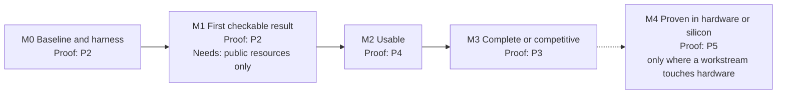
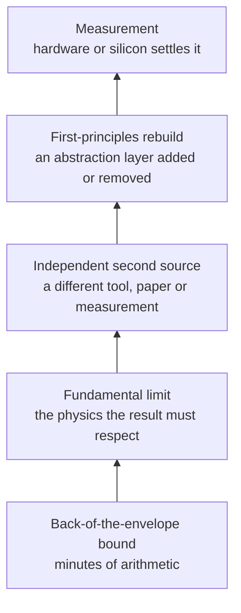
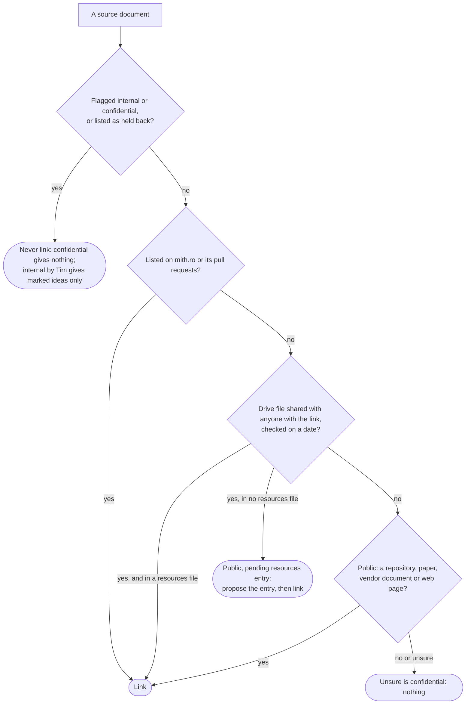

# Guidelines for item documents

Every item on the hit list has a document at `projects/<id>.md`, mirrored as a [living doc](#8-glossary) (see [SYNC.md](SYNC.md)). This file is the contract for those documents: what each must contain, how claims are sourced, what may be published, and when a document is done. [TEMPLATE.md](TEMPLATE.md) is the skeleton to fill in. [PROCESS.md](PROCESS.md) is how a document is written, reviewed and iterated with AI agents and with Tim.

The documents are public. They are written for frontier AI models and for people, in that order. Their job is to turn a one-paragraph idea into a brief an agent can plan and start executing from, without first having to ask the person who had the idea, and to distil what Tim has already worked out so nobody rediscovers it.

*Status of this file: draft 4, 2026-10-21, in progress. Draft 1 was reviewed by an AI panel of eleven persona reviews and two template dry runs; draft 2 applied their findings; draft 3 rewrote the file around one principle ([section 1, One principle](#1-one-principle)) in the writer's own words. Draft 3 was reviewed by five readers who read it from the reader's situation (the stranger, the readability and clarity reviewer, the self-application auditor, the opponent and the claim verifier); draft 4 applies their findings in committed rounds, listed at the end. What still breaks the file's own rules is recorded in the self-application audit ([PROCESS.md section 13, The guideline files obey their own rules](PROCESS.md#13-the-guideline-files-obey-their-own-rules)).*

## 0. The fifteen hard rules

Given to every writer with the template. Everything else in this file explains them.

1. Write from the [source pack](#8-glossary) only; a claim not in the pack goes into the pack, with its source, before it is used.
2. Every claim links to its source or carries exactly one sanctioned status ([5.4, Claim statuses](#54-claim-statuses)). Never invent: write `None found (searched: …)`, `Unknown (settled by: …)` or `Not applicable (…)`.
3. Never cite a paper, repository or document from memory; resolve it with a tool and copy the identifier.
4. Link Tim's material only through the allow-list ([5.1, Link allow-list](#51-link-allow-list)). A flagged or held-back document is never linked. Internal material gives technical ideas only, marked, with no title or fragment. Confidential material gives nothing.
5. No partners, funding, quotes, customers, contacts, contractors, grant or contract terms, internal programme names, and no prices from private material (public price lists are allowed, [4.10, Needs beyond AI tokens](#410-needs-beyond-ai-tokens)). No AI company, product or sponsor. Never who asked for the list.
6. Attribute to Tim only what you read in his documents, and say what you read. Invent no position for him, and check his claims as you would anyone else's: a claim of his that could not be checked is stated as his claim, never as fact.
7. Every workstream has an [oracle](#8-glossary) with a [negative control](#8-glossary) and stated blind spots; fit is derived from oracle, access and knowledge, never asserted.
8. [M1](#49-work-plan-and-milestones) (first checkable result) needs only public resources, at most one named commodity board and no-cost vendor editions; every Needs line names only what exists today.
9. Every state-of-the-art claim carries `(as of YYYY-MM)`; every tool carries a status word from [5.5, Status of tools and projects](#55-status-of-tools-and-projects) and its [licence class](#8-glossary) ([open-source](#8-glossary), [source-available](#8-glossary) or [proprietary](#8-glossary)) from [5.6, Licences](#56-licences).
10. Dates, numbers and counts come from a named source, or are marked `(estimate)` with what will replace them.
11. Use the template's headings, order and bold lead-ins exactly; after each lead-in the first sentence is the conclusion; three or more parallel things are a list, things with the same attributes a table, a structure a diagram with a caption ([6.7, Readability and presentation](#67-readability-and-presentation)); delete every guidance line; write no generated section.
12. Each paper and each repository carries its identifier once, under Start here; every other mention names it in full, as every pointer does, for a reader who lands mid-document ([6.8, Words: pointers, terms and second readings](#68-words-pointers-terms-and-second-readings)); coin no term; replace or pin every word with a second meaning; link every section, id, item, tool, paper, term and file that can be linked ([6.9, Links](#69-links)).
13. Keep the document within 3,000 to 6,000 words, counted as [6.2, Length](#62-length) says (the hand-written part, link addresses and table separator rows removed), and the summary within 60 to 120.
14. Never open an issue or pull request elsewhere, write to Tim's files, or contact anyone outside the project.
15. When unsure whether something may be published, it may not: ask through Questions for Tim.

## 1. One principle

Every part of an item document is written for a stranger who has only that part, little time, no one to ask, and no reason to take anyone's word for anything, Tim's included.

The stranger is one of three readers: an AI agent handed the document as its brief; a person deciding whether to point people, compute or money at the item; or a domain expert who wants to check the claims, contribute, or disagree. All three arrive through a link to a heading as often as from the top. None can reach the person who had the idea, and none should have to. So whatever a reader needs to understand a sentence, to find the next thing, and to check a claim has to be in that sentence, in its section, or one link away.

Everything else in this file follows from that:

| Corollary | What it requires of a document | Where the rules are |
| --- | --- | --- |
| Each part stands alone | A term is defined where it is used; a pointer names what it points to; everything that can be linked is linked; a sentence has one reading | [6.8 Words](#68-words-pointers-terms-and-second-readings), [6.9 Links](#69-links) |
| Claims are checked, not believed | Every claim carries a source or a status; no single source, person or tool is trusted alone; a key result climbs a [verification ladder](#8-glossary); a claim that breaks physics is wrong until shown otherwise | [2 Principles](#2-principles), [4.9 Work plan and milestones](#49-work-plan-and-milestones) (Cross-checks), [5.4 Claim statuses](#54-claim-statuses) |
| The reader's time is respected | A reader who stops after the summary, or after the [skim path](#8-glossary), still has the gist; the first sentence after each lead-in is the conclusion; the form of each element shows the shape of its content | [6.7 Readability and presentation](#67-readability-and-presentation) |
| An agent can start | The goal is written as acceptance criteria; every workstream has an [oracle](#8-glossary); Start here names the first task, its check and the access to ask for | [4.2 Goal](#42-goal), [4.9 Work plan and milestones](#49-work-plan-and-milestones), [4.14 Start here](#414-start-here) |
| Open is argued, not assumed | Each document says, for its own item, why doing the work closed would not produce the breakthrough; open means anyone can reproduce and replicate the result and change what produced it, and a licence that only looks open is named as such | [4.5 Why it must be open](#45-why-it-must-be-open), [4.6 State of the art](#46-state-of-the-art) |
| This file obeys its own rules | The guidelines, the template and the process are held to every check they set and are reviewed from the reader's situation, not the writer's; what still breaks is recorded in the self-application audit until the count is zero | [7 Definition of done](#7-definition-of-done), [PROCESS.md section 13](PROCESS.md#13-the-guideline-files-obey-their-own-rules) |

**What a document is for.** It turns a one-paragraph idea into a brief an agent can plan and start executing from without asking the person who had the idea; it makes the case for the item to a person who decides; and it distils what Tim has already worked out, in design documents, talks, experiments and dead ends, so that nobody rediscovers it. Tim's record is the richest source most items have, and it is a source: mined in full, attributed exactly, and checked like any other ([principle 7](#21-checking)). Where the record runs out, the document asks him targeted questions and folds the answers in as his claims, with what was done to check them.

**The tests of a finished document.** Four readers, four tests; [PROCESS.md](PROCESS.md) runs each.

1. *The agent.* Having read nothing else, it can state the goal as acceptance criteria, name the first task with its oracle and where the result lands, list the access it needs and the role that holds it, name the items upstream and downstream, and say why the work must be open. The [agent digest](#8-glossary) at the top of [4.14 Start here](#414-start-here) carries the first four; [4.5 Why it must be open](#45-why-it-must-be-open) carries the fifth.
2. *The five-minute reader.* Reading only the skim path defined in [6.7](#67-readability-and-presentation), they can say what the item produces, why it matters, what it unlocks, how the work is cut up and checked, what it needs, the biggest risk and where to start.
3. *The stranger in the middle.* Landing on any section from a link, they can resolve every term, id and pointer in it from that section and the [glossary](#8-glossary), and reach each thing it refers to in one click.
4. *The opponent.* Reading each sentence that states a number, a capability, a requirement or a prohibition as uncharitably as possible, they find no second reading, and they can check every claim from what it links to.

## 2. Principles

The principles are the reasons behind the rules of sections [4](#4-section-requirements) to [6](#6-style-and-mechanics). Each ends with where a document applies it. Several rest on claims about the world (that published results often fail to reproduce; that the open tools are slow). Those are claims like any other: their evidence is in [section 9, References](#9-references), and each item's document re-checks them for its own tools and sources rather than inheriting them.

**Working assumption.** The work is done by an organisation with effectively unlimited AI processes. No document costs tokens, rations agent runs or picks a smaller model to save money; what a document accounts for is everything else that can bind: the [oracle](#8-glossary), access to hardware and foundries, other compute (simulation hours, GPUs), knowledge, decisions and people.

### 2.1 Checking

1. **Every claim has a source or a status.** A number, a date, "nobody has done X", "tool Y cannot Z": each links to where it comes from, or carries exactly one of the statuses in [5.4 Claim statuses](#54-claim-statuses). Nothing is cited from memory; a paper, repository or document is resolved with a tool and its identifier copied. *In the document:* everywhere; the claim audit in [PROCESS.md](PROCESS.md#step-5-revise-and-audit) samples it.
2. **No single source is trusted, and no single person.** Simulators have bugs. Published results fail to reproduce, highly cited ones included. Reports get details wrong. Companies have lied. The writer's own memory is the least reliable source of all. And what was impossible a year ago may be routine now, so even a correct claim carries a date. Tim's documents, answers and rulings are sources with the same standing as any other: attributed exactly and checked. *In the document:* every number that drives a decision has two independent sources or a bound the writer computed; every tool result that matters has a second route to it; the sources a key result rests on are listed with their known failure modes ([4.9, Cross-checks](#49-work-plan-and-milestones)); what Tim worked out is reported with what was read and what was checked ([4.7](#47-what-tim-has-already-worked-out)).
3. **Physics bounds everything.** A headline figure is checked against a fundamental limit and a back-of-the-envelope estimate before it is believed; a claim that breaks a limit is wrong until shown otherwise. A result that contradicts an established one, or beats the best published result, is an extraordinary claim and needs extraordinary proof: a higher [proof level](#8-glossary) and an independent reference ([4.9.1 Proof levels](#491-proof-levels)). *In the document:* the [verification ladder](#8-glossary) names the bound and the limit for each key result ([4.9, Cross-checks](#49-work-plan-and-milestones)).
4. **Every check is a proxy for physics, and every rule has a reason.** A design-rule check, a SPICE model, a timing check or a layout-versus-schematic comparison is a fast stand-in (fast in intent, even when slow in practice) for a question about manufacturing, yield, device physics or non-ideal conditions. Each rule in such a check exists for a reason, and the reason may or may not matter for a given use; without it nobody can say when the rule may be relaxed, and with a simulator accurate and fast enough the proxy would not be needed at all. *In the document:* every oracle names the physical question it stands in for and where the reason for each of its rules is recorded, or `Unknown (settled by: …)` ([4.9](#49-work-plan-and-milestones), the Oracle lines); the [PDK](#8-glossary) audit workstream of PDK items records the reason behind each rule ([4.9](#49-work-plan-and-milestones)); the fundamental-limit rung of the verification ladder is the direct check the proxy approximates ([4.9, Cross-checks](#49-work-plan-and-milestones)).
5. **Rebuild and compare.** The strongest check on a result is an independent reconstruction from first principles, compared against the existing result, with a layer of abstraction added or removed where that separates or combines concerns more cleanly. *In the document:* the verification ladder names the rebuild for each key result ([4.9, Cross-checks](#49-work-plan-and-milestones)).
6. **Rough first, accurate when it matters, effort in proportion.** Each key quantity has a fast path that answers in minutes and an accurate path used when the answer carries weight; the verification a result gets is proportional to the cost of its being wrong. *In the document:* Fast and accurate paths and the Effort rule ([4.9, Cross-checks](#49-work-plan-and-milestones)).
7. **Distil Tim's record, and check it.** Design documents, talks, experiments and dead ends are paraphrased or briefly quoted in the body with attribution, not only listed at the end, so a reader learns what was worked out without opening the links. Nothing is attributed to a document the writer has not read; no position is invented for Tim; and each of his claims carries what was done to check it, or the status that says it could not be. *In the document:* [4.7 What Tim has already worked out](#47-what-tim-has-already-worked-out) and [4.13 Questions for Tim](#413-questions-for-tim).

### 2.2 Working

8. **Oracles first.** Work suits AI agents when the result can be checked without a person: a design-rule check, a layout-versus-schematic comparison, a circuit simulation, formal equivalence, a reference tool, hardware. Every workstream names its oracle and what the oracle cannot see; work with no oracle is flagged, because it is where agents are weakest. *In the document:* every workstream block ([4.9](#49-work-plan-and-milestones)); [hard rule 7](#0-the-fifteen-hard-rules).
9. **Harness and benchmarks before the tool.** The open tools in this field are mostly slow, often poorly written, and have few users despite their complexity; a simulator with excellent fundamentals can spend most of its time recomputing values whose inputs have not changed. A test suite and a benchmark come first, because they let a tool be replaced with confidence, and replacement is often the only way to reach the iteration speed agents allow. Every item spends real effort on optimisation and tooling, to keep up and to verify what it produces. *In the document:* speed and quality per tool and the replace-or-build-on decision ([4.6](#46-state-of-the-art)); the "[Harness](#8-glossary), benchmarks and tool speed" workstream ([4.9](#49-work-plan-and-milestones)).
10. **More attempts beat better guesses.** Learning comes from the number of attempts and from lower barriers to trying, not from deciding in advance what is worth trying: a thousand times more attempts at a tenth of the success rate is a hundred times more results. Where an oracle can gate attempts, the plan gates on the oracle, never on judgement. *In the document:* [Shots on goal](#8-glossary) ([4.3](#43-why-it-is-high-value)); universal access argued in [4.5](#45-why-it-must-be-open).
11. **If it were easy it would be done, and bad solutions outlive their reasons.** Every item has a reason it has not already happened, and the document names the real one: a missing oracle, closed data, no money, no developer time, or nobody's job. Inertia and sunk cost keep worse solutions alive long after better ones exist. A past attempt that stopped is not a failed idea until the record shows the idea failed; most stopped for resources, software developer time above all, which agents now supply. *In the document:* Why not already done and Why now ([4.3](#43-why-it-is-high-value)); Past and parallel efforts ([4.6](#46-state-of-the-art)); each dead end classed as the idea or the resources, with the evidence ([4.7](#47-what-tim-has-already-worked-out)).
12. **Honest about limits.** The document says what agents cannot do for this item (physical access, legal judgement, tacit foundry knowledge, decisions, getting changes merged) and what has to be true for the AI case to hold. *In the document:* [4.8 What frontier models change](#48-what-frontier-models-change) and [4.11 Unknowns, blockers and risks](#411-unknowns-blockers-and-risks).
13. **The bar is physics and what agent-scale work needs, never the proprietary result.** [Proprietary](#8-glossary) tools and results are what the old world built: slow to change, closed to the debugging and optimisation agents could do, licensed per seat, and so unable to serve work in which agents write code, debug, optimise and use compute at scale. They appear in a document as dated context, in a line each, never as the target. The bar an item sets itself is the physical limit, the first-principles bound, and what agent-scale work needs: iteration time, cost per attempt, reproducibility, no licence gate, the freedom to change the tool. *In the document:* The bar to clear ([4.6](#46-state-of-the-art)); Metric and baseline ([4.9](#49-work-plan-and-milestones)).

### 2.3 Writing

14. **Specific beats general.** Name the tool, the family, the node, the pull request, the number. "Large, mechanical, checkable work that suits agents" is the thesis of the whole list; each document shows which work, checked by which oracle, at what scale. A sentence that would survive unchanged in another item's document is too general.
15. **Open is a requirement, argued per item.** Before anything can be changed it has to be understood, and before it can be understood it has to be reproduced from what is published and replicated independently. So open means that every input, tool and step needed to reproduce and replicate a result is available to anyone, under a licence that allows it to be studied, changed and redistributed. A [source-available](#8-glossary) licence (the Business Source License and its relatives), a delayed or partial release, or data and models published without what generated them is not open, and the document says so wherever it meets one. Each document explains, for its own item, why doing the work closed does not produce the breakthrough and what open has to mean for it. *In the document:* [4.5](#45-why-it-must-be-open); the [licence class](#8-glossary) of every tool in [4.6](#46-state-of-the-art).
16. **Write so an agent can start.** The document ends with a Start here section an agent can act on today: what to read, what to reproduce, the first tasks with oracles, the access to request, the known dead ends ([4.14](#414-start-here)).
17. **Dated and checked.** State-of-the-art claims carry `(as of YYYY-MM)`; every link is fetched before landing. A stale fact is worse than a missing one; a missing one is written as `None found` or `Unknown`, never papered over ([5.4](#54-claim-statuses), [5.10](#510-citations-and-links)).
18. **Public and safe.** Only links that pass [5.1 Link allow-list](#51-link-allow-list). Technical ideas only: no partners, funding, customers, contacts or prices from private material. AI is described generically; no AI company, product or sponsor is named, and the document never says who asked for the list ([5](#5-sources-provenance-and-confidentiality)).
19. **One home per fact.** Each required element has exactly one section ([3](#3-structure-of-an-item-document)); other sections point to it, with a link, and never restate it. A fact with one home can be found and corrected; a restated one drifts.
20. **Generated sections are generated.** The id prefix of the title, "Where it sits", "Resources" and "Related items" come from [`items.json`](items.json) through [`tools/build.py`](tools/build.py). Relationship changes are proposed for [`items.json`](items.json), never written into the document ([6.4](#64-title-and-the-generated-tail)).
21. **Words that cannot be misread.** Terms of the field are defined where they are used or replaced by plain words; no term is coined; a word with a second meaning is replaced or pinned; every pointer names what it points to; everything that can be linked is linked ([6.8](#68-words-pointers-terms-and-second-readings), [6.9](#69-links)).

## 3. Structure of an item document

The hand-written sections sit between the title and the generated tail. [`tools/build.py`](tools/build.py) keeps the file's own title, adds the `<id>: ` prefix, strips the three generated sections wherever they are and re-appends them at the end. The template therefore ends with "Start here" and no generated headings ([section 6.4, Title and the generated tail](#64-title-and-the-generated-tail)).

| Order | Section | Home of |
| --- | --- | --- |
| 0 | `# <item id>: <item title>` | The stable id (generated) and the title (hand-written, kept by build.py). |
| 1 | Summary and status line (no heading) | What the item is in three to five sentences; which draft this is and who has reviewed it. |
| 2 | Goal | The end state as deliverables, the acceptance test, the [two-ways framing](#8-glossary), out of scope. |
| 3 | Why it is high value | The pain today, why not already done, who is waiting, why now, [shots on goal](#8-glossary). |
| 4 | What success unlocks | Needs first, unlocks on the list, cross-checks with other items, shared [harness](#8-glossary), beyond the list, compounding effects. |
| 5 | Why it must be open | The counterfactual, the strongest case against open, why closed does not deliver, what open must mean here. |
| 6 | State of the art | Open tools with [licence class](#8-glossary), speed and quality; the bar to clear; research results; past and parallel efforts; what is missing and what to replace or build on. |
| 7 | What Tim has already worked out | His proposals, numbers, experiments, dead ends and framing, per document read; where the record runs out. |
| 8 | What frontier models change | Why faster, why better, what has to be true, and in two sentences what people still do. |
| 9 | Work plan and milestones | Workstreams, the summary table, milestones, the dependency diagram, the metric and baseline, lead times, cross-checks; the parts are in [4.9, Work plan and milestones](#49-work-plan-and-milestones). |
| 10 | Needs beyond AI tokens | Compute, licences, hardware, data, access, people, money, time: cost, lead time, who could provide it. |
| 11 | Unknowns, blockers and risks | Expertise barriers, hard blockers, and the risks of the approach (the plausible-but-wrong risk first), each with its check. |
| 12 | Unanswered technical questions | Every technical question and known unknown anyone could take up, each with how to settle it, which workstream it blocks and who could take it. |
| 13 | Questions for Tim | Where the written record runs out. Transient. |
| 14 | Start here | The [agent digest](#8-glossary), then the brief: read, reproduce, first tasks, access to request, dead ends, key papers, projects and code. |
| 15 to 17 | Where it sits; Resources; Related items | Generated from [`items.json`](items.json). |

What happens to the sections the documents have today: **Goal** stays and gains "Out of scope". **Why it is high value** stays, restructured. **State of the art** stays and gains The bar to clear and the "Past and parallel efforts" table. **PDK consistency audit and generated docs** ([shadow-pdks](projects/shadow-pdks.md), [drc-forge](projects/drc-forge.md), [tcad-twin](projects/tcad-twin.md), [cell-foundry](projects/cell-foundry.md), [cloud-fab](projects/cloud-fab.md)) becomes a workstream in "Work plan and milestones" ([4.9, Work plan and milestones](#49-work-plan-and-milestones)). **Open questions** becomes "Unanswered technical questions"; questions only Tim can answer move to "Questions for Tim" ([4.13, Questions for Tim](#413-questions-for-tim)). **Sources** dissolves: its links are cited where they are used. The generated sections are unchanged.

`resources/<id>.md` keeps its role as the raw link collection. "Start here" is the curated subset with a reason for each entry. A new link found while writing goes into the resources file first, with the sharing check of [section 5.1, Link allow-list](#51-link-allow-list), through the routed change in [PROCESS.md](PROCESS.md); the document links it only after that.

## 4. Section requirements

Each block gives the purpose, the required elements, what to avoid, and where it helps an illustrative example. Required elements are written as **bold lead-ins** at the start of the paragraph or list that carries them, with the exact words shown, so a reader and the lint can find them. Where a block says "as sub-headings", the bold names in its list are `###` sub-headings, as the template shows, and the lead-ins inside them are the ones the template shows in bold. An element with nothing to say is not omitted: it carries one of the sanctioned empty values of [section 5.4, Claim statuses](#54-claim-statuses).

Length is governed by one document band ([section 6.2, Length](#62-length)), not by per-section bands. After each lead-in the first sentence states the element's conclusion, and the form of each element (prose, list, table, block or diagram) follows the shape of its content ([section 6.7, Readability and presentation](#67-readability-and-presentation)); pointers and terms follow [section 6.8, Words: pointers, terms and second readings](#68-words-pointers-terms-and-second-readings).

All examples in this section are **illustrative**. Their figures were verified on 2026-10-21 against the sources named; a writer re-verifies before reuse and never copies the sentences.

### 4.1 Summary and status line

**Purpose.** Let a skimming reader decide in twenty seconds whether to read on. It is the first depth of reading ([6.7, Readability and presentation](#67-readability-and-presentation)) and stands alone.

**Required.** One paragraph of three to five sentences, 60 to 120 words, directly under the title: what the item produces, who uses it, what is broken today, and the one-line case for AI agents. Then the status line, in exactly this grammar:

`*Status: <draft N | stable draft | reviewed>, YYYY-MM-DD. AI review panel: <personas, comma-separated, or none yet>. Human review: <none | Tim, YYYY-MM-DD>. Questions for Tim: <N>. This document was drafted and reviewed with AI agents; human review is recorded here.*`

*draft N* means the document is still in the loop; *stable draft* means the loop's exit condition holds but Tim has not approved; *reviewed* is written only after Tim has approved the document ([PROCESS.md](PROCESS.md), exit condition). The last sentence is fixed text so that no reader mistakes an AI persona for a human reviewer.

**Avoid.** Repeating the title. Adjectives in place of facts.

### 4.2 Goal

**Purpose.** Define "done" so precisely that two people would agree whether it has been reached.

**Required.**
- **Deliverables.** The artefacts that will exist (a database, a library, a tool, a corpus, a chip) with their essential properties (coverage, accuracy, speed, licence).
- **Acceptance test.** How someone would check the goal is met, with numbers where they exist. Where the number is not yet known, `Unknown (settled by: <the M0 measurement or decision>)`.
- **Framing.** The [two-ways framing](#8-glossary) in the writer's own words: which layer ([PDK](#8-glossary), tooling, IP blocks, proof in silicon), which function (interface, computation, storage) and which manual-to-generator shift this item performs. The generated "Where it sits" line carries the tags; the Goal explains them.
- **Out of scope.** Three to six things this item deliberately does not do, each with the item or candidate that does.

**Avoid.** Goals that are activities ("improve [DRC](#8-glossary)") instead of end states. Goals with no way to check them.

**Example (illustrative).** "Open DRC that checks a reticle-sized layout (about 26 x 33 mm) at a stated node in under one hour on a stated cluster; for every open PDK, one test layout per rule with a passing and a failing case; and a record per rule stating the reason it exists with a public source. Acceptance: the engine's violation list matches a reference checker's on a pinned set of public [shuttle](#8-glossary) designs with every difference explained, and the per-rule suite covers every rule in the SKY130, GF180MCU and IHP SG13G2 decks, where 'every rule' is the count taken from each deck's files at [M0](#49-work-plan-and-milestones) (baseline and [harness](#8-glossary))."

**Example (weak).** "Make open DRC fast and reliable enough for real designs."

### 4.3 Why it is high value

**Purpose.** Make the case before any work is done.

**Required.**
- **The pain today.** What takes how long, what is missing, what people do instead (pay for a licence, give up, use a closed tool), with sources or statuses.
- **Why not already done.** The real obstacle, since an obvious solution would already be in use: cost, access, a missing [oracle](#8-glossary), the scale of the tedium, software developer time, inertia, or the sunk cost that keeps a worse solution alive. Name it; "nobody thought of it" is not an answer.
- **Who is waiting.** The users and projects blocked by this, on this list and outside it.
- **Why now.** One or two sentences naming which of the three framings applies: *easy now with AI*, *unlocks other tasks*, *accelerates a kind of work or iteration*, with a clause on the manual-to-generator shift the Goal's Framing describes, and what changed (model capability, compute price, a new open PDK, a licence) so that the obstacle above no longer holds. The mechanisms belong to [section 4.8, What frontier models change](#48-what-frontier-models-change); do not argue them here.
- **Shots on goal.** How many attempts (designs, runs, tapeouts, tests) per month the item makes possible against today's number, and the cost of one attempt before and after, with sources or `(estimate)`. A thousand times the attempts at a tenth of the success rate is a hundred times the results; say which side of that trade this item is on.

The dependency order of the list (what this item needs first, what it is a prerequisite for) lives in [section 4.4, What success unlocks](#44-what-success-unlocks) and the [agent digest](#8-glossary), not here; the manual-to-generator shift is owned by the Goal's **Framing**.

**Avoid.** Hype. Claims about [proprietary](#8-glossary) tools without a public source. Restating the Goal.

### 4.4 What success unlocks

**Purpose.** Show where the item sits in the list's dependency order and how success compounds.

**Required.**
- **Needs first.** The items this one depends on, each with what it must deliver first. Each must be listed under this item in [`items.json`](items.json)'s `related` map.
- **Unlocks on this list.** The items that become possible, cheaper or faster, each with the mechanism in a sentence. Each must be in `related` for this item; a missing relationship is proposed for [`items.json`](items.json) through [PROCESS.md](PROCESS.md), never added to the document first.
- **Cross-checks with.** The items whose results check this item's results and vice versa (a simulated value against a measured one, an open tool's output against a [scoreboard](#8-glossary) run, a generated rule against a shuttle result), each with the quantity compared and the agreement expected. Each must be in `related`.
- **Shared harness.** The test suites and benchmarks this item shares with other items, and which item owns each.
- **Beyond the list.** Products, research, education, communities this enables.
- **Compounding.** Corpora and test suites that grow, data that future models learn from, work that becomes continuous (re-run on every tool change) instead of one-off.

**Avoid.** Repeating "Why it is high value". "Enables innovation".

### 4.5 Why it must be open

**Purpose.** Make clear that keeping this work open and universally accessible is a requirement for the breakthrough, not a preference, and argue it for this item specifically.

**Required.**
- **The closed version.** One or two sentences naming the closed tools or results that exist for this goal as dated context (the one line each under The bar to clear in [4.6, State of the art](#46-state-of-the-art) owns the description) and stating that their existence has not closed the gap: they cannot be reproduced, changed or run at agent scale.
- **The counterfactual.** Two sentences: what happens if this work is done closed, or not at all.
- **The strongest case against open.** The best argument that a closed or proprietary route would serve better here, and why it fails for this item.
- **Why closed does not deliver.** At least two of the mechanisms in the table below, applied with the item's specifics, each labelled *empirical* (with a citation), *contractual* (with the clause and its date, stated as a question per [5.9, Vendor terms](#59-vendor-terms)) or *normative* (said so).
- **What open means here.** The licence per artefact ([5.6, Licences](#56-licences) gives the defaults); what has to be published for anyone to reproduce the result (inputs, tools, versions, steps) and to replicate it (enough of the method to rebuild it independently); the public test suite; whose consent any vendor or foundry data needs; the clean-room rule where the item touches a PDK ([5.7, Clean-room rule for PDK items](#57-clean-room-rule-for-pdk-items)); and the licences that only look open, which this item must not build on or be mistaken for ([source-available](#8-glossary) and business-source licences, delayed or partial releases, models or data without their generating inputs), each named with the tool or project that carries it.

| Mechanism | What closed breaks |
| --- | --- |
| Reproducibility | A result on closed tools cannot be re-run or checked by others |
| Replicability | Nobody outside can rebuild the method independently and compare |
| Composability | Agents and people can only fix, extend and chain tools whose source they can change |
| Legal scale | Per-seat licences and EULAs do not allow thousands of agents to run the work |
| Universal access | Any student, company or country can use an open result; a closed one is rationed |
| Accumulation | Open material survives when it is copied and archived under persistent identifiers; closed material vanishes with its owner |
| AI itself | Models learn from and act on open data and tools, so open work is what future models will be good at |
| Supportability | Users can fix what they depend on |

**Avoid.** A paragraph that could be pasted into another item unchanged. Arguing that open is nicer; argue that it is necessary.

**Example (illustrative, FPGA).** "The vendor's tools know every bit of every device; the gap exists because that knowledge is sealed inside them. A closed documentation effort would recreate the seal. The Project X-Ray database is published under CC0, which is why nextpnr-xilinx could build its 7-series [FASM](#8-glossary) path on it without a per-tool deal, and why the data outlived the toolchain branches that first used it."

### 4.6 State of the art

**Purpose.** Tell the reader exactly where the field stands, so the work starts from the frontier and not from a blank page.

**Required**, as sub-headings in this order:
- **Open-source tools and projects.** Each named (its one link lives under "Projects and code" in [4.14, Start here](#414-start-here)) as a bullet whose first line is `- **<Tool>**: <status>, as of <YYYY-MM>` (the [5.5, Status of tools and projects](#55-status-of-tools-and-projects) vocabulary, so the lint can read it), followed by one nested line per attribute: its [licence class](#8-glossary) and licence name ([5.6, Licences](#56-licences)); what it can do for this goal; what it cannot; its speed (runtime on a stated input, or `Unknown`, and whether it recomputes values whose inputs have not changed); its quality (tests, continuous integration, releases, user base); and whether the item builds on it or replaces it.
- **The bar to clear.** What the item measures itself against, in three parts. First, the physical limit and the first-principles bound for the key quantity (the [Verification ladder](#8-glossary) in [4.9, Work plan and milestones](#49-work-plan-and-milestones) carries the working). Second, what agent-scale work needs from a tool or result (iteration time, cost per attempt, reproducibility, no licence gate, the freedom to change it), as numbers where the Metric and baseline of [4.9, Work plan and milestones](#49-work-plan-and-milestones) has them. Third, as dated context in one line each, the proprietary tools or results that exist for this goal and the licence terms that keep them from agent-scale use; they are what the old world built, never the target, and the document does not dwell on them. A part with no public figure: `None found (searched: <where>, <date>)`.
- **Research results.** The papers or theses that established the methods, each resolved through a search tool with a one-line statement of what it showed. The project's paper trackers are the first place to look ([PROCESS.md Step 0, Source pack](PROCESS.md#step-0-source-pack)).
- **Past and parallel efforts.** A table: `| Effort | Years | What it did | Why it stopped, or where it stands | Pointer |`. Earlier open efforts at this goal and parallel efforts under way, with pointers (repositories, pull requests, branches, threads) and the reason they stopped as far as it is known: funding ended, maintainers left, the approach was too heavy, a vendor changed its tools, the result was never merged. Name projects and decisions, not people's failings. Where the reason is not known, `Unknown (settled by: asking <role> or reading <pointer>)`.
- **What is missing.** One list: the specific gaps between the open state and the Goal. Then the lead-in **Replace or build on.** Which existing tools the item builds on and which it replaces, with the reason (speed, quality, licence, maintainability) and the test suite or benchmark that makes the replacement safe.

**Avoid.** Undated claims. Tools listed without what they lack or without their licence class. Praise. A proprietary result treated as the goal. A citation that was not resolved with a search tool.

**Example (illustrative, status entry).** "SKY130 rule documentation: the `periphery-rules.rst` file in the SkyWater PDK repository carries 546 distinct `layer.N` rule identifiers when counted by regular expression (as of 2026-10; the count depends on the grouping rule and must be re-done per deck). The shuttle precheck deck `sky130A_mr.drc` carries 282 output statements for 132 distinct rule identifiers under the same rule. Neither ships a per-rule test; the IHP SG13G2 PDK does ship a regression harness with golden results, marked for developers only, and notes that some rules have not been verified or tested."

### 4.7 What Tim has already worked out

**Purpose.** Capture the knowledge in Tim's design docs, talks, experiments and notes so it is not lost and not rediscovered. This is the section that distinguishes these documents from a survey, and the one Tim signs off before a document is called reviewed.

**Required.**
- **Documents.** For each relevant public document or talk of his (from `resources/<id>.md` and the mith.ro design-doc index): its title linked, what the writer read (`read in full` or `summary only`), and the **specific proposals, decisions and numbers** it contains, paraphrased or briefly quoted. A document the writer has not read at least in summary does not appear. A `summary only` entry carries only what the summary says.
- **Experiments and results.** What was tried, what was measured, what it showed.
- **Dead ends.** Approaches he tried or considered and why they were dropped, with the reason classed as *resources* (developer time, money, hardware, access) or *the idea* (it did not work, and what showed that). Tim's view, October 2026: most of his dead ends stopped for lack of resources, mostly software developer time, not because the idea failed; AI changes that, so a resource-stopped dead end is a candidate first task and is cross-referenced from Start here. These are his; community dead ends belong in [4.6, State of the art](#46-state-of-the-art) and practical traps in [4.14, Start here](#414-start-here).
- **Framing inherited.** The choices the item inherits (the two-ways ecosystem, the [manual-to-generator axis](#8-glossary), the "[stepping stones](#8-glossary)" view).
- **From unpublished notes.** Technical ideas from material that cannot be linked ([section 5.2, Material outside the allow-list](#52-material-outside-the-allow-list)), each sentence marked `(from Tim's unpublished notes)`, with no link, title, title fragment, partner, figure or name. These sentences are signed off by Tim before the first landing ([PROCESS.md Step 5, Revise and audit](PROCESS.md#step-5-revise-and-audit)).
- **Where the written record runs out.** The specific points the documents do not settle. These become the "Questions for Tim" entries.

**Avoid.** Inventing positions for Tim. Attributing community results to him or his to the community. Listing links without content. Carrying content from a title.

**Example (illustrative, document entry).** "Tim's [Design Rule Check (DRC) Testing](https://docs.google.com/document/d/18z-FBJHni6qt1WR_tF6bbRHfQydKcFMAVnuj4Ixbj90/edit) (read in full; work in progress, last updated early 2023) proposes one test per [GDS](#8-glossary) file, each rule with pass and fail cases, and defines the verdicts: a pass case that fails DRC is a false positive, a fail case that passes is a false negative. It says interacting rules should have specific tests around them, gives a density rule as its worked example, and leaves its fuzz, torture and performance headings empty, which is where the written record runs out."

### 4.8 What frontier models change

**Purpose.** Explain why frontier models could do this work faster and better than people, what has to be true for that to hold, and what people still do.

**Required.**
- **Why faster.** The mechanisms that apply, each justified with the item's specifics: parallel execution of skilled-but-mechanical units (how many units, from a counted source or `estimate`); closed-loop iteration against an automated oracle (which oracle, the latency of one iteration); design-space search where evaluation is automated (how big the space is); reading the entire record (which record); cheap re-execution whenever a tool changes.
- **Why better.** Where people fail on this item: the work spans silos few people combine (name them); the work is too tedious to finish (what has been left unfinished); expertise is scarce in the open community (which); people sample the literature, a model can cross-reference all of it.
- **What has to be true.** The preconditions for the AI case: an oracle exists or must be built first; the inputs are public; the work decomposes into independent units; a person can supply X; and which of these rest on current model capability or price, with the month, so the plan is re-checked when they change.
- **What people still do.** Two sentences on the parts of this item that stay with people (physical access, decisions, merges, legal judgement) and how an agent supports them, then a pointer to [section 4.11, Unknowns, blockers and risks](#411-unknowns-blockers-and-risks), which owns the itemised blockers and the plausible-but-wrong risk.

No human baseline, agent rate or duration is estimated: what is stated is the structural difference (how many units can run in parallel, the oracle's latency per iteration, the absence of a licence gate), each from a counted or sourced number or `Unknown`. There is no table in this section. The per-workstream oracle, access, knowledge and fit live in the workstream blocks and the summary table of [section 4.9, Work plan and milestones](#49-work-plan-and-milestones); this section argues from them.

**Avoid.** "Agents can do this" with no mechanism. Capability claims not tied to an oracle. Hiding the work that stays with people.

**Example (illustrative).** "The SKY130 periphery rule document lists 546 rule identifiers (as of 2026-10, counted by regular expression). Each needs a passing and a failing layout; KLayout, the open-source layout editor and design-rule checker, decides whether one small layout violates a rule in a single run (seconds `(estimate)`, measured at [M0](#49-work-plan-and-milestones) for the pinned deck and machine), so each case is an independent unit that an agent can propose, run and fix with no person in the loop. People stopped early: the task is skilled but repetitive, and nobody is paid to finish it. The oracle is weaker for the rule *reasons*: a model can read the lithography and device literature and propose why a spacing rule exists, but the proposal needs a public source or measured data, which makes it a partial oracle until [tcad-twin](projects/tcad-twin.md) exists."

**Example (weak).** "This is well-specified, repetitive work that suits AI agents."

### 4.9 Work plan and milestones

**Purpose.** Name the core pieces of work and define how progress and success are measured. This is not a project plan; it is enough for an agent to build one.

**Required**, as sub-headings in this order.

**Workstreams.** Three to eight, numbered W1 upward, one block each in this form:

```
**W1 <name>.** Produces: <artefact>. Needed because: <why the Goal needs it>.
- Oracle: <what decides>.
  - Stands in for: <the physical or manufacturing question this check is a proxy for; where the reason for each of its rules is recorded, or Unknown>.
  - Reference: <where the expected answer comes from>.
  - Pass: <criterion>.
  - Latency: <per unit>.
  - Negative control: <a case that must fail, showing the oracle can fail>.
  - Blind spots: <what it cannot catch>.
- Access: <public | free EULA | paid licence | NDA | membership | remote hardware | on-site hardware or lab | money | partner>, with what exactly.
- Knowledge: <public record | spread across silos | tacit | unknown>, with what exactly.
- Units: <how many independent units; the cap and what sets it>.
- Binding constraint: <oracle | access | compute | knowledge | decision>, because <reason>.
- Lands in: <repository or project>.
  - Contribution rules: <link or "this project's repository">.
  - Gate: <what its maintainers require>.
- Fit: <A | B | C | D>, because <derived from the lines above>.
- Lead time: <waits that no effort shortens (a shuttle cycle, a lab queue), or none>.
- Depends on: <workstreams, items, resources>.
- Suite quality (optional; only for a workstream that produces a checker or a test suite): <share of deliberately broken inputs it catches>.
```

Fit is derived from the lines above it, never asserted:

| Fit | Derived when | Who does what |
| --- | --- | --- |
| A | The oracle is automated, access is public and units are many | Agents do it now |
| B | Access is the only missing thing | Agents do it once the access is granted |
| C | Knowledge or a decision binds | An agent drafts, a person decides |
| D | A person must execute | A person does it, an agent supports |

A workstream whose parts would take different values is split, or takes the least favourable value. A workstream whose product is a checker or a test suite also fills the optional `Suite quality:` line with the quality metric of the suite itself: the share of deliberately broken inputs it catches (its mutation score), measured from M1 on.

For PDK-layer items ([shadow-pdks](projects/shadow-pdks.md), [drc-forge](projects/drc-forge.md), [tcad-twin](projects/tcad-twin.md), [cell-foundry](projects/cell-foundry.md), [cloud-fab](projects/cloud-fab.md)) one workstream is **PDK consistency audit and generated docs**. Its clauses are: every view of every cell agrees; decks match the layer maps and the written rules; the reason for each rule is recorded with its source, or marked `Unknown`; documentation is generated from the PDK data. The block states which clauses apply to this item and why the others do not.

Every item has a workstream **Harness, benchmarks and tool speed**, or says in one line why it does not need one. It builds the M0 harness; owns the benchmarks and test suites that let a tool be replaced with confidence; profiles where the existing tools spend their time, which is often recomputing values whose inputs have not changed; and carries the replace-or-build-on decisions of [4.6, State of the art](#46-state-of-the-art). Its size is stated honestly: keeping up with the iteration speed AI allows, and verifying what it produces, costs real effort in every item.

**Summary table.** One row per workstream, derived from the blocks: `| # | Workstream | Oracle | Access | Units | Binding constraint | Fit |`. This is the only table of its kind in the document.

**Milestones.** A ladder of at least four rungs, each a block with these lines: *Done when* (measurable: a number, a passing suite, a public artefact), *Evidence* (what will exist and where), *Proof* (the level required, [section 4.9.1, Proof levels](#491-proof-levels)), *Needs* (only things that exist today, by name), *Completes* (the W-ids the rung finishes or advances), *Fit* (the least favourable fit among the workstreams the rung needs), *Gate* (who or what decides the rung is reached). M4 applies exactly when some workstream has a silicon or physical oracle or a hardware access value.
- **M0 Baseline and harness.** Reproduce the current open state and build the oracle: the harness, the benchmark, the reference results, the counts.
- **M1 First checkable result.** A narrow but real end-to-end win. Its *Needs* are public resources, at most one named piece of commodity hardware, and no-cost vendor editions only; nothing under NDA, nothing paid.
- **M2 Usable.** Someone outside the project uses it for real work.
- **M3 Complete or competitive.** The Goal's coverage or parity target.
- **M4 Proven in hardware or silicon**, where it applies, with three extra lines: *Hardware* (board, shuttle, lab), *Test plan* (what is measured, how, against what), *What silicon returns and when* (the data, the turnaround, what a failure would mean). Where it does not apply: `Not applicable (<why>)`.



*Figure 1: The milestone ladder with the default [proof level](#8-glossary) of each rung; an arrow means "reached before"; the dashed arrow marks M4 as conditional. Each rung is a state, never an activity.*

Where a rung touches silicon or hardware before M4, the *Needs* line says so.

**Dependencies.** One diagram, drawn from the blocks: a node per workstream and per milestone, and an arrow from each node to what depends on it, taken from the `Depends on` and `Completes` lines and from nothing else. The caption names the longest chain to M3 and any lead time on it. A proposed lint check will verify that the node ids are exactly the document's W and M ids ([L23](PROCESS.md#appendix-b-the-lint-toolscheckpy), proposed); the form of the diagram and of its caption follow [6.7, Readability and presentation](#67-readability-and-presentation).

**Metric and baseline.** For each number that tracks progress (several when the Goal has several deliverables): its name, formula and unit, with the population and denominator ("rules with both cases, over the rule count taken from the deck's files"); the tolerance that counts as success, written before anything is measured; one **guardrail** metric that fails if the primary is gamed (coverage without a mutation score is gamed by trivial tests; speed without a violation-list match is gamed by skipping rules); the **baseline** today as a median and range over a stated number of runs with pinned versions (tool commit, PDK release, benchmark tag, machine), or `Unknown (settled by: M0)`; where it is measured (the scoreboard item that scores it, otherwise a script committed at M0); and the target. Measurement items also state the instrument's coverage, repeatability and agreement with a reference.

**Lead times.** The waits that no effort shortens between now and M3, and for M4 where it applies (a shuttle cycle, a lab queue, a licence approval), each from a named source or `Unknown (settled by: …)`. No estimate of how long the work itself takes or how much code it needs: such numbers are guesses the reader cannot check, and nothing in the plan turns on them.

**Cross-checks.** The verification behind the plan, as four lead-ins.
- **Sources and failure modes.** A table `| Source | Trusted for | Known failure mode | Independent check |` for the sources the item's key results rest on (a simulator, a vendor datasheet, a paper, a tracker row, a measurement). No single source is trusted ([2.1, Checking](#21-checking)); the table says what would catch each one being wrong.
- **Verification ladder.** For each key result or headline number: the back-of-the-envelope bound the writer computed; the fundamental limit it must respect; the independent second source; the first-principles rebuild that would reproduce it, with the layer of abstraction added or removed to make the comparison clean; and the measurement that settles it. Say which rungs exist today and which milestone builds the rest.
- **Fast and accurate paths.** For each key quantity, the rough method that answers in minutes and the accurate method used when it matters, with the cost of each and when each is used.
- **Effort rule.** How much verification each class of result gets, in proportion to the consequence of its being wrong.



*Figure 2: The verification ladder every key result climbs, bottom to top; a document says which rungs exist today and which milestone builds the rest.*

#### 4.9.1 Proof levels

Each milestone's *Proof* line names the level its evidence must reach.

| Level | Meaning |
| --- | --- |
| P0 | Stated; no artefact. |
| P1 | An artefact exists and its author ran it; logs are in the repository. |
| P2 | Reproduced from a clean checkout by continuous integration or by a second agent, with versions pinned. |
| P3 | Agrees with an independent reference (a second engine, a vendor tool, a published result) with every difference explained. |
| P4 | Used or accepted outside the project: merged upstream, used by another project, or cited. |
| P5 | Proven in hardware or silicon: a board test or a shuttle result. |

Defaults: M0 and M1 need P2; M2 needs P4; M3 needs P3; M4 is P5. A document may raise a default and must say why if it lowers one. A result that contradicts an established one, or a headline figure that beats the best published result, open or proprietary, is an extraordinary claim: it needs P3 with an independent reference and the first-principles rung of the verification ladder before it is stated as a result.

**Avoid.** Milestones that are activities ("investigate X") rather than states. Milestones with no evidence. *Needs* lines naming things that do not exist yet. A plan so detailed it will be wrong next month.

**Example (illustrative, M1 for an FPGA item).** "M1: one open [bitstream](#8-glossary) for a 7-series part. Done when a small SoC with integrated main RAM, built with Yosys, nextpnr-xilinx and the Project X-Ray FASM path, boots on a named commodity board and passes its self-test. Evidence: bitstream, build log and board log in the repository, rebuilt by continuous integration. Proof: P2. Needs: the board; the Project X-Ray database (CC0); the no-cost vendor edition that covers the part, for reference bitstreams only. Fit: B. Gate: the self-test passes on the continuous-integration hardware a second time." An UltraScale+ rung is a later milestone, because as of 2026-10 nextpnr-xilinx's UltraScale+ support goes through RapidWright for the database and through RapidWright plus the vendor tool for the bitstream, and the open FASM path covers 7-series only.

**Example (weak milestone).** "M1: good UltraScale+ coverage."

### 4.10 Needs beyond AI tokens

**Purpose.** List everything the work needs other than AI tokens, so a sponsor knows the ask and an agent knows what to request.

**Required.** A table, one row per concrete need:

`| Kind | What exactly | Why | Who could provide it | Cost | Lead time | What can proceed without it |`

Kinds to consider:

| Kind | Examples |
| --- | --- |
| Compute, other than AI processes | CPU-hours, memory, a cluster, GPUs for simulation |
| Software licences | Vendor EDA and FPGA tools, with the EULA question stated, not answered |
| Hardware | Boards, test chips, probe stations, oscilloscopes, a board farm |
| Data | Measured silicon, vendor documentation, golden results from reference tools, benchmark designs |
| Access | Foundry PDKs under NDA, shuttle slots, standards-body membership, maintainers willing to merge |
| People | Domain reviewers, a legal opinion, a lab, a person to author upstream contributions |
| Money | Shuttle runs, boards |
| Time | Shuttle cadence, fab turnaround, lab queues |

- *Cost* is an order of magnitude with a public price list linked, or `Unknown`; never a quote or a figure from private material.
- *Lead time* is the wait no effort shortens.

AI processes are not a need: the work is assumed to be done by an organisation with effectively unlimited AI processes ([section 2, Principles](#2-principles), Working assumption), so nothing in the table costs tokens or rations agent runs.

Then two lead-ins in prose: **Licence questions.** The questions stated, not answered (does this EULA allow benchmarking, redistribution of outputs, thousands of automated runs), per [section 5.9, Vendor terms](#59-vendor-terms). **Clean room.** For PDK-layer items, how the rule of [section 5.7, Clean-room rule for PDK items](#57-clean-room-rule-for-pdk-items) applies to this item; for others, `Not applicable (<why>)`.

**Avoid.** Vendor quotes, prices from private documents, named contacts. Leaving out the licence question for vendor tools.

### 4.11 Unknowns, blockers and risks

**Purpose.** Say what is not known, what could stop the work, and where deep expertise is the barrier.

**Required**, as three sub-headings (technical unknowns with a path to an answer belong to [4.12, Unanswered technical questions](#412-unanswered-technical-questions), which owns them):
- **Expertise barriers.** The knowledge that defeats people because it is spread across domains, locked inside companies, or held by a few retiring experts; for each, how a frontier model gets through it (reading everything, combining silos, proposing and testing hypotheses) and how its answer is validated.
- **Hard blockers.** Legal (EULAs, DMCA, NDAs, export control), physical (needs silicon or a lab), economic (needs money), social (needs a vendor, a foundry, a standards body, a maintainer). For each: what an AI cannot do about it, what it can do (prepare, plan, de-risk), and the mitigation or the question to put to a person.
- **Risks of the approach.** How the work could succeed on paper and fail in practice, each with the check that catches it. The first risk is always **the plausible-but-wrong risk**: the specific way this item's AI-produced output could look right and be wrong (an invented rule reason, a parser that passes its own tests, a benchmark that games itself) and the check that catches it. Others to consider: contamination of an open PDK with confidential data, including through an agent's own recall of material it has seen; a benchmark that measures the wrong thing; a result that depends on one tool version; a speed claim measured on an easy input.

**Avoid.** Hiding the hard blockers. Listing risks with no check.

### 4.12 Unanswered technical questions

**Purpose.** List the technical questions and known unknowns anyone could take up. This section owns them; no other section lists unanswered technical questions.

**Required.** Each question as a labelled list (the template shows the form): how it could be settled (an experiment, a measurement, a search, a prototype); which workstream it blocks, if any; and who could take it (an agent with public resources, or a role).

**Avoid.** Questions only Tim can answer (they go in [4.13, Questions for Tim](#413-questions-for-tim)). Questions already answered in the body.

### 4.13 Questions for Tim

**Purpose.** Capture, precisely, where the written record runs out, so Tim's answers can be folded in with the least effort on his side.

**Required.** At most five, most valuable first (the ones whose answer changes the most text), at most 300 words in all. Each: `**Q:** <one line, answerable in a line>. **Context:** <what the record says and does not say>. **Assumed for now:** <the draft's assumption>. **Changes if different:** <which sections move>.`

When Tim answers (in the thread or as a comment in the [living doc](#8-glossary)), the answer is written into the body with attribution ("Tim's view, October 2026: …") and the question is removed. A question Tim parks is moved to [4.12, Unanswered technical questions](#412-unanswered-technical-questions) with that note. A question unanswered for seven days keeps its assumption, marked `(assumed; unanswered since YYYY-MM-DD)`, and the loop continues ([PROCESS.md](PROCESS.md)). When the section is empty it is deleted and the status line reads `Questions for Tim: 0`.

**Avoid.** Questions the public record answers. Open-ended questions.

### 4.14 Start here

**Purpose.** The brief an agent (or a new contributor) acts on. The document ends with this, followed only by the generated sections.

**Required**, as sub-headings in this order:
- **Agent digest.** At most 150 words in seven fixed lines: `Goal:` (as three tests), `First task:`, `Oracle:`, `Lands in:`, `Ask a person for:`, `Upstream / downstream:` (item ids), `Budget and stop rule:` (the default time box for a first attempt and when to stop and report). An executor who reads only these lines must be able to begin.
- **Read first.** Three to six documents in reading order, one line each on why and an approximate size, every one read by the writer.
- **Reproduce first.** One existing result to reproduce before anything else, so that the harness and the oracle are proven, as a labelled list with one line each (the template shows the form):
  - Source: the repository or dataset.
  - Pin: the commit or tag, and a container digest where one exists.
  - Environment: what it runs in.
  - Flow: the command or flow, linked rather than pasted where it would rot.
  - Expected value: with its tolerance and its source.
  - Runtime: how long one run takes.
  - Time box: how long to try before reporting.
  - Known-good and known-bad cases: one each, showing that the oracle itself was checked.
  - Failure report: what it must contain.
  If nothing suitable exists: `None found (searched: <where>, <date>)` and the [M0](#49-work-plan-and-milestones) task that creates it.
- **First tasks.** Three to five tasks doable now, each in this form: `Produce: … Oracle: … Inputs: … Workstream: W<n>. Fit: A. Lands in: …`. All are fit A; a task that needs access is not a first task.
- **Ask a person for.** The access from [section 4.10, Needs beyond AI tokens](#410-needs-beyond-ai-tokens) an agent must request for the first milestones, and the role that holds it, never a named contact.
- **Known dead ends.** Specific traps from past attempts (a tool version that breaks, a cell definition that is invalid, an approach that does not scale), each with a pointer. If none are known: `None found (searched: <where>, <date>)`.
- **Key papers.** Up to fifteen papers or theses, fewer if fewer resolve, each resolved through a search tool with its DOI or arXiv identifier (or its OpenAlex id where it has neither) and a line on why it matters. Each paper appears once in the document; other sections refer to it by author and year.
- **Projects and code.** The repositories and branches to start from, including abandoned ones with unmerged work, each with its status ([section 5.5, Status of tools and projects](#55-status-of-tools-and-projects)), its licence, and what is in it. Each repository appears once in the document.

**Avoid.** Commands that will rot (link the project's own instructions). Papers from memory. A reading list without reasons. Duplicating the paper and project lists in other sections.

## 5. Sources, provenance and confidentiality

The repository is public. These rules are not optional; the lint ([`tools/check.py`](tools/check.py), specified in [PROCESS.md Appendix B, The lint, `tools/check.py`](PROCESS.md#appendix-b-the-lint-toolscheckpy)) enforces the ones it can once it lands, and the compliance review checks the rest. The working-folder side of these rules (where the private material lives, how flags are recorded) is in the project's private workflow notes, not here.

### 5.1 Link allow-list

A link to Tim's material may appear in a document only if it is (a) listed on [mith.ro](https://mith.ro) or in that site's pull requests, or (b) a Google Drive file shared with "anyone with the link", checked on a stated date, or (c) public: a repository, a paper, a vendor document, a public web page. A Drive link enters a document only through `resources/<id>.md` or `resources/misc.md`, where the sharing check is recorded; the lint rejects a Drive link in `projects/` that is not in a resources file.

**Precedence.** A document flagged internal or confidential in the project's working notes, or listed as held back, is not linked even if a resources file lists it, until Tim clears it; the clearance is recorded in the project's decisions log. A public document not yet in any resources file is a third status, `public, pending resources entry`: the entry is proposed first, the link follows.



*Figure 3: Whether a source may be linked; diamonds are the tests in the order they are applied, rounded boxes are outcomes; a flag or a held-back listing wins over every later test.*

### 5.2 Material outside the allow-list

Three sensitivity classes, decided per source before writing:

- **Confidential** (government-marked or limited-sharing material, anything under NDA, foundry-derived data, third-party reports, proposals or quotes, anything read under conditions): contributes **nothing** to any repository file, not even an idea.
- **Internal and written by Tim**: contributes **technical ideas only**, each sentence marked `(from Tim's unpublished notes)`, with no link, title, title fragment, partner, figure or name, and each sentence approved by Tim before the first landing.
- **Unsure** is treated as confidential.

Never carry over partners, funding, pricing, quotes, customers, contacts, contractors, grant amounts, contract terms or internal programme names. Never quote internal material, even as an example. If a public version would be valuable, add a "Questions for Tim" entry asking for one.

### 5.3 Naming

- **AI generically.** Write "frontier AI models" or "AI agents". No AI company, product or sponsor is named, and the document never says who asked for the list.
- **People.** Name public contributors for their public work (a core's author, a tool's maintainer, a paper's authors), by the names they use publicly. Never name contacts, contractors, reviewers or staff from internal documents.
- **Projects.** Use current names, with the former name once where readers may know it ("F4PGA, formerly SymbiFlow").
- **Credit.** Prior work is credited to the project or paper that did it, in the section where it is used.

### 5.4 Claim statuses

Every claim either links to its source or carries exactly one of these statuses. Nothing else is allowed in a landed document.

| Status | Meaning | Survives landing |
| --- | --- | --- |
| `(as of YYYY-MM)` | A state-of-the-art claim, true when checked. Required on every tool status and "nobody has done X". | yes |
| `(estimate)` | The writer's order-of-magnitude figure, with what replaces it ("to be measured at [M0](#49-work-plan-and-milestones) (baseline and [harness](#8-glossary))"). | yes |
| `None found (searched: <where>, <date>)` | A required element with nothing to report, after a named search. | yes |
| `Unknown (settled by: <what>)` | A fact nobody has, with the measurement, experiment or question that settles it. | yes |
| `Not applicable (<why>)` | A required element that does not apply to this item. | yes |
| `(from Tim's unpublished notes)` | An idea from an internal document of Tim's ([5.2, Material outside the allow-list](#52-material-outside-the-allow-list)), after his sign-off. | yes, once signed off |
| `(assumed; unanswered since YYYY-MM-DD)` | A Questions-for-Tim default applied after seven days without an answer ([4.13, Questions for Tim](#413-questions-for-tim)); only in that section. | yes, until answered |
| `(unverified)` | A claim the writer could not check. | no: verified, rewritten as `Unknown`, or deleted before landing |
| `(staging note; not re-checked)` | A fact taken from the project's working notes rather than a public source. | no: traced to a public source or deleted |
| `[S<n>]` | A claim id pointing into the [source pack](#8-glossary) ([PROCESS.md](PROCESS.md)). | no: stripped at landing |

A negative claim ("no open [PDK](#8-glossary) has a complete per-rule suite") is a claim like any other: it carries `(as of YYYY-MM)` and names where the writer looked.

### 5.5 Status of tools and projects

Each tool, project or repository carries one status word:

| Status | Meaning |
| --- | --- |
| active | A commit or release within six months of the as-of month |
| quiet | The last commit or release six to twelve months before the as-of month |
| inactive | More than twelve months |
| archived | Marked read-only by its owners |
| moved | A successor is named, with the link |

The as-of month is stated on each entry, or once at the head of a list when it applies to every entry in it.

### 5.6 Licences

The document states, under "What open means here", which licences the work will carry. Defaults, departed from with a reason: contributions to an existing project under that project's licence; new code under Apache-2.0 (this repository's licence) or ISC where the surrounding ecosystem uses it; data, test suites and documentation under CC0 or CC-BY-4.0.

**Licence classes.** Every tool, dataset and result named in a document carries one of three classes:

| Class | Meaning | Examples |
| --- | --- | --- |
| [open-source](#8-glossary) | Anyone may study, change and redistribute it; for software, a licence the Open Source Initiative approves | Apache-2.0, ISC, CC0, CC-BY-4.0, CERN-OHL |
| [source-available](#8-glossary) | The source can be read, but the licence limits who may use or change it or for what, or opens only after a delay; also "open core" where the useful part is closed, and models or data released without what produced them | The Business Source License and its relatives |
| [proprietary](#8-glossary) | Closed | Vendor tools and their outputs under EULA |

Only open-source counts as open in the sense of [4.5, Why it must be open](#45-why-it-must-be-open). A source-available licence is named as such wherever the document meets it, and nothing the item delivers depends on one.

### 5.7 Clean-room rule for PDK items

Rule values, rule reasons, device parameters and process descriptions in open decks and open PDKs come only from public sources, each cited. Nobody writes them from memory of material under NDA. A person who has signed a foundry NDA covering a related process reviews open work for plausibility only and contributes no values. A proxy PDK is derived from public papers, public PDKs and measurement, and its document says which. Foundry decks under NDA are never read in, copied, used as a reference, or named as the source of a reason.

### 5.8 Upstream contributions

An agent working an item never opens an issue or pull request in another project, posts on its lists or chats, or submits to a standards body, unless a person has agreed to own that contribution. Each workstream's `Lands in` line names the project and links its contribution rules, and the gate names what the maintainers require. Where a project forbids AI-authored commits or AI co-author lines (VTR does, as of 2026-10), the work stays in this project's repositories until a person authors the contribution. Where a project requires a developer sign-off on each commit (OpenROAD does, as of 2026-10), only a person gives it. Where a project asks that quality-of-results claims be shown on more than one design (OpenROAD does), the evidence is prepared that way before anything is proposed.

### 5.9 Vendor terms

State the legal question (does this EULA permit reverse engineering, redistribution, benchmarking, automated runs at scale) and the fact of what others have done in public; do not give a legal conclusion.

### 5.10 Citations and links

A paper is cited only after a search tool returns it; the title, year and DOI or arXiv identifier (or the OpenAlex id where it has neither) are copied from the result. The resolution protocol:

1. Query the exact title.
2. On no result, try a second index.
3. A match is uncertain until the first author, the year and the venue agree.
4. A different title or year is a different work.
5. Cite the version of record where one exists, then the arXiv version.
6. Cite a dataset's DOI separately from its paper.
7. Record any correction, addendum, retraction or published critique.

| Object | Cited or linked only after |
| --- | --- |
| A paper | The protocol above |
| A repository | It is fetched and its status read |
| A design doc of Tim's | It is listed in a resources file ([5.1, Link allow-list](#51-link-allow-list)) |
| Any link | It was fetched on the landing date |

A broken link is removed or replaced, never left; "unreachable from this sandbox" is a status to record, never a pass. Invented or unverifiable references are a blocker in review.

### 5.11 Provenance in the text

The reader must be able to tell what is Tim's prior work, what is the state of the art elsewhere, and what is the writer's synthesis or estimate: "Tim's [doc](link) proposes", "as of 2026-10, KLayout …", "(estimate)". An unverified claim that matters becomes an "Unanswered technical question" or a "Question for Tim".

## 6. Style and mechanics

### 6.1 Voice

- Plain English, short sentences, British spelling as in the rest of the repository (characterise, artefact, licence).
- The voice of the existing documents: direct, factual, no hype, no first person. Tim is referred to by name, in the third person.
- Numbers with units and sources. "About" for rounded figures.
- Links inline with descriptive text, never bare URLs in prose.
- No marketing adjectives. If a sentence would survive in any other item's document unchanged, it is too general.
- Closed-source tools, data, decks and processes are *[proprietary](#8-glossary)*, never *commercial*: [open-source](#8-glossary) software is sold too, so "commercial" says nothing about openness; *vendor* names the company that sells them.
- The form of each element (prose, list, table, block or diagram) follows [6.7, Readability and presentation](#67-readability-and-presentation); the choice of words, the definition of terms and the form of pointers follow [6.8, Words: pointers, terms and second readings](#68-words-pointers-terms-and-second-readings).

### 6.2 Length

One band for the whole document: **3,000 to 6,000 words**; the lint warns above 6,000 and fails above 7,000. The count is `wc -w` over the hand-written part (from the line after the title to the line before the generated "Where it sits"), after removing the URL part of every link and the separator rows of tables. Lists and table cells count. The summary (60 to 120 words) and "Questions for Tim" (at most 300 words) are the only per-section limits.

### 6.3 Headings and lead-ins

Headings are exactly the ones in the template, in the template's order, as `##`; sub-headings as `###`, also in the template's order. The bold lead-ins named in [section 4, Section requirements](#4-section-requirements) are present with the exact words shown. The lint checks the heading set, the order and the lead-ins.

### 6.4 Title and the generated tail

The title line is `# <item id>: <item title>` and is line 1; nothing sits above it, and no heading ends in whitespace. For an existing item it is the current file's first line, unchanged; for a new item it is the [`items.json`](items.json) title after the id prefix. [`tools/build.py`](tools/build.py) keeps the file's own title and only re-adds the id prefix, so the title is hand-written and stays as it is in the current file; a title change is made together with the [`items.json`](items.json) title through the routed change in [PROCESS.md](PROCESS.md). The document ends with "Start here"; the three generated sections are not written, not even as empty headings, because `build.py` strips and re-appends them and an empty trailing heading survives as a duplicate. A change log never goes in the file; it lives in the working folder as `draft-<n>.changes.md`.

### 6.5 Guidance lines and placeholders

Every guidance line in the template starts with `> *` and ends with `*`. Documents never use that form for anything else, so the lint can reject any line matching `^>\s*\*`. Placeholders (`YYYY-MM-DD`, `<id>`, `<Title>`, `<name>`, `…`, `TODO`) are rejected the same way.

### 6.6 Markers that do not survive

`(unverified)`, `(staging note; not re-checked)`, `(thin: needs research)` and `[S<n>]` claim ids are working-draft markers. The lint fails a landing that contains any of them ([section 5.4, Claim statuses](#54-claim-statuses)).

### 6.7 Readability and presentation

The documents are dense by design: each distils years of work into a few thousand words. Density only pays if a reader can get at it quickly, so a person must be able to skim a document and come away with most of its value and the gist without reading every part, and every means the medium offers (headings, lead-ins, lists, tables, labelled blocks, diagrams, captions, ids, links, the glossary, the digest) is used to make understanding fast. The principles below say what that requires. The familiar failures (a paragraph that should be a list; a list that should be a table; a table cell stuffed with text that should be columns; a description that should be a diagram; a diagram made unclear by overlap, colour, sizing, missing units or the wrong amount of detail) are instances of these principles, not the whole test. The readability and clarity reviewer ([brief A.14, Readability and clarity reviewer](PROCESS.md#appendix-a-reviewer-briefs)) checks every document against the principles; the mechanical cases will be caught by the proposed lint checks [L20](PROCESS.md#appendix-b-the-lint-toolscheckpy) to [L23](PROCESS.md#appendix-b-the-lint-toolscheckpy) ([PROCESS.md Appendix B, The lint, `tools/check.py`](PROCESS.md#appendix-b-the-lint-toolscheckpy)) once they land.

**Three depths of reading, each complete.** A reader stops at one of three depths, and each depth must stand on its own.

| Depth | What is read | What the reader comes away with |
| --- | --- | --- |
| Twenty seconds | The title and the summary | What the item produces, for whom, what is broken, why agents change it |
| Five minutes | The [skim path](#8-glossary) | The gist, listed below |
| The full read | Everything | The evidence: sources, numbers, open questions |

The skim path is:

- the title and the summary;
- every heading;
- every bold lead-in with the first sentence after it;
- every table;
- every diagram with its caption;
- the [agent digest](#8-glossary).

The gist a five-minute reader must come away with:

- why the item matters and what it unlocks;
- how the work is cut up and how each part is checked;
- what it needs beyond AI processes;
- the biggest risk;
- where to start.

The skim path is a defined thing: the proposed `--skim` option of [`tools/check.py`](tools/check.py) will print it ([PROCESS.md Appendix B, The lint, `tools/check.py`](PROCESS.md#appendix-b-the-lint-toolscheckpy)); until it lands, the writer assembles it by hand from the list above. The writer reads it before the panel; the reviewer reads it first, alone, and reports what it got wrong (the skim test, [brief A.14](PROCESS.md#appendix-a-reviewer-briefs)). Everything not on the skim path is evidence and detail for the reader who wants it.

**The first sentence is the conclusion.** After each bold lead-in, the first sentence states what the element concludes: the number, the decision, the name, the answer. What follows supports it. A conclusion at the end of a paragraph is invisible to a skimmer; a paragraph that opens with background has buried its point.

**Form follows the shape of the content.** Each kind of content has a form that shows its shape. Prose is the form a writer falls into and the hardest to skim, so the form of each element is chosen on purpose:

| The content is | Its form is | The form to avoid |
| --- | --- | --- |
| An argument, a reason or a judgement | Prose: short paragraphs, one idea each | A list of fragments that hides the reasoning |
| Three or more parallel things | A list, one per line | A paragraph that strings them together with "and" and semicolons |
| Several things that each carry the same attributes | A table: one row per thing, one column per attribute, the unit in the header | A list whose entries repeat the same labels; a table cell that holds a paragraph |
| One thing with many attributes | A labelled block (the workstream and milestone blocks) | A one-row table; a cell holding several facts |
| Structure: a flow, a dependency, a hierarchy, a ladder, a tiling, a timeline, a layout | A diagram with a caption that says what it shows | Prose the reader has to draw for themselves |
| Numbers to compare | A table with the unit in the header; a chart when the trend is the point | Numbers scattered through sentences |
| A fact used in several places | One home, pointed to from elsewhere ([principle 19](#2-principles)) | The fact restated, drifting between copies |

**One unit of form carries one unit of content.** A unit that holds more has no boundaries a skimmer can see, which is what is wrong with the stuffed table cell. The lint applies the limits.

| Unit of form | Carries | Limit (about) |
| --- | --- | --- |
| Sentence | One idea | 60 words |
| Paragraph | One point and its support | 120 words, six sentences |
| List item | One thing | 60 words |
| Table cell | One value or one short phrase | 25 words |
| Diagram node; edge | One thing; one relation | 15 nodes per diagram, split or layered beyond that |
| Diagram | One question answered | One per caption |

**Everything that carries information is labelled.** Every number has its unit and its source or status. Every table has a header row, with the unit in the column header rather than repeated in the cells. Every diagram has a caption that says what it shows and what its shapes and arrows mean; every axis has its unit; every node and edge has a label; every colour has a stated meaning or no role. A reader who lands on a table or a figure knows what they are looking at without the prose around it.

**Detail is matched to the reader's question.** Each table and diagram answers one question at the level of detail that question needs. Every box of a forty-step flow answers nothing at a glance; three boxes labelled input, process and output say nothing at all. The level is set by what the reader will do with the answer: decide, start or check. What does not fit goes to a second figure or a table; what is not worth a reader's glance is left out.

**The same thing looks the same everywhere.** One name per concept, within a document and across the list (the glossary's names); the same column order in every table of a kind; the ids [W1](#49-work-plan-and-milestones), [M2](#49-work-plan-and-milestones) (usable) and [P3](#491-proof-levels) (agrees with an independent reference) written as they are in the blocks; the same shape and colour for the same kind of thing in every diagram; the fixed lead-ins. Consistency lets a reader reuse in the next section what they learned in the last.

**A visual property means something or is uniform.** Size, colour, position, line weight and emphasis each encode one stated variable or are the same for every element of a kind. Overlapping text, colour as decoration, boxes sized by how much text happened to fit, whole sentences in bold: each makes the form say something the writer did not mean. Colour is never the only channel for a meaning, because of printed pages, colour-blind readers and the dark theme of the [living doc](#8-glossary).

**Render and look.** Source that reads well can render badly. Every diagram is rendered as the reader will see it, on the repository page and in the living doc, and looked at: overlaps, clipped or unreadable labels, arrows through boxes, type too small to read. The rendering (with the proposed render script of [PROCESS.md Appendix C, Changes needed elsewhere](PROCESS.md#appendix-c-changes-needed-elsewhere), or in a browser by hand until it lands) and the looking are part of the reviewer's brief ([brief A.14, Readability and clarity reviewer](PROCESS.md#appendix-a-reviewer-briefs)).

**Navigation is the price of density.** Readers arrive through a link to a heading as often as from the top. They find their way by the fixed structure ([section 3, Structure of an item document](#3-structure-of-an-item-document)), the summary at the top, the digest at the end, the lead-ins, the ids, and pointers that name what they point to ([6.8, Words: pointers, terms and second readings](#68-words-pointers-terms-and-second-readings)). "One home per fact" ([principle 19](#2-principles)) is a navigation rule as much as a correctness rule: a fact with one home can be found and corrected; a restated fact drifts.

**Diagrams in practice.**

| Where | Form |
| --- | --- |
| The repository file | A Mermaid block, which the repository host renders, followed by one italic caption line: `*Figure <n>: <what it shows>; <what the shapes and arrows mean>; <the finding the reader should take away>.*` |
| The living doc | The doc's own diagram block with the same caption, drawn from the Mermaid |

The Mermaid in the file is the source of truth; a change made on the doc's side is carried back to it by hand ([SYNC.md](SYNC.md)). The living doc's own rules for drawings apply there:

- the title states the finding;
- the same fill for the same kind of box;
- type no smaller than the body text;
- connectors never across a box.

Due in every document: the Dependencies diagram of [4.9, Work plan and milestones](#49-work-plan-and-milestones). Due where the form table above calls for one: a tool pipeline, a [verification ladder](#8-glossary), how the item's neighbours connect. A diagram shows only what the document states: no invented numbers, steps or parts.

### 6.8 Words: pointers, terms and second readings

Readers land in the middle and have not read the first part, and they will read a sentence in every way except the intended one wherever there is room. So references carry full details, jargon is reduced, no term is made up, and words are chosen against their everyday meanings.

**Every pointer is self-contained.** A reader who arrives at a heading from a link has read nothing before it. A pointer therefore names what it points to in full, in the sentence where it is used:

| Pointing to | Write | Never |
| --- | --- | --- |
| A paper | The authors and year with what it established: "Smith and Lee (2023), who measured X on Y (Key papers)" | "the paper above"; "[3]"; "Smith et al." alone |
| A tool or project | Its name and what it is, at its first use in each `##` section: "KLayout, the open-source layout editor and design-rule checker" | A bare name the reader may not know |
| A workstream or milestone | Its id and its name: "[W2](#49-work-plan-and-milestones), the [harness](#8-glossary) workstream"; "[M1](#49-work-plan-and-milestones), the first checkable result" | "[W2](#49-work-plan-and-milestones)" alone, outside the blocks and the summary table |
| Another item on the list | Its id and what it is: "[drc-forge](projects/drc-forge.md), the open design-rule-check engine" | The id alone |
| A section of this file or of the document | Its number and its name: "[section 4.9, Work plan and milestones](#49-work-plan-and-milestones)" | A number alone |
| A number | The number with its unit, its baseline and its source or status | "50% faster"; "1,500" |

The identifier or link still lives in one place ([hard rule 12](#0-the-fifteen-hard-rules)); every other mention is a full name plus where the details are.

**Terms of the field are reduced, then defined where they stay.** Where a plain phrase loses nothing, it replaces the term. A term that stays is defined in a few words at its first use in each `##` section, or linked to the glossary ([section 8, Glossary](#8-glossary)). An acronym is written out at its first use in each section and kept only when it is more common than the phrase ([DRC](#8-glossary), [PDK](#8-glossary), FPGA); an acronym with a second expansion in the field or in daily use (the table below) is written out every time.

**No invented terms.** A document uses the field's own name for a thing. Where the field has none, the document describes the thing in plain words rather than coining a name. The only coined terms the documents use are the ones this file defines in the glossary ([section 8, Glossary](#8-glossary)), with exactly those meanings; a document introduces no term, label, nickname or acronym of its own, and names nothing after the project or a person.

**A word with a second meaning is replaced or pinned.** Many words mean one thing in this field and another in daily use or in a neighbouring field. Where a reader could take the other meaning, the document uses the specific word, or pins the meaning at its first use in the section. The table lists the collisions met most often; a proposed lint check warns on each occurrence ([L21](PROCESS.md#appendix-b-the-lint-toolscheckpy) and [L22](PROCESS.md#appendix-b-the-lint-toolscheckpy), proposed) and the reviewer judges whether the context pins it.

| Word | Meaning | Write instead |
| --- | --- | --- |
| open | open source | open-source |
| open | open to anyone | publicly available |
| open | an open circuit | open-circuit |
| open | an unanswered question | unanswered |
| open-source | a licence the Open Source Initiative approves | open-source |
| open-source | code that can merely be read | [source-available](#8-glossary), or public |
| free | no cost | no-cost |
| free | free to study, change and share | open-source |
| commercial | closed source | proprietary |
| commercial | sold or paid for | paid, sold |
| model | an AI model | AI model |
| model | a transistor or device model | device model, SPICE model |
| model | a simulation model | simulation model |
| model | a mental model | the plain phrase |
| cell | a standard cell | standard cell |
| cell | a memory bit cell | bit cell |
| cell | a table cell | table cell |
| process | a manufacturing process | the named process, or process node |
| process | a procedure | procedure |
| process | a running program | program |
| node | a process node | process node |
| node | a graph node | graph node |
| node | a circuit node | net |
| node | a machine | machine |
| corner | a process-voltage-temperature corner | process corner |
| corner | a geometric corner | corner of the die |
| yield | the share of working dies | manufacturing yield |
| yield | to give | gives |
| rule | a design rule | design rule |
| rule | a lint rule | check |
| rule | a rule of thumb | rule of thumb |
| deck | a [rule deck](#8-glossary) | rule deck |
| deck | a slide deck | slides |
| flow | a tool flow | tool flow |
| flow | a flow of data or control | data flow, control flow |
| regression | a regression test | regression test |
| regression | a slowdown | slowdown |
| regression | a statistical fit | fit to the data |
| significant | statistically significant | the test and its result |
| significant | important | important |
| device | a transistor | transistor |
| device | a chip | chip |
| device | a board | board |
| library | a cell library | cell library |
| library | a software library | software library |
| slack | timing slack | timing slack |
| slack | spare time | spare time |
| closure | timing closure | timing closure |
| closure | a settled question | settled |
| sign-off | the signoff checks | signoff checks |
| sign-off | approval | approval |
| design | the activity | designing |
| design | the artefact | the design (the chip, the block) |
| [oracle](#8-glossary) | the check that decides a result (this file's term) | oracle, defined at its first use in the section |
| oracle | the company | never |
| fit | the A to D suitability (this file's term) | Fit: A, defined at its first use in the section |
| fit | a curve fit | curve fit |
| fit | fitting within | fits within |
| harness | the test harness (this file's term) | harness, defined at its first use in the section |
| [shuttle](#8-glossary) | a multi-project wafer run | shuttle run, with "multi-project wafer" at its first use |
| may | permission | allowed to |
| may | possibility | might |
| can | ability | can |
| can | permission | allowed to |
| should | a rule | must |
| should | advice | is better, with the reason |
| must | a requirement | must (only for requirements) |
| only, all, not | depends on placement | next to the word it limits |
| up to | a maximum | at most |
| up to | a range | the range, with both ends |
| faster, better, N times | relative to what | the baseline, the unit and the number |
| recently, currently, now | when | a date, or `(as of YYYY-MM)` |
| it, this, which | which referent | the noun again |
| PR | pull request | pull request |
| PR | place and route | place and route |
| IP | IP blocks | IP block at its first use in the section, then IP |
| IP | internet protocol | internet protocol |
| DFT | design for test | design for test |
| DFT | discrete Fourier transform | discrete Fourier transform |
| PV | physical verification | physical verification |
| PV | photovoltaic | photovoltaic |
| FF | flip-flop | flip-flop |
| FF | the fast-fast corner | fast-fast corner |
| FF | fill factor | fill factor |
| CI | continuous integration | continuous integration |
| CI | confidence interval | confidence interval |
| DSP | digital signal processing | digital signal processing |
| DSP | a DSP block | DSP block, defined |

**Assume the hostile reading.** For every sentence that states a number, a capability, a requirement or a prohibition, the writer asks what else it could mean and rewrites until it has one reading. The usual rooms for a second reading:

- a pronoun with two possible referents;
- "only", "all" or "not" placed loosely;
- a comparison without its baseline;
- a percentage without its base;
- a range that does not say whether its ends are included;
- a list that does not say whether its items are alternatives or all required;
- a negative that reads as a positive;
- a unit left to be assumed (seconds or milliseconds; per rule or per deck);
- a precision not stated ("1,500" against "about 1,500");
- an acronym with two expansions.

The reviewer's test is to read each such sentence as an opponent would and quote the second reading ([brief A.14](PROCESS.md#appendix-a-reviewer-briefs)).

### 6.9 Links

Links are cheap; a reader's search is not. A document links everything a reader might want to go to, at the place where they would want to go:

| What | Link target | How often |
| --- | --- | --- |
| A section of this file or of the document ("[4.10, Needs beyond AI tokens](#410-needs-beyond-ai-tokens)") | The heading's anchor | Every mention |
| An id: a workstream ([W2](#49-work-plan-and-milestones)), a milestone ([M1](#49-work-plan-and-milestones)), a [proof level](#8-glossary) ([P3](#491-proof-levels)), a lint check ([L20](PROCESS.md#appendix-b-the-lint-toolscheckpy)), a brief (A.14) | The sub-heading or section that defines it | Every mention outside the block that defines it; the first mention in a section also carries its name ("[M1](#49-work-plan-and-milestones), the first checkable result") |
| Another item ([`drc-forge`](projects/drc-forge.md)) | `<id>.md` from an item document (the documents share the `projects/` folder); `projects/<id>.md` from a file at the repository root | The first mention in each section, with what the item is |
| A tool or project | Its home page or repository, as listed under Projects and code | The first mention in each section |
| A paper | Its identifier, as listed under Key papers | The first mention in each section |
| A term of the field | The [glossary](#8-glossary), or the sentence that defines it | The first mention in each section, unless defined there |
| A file ([`items.json`](items.json), [`tools/build.py`](tools/build.py), [SYNC.md](SYNC.md)) | The file | Every mention |

Link text is the name of the thing, never "here" or "this". An internal link points at a heading that exists: a proposed lint check fails on one that does not ([L24](PROCESS.md#appendix-b-the-lint-toolscheckpy), proposed) and warns on a section number or id left unlinked ([L25](PROCESS.md#appendix-b-the-lint-toolscheckpy), proposed); until they land, the claim audit checks both ([PROCESS.md Step 5, Revise and audit](PROCESS.md#step-5-revise-and-audit)). Heading anchors are the repository host's: the heading in lower case, punctuation removed, spaces as hyphens, so `### 4.10 Needs beyond AI tokens` is `#410-needs-beyond-ai-tokens`. How these links carry into the living doc is in [SYNC.md](SYNC.md).

## 7. Definition of done

Copied into the working folder for each iteration and ticked before landing, one box per check. The exit condition for the loop is in [PROCESS.md](PROCESS.md).

**Structure**
- [ ] All hand-written sections present, in order.
- [ ] Every guidance line and placeholder removed.
- [ ] No generated heading in the file.
- [ ] Summary of 60 to 120 words.
- [ ] Status line in the [4.1, Summary and status line](#41-summary-and-status-line) grammar; its question count matches the Questions for Tim section.

**Goal and value**
- [ ] Goal has Deliverables, Acceptance test, Framing and Out of scope.
- [ ] Why it is high value has The pain today, Why not already done, Who is waiting, Why now (naming the framing and what changed) and [Shots on goal](#8-glossary).
- [ ] What success unlocks names only items in `related` for this item under Needs first, Unlocks on this list and Cross-checks with; Shared [harness](#8-glossary) is present.

**Open**
- [ ] The closed version, The counterfactual and The strongest case against open are present.
- [ ] Why closed does not deliver has two labelled mechanisms.
- [ ] What open means here states the licence per artefact, what must be published to reproduce and to replicate, and names the look-alike licences.

**State of the art**
- [ ] The five sub-headings are present.
- [ ] Every status carries the [5.5, Status of tools and projects](#55-status-of-tools-and-projects) vocabulary and an as-of month.
- [ ] Every tool entry states its [licence class](#8-glossary), speed and quality.
- [ ] The bar to clear has its three parts.
- [ ] The efforts table has a pointer per row.
- [ ] What is missing ends with Replace or build on.

**Tim's record**
- [ ] Lists only documents read, marks what was read, marks unpublished ideas.
- [ ] Each claim of Tim's carries what was done to check it.
- [ ] Ends with Where the written record runs out.

**Frontier models**
- [ ] Why faster, Why better, What has to be true and What people still do are present, argued from counted or sourced numbers, with no estimated rate or duration; no table.

**Work plan**
- [ ] Three to eight workstream blocks, each with every line.
- [ ] The summary table matches the blocks.
- [ ] M0 to [M3](#49-work-plan-and-milestones) (complete or competitive) ([M4](#49-work-plan-and-milestones) or Not applicable) each have Done when, Evidence, Proof, Needs, Completes, Fit and Gate.
- [ ] [M1](#49-work-plan-and-milestones) needs nothing beyond public resources, one commodity board and no-cost editions.
- [ ] Harness, benchmarks and tool speed is a workstream or is declined with a reason.
- [ ] Dependencies is present and matches the blocks.
- [ ] Metric and baseline has a formula, a guardrail and a pinned baseline.
- [ ] Lead times is present, with a source per wait.
- [ ] Cross-checks has Sources and failure modes, [Verification ladder](#8-glossary), Fast and accurate paths and Effort rule.

**Needs, unknowns, questions**
- [ ] Needs beyond AI tokens has the seven-column table, Licence questions and [Clean room](#8-glossary) (Not applicable for non-PDK items).
- [ ] Unknowns, blockers and risks has its three lists, the plausible-but-wrong risk first, each risk with its check, each blocker with its question.
- [ ] Unanswered technical questions each have a way to settle them and a taker.
- [ ] Questions for Tim: at most five, at most 300 words, each in the [4.13, Questions for Tim](#413-questions-for-tim) form, or the section is absent.

**Start here**
- [ ] The seven-line [agent digest](#8-glossary) and all seven sub-headings.
- [ ] Reproduce first is pinned, with a known-good and a known-bad case.
- [ ] Every paper resolved and listed once; every repository fetched, with status and licence, listed once.
- [ ] Every first task fit A in the [4.14, Start here](#414-start-here) form.

**Sources and safety**
- [ ] No Drive link outside the allow-list; no held-back or flagged document.
- [ ] No AI company or sponsor named; no prices, contacts, partners or figures from private material.
- [ ] No working-draft markers.

**Readability and words**
- [ ] Word count within 3,000 to 6,000, counted as [6.2, Length](#62-length) says (the hand-written part, link addresses and table separator rows removed).
- [ ] Skim test passed ([6.7, Readability and presentation](#67-readability-and-presentation)): the [skim path](#8-glossary) read alone gives what the item produces, why it matters and what it unlocks, how the work is cut up and checked, what it needs, the biggest risk and the first task.
- [ ] After every lead-in the first sentence is the conclusion.
- [ ] No paragraph that should be a list, list that should be a table, table cell that should be columns, structure in prose that should be a diagram, or diagram that is unclear.
- [ ] Every diagram rendered and looked at on the repository page and in the [living doc](#8-glossary).
- [ ] Every pointer names what it points to; every term of the field defined at its first use in its section or linked to the glossary; no coined term outside the glossary.
- [ ] No word from the [6.8, Words: pointers, terms and second readings](#68-words-pointers-terms-and-second-readings) table in an ambiguous sense; every sentence stating a number, a capability, a requirement or a prohibition has one reading.
- [ ] Links ([6.9, Links](#69-links)): every section reference, id, item, tool, paper, term and file linked; every internal link resolves to a heading.

**Landing**
- [ ] [`tools/build.py`](tools/build.py) run from the repository root (it rewrites every item file, [README.md](README.md) and [docs.json](docs.json) from [items.json](items.json)); the living doc mirrored per [SYNC.md](SYNC.md).

## 8. Glossary

Short definitions of the terms the documents use. A document defines each at its first use in every section where it appears, or links here ([6.8, Words: pointers, terms and second readings](#68-words-pointers-terms-and-second-readings)); these are the only coined terms the documents may use.

- **Two-ways framing**: the README's two ways of reading the list: by what a chip does (interface, computation, storage) and by what you need to build one (PDK, tooling, IP blocks, then proof in silicon).
- **Manual-to-generator axis**: the shift, running through every item, from artefacts made by hand to artefacts that are generated, audited and re-run on every change.
- **Stepping stones**: Tim's view that each open layer makes the next one possible: open PDKs make open tools possible, open tools make open IP blocks possible.
- **PDK**: process design kit, the files a foundry gives designers (rules, models, cells) for one process.
- **Fake or proxy PDK**: an open PDK for a node with no real open kit, realistic enough to design against.
- **DRC, LVS, PEX, STA**: design rule check, layout-versus-schematic, parasitic extraction, static timing analysis: the signoff checks.
- **Rule deck**: the executable form of a PDK's design rules for one checker.
- **Reticle**: the largest area one exposure can print, about 26 x 33 mm; the upper bound on die size.
- **MPW, shuttle**: a multi-project wafer run shared by many designs; the cheap way to get silicon.
- **TCAD**: technology CAD: simulation of the process steps and the resulting devices.
- **Liberty, LEF, DEF, GDS, OASIS, SPEF, SDC**: the standard file formats for timing, abstracts, placement, layout, parasitics and constraints.
- **Bitstream, FASM**: the configuration data of an FPGA, and the FPGA assembly text format that names each feature it sets.
- **FPGA Interchange**: an open format for FPGA device resources and netlists so tools and device databases can be mixed.
- **eFPGA**: an FPGA fabric embedded as a block inside an ASIC.
- **PPA, QoR**: power, performance and area; quality of results, the figures a flow is judged by.
- **Verification ladder**: the rungs a key result climbs, from a back-of-the-envelope bound through a fundamental limit, an independent source and a first-principles rebuild to a measurement ([4.9, Work plan and milestones](#49-work-plan-and-milestones), Cross-checks).
- **Shots on goal**: the number of attempts an item makes possible per unit time; many more attempts at a lower success rate can mean many more results ([2.1, Checking](#21-checking)).
- **Oracle**: an automated check that says whether a result is right, with known blind spots.
- **Negative control**: a case the oracle must reject, run to show the oracle can fail.
- **Proof level**: P0 to [P5](#491-proof-levels) (proven in hardware or silicon), the strength of evidence behind a milestone ([section 4.9.1, Proof levels](#491-proof-levels)).
- **Proxy check**: a check such as a design-rule check or a SPICE run that stands in for a question about physics or manufacturing; every rule in it has a reason, which decides when it may be relaxed ([principle 4](#2-principles)).
- **Scoreboard**: the benchmark item that measures progress for others ([fpga-scoreboard](projects/fpga-scoreboard.md), [asic-scoreboard](projects/asic-scoreboard.md)).
- **Clean room**: work done only from public sources by people who have not seen the confidential equivalent ([section 5.7, Clean-room rule for PDK items](#57-clean-room-rule-for-pdk-items)).
- **Item**: one entry on the hit list, with its id ([`drc-forge`](projects/drc-forge.md)), its `projects/<id>.md` document and its living doc.
- **Living doc**: the editable copy of a document outside the repository, mirrored per [SYNC.md](SYNC.md).
- **Workstream (W1, W2, …)**: one of three to eight independent pieces of work in the Work plan, each with its oracle, access, knowledge and fit ([4.9, Work plan and milestones](#49-work-plan-and-milestones)).
- **Milestone (M0 to M4)**: a rung of the ladder in the Work plan, defined by a measurable state, not an activity ([4.9, Work plan and milestones](#49-work-plan-and-milestones)).
- **Fit (A to D)**: how well a workstream suits AI agents, derived from its oracle, access and knowledge: A, agents can do it now; B, only access is missing; C, a person decides; D, a person executes ([4.9, Work plan and milestones](#49-work-plan-and-milestones)).
- **Harness**: the scripts, benchmarks, reference results and checks that run a tool and decide whether its output is right; built at [M0](#49-work-plan-and-milestones) (baseline and harness) ([4.9, Work plan and milestones](#49-work-plan-and-milestones)).
- **Binding constraint**: the one thing (the oracle, access, compute other than AI processes, knowledge or a decision) that limits a workstream most ([4.9, Work plan and milestones](#49-work-plan-and-milestones)).
- **Guardrail metric**: a second metric that fails when the primary metric is gamed ([4.9, Work plan and milestones](#49-work-plan-and-milestones), Metric and baseline).
- **The bar to clear**: what an item measures itself against: the physical limit, the first-principles bound, and what agent-scale work needs; never a proprietary result ([4.6, State of the art](#46-state-of-the-art)).
- **Licence class**: open-source, source-available or proprietary ([5.6, Licences](#56-licences)).
- **Open-source**: released under a licence that lets anyone study, change and redistribute it; for software, one the Open Source Initiative approves ([5.6, Licences](#56-licences)).
- **Source-available**: readable source under a licence that restricts use, change or redistribution, or opens only after a delay, such as the Business Source License; not open ([5.6, Licences](#56-licences)).
- **Open-washing**: calling something open when its licence, data or process does not let others reproduce it, change it and redistribute it; named wherever a document meets it ([4.5, Why it must be open](#45-why-it-must-be-open), [5.6, Licences](#56-licences)).
- **Reproducible**: anyone can re-run the published inputs, tools and steps and get the same result ([4.5, Why it must be open](#45-why-it-must-be-open)).
- **Replicable**: an independent rebuild of the method, by other people with their own tools, gets a consistent result ([4.5, Why it must be open](#45-why-it-must-be-open)).
- **Units (of work)**: the independent pieces a workstream splits into, which set how many agents can work in parallel ([4.9, Work plan and milestones](#49-work-plan-and-milestones)).
- **Agent digest**: the seven fixed lines at the top of Start here that an agent can begin from ([4.14, Start here](#414-start-here)).
- **Lead-in**: the bold words that open a required element, in the template's exact wording ([6.3, Headings and lead-ins](#63-headings-and-lead-ins)).
- **Guidance line**: a template line in the form `> *…*`, deleted as the document is written ([6.5, Guidance lines and placeholders](#65-guidance-lines-and-placeholders)).
- **Claim status**: one of the sanctioned markers a claim carries instead of a link: `(as of YYYY-MM)`, `(estimate)`, `None found (searched: …)`, `Unknown (settled by: …)`, `Not applicable (…)`, `(from Tim's unpublished notes)` ([5.4, Claim statuses](#54-claim-statuses)).
- **Source pack**: the file of sourced claims a draft is written from ([PROCESS.md Step 0, Source pack](PROCESS.md#step-0-source-pack)).
- **Skim path**: the title, summary, headings, lead-ins with their first sentences, tables, diagram captions and agent digest; what a five-minute reader sees ([6.7, Readability and presentation](#67-readability-and-presentation)).
- **Model tier**: a size class of AI model used for a step, named generically as tier 1 (largest) to tier 4 (smallest) ([PROCESS.md section 10, Model tiers](PROCESS.md#10-model-tiers)).
- **Proprietary**: closed source, whether or not sold; the documents never write "commercial" for it ([6.1, Voice](#61-voice)).

## 9. References

The evidence behind the claims about the world in [section 2](#2-principles). Each is a claim, not a ruling: an item document that relies on one re-checks it for its own tools and sources. Entries are resolved with a search tool and carry their identifier; a claim with no resolved source carries a status from [5.4](#54-claim-statuses).

| Claim (principle) | Evidence | Status |
| --- | --- | --- |
| Published results often fail to reproduce, highly cited ones included (2) | | `Unknown (settled by: the claim audit of draft 3, 2026-10-21)` |
| Simulators and the tools built on them have bugs that change results (2) | | `Unknown (settled by: the claim audit of draft 3, 2026-10-21)` |
| Design rules and compact models stand in for physical and manufacturing constraints, each rule with a reason (4) | | `Unknown (settled by: the claim audit of draft 3, 2026-10-21)` |
| The open tools in this field are slow, have few users, and spend much of their time recomputing unchanged values (9) | | `Unknown (settled by: the claim audit of draft 3, 2026-10-21)`; re-checked per item in [4.6](#46-state-of-the-art) |
| More attempts at a lower success rate yield more results where an [oracle](#8-glossary) gates them (10) | | `Unknown (settled by: the claim audit of draft 3, 2026-10-21)` |
| Most of Tim's stopped attempts stopped for resources, not because the idea failed (11) | Tim's statement of 2026-10-21; checked per dead end in [4.7](#47-what-tim-has-already-worked-out) | `(from Tim's unpublished notes)`; verified case by case |
| A reader who skims gets most of a well-formed document's value; readers land mid-document through links ([6.7, Readability and presentation](#67-readability-and-presentation), [6.8, Words: pointers, terms and second readings](#68-words-pointers-terms-and-second-readings)) | | `Unknown (settled by: the claim audit of draft 3, 2026-10-21)` |

## Revision history

- **Draft 4, 2026-10-21 (in progress).** Applies the findings of five reader-situated reviews of draft 3 (the stranger, the readability and clarity reviewer, the self-application auditor, the opponent and the claim verifier), merged with one decision each in the working folder (`hitlist-guidelines/reviews/findings-draft3.md`), in committed rounds:
  - Round 1a, truth: lint checks and tools that do not exist yet are marked proposed; [PROCESS.md Appendix B](PROCESS.md#appendix-b-the-lint-toolscheckpy) describes the lint as it is and Appendix C the changes; the claim that the files pass every check they set replaced by the audit record; two links that pointed at the wrong file's section fixed; three estimates removed; "Open technical questions" renamed "Unanswered technical questions" and "Open tools and projects" "Open-source tools and projects"; "continuous integration" and "IP block" written out; "sensitivity" for sources, "tier" for models only.
- **Draft 3, 2026-10-21.** One principle at the top ([section 1, One principle](#1-one-principle): a stranger with only this part, little time, no one to ask, no one to trust) and four reader tests; [section 2, Principles](#2-principles) rewritten in the writer's words as twenty-one principles in three groups, with the working assumption of unlimited AI processes and the claims behind the principles listed in [section 9, References](#9-references); open defined as [reproducible](#8-glossary) and [replicable](#8-glossary), with the look-alike licences named ([4.5, Why it must be open](#45-why-it-must-be-open), [5.6, Licences](#56-licences)); The bar to clear in place of the [proprietary](#8-glossary) yardstick ([4.6, State of the art](#46-state-of-the-art)); the milestone ladder, the [verification ladder](#8-glossary) and the link decision drawn ([4.9, Work plan and milestones](#49-work-plan-and-milestones), [5.1, Link allow-list](#51-link-allow-list)); [6.9, Links](#69-links) Links; the file's longest paragraphs, list items and cells turned into lists and tables; one box per check in the definition of done; the glossary extended.
- **Draft 2.2, 2026-10-21.** Readability as principles ([6.7, Readability and presentation](#67-readability-and-presentation): three depths of reading, the first sentence is the conclusion, form follows the shape of the content, one unit of form per unit of content, everything labelled, detail matched to the question, the same thing looks the same, visual properties with meaning, render and look, navigation), with Tim's five checks kept as instances; the rules for pointers, terms, invented terms, colliding words and second readings ([6.8, Words: pointers, terms and second readings](#68-words-pointers-terms-and-second-readings)); the Dependencies diagram in [4.9, Work plan and milestones](#49-work-plan-and-milestones); [hard rules 11](#0-the-fifteen-hard-rules) and 12 reworded; the definition of done and the glossary extended.
- **Draft 2.1, 2026-10-21.** Tim's working principles ([section 2.1, Checking](#21-checking)) and what they require: Why not already done and [Shots on goal](#8-glossary) in [4.3, Why it is high value](#43-why-it-is-high-value); speed and quality per tool and Replace or build on in [4.6, State of the art](#46-state-of-the-art); model-dependent preconditions in [4.8, What frontier models change](#48-what-frontier-models-change); the [Harness](#8-glossary), benchmarks and tool speed workstream, the extraordinary-claims rule and the Cross-checks sub-section in [4.9, Work plan and milestones](#49-work-plan-and-milestones); Cross-checks with and Shared harness in [4.4, What success unlocks](#44-what-success-unlocks).
- **Draft 2, 2026-10-21.** After an AI review panel of eleven persona reviews across four model tiers and two template dry runs on [drc-forge](projects/drc-forge.md). Main changes: the fifteen hard rules; the process moved to [PROCESS.md](PROCESS.md) and the private side of the confidentiality rules to the project's working notes; workstream blocks with a full [oracle](#8-glossary) description, access and knowledge values, a [binding constraint](#8-glossary) and a derived fit; one workstream summary table instead of a second AI-fit table; proof levels P0 to [P5](#491-proof-levels) (proven in hardware or silicon) and a gate per milestone; [M1](#49-work-plan-and-milestones) (first checkable result) restricted to public resources; an extended [M4](#49-work-plan-and-milestones) block; cost and lead time in the needs table; the clean-room and upstream-contribution rules; sanctioned empty values and the claim-status table; status thresholds for tools; the "Past and parallel efforts" table; licence defaults; the status-line grammar with a fixed AI disclosure; one document word band with a counting rule instead of per-section bands; the [agent digest](#8-glossary) and the first-task form; "What Tim has already worked out" limited to documents read, with sign-off; the generated tail removed from the template; every example rewritten from facts verified on 2026-10-21 and marked illustrative; the invented "1,500 checks" figure and an internal quotation removed.
- **Draft 1, 2026-10-21.** First version.
