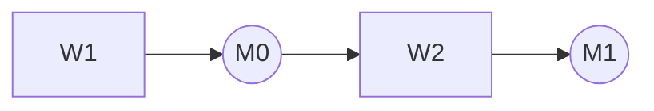

# <item id>: <item title>

> *Every guidance line starts with "> \*" and ends with "\*"; delete all of them as you write, and never use that form for anything else. Placeholders in angle brackets are replaced or the element is written as one of the sanctioned empty values: `None found (searched: <where searched>, <date searched>)`, `Unknown (settled by: <what exactly>)`, `Not applicable (<why not>)`. The rules in full are in [GUIDELINES.md](GUIDELINES.md); the numbers in brackets point at its sections. Line 1 is the current file's first line, unchanged (it already carries the id prefix); for a new item write the [`items.json`](items.json) title after `# <item id>: `. Do not write the generated sections (Where it sits, Resources, Related items), not even as empty headings; build.py appends them.*

> *Readers skim and land mid-document ([6.7, Readability and presentation](GUIDELINES.md#67-readability-and-presentation), [6.8, Words: pointers, terms and second readings](GUIDELINES.md#68-words-pointers-terms-and-second-readings), [6.9, Links](GUIDELINES.md#69-links)): after each lead-in the first sentence is the conclusion; three or more parallel things are a list; things with the same attributes are a table with the unit in the header; a structure is a diagram with a caption; every number carries its unit, baseline and source; every pointer names what it points to in full and links to it; each term of the field is defined at its first use in its section; coin no term; replace a word that has a second meaning (the [6.8, Words: pointers, terms and second readings](GUIDELINES.md#68-words-pointers-terms-and-second-readings) table). No estimate of how long anything takes or how much code it needs.*

> *([4.1, Summary and status line](GUIDELINES.md#41-summary-and-status-line)) Summary: one paragraph, three to five sentences, 60 to 120 words, no heading: what the item produces, who uses it, what is broken today, the one-line case for AI agents. Then the status line in exactly this grammar.*

*Status: draft 1, YYYY-MM-DD. AI review panel: none yet. Human review: none. Questions for Tim: 0. This document was drafted and reviewed with AI agents; human review is recorded here.*

## Goal

> *([4.2, Goal](GUIDELINES.md#42-goal)) Four lead-ins, in this order. Deliverables as artefacts with properties; the acceptance test with numbers or `Unknown (settled by: …)`; the two-ways framing in your own words; three to six out-of-scope items, each naming the item or candidate that covers it.*

**Deliverables.** 

**Acceptance test.** 

**Framing.** 

**Out of scope.**
- <what this item does not do>: <item or candidate that does>.

## Why it is high value

> *([4.3, Why it is high value](GUIDELINES.md#43-why-it-is-high-value)) Five lead-ins. The pain today with sources; why it has not already been done (the real obstacle: cost, access, a missing oracle, tedium, inertia, sunk cost); who is waiting (on the list and outside it); why now, naming which framing applies (easy now with AI / unlocks other tasks / accelerates work or iteration) in one or two sentences, with a clause on the shift the Goal's Framing describes and what changed so the obstacle no longer holds; shots on goal (attempts per month today and after, cost per attempt, sources or estimates). The dependency order of the list lives in What success unlocks, not here.*

**The pain today.** 

**Why not already done.** 

**Who is waiting.** 

**Why now.** 

**Shots on goal.** 

## What success unlocks

> *([4.4, What success unlocks](GUIDELINES.md#44-what-success-unlocks)) Six lead-ins. Every item named under Needs first, Unlocks on this list and Cross-checks with must be in `related` for this item in [`items.json`](items.json); propose a missing relationship through [PROCESS.md](PROCESS.md), never add it here first.*

**Needs first.**
- [<item id>](<item id>.md): <what it must deliver first>.

**Unlocks on this list.**
- [<item id>](<item id>.md): <the mechanism>.

**Cross-checks with.**
- [<item id>](<item id>.md): <quantity compared; agreement expected>.

**Shared harness.** 

**Beyond the list.** 

**Compounding.** 

## Why it must be open

> *([4.5, Why it must be open](GUIDELINES.md#45-why-it-must-be-open)) Five lead-ins, item-specific. The closed version in one or two sentences naming the closed tools or results as dated context (The bar to clear owns them); the counterfactual in two sentences; the strongest case against open and why it fails here; at least two mechanisms from the [4.5, Why it must be open](GUIDELINES.md#45-why-it-must-be-open) table (reproducibility, replicability, composability, legal scale, universal access, accumulation, AI itself, supportability), each labelled empirical, contractual or normative, with specifics; what open means here: the licence per artefact ([5.6, Licences](GUIDELINES.md#56-licences)), what must be published to reproduce and to replicate the result, whose consent any vendor or foundry data needs, for PDK items the clean-room rule ([5.7, Clean-room rule for PDK items](GUIDELINES.md#57-clean-room-rule-for-pdk-items)), and the look-alike licences (source-available, business-source, delayed or partial releases) this item must not build on, named with their tools.*

**The closed version.** 

**The counterfactual.** 

**The strongest case against open.** 

**Why closed does not deliver.** 

**What open means here.** 

## State of the art

> *([4.6, State of the art](GUIDELINES.md#46-state-of-the-art)) Every claim links or carries a status ([5.4, Claim statuses](GUIDELINES.md#54-claim-statuses)); every tool carries a status from the [5.5, Status of tools and projects](GUIDELINES.md#55-status-of-tools-and-projects) vocabulary with an as-of month and a licence class from [5.6, Licences](GUIDELINES.md#56-licences) (open-source, source-available, proprietary); a licence that only looks open is named as such. Each tool's one link lives under Projects and code.*

### Open tools and projects

- **<tool name>**: <status word>, as of YYYY-MM.
  - Licence: <open-source | source-available | proprietary>, <licence name>.
  - Can: <what it does for this goal>.
  - Cannot: <what it lacks>.
  - Speed: <runtime on a stated input, or Unknown>; recomputes unchanged inputs: <yes | no | Unknown>.
  - Quality: <tests, CI, releases, user base>.
  - Build on or replace: <which, and why>.

### The bar to clear

> *Three parts: the physical limit and the first-principles bound for the key quantity; what agent-scale work needs (iteration time, cost per attempt, reproducibility, no licence gate, freedom to change the tool), with numbers where Metric and baseline has them; then, as dated context in one line each, the proprietary tools or results that exist and the licence terms that keep them from agent-scale use. Never the target. A missing part: `None found (searched: …)`.*

### Research results

> *The papers or theses that established the methods, one line each on what they showed. Resolved through a search tool (the paper trackers first), never from memory. Each paper is listed with its identifier once, under Key papers; refer to it here by author and year.*

### Past and parallel efforts

| Effort | Years | What it did | Why it stopped, or where it stands | Pointer |
| --- | --- | --- | --- | --- |
|  |  |  |  |  |

### What is missing

- <a capability no open tool has, with the closest tool and what it lacks>.

**Replace or build on.** 

## What Tim has already worked out

> *([4.7, What Tim has already worked out](GUIDELINES.md#47-what-tim-has-already-worked-out)) Only documents the writer has read, marked `read in full` or `summary only`. Six lead-ins. Dead ends: say for each whether it stopped for resources (developer time, money, hardware, access) or because the idea failed. Ideas from unpublished material: each sentence marked `(from Tim's unpublished notes)`, no link, title, title fragment, partner, figure or name; Tim signs each off before landing.*

**Documents.**
- Tim's [<document title>](<allow-listed link>) (<read in full | summary only>): <the specific proposals, decisions and numbers>.

**Experiments and results.** 

**Dead ends.** 

**Framing inherited.** 

**From unpublished notes.** 

**Where the written record runs out.**
- <the first question the record does not answer, and who could>.

## What frontier models change

> *([4.8, What frontier models change](GUIDELINES.md#48-what-frontier-models-change)) Four lead-ins, no table. Mechanisms with the item's numbers (units from a counted source or `(estimate)`, oracle latency, size of the record), with no estimated rate or duration; which silos, unfinished work and scarce expertise; the preconditions, saying which rest on current model capability or price; two sentences on what people still do and a pointer to Unknowns, blockers and risks, which owns the itemised blockers and the plausible-but-wrong risk. The per-workstream oracle, access and fit live in the Work plan.*

**Why faster.** 

**Why better.** 

**What has to be true.** 

**What people still do.** 

## Work plan and milestones

> *([4.9, Work plan and milestones](GUIDELINES.md#49-work-plan-and-milestones)) Workstream blocks W1 upward (three to eight), then the summary table derived from them, then the milestone ladder and the Dependencies diagram, then the metric, the lead times and the cross-checks. Every item includes "Harness, benchmarks and tool speed" or says in one line why not. PDK-layer items include "PDK consistency audit and generated docs" and say which of its clauses apply.*

### Workstreams

**W1 <workstream name>.** Produces: <the artefact>. Needed because: <why the Goal needs it>.
- Oracle: <what decides>.
  - Stands in for: <the physical or manufacturing question this check is a proxy for; where the reason for each of its rules is recorded, or Unknown>.
  - Reference: <where the expected answer comes from>.
  - Pass: <pass criterion>.
  - Latency: <per unit>.
  - Negative control: <a case that must fail>.
  - Blind spots: <what it cannot catch>.
- Access: <public | free EULA | paid licence | NDA | membership | remote hardware | on-site hardware or lab | money | partner>: <what exactly>.
- Knowledge: <public record | spread across silos | tacit | unknown>: <what exactly>.
- Units: <how many independent units; the cap and what sets it>.
- Binding constraint: <oracle | access | compute | knowledge | decision>, because <the reason>.
- Lands in: <repository or project>.
  - Contribution rules: <link or "this project's repository">.
  - Gate: <what its maintainers require>.
- Fit: <A | B | C | D>, because <derived from the lines above>.
- Lead time: <waits no effort shortens (a shuttle cycle, a lab queue), or none>.
- Depends on: <workstreams, items, resources>.
- Suite quality (only for a workstream that produces a checker or a test suite): <share of deliberately broken inputs it catches, measured from M1>.

### Summary table

| # | Workstream | Oracle | Access | Units | Binding constraint | Fit |
| --- | --- | --- | --- | --- | --- | --- |
| W1 |  |  |  |  |  |  |

### Milestones

> *Each rung has all seven lines. Completes names the W-ids the rung finishes or advances; Fit is the least favourable fit among them. M1 needs only public resources, at most one named commodity board and no-cost vendor editions. Proof levels: P2 for M0 and M1, P4 for M2, P3 for M3, P5 for M4 ([4.9.1, Proof levels](GUIDELINES.md#491-proof-levels)); say why if lower. M4 applies exactly when a workstream has a silicon or physical oracle or hardware access; it has three extra lines, or the whole block is `Not applicable (<why not>)`.*

**M0 Baseline and harness.**
- Done when: 
- Evidence: 
- Proof: P2
- Needs: 
- Completes: 
- Fit: 
- Gate: 

**M1 First checkable result.**
- Done when: 
- Evidence: 
- Proof: P2
- Needs: 
- Completes: 
- Fit: 
- Gate: 

**M2 Usable.**
- Done when: 
- Evidence: 
- Proof: P4
- Needs: 
- Completes: 
- Fit: 
- Gate: 

**M3 Complete or competitive.**
- Done when: 
- Evidence: 
- Proof: P3
- Needs: 
- Completes: 
- Fit: 
- Gate: 

**M4 Proven in hardware or silicon.**
- Done when: 
- Evidence: 
- Proof: P5
- Needs: 
- Completes: 
- Fit: 
- Gate: 
- Hardware: 
- Test plan: 
- What silicon returns and when: 

**Dependencies.**

> *([4.9, Work plan and milestones](GUIDELINES.md#49-work-plan-and-milestones), [6.7, Readability and presentation](GUIDELINES.md#67-readability-and-presentation)) One node per workstream and per milestone; an arrow from each node to what depends on it, from the Depends on and Completes lines; nothing in the picture that is not in the blocks. The caption names the longest chain to M3 and any lead time on it.*

*Figure 1: Workstreams (boxes) and milestones (circles); an arrow means "needed before". Longest chain to M3: <the W ids>; lead time on it: <none, or what>.*

### Metric and baseline

> *For each number that tracks progress: name, formula and unit with the population and denominator; the success tolerance, written before measuring; one guardrail metric that fails if the primary is gamed; the baseline as a median and range over a stated number of runs with pinned versions (tool commit, PDK release, benchmark tag, machine), or `Unknown (settled by: M0)`; where it is measured (the scoreboard item, or a script committed at M0); the target. Measurement items add the instrument's coverage, repeatability and agreement with a reference.*

- **<metric name>.**
  - Formula: <…>.
  - Unit: <…>.
  - Over: <population / denominator>.
  - Success: <the tolerance>.
  - Guardrail: <metric that fails if this one is gamed>.
  - Baseline: <median and range over n runs; pins> or `Unknown (settled by: M0)`.
  - Measured by: <scoreboard item or script>.
  - Target: <…>.

### Lead times

> *The waits no effort shortens between now and M3, and for M4 where it applies (a shuttle cycle, a lab queue, a licence approval), each from a named source or `Unknown (settled by: …)`. No estimate of how long the work itself takes.*

- **<the wait>.** <Duration, from a named source>; affects <which milestone>.

### Cross-checks

> *Four lead-ins. No single source is trusted: list the sources the key results rest on with what would catch each being wrong; give each key result its ladder (bound, fundamental limit, independent source, first-principles rebuild, measurement) and say which rungs exist today; give each key quantity a fast path and an accurate path; say how much verification each class of result gets.*

**Sources and failure modes.**

| Source | Trusted for | Known failure mode | Independent check |
| --- | --- | --- | --- |
|  |  |  |  |

**Verification ladder.**
- **<Key result>.**
  - Bound: <back-of-the-envelope figure>.
  - Limit: <fundamental limit it must respect>.
  - Second source: <independent source>.
  - Rebuild: <first-principles reconstruction; abstraction layer added or removed>.
  - Measurement: <what settles it>.
  - Rungs today: <which rungs>; built by: <which milestone>.

**Fast and accurate paths.**
- **<quantity name>.**
  - Fast: <the method>; cost: <…>; used when: <…>.
  - Accurate: <the method>; cost: <…>; used when: <…>.

**Effort rule.** 

## Needs beyond AI tokens

> *([4.10, Needs beyond AI tokens](GUIDELINES.md#410-needs-beyond-ai-tokens)) One row per concrete need. Kinds: compute, software licences, hardware, data, access, people, money, time. Cost is an order of magnitude with a public price list linked, or `Unknown`; never a quote or a private figure. Lead time is the wait no effort shortens. Then the licence questions in prose, and for PDK items the clean-room rule as it applies.*

| Kind | What exactly | Why | Who could provide it | Cost | Lead time | What can proceed without it |
| --- | --- | --- | --- | --- | --- | --- |
|  |  |  |  |  |  |  |

**Licence questions.** 

**Clean room.** 

## Unknowns, blockers and risks

> *([4.11, Unknowns, blockers and risks](GUIDELINES.md#411-unknowns-blockers-and-risks)) Three lists. Technical unknowns with a path to an answer go under Open technical questions, which owns them. The first risk is always the plausible-but-wrong risk.*

### Expertise barriers

- **<the knowledge>.**
  - Why it defeats people: <the reason>.
  - How a model gets through: <reading, combining, hypothesising>.
  - Validated by: <the check>.

### Hard blockers

- **<Legal | Physical | Economic | Social>: <the blocker>.**
  - AI cannot: <what exactly>.
  - AI can: <prepare, plan, de-risk>.
  - Mitigation or question for a person: <what exactly>.

### Risks of the approach

- **The plausible-but-wrong risk: <how this item's AI-produced output could look right and be wrong>.** Check: <what catches it>.
- **<the risk>.** Check: <what catches it>.

## Open technical questions

> *([4.12, Open technical questions](GUIDELINES.md#412-open-technical-questions)) This section owns every technical question and known unknown. Each: how it could be settled; which workstream it blocks; who could take it.*

1. **<the question>.**
   - Settled by: <experiment, measurement, search or prototype>.
   - Blocks: <W-ids or none>.
   - Taker: <an agent with public resources | role>.

## Questions for Tim

> *([4.13, Questions for Tim](GUIDELINES.md#413-questions-for-tim)) At most five, most valuable first, at most 300 words in all. Delete the section when empty and set the status line to 0.*

1. **Q:** <one line>. **Context:** <what the record says and does not say>. **Assumed for now:** <the assumption>. **Changes if different:** <which sections>.

## Start here

> *([4.14, Start here](GUIDELINES.md#414-start-here)) The agent digest, then seven sub-headings in this order. Each paper and each repository appears once in the document. Nothing below this heading is generated; build.py appends the generated sections after it.*

### Agent digest

> *At most 150 words in these seven lines. Goal as three tests. Budget and stop rule: the default time box for a first attempt and when to stop and report.*

- Goal: 
- First task: 
- Oracle: 
- Lands in: 
- Ask a person for: 
- Upstream / downstream: 
- Budget and stop rule: 

### Read first

1. [<document title>](<the link>) (<approximate size>): <why, one line>.

### Reproduce first

> *One existing result, one line per field. Or `None found (searched: …)` and the M0 task that creates it.*

- Source: <repository or dataset>.
- Pin: <commit or tag; container digest where one exists>.
- Environment: <…>.
- Flow: <linked, not pasted>.
- Expected value: <value, tolerance, source>.
- Runtime: <…>.
- Time box: <…>.
- Known-good case: <…>; known-bad case: <…>.
- Failure report: <what it must contain>.

### First tasks

1. **<task name>.**
   - Produce: <the artefact>.
   - Oracle: <the check>.
   - Inputs: <what it needs>.
   - Workstream: W<workstream number>.
   - Fit: A.
   - Lands in: <where searched>.

### Ask a person for

- **<the access>:** from <which role>, for <which milestone>.

### Known dead ends

- **<the trap>.** <pointer to it>.

### Key papers

- <author list>, "<paper title>" (<publication year>). [<DOI or arXiv id, or OpenAlex id if it has neither>](<the link>). <Why it matters>.

### Projects and code

- [<project name>](<the link>): <status word>, as of YYYY-MM.
  - Licence: <open-source | source-available | proprietary>, <licence name>.
  - Contains: <what is in it>.
