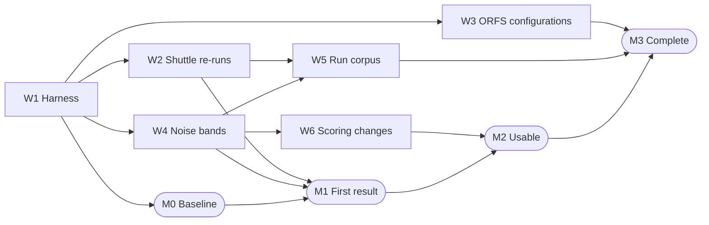

# asic-scoreboard: ASIC benchmarking

This item builds an open [scoreboard](../GUIDELINES.md#scoreboard) for open chip tool flows. It re-runs public designs at pinned versions and keeps each result, with its power, performance and area (PPA), as an open corpus. The designs come from OpenROAD-flow-scripts (ORFS) and the [Tiny Tapeout](https://tinytapeout.com) shuttles; its users are tool maintainers and items that need a score. As of 2026-11, about 4,900 shuttle entries record a commit; no public re-run of them was found. ORFS keeps its tolerances in a hosted service. Agents can run and compare thousands of pinned runs, each checked against a recorded result.

*Status: draft 2, 2026-11-13. AI review panel: draft 1, 9 personas at 3 model tiers; draft 2, claim audits at two tiers. Human review: none. Questions for Tim: 5. This document was drafted and reviewed with AI agents; the AI review panel is not a human review, and the Human review entry is the only record of one.*

## Goal

**Deliverables.** A runner, a run record, a scoreboard and a reproduction report.
- *Runner:* wraps the flows' own record writers and adds the pinned versions of each run; Apache-2.0.
- *Pinned versions:* container digest, tool commits, process design kit (PDK) commit, configuration, seed, thread count.
- *Run record:* one row per run, metrics under one set of names and units; CC-BY-4.0.
- *Scoreboard:* per tool release and design, each metric against the best earlier open result, with its noise band.
- *Reproduction report:* each shuttle project re-run at its recorded versions, against the metrics recorded at submission.

**Acceptance test.** Five lines, each able to fail.
- *Repeatability, one machine:* two fresh-container runs at one thread count give the same non-runtime metrics; met on 2026-11-13 for four `gcd` configurations.
- *Repeatability, two machines:* the same, on a second machine; `Unknown (settled by: a run on a second machine)`.
- *Reproduction:* the share of tinytapeout-10 projects whose re-run matches the recorded `metrics.csv`; target `Unknown (settled by: M1)`.
- *Change detection:* every seeded change in the negative-control set is flagged; no repeat run is.
- *Coverage:* each new OpenROAD-flow-scripts (ORFS) image is scored on every ORFS configuration of the four foundry platforms (26).

The four foundry platforms are sky130hd, sky130hs, gf180 and ihp-sg13g2; asap7 and nangate45 are left out because they are not manufacturable kits.

**Framing.** A cross-cutting tooling item that scores the items above it.
- *Layer:* tooling; it scores PDK, IP-block and tool items.
- *Manual-to-generator axis:* from a maintainer judging a change on a few designs to every change scored on every public design.
- *Open tools only:* open tools are measured against themselves; a proprietary figure is dated context, never the target.
- *Twin:* the framing of [fpga-scoreboard](fpga-scoreboard.md).

**Out of scope.** Five neighbours own the rest.
- Running shuttles and archiving their designs and silicon results: [shuttle-program](shuttle-program.md).
- Whether each tool stage is correct: [flow-proofs](flow-proofs.md).
- The design-rule check engine and its per-rule tests: [drc-forge](drc-forge.md).
- Field-programmable gate array (FPGA) tool flows: [fpga-scoreboard](fpga-scoreboard.md).
- Bit-identical tool builds: [signed-builds](signed-builds.md).

## Why it is high value

**The pain today.** Open-flow changes are judged on a fixed design set.
- OpenROAD's contribution guide: "Be skeptical of QoR improvements claimed from a single design"; QoR is [quality of results](../GUIDELINES.md#quality-of-results-qor).
- The OpenROAD-flow-scripts (ORFS) gate: "Rule tolerances live in the dashboard, not in this repository, and the baseline moves with master".
- An unreachable dashboard gives `INCONCLUSIVE`, not a failure; from this sandbox it was unreachable.
- Basilisk's open-flow changes gave "2.3x improvement compared to the baseline", shown on that one design (Sauter et al. 2024).
- No public re-run of shuttle projects at their recorded versions was found (see What is missing).

**Why not already done.** Old pinned versions need upkeep nobody owns.
- Pinned versions drift: tinytapeout-ihp-25a's flow (3.0.0.dev17) installs only under the old package name and registry.
- Tool requirements age: Tiny Tapeout 10's tools did not install under Python 3.13 here.
- The corpus is spread over 29 shuttle repositories with three record layouts.

**Who is waiting.** Tool maintainers and five items on this list.
- OpenROAD and [LibreLane](https://github.com/librelane/librelane) maintainers, who ask for evidence on many designs.
- [arithmetic-zoo](arithmetic-zoo.md), [cell-foundry](cell-foundry.md) and [shadow-pdks](shadow-pdks.md): their results are scores on real designs.
- [paper-replay](paper-replay.md), whose replicated results become cases.
- [drc-forge](drc-forge.md), whose engine runtimes are kept here.

**Why now.** The corpus and pinned containers exist, and agents can keep old versions runnable.
- Corpus: 29 Tiny Tapeout shuttles, 2022 to 2026, each entry with a repository and commit.
- Containers: ORFS published 81 images in 2026-10.

**Shots on goal.** Each ORFS image is one candidate change to score.
- Candidates per month: 81 images pushed in 2026-10.
- Cost of one small-design attempt: 55 to 100 s per `gcd` run on 4 cores.
- Cost of one mid-size attempt: over 25 min for `aes` on sky130hd (did not finish).
- Designs per attempt: 26 ORFS configurations now; shuttle projects once [W3](#workstreams) converts them.
- This item multiplies designs per attempt, not attempts; the success rate per attempt is unchanged.

**Corpus size.** Shuttle projects are small, so they score some changes and not others.

| Shuttle | Projects with metrics | Median cells | 90th percentile cells | Largest | Over 10,000 cells |
| --- | --- | --- | --- | --- | --- |
| tinytapeout-10 | 102 | 615 | 2,733 | 15,055 | 1 |
| tinytapeout-ihp-25a | 329 | 910 | 4,020 | 22,081 | 8 |
| tinytapeout-gf-0p2 | 52 | 1,992 | 13,028 | 28,173 | 8 |

- Source: `design__instance__count__stdcell` in each `stats/metrics.csv`.
- Small designs score synthesis and flow robustness.
- Routing and timing changes need the larger ORFS designs.

## What success unlocks

**Needs first.** Nothing; the corpus and flows are public.
- [shuttle-program](shuttle-program.md): later shuttles' archived designs extend the corpus.

**Unlocks on this list.** Items that change a cell, kit or tool get a score.
- [arithmetic-zoo](arithmetic-zoo.md): adder and multiplier choices scored on designs that use them.
- [cell-foundry](cell-foundry.md): a generated cell library scored against the kit's own.
- [shadow-pdks](shadow-pdks.md): power, performance and area (PPA) of the same designs on a real and a proxy kit.
- [paper-replay](paper-replay.md): a replicated result becomes a scored case.

**Cross-checks with.** Two neighbours check this item's results.
- [drc-forge](drc-forge.md): violation counts on scored designs agree with the flow's own check.
- [shuttle-program](shuttle-program.md): predicted timing against measured silicon, where it measures any.

**Shared harness.** This item owns the run record and the scoreboard.
- The run record and the noise bands: this item.
- The shuttle corpus and silicon status: [shuttle-program](shuttle-program.md).
- Per-rule design-rule tests: [drc-forge](drc-forge.md).

**Beyond the list.** The run corpus serves research.
- Learning datasets from open-flow runs gain shuttle designs.

**Compounding.** Every run adds a row; every release re-scores the corpus.
- The corpus grows with each shuttle and each OpenROAD-flow-scripts (ORFS) image.
- Tiny Tapeout sources already feed AI benchmarks: NotSoTiny and SGAnalog (Ghorab et al. 2025; Li and Ding 2026).

## Why it must be open

**The closed version.** Proprietary tool vendors benchmark internally, on designs nobody outside sees (as of 2026-11).
- Their results cannot be re-run or extended to the open tools.

**The counterfactual.** Closed, nobody could check the scores. Not done, changes stay judged on a fixed set.

**The strongest case against open.** Maintainers already have a working gate and may not read a second scoreboard.
- The answer is [M2](#milestones): a score counts only once a reviewer cites it.
- The hosted gate's tolerances are not in the OpenROAD-flow-scripts (ORFS) repository, so outsiders cannot replicate its verdicts.

**Why closed does not deliver.** Four mechanisms.
- *Reproducibility (empirical):* the ORFS gate's verdict depends on tolerances held only by the service.
- *Replicability (empirical):* an open re-implementation of a closed macro placer let others assess it (Cheng et al. 2023).
- *Accumulation (empirical):* OpenLane 2 moved to LibreLane, and one recorded version has no image under the new name.
- *AI itself (empirical):* Tiny Tapeout designs are AI benchmarks because their sources and revisions are public.

**What open means here.** Every input of a score is published.
- Licences: runner Apache-2.0; run records CC-BY-4.0.
- Design licences: the Tiny Tapeout template is Apache-2.0; each project's licence file is read per run.
- To reproduce: the pinned versions of each run.
- To replicate: the metric names and the noise-band method.
- Public test suite: the negative-control set.
- Consent: none needed; every design is public with a licence.
- Clean room: Not applicable (no process design kit (PDK) values are written).
- Look-alikes not to build on:
  - a hosted check whose tolerances are not published;
  - datasets under Creative Commons (CC) BY-NC-SA, such as EDA-Schema-V2;
  - datasets made with closed tools, such as CircuitNet.

## State of the art

### Open-source tools and projects

- **OpenROAD-flow-scripts (ORFS)**: active, as of 2026-11.
  - Licence: open-source, BSD-3-Clause.
  - Can: run 26 configurations on the four foundry platforms; write 544 to 568 metrics per run.
  - Cannot: keep tolerances in its repository; name its tool versions inside its image.
  - Speed: 55 to 100 s per `gcd` run on 4 cores; per-stage times are in the record.
  - Quality: continuous integration with the dashboard check; an image per build.
  - Build on or replace: build on.
- **LibreLane**: active, as of 2026-11.
  - Licence: open-source, Apache-2.0.
  - Can: harden Tiny Tapeout designs and write `metrics.csv` per run.
  - Cannot: `Unknown (settled by: W2's metric map)`.
  - Speed: `Unknown (settled by: First task 2)`.
  - Quality: 83 releases on the package index.
  - Build on or replace: build on.
- **ORFS QoR dashboard**: active, as of 2026-11.
  - Licence: `Unknown (settled by: a source repository or terms page)`.
  - Can: compare a run with the master build at its merge base.
  - Cannot: give a verdict when unreachable.
  - Speed: `Unknown (settled by: a timed check from a machine that reaches it)`.
  - Quality: `Unknown (settled by: its source)`.
  - Build on or replace: a second source only.
- **Tiny Tapeout shuttle repositories and index**: active, as of 2026-11.
  - Licence: open-source, Apache-2.0.
  - Can: list 4,921 to 4,937 entries on 29 shuttles, each with repository and commit.
  - Can, per shuttle: flow version, process design kit (PDK) commit and `metrics.csv` per project.
  - Cannot: name the flow version for any of 52 GlobalFoundries (GF) 0.2 projects.
  - Speed: Not applicable (data).
  - Quality: generated by the shuttle build; two counting methods differ by 16.
  - Build on or replace: build on.
- **tinytapeout-project-search**: active, as of 2026-11.
  - Licence: open-source, Apache-2.0.
  - Can: index every Tiny Tapeout project.
  - Cannot: run or score designs.
  - Speed: Not applicable (index).
  - Quality: has a tests directory.
  - Build on or replace: build on, for listing projects.

### The bar to clear

- *Physical limit:* Not applicable (a benchmark measures tools).
- *First-principles bound:* identical inputs at a fixed thread count should give identical results; ORFS runs OpenROAD on one thread per core, so the thread count is a pinned version.
- *What agent-scale work needs:* a verdict in minutes on small designs; tolerances in the repository.
- *Dated context, proprietary:* an open flow used 53% more area than a proprietary one for a state machine on the 130 nm kit of the Leibniz Institute for High Performance Microelectronics (IHP) (Freitas et al. 2025, as of 2025-12); never the target.

### Research results

- Jung et al. 2021 proposed METRICS2.1, the metric names ORFS still writes.
- A 2026 dataset record reports run-to-run spread over 2,241 ORFS runs; not peer-reviewed.

### Past and parallel efforts

| Effort | Years | What it did | Where it stands | Link |
| --- | --- | --- | --- | --- |
| RDF-2020 | 2017–2020 | Academic flow and calibrations | `Unknown (settled by: its repository)` | [Chen et al. 2020](https://doi.org/10.1145/3400302.3415742) |
| METRICS2.1 | 2021– | Metric names | In ORFS records | [Jung et al. 2021](https://doi.org/10.1109/ICCAD51958.2021.9643541) |
| ORFS rules files | 2021–2026 | Per-design tolerances in the repository | Replaced by the dashboard | [ORFS](https://github.com/The-OpenROAD-Project/OpenROAD-flow-scripts) |
| ORFS QoR dashboard | 2026– | Hosted baseline and tolerances | Tolerances unpublished | [ORFS](https://github.com/The-OpenROAD-Project/OpenROAD-flow-scripts) |
| Zheludkov dataset | 2026 | 2,432 runs, 40 designs | Published, CC-BY-4.0 | [Zenodo](https://doi.org/10.5281/zenodo.22860933) |
| MF-Tune campaign | 2026 | 2,241 ORFS runs | Published, CC-BY-4.0 | [Zenodo](https://doi.org/10.5281/zenodo.22773889) |
| Tim's ORFS fork | 2021–2023 | Yosys update branches 0.14 to 0.20 | Inactive since 2023-09 | [mithro/OpenROAD-flow-scripts](https://github.com/mithro/OpenROAD-flow-scripts) |

### What is missing

- A re-run of shuttle projects at recorded versions: None found (searched: ORFS, LibreLane, bazel-orfs, three Tiny Tapeout shuttle repositories, both trackers, 2026-11-13).
- Tolerances and baselines in an open repository.
- One metric schema across ORFS `metadata.json` and LibreLane `metrics.csv`.
- A published noise band per design and platform.
- Shuttle projects as ORFS configurations: None found (searched: ORFS designs, bazel-orfs, tt-support-tools, 2026-11-13).

**Replace or build on.** Build on ORFS, LibreLane and the shuttle records.
- Replace only the hosted tolerance check, with tolerances beside the run records.
- Keep the dashboard as a second source.

## What Tim has already worked out

**Documents.** Three summaries read; the 26 Drive documents were not reached.
- Open multi-project wafer (MPW) viewer requirements (summary): a public portal of every design submitted to the multi-project wafer (MPW) shuttles of the Open MPW programme (Tim's claim, undated; not checked).
- The 10 mm² Open MPW user area (summary): what fits in it, with measured memory densities (Tim's claim, undated; not checked).
- ASAP7 primer (summary): the predictive 7 nm kit "used to benchmark open EDA tools" (Tim's claim, undated; not checked).

**Experiments and results.** Tim's OpenROAD-flow-scripts (ORFS) fork has Yosys update branches 0.14 to 0.20, the last dated 2023-09-28.
- What each update measured: `Unknown (settled by: Tim, question 4)`.

**Dead ends.** None found (searched: three summaries and the fork's branch list, 2026-11-13).

**Framing inherited.** The item page sets the frame.
- Open tools against themselves; each change against the best earlier open result; every run kept.

**From unpublished notes.** None used; no internal document was read.

**Where the written record runs out.** Canonical metrics and the corpus home.
- Which metrics count (the item page's open question): Tim.
- What the 26 unreached Drive documents propose: Tim, or a reachable copy.

## What frontier models change

**Why faster.** Many independent runs, each with an automatic check.
- Units: 26 OpenROAD-flow-scripts (ORFS) configurations; shuttle projects with recorded versions, count `Unknown (settled by: First task 4)`.
- Oracle latency: 55 to 100 s per small design on 4 cores.
- Re-execution: every ORFS image can re-score the set with no person in the loop.

**Why better.** The upkeep spans silos few people combine.
- Silos: flow configuration, process design kit (PDK) versions, Python packaging, container registries, statistics.
- Unfinished: old shuttle versions nobody keeps runnable.
- Failure triage: an agent assigns each failed run a cause from a fixed list; a second agent re-checks a sample.

**What has to be true.** Versions stay fetchable; runs repeat.
- Containers and packages for recorded versions stay served: true for the three tags checked under old names.
- A re-run at fixed versions and thread count gives the same record.
- Design licences allow publishing derived records.
- Current AI models can repair broken installs from logs: not shown here (as of 2026-11).

**What people still do.** People decide where the corpus lives, which metrics count, and what goes upstream.
- The blockers and the [plausible-but-wrong risk](../GUIDELINES.md#plausible-but-wrong-risk) are in [Unknowns, blockers and risks](#unknowns-blockers-and-risks).

## Work plan and milestones

### Workstreams

No oracle here is a proxy for physics; each Stands in for line reads `direct`.

**W1 Harness and baseline.** Produces: the runner and the M0 records. Needed because: every score is a run.
- Oracle: exit state and record against the reference record.
  - Stands in for: direct: whether the pinned run completes and writes a record.
  - Reference: the M0 records of four `gcd` configurations.
  - Pass: exit 0 and every reference metric present.
  - Latency: 55 to 100 s per small design.
  - Negative control: 99% core utilisation must fail; it does.
  - Blind spots: a run that completes with wrong metrics.
- Access: public.
- Knowledge: public record.
- Units: 26 OpenROAD-flow-scripts (ORFS) configurations.
- Binding constraint: compute, because each run takes processor time.
- Lands in: a new repository named by Tim; until then, the agent's own fork.
  - Contribution rules: this project's repository.
  - Contribution gate: Tim's review.
- Fit: A, because the binding constraint is compute.
- Lead time: none.
- Depends on: nothing.
- Suite quality: the share of negative controls that fail, from M0.

**W2 Shuttle re-runs at recorded versions.** Produces: the reproduction report. Needed because: the corpus is useful only if its recorded results can be re-made.
- Oracle: the re-run's `metrics.csv` against the one recorded at submission.
  - Stands in for: direct: whether a recorded result can be re-made.
  - Reference: each project's `stats/metrics.csv`.
  - Pass: every metric in the compared set within the W4 band.
  - Latency: `Unknown (settled by: First task 2)`.
  - Negative control: a re-run at another flow version must differ.
  - Blind spots: a recorded result that was itself wrong.
- Access: public; needs a machine that can fetch process design kit (PDK) releases.
- Knowledge: spread across silos: three record layouts, old Python packages.
- Units: tinytapeout-10, 112 projects, 102 with metrics.
- Binding constraint: compute.
- Lands in: this item's repository.
  - Contribution rules: this project's repository.
  - Contribution gate: Tim's review.
- Fit: A, because the binding constraint is compute.
- Lead time: none.
- Depends on: W1.

**W3 Shuttle projects as ORFS configurations.** Produces: one ORFS configuration per shuttle project. Needed because: each project carries a LibreLane configuration, not an ORFS one.
- Oracle: the project's own gate-level test passes on the ORFS netlist.
  - Stands in for: direct: whether the converted run implements the same function.
  - Reference: each project's `test/` bench, run with `GATES=yes`.
  - Pass: the test passes and the run has zero route violations.
  - Latency: one ORFS run plus one simulation per project.
  - Negative control: a netlist with one gate swapped must fail its test.
  - Blind spots: projects whose tests check little.
- Access: public.
- Knowledge: public record.
- Units: one per project; tinytapeout-10 first.
- Binding constraint: compute.
- Lands in: this item's repository.
  - Contribution rules: this project's repository.
  - Contribution gate: Tim's review.
- Fit: A, because the binding constraint is compute.
- Lead time: none.
- Depends on: W1.

**W4 Record, noise bands and change detection.** Produces: the metric map and a band per design and platform. Needed because: a score means nothing without its noise.
- Method: the band of a metric is its range over n repeats at fixed versions; n is `Unknown (settled by: M0)`.
- Method: a change is flagged when the new value lies outside the band of the old one.
- Oracle: seeded changes flagged; repeat runs not flagged.
  - Stands in for: direct: whether a metric change is real.
  - Reference: repeat runs at fixed versions.
  - Pass: all seeded changes flagged, no flag on repeats.
  - Latency: one pair of runs per design.
  - Negative control: a setting shown in M0 to move a metric; `ABC_AREA=1` moved none on sky130hd `gcd`.
  - Blind spots: a slow drift smaller than the band.
- Access: public.
- Knowledge: public record.
- Units: one per design and platform.
- Binding constraint: compute.
- Lands in: this item's repository.
  - Contribution rules: this project's repository.
  - Contribution gate: Tim's review.
- Fit: A, because the binding constraint is compute.
- Lead time: none.
- Depends on: W1.
- Suite quality: the share of seeded changes flagged, from M1.

**W5 Open run corpus.** Produces: the published records with versions. Needed because: the corpus is what others learn from.
- Oracle: a second agent rebuilds a sample of records from the published versions.
  - Stands in for: direct: whether a record is rebuildable.
  - Reference: the published records.
  - Pass: the rebuilt sample matches within the W4 band.
  - Latency: one run per sampled record.
  - Negative control: a record missing a version must be rejected.
  - Blind spots: designs whose licence forbids derived data.
- Access: public.
- Knowledge: public record.
- Units: one per run.
- Binding constraint: decision, because the corpus home and licence are Tim's choice.
- Lands in: a repository or dataset named by Tim.
  - Contribution rules: this project's repository.
  - Contribution gate: Tim's review.
- Fit: C, because the binding constraint is decision.
- Lead time: none.
- Depends on: W2, W4.

**W6 Scoring changes for others.** Produces: scores for changes proposed by items and maintainers. Needed because: the scoreboard exists to judge changes.
- Oracle: the scoreboard verdict, with [flow-proofs](flow-proofs.md) equivalence as a guardrail.
  - Stands in for: direct: whether a change improves the scored metrics.
  - Reference: the best earlier open result per design.
  - Pass: a change outside the band with no guardrail failure.
  - Latency: one sweep per change.
  - Negative control: a change known to worsen area must score worse.
  - Blind spots: what the record does not carry, such as silicon behaviour.
- Access: public.
- Knowledge: public record.
- Units: one per proposed change.
- Binding constraint: compute.
- Lands in: the proposing item's repository; upstream through a named person.
  - Contribution rules: [OpenROAD CONTRIBUTING.md](https://github.com/The-OpenROAD-Project/OpenROAD/blob/master/CONTRIBUTING.md).
  - Contribution gate: a person signs each commit and shows QoR on several designs.
- Fit: A, because the binding constraint is compute.
- Lead time: none.
- Depends on: W4.

### Summary table

| # | Workstream | Oracle | Access | Units | Binding constraint | Fit |
| --- | --- | --- | --- | --- | --- | --- |
| W1 | Harness and baseline | Exit state and record | public | 26 configurations | compute | A |
| W2 | Shuttle re-runs | Recorded metrics.csv | public | 102 projects | compute | A |
| W3 | Projects as ORFS configurations | Gate-level test | public | per project | compute | A |
| W4 | Record and noise bands | Seeded changes flagged | public | per design | compute | A |
| W5 | Open run corpus | Second-agent rebuild | public | per run | decision | C |
| W6 | Scoring changes | Scoreboard and equivalence | public | per change | compute | A |

### Milestones

**M0 Baseline and harness.**
- Done when: four `gcd` configurations run twice each from the pinned image, with records and measured repeatability.
- Evidence: records, logs and the runner.
- Proof: P2
- Needs: the ORFS image; a 4-core machine.
- Completes: W1.
- Fit: A
- Gate: a second agent reproduces the records from a clean checkout.

**M1 First checkable result.**
- Done when: 20 tinytapeout-10 projects, by sorted name, re-run at recorded versions, with a report each.
- Evidence: the reproduction report and records.
- Proof: P2
- Needs: M0; the shuttle repository and flow image.
- Completes: W2 for the sample; W4 for the sample.
- Fit: A
- Gate: a second agent reproduces five of the twenty.

**M2 Usable.**
- Done when: one change proposed by an item or maintainer is scored and the score is cited in its review.
- Evidence: a link from the review to the score.
- Proof: P4
- Needs: M1.
- Completes: W6.
- Fit: C
- Gate: the reviewing maintainer or item lead cites it.

**M3 Complete or at the bar.**
- Done when: every new ORFS image is scored on the 26 configurations and on converted shuttle projects, with noise bands.
- Evidence: the scoreboard and the published corpus.
- Proof: P3
- Needs: M2.
- Completes: W3, W5.
- Fit: C
- Gate: the dashboard verdicts as an independent reference.

**M4 Proven in hardware or silicon.** Not applicable (silicon results come from [shuttle-program](shuttle-program.md)).

**Dependencies.** The longest chain to M3 runs through the harness and the corpus.

*Figure 1: Workstreams (boxes) and milestones (rounded); an arrow means "needed before". Longest chain to M3: W1, W2, W5; lead time on it: none.*

### Metric and baseline

- **Reproduction rate.**
  - Formula: projects whose re-run matches, over projects re-run.
  - Unit: percent.
  - Over: the compared metric set, fixed before M1 (question 3).
  - Success: `Unknown (settled by: M1)`.
  - Guardrail: the share of re-runs that complete.
  - Baseline: `Unknown (settled by: M1)`.
  - Measured by: the W2 script.
  - Target: `Unknown (settled by: M1)`.
- **Repeatability.**
  - Formula: finish metrics that differ between two fresh-container runs, over metrics compared.
  - Unit: count.
  - Over: four `gcd` configurations at 4 threads.
  - Success: zero, or each difference explained.
  - Guardrail: runtime excluded and reported with the machine's core count and memory.
  - Baseline: 0 non-runtime keys differ, four configurations, one machine.
  - Measured by: the W1 runner.
  - Target: zero.
- **Instrument coverage, repeatability and agreement.**
  - Coverage: 26 ORFS configurations; shuttle entries 4,921 to 4,937.
  - Repeatability: the metric above.
  - Agreement: the dashboard verdict on the same run, where reachable.

### Lead times

- **None on the path to M3.** All inputs exist as of 2026-11-13.

### Cross-checks

**Sources and failure modes.** Each source has a second that fails differently.

| Source | Trusted for | Known failure mode | Independent check |
| --- | --- | --- | --- |
| ORFS metadata.json | Per-run metrics | Missing tags written as N/A | LibreLane record of the design |
| LibreLane metrics.csv | Recorded shuttle results | Flow version absent for GlobalFoundries (GF) 0.2 | Re-run at recorded versions |
| Tiny Tapeout index | Corpus count | Two counts differ by 16 | Shuttle repository directories |
| ORFS dashboard | Tolerances | Unreachable gives no verdict | Repeat-run noise bands |
| OpenSTA timing | Setup slack | One engine for all timing | `Unknown (settled by: M3)` |

**Verification ladder.** Repeatability has a bound and a measurement.
- **Re-run at identical versions matches.**
  - Bound: zero difference at a fixed thread count.
  - Limit: Not applicable (no physics).
  - Second source: a second machine, `Unknown (settled by: a second machine)`.
  - Rebuild: a second agent from a clean checkout.
  - Measurement: the M0 repeat pair.
  - Rungs in place: bound, measurement; built by: [M0](#milestones).

**Fast and accurate paths.** Four small designs, or the full set.
- **Change score.**
  - Fast: four `gcd` runs; about 5 min on 4 cores; used for every image.
  - Accurate: all configurations with repeats; cost `Unknown (settled by: M1)`; used for upstream proposals.

**Effort rule.** A score sent upstream gets the accurate path and a second agent's rebuild.

## Needs beyond AI processes

| Kind | What exactly | Why | Who could provide it | Cost | Lead time | What can proceed without it |
| --- | --- | --- | --- | --- | --- | --- |
| Compute | Multi-core machines with Docker | Every run | A cloud or university cluster | `Unknown (settled by: M1 timing)` | none | M0 on one machine |
| Compute | A second machine | Cross-machine repeatability | Any contributor | `Unknown (settled by: M0)` | none | One-machine results |
| Data | Storage for records | The corpus | A dataset host | 27,811 bytes per record | none | Local storage |
| People | A maintainer-facing contributor | Upstream sign-off | Named by Tim | Not applicable (a person) | none | Scores kept here |

**Licence questions.** None for tools; design licences are checked per project.

**Clean room.** Not applicable (no process design kit (PDK) values are written).

## Unknowns, blockers and risks

### Expertise barriers

- **Keeping old flow versions runnable.**
  - Why it defeats people: it needs packaging, container and flow knowledge at once.
  - How an AI model gets through: reads failing logs and pinned requirements; tries other interpreters and images.
  - Validated by: the re-run matches the recorded metrics.

### Hard blockers

- **Social: upstream changes need a person.**
  - AI cannot: sign a Developer Certificate of Origin line.
  - AI can: prepare the multi-design evidence.
  - Mitigation or question for a person: Tim names who carries changes upstream.

### Risks of the approach

- **Plausible-but-wrong: a reported improvement that is noise or a missing metric.** Check: every score carries its band and completeness count; negative controls run each sweep.
- **A metric changes meaning between tool versions.** Check: the record keeps the source field and metrics version.
- **The image does not name its tools.** Check: record the image digest and resolve tool commits from the OpenROAD-flow-scripts (ORFS) commit in the tag.
- **The dashboard becomes the oracle.** Check: tolerances live beside the records.

## Unanswered technical questions

1. **What are the 234 ttihp25a index entries with no project directory?**
   - Known: all 234 have zero tiles.
   - Settled by: the shuttle's build scripts.
   - Blocks: [W2](#workstreams) counts.
   - Taker: an agent with public resources.
2. **Does OpenROAD-flow-scripts (ORFS) give the same record on a second machine at the same thread count?**
   - Settled by: the M0 pair on a second machine.
   - Blocks: [W4](#workstreams).
   - Taker: an agent with public resources.
3. **What licence covers the dashboard's source and data?**
   - Settled by: its source repository or terms page.
   - Blocks: [W6](#workstreams) second source.
   - Taker: an agent with public resources.

## Questions for Tim

1. **Q:** Which reference runner first? **Context:** both are open; the shuttles used LibreLane and its predecessor. **Assumed for now:** both; OpenROAD-flow-scripts (ORFS) for its set, LibreLane for re-runs. **Changes if different:** Goal, W1, W2.
2. **Q:** Where does the run corpus live, and under what licence? **Context:** the record names no home. **Assumed for now:** a new repository; records CC-BY-4.0. **Changes if different:** W5.
3. **Q:** Which metrics are canonical? **Context:** the item page asks this. **Assumed for now:** cell area, setup slack, power, wirelength, violations, runtime. **Changes if different:** W4, Metric and baseline.
4. **Q:** What did the Yosys 0.14 to 0.20 branches of your ORFS fork measure? **Context:** branch names give versions only. **Assumed for now:** updates with no recorded scores. **Changes if different:** What Tim has already worked out.
5. **Q:** Should shuttle projects be converted to ORFS configurations (W3)? **Context:** projects carry LibreLane configurations only. **Assumed for now:** yes, tinytapeout-10 first. **Changes if different:** W3, M3, Coverage.

## Start here

### Agent digest

- Goal: pinned runs repeat; shuttle re-runs match their records.
- First task: run four `gcd` configurations from the pinned OpenROAD-flow-scripts (ORFS) image twice; diff the records.
- Oracle: the expected values below and the second run.
- Lands in: the agent's fork until Tim names a repository.
- Ask a person for: the corpus home; who signs upstream commits.
- Upstream / downstream: shuttle-program / arithmetic-zoo, cell-foundry, shadow-pdks, paper-replay, drc-forge.
- Stop rule: 30 minutes after the image pull; report per run.

### Read first

1. [ORFS metrics guide](https://github.com/The-OpenROAD-Project/OpenROAD-flow-scripts/blob/master/docs/contrib/Metrics.md): how records are written and checked.
2. [checkQorMetrics.py](https://github.com/The-OpenROAD-Project/OpenROAD-flow-scripts/blob/master/flow/util/checkQorMetrics.py) docstring: where tolerances live.
3. A [tinytapeout-10 project record](https://github.com/TinyTapeout/tinytapeout-10/tree/main/projects/tt_um_DaDDS): pinned versions and metrics.
4. Jung et al. 2021: the metric names.

### Reproduce first

- Source: [ORFS](https://github.com/The-OpenROAD-Project/OpenROAD-flow-scripts) in its Docker image.
- Pin: `openroad/orfs:26Q4-419-g23341145f`, digest `sha256:8eff077230b86729f6248b34eeab370e486fa4052d34c60d9067e3e4aa720987`.
- Environment: Docker on 4 cores with 15 GiB.
- Image pull: 1 min 7 s here; one pull was refused for rate limits, and a retry worked.
- Flow: in the container, `source env.sh`, then `cd flow`.
- Flow, per configuration: `make DESIGN_CONFIG=./designs/<platform>/gcd/config.mk`, then the same with `metadata`.
- Corpus: 26 configurations under `flow/designs/` for the four foundry platforms.
- Sample: the four `gcd` configurations (a small test design), 4 of 26, to fit the time box.
- Expected values: finish metrics in `reports/<platform>/gcd/base/metadata.json`, compared as numbers.
- Runtime: 55 to 100 s per configuration.
- Time box: 30 minutes.
- Known-good case: sky130hd `gcd`, values in the table below.
- Known-bad case: the same with `CORE_UTILIZATION=99`; it stops at global placement with error GPL-0301 in about 10 s.
- Failure report: platform, exit state, first error line, wall time, any metric that differs.

| Metric key | Unit | sky130hd | sky130hs | gf180 | ihp-sg13g2 |
| --- | --- | --- | --- | --- | --- |
| `finish__design__instance__area` | µm² | 4,414.23 | 6,005.19 | 18,596.8 | 6,377.62 |
| `finish__timing__setup__ws` | ns | −1.205 | −0.244 | −0.727 | −0.201 |
| `detailedroute__route__wirelength` | µm | 7,425 | 9,501 | 14,912 | 10,930 |
| `detailedroute__route__drc_errors` | count | 0 | 0 | 0 | 0 |

- Negative setup slack is expected: these configurations do not meet their set clock.
- Worst negative slack is `finish__timing__setup__ws`; the area is cell area, not die area.

### First tasks

1. **Reproduce and diff.**
   - Produce: records for the four `gcd` configurations, two runs each, and a difference table.
   - Oracle: the expected values and the second run.
   - Inputs: the pinned image.
   - Workstream: [W1](#workstreams).
   - Fit: A.
   - Lands in: the agent's fork.
2. **Re-run five tinytapeout-10 projects at recorded versions.**
   - Produce: re-run `metrics.csv` per project and a comparison.
   - Oracle: each project's recorded `stats/metrics.csv`.
   - Inputs: `projects/*/commit_id.json` in [tinytapeout-10](https://github.com/TinyTapeout/tinytapeout-10); `tt-support-tools` branch tt10; `openlane==2.2.9`.
   - Workstream: [W2](#workstreams).
   - Fit: A.
   - Lands in: the agent's fork.
3. **List the corpus.**
   - Produce: every Tiny Tapeout entry, with whether its flow version, process design kit (PDK) commit and metrics are recorded.
   - Oracle: per-shuttle counts in the index and repositories agree, or the difference is listed.
   - Inputs: index.tinytapeout.com and the shuttle repositories.
   - Workstream: [W2](#workstreams).
   - Fit: A.
   - Lands in: the agent's fork.

### Ask a person for

- **The corpus home and licence:** from Tim, for M2.
- **Upstream sign-off:** a maintainer-facing contributor named by Tim, for M2.

### Known dead ends

- **Python 3.13 with Tiny Tapeout 10 tools.** numpy 1.26.4 builds from source and fails; use Python 3.11.
- **Work directory under `/tmp` with YoWASP Yosys.** It could not open files there; use a directory under home.
- **PDK fetch inside the OpenLane container behind a TLS-intercepting proxy.** Certificate verification failed; fetch the kit on a machine with direct access.
- **`ABC_AREA=1` as a negative control on sky130hd `gcd`.** No metric moved; this configuration's synthesis ignores that switch.
- **The QoR check behind a proxy.** It reports inconclusive ([checkQorMetrics.py](https://github.com/The-OpenROAD-Project/OpenROAD-flow-scripts/blob/master/flow/util/checkQorMetrics.py)).

### Key papers

- Tutu Ajayi, Vidya A. Chhabria, Mateus Fogaça et al., "Toward an Open-Source Digital Flow: First Learnings from the OpenROAD Project" (2019). [10.1145/3316781.3326334](https://doi.org/10.1145/3316781.3326334). The open flow's aims.
- Jinwook Jung, Andrew B. Kahng, Seungwon Kim, Ravi Varadarajan, "METRICS2.1 and Flow Tuning in the IEEE CEDA Robust Design Flow and OpenROAD" (2021). [10.1109/ICCAD51958.2021.9643541](https://doi.org/10.1109/ICCAD51958.2021.9643541). The metric names.
- Jianli Chen, Iris Hui-Ru Jiang, Jinwook Jung et al., "DATC RDF-2020: Strengthening the Foundation for Academic Research in IC Physical Design" (2020). [10.1145/3400302.3415742](https://doi.org/10.1145/3400302.3415742). Runnable academic codes.
- Philippe Sauter, Thomas Emanuel Benz, Paul Scheffler et al., "Insights from Basilisk: Are Open-Source EDA Tools Ready for a Multi-Million-Gate, Linux-Booting RV64 SoC Design?" (2024). [arXiv:2405.04257](https://arxiv.org/abs/2405.04257). One taped-out design.
- Édney M. V. Freitas et al., "Using open source EDA tools in ASICs for HEP: A mixed comparison" (2025). [10.1088/1748-0221/20/12/p12022](https://doi.org/10.1088/1748-0221/20/12/p12022). Dated context only.
- Chung-Kuan Cheng, Andrew B. Kahng, Sayak Kundu et al., "Assessment of Reinforcement Learning for Macro Placement" (2023). [10.1145/3569052.3578926](https://doi.org/10.1145/3569052.3578926). Open replication.
- Zhuo-Min Chai, Yuxiang Zhao, Wei Liu et al., "CircuitNet: An Open-Source Dataset for Machine Learning in VLSI CAD Applications With Improved Domain-Specific Evaluation Metric and Learning Strategies" (2023). [10.1109/TCAD.2023.3287970](https://doi.org/10.1109/TCAD.2023.3287970). Not rebuildable with open tools.
- Pratik Shrestha et al., "EDA-Schema-V2: A Multimodal Schema, Open Datasets, and Benchmarks for Machine Learning in Digital Physical Design" (2026). [arXiv:2605.06952](https://arxiv.org/abs/2605.06952). Licence bars reuse.
- Matt Venn, "Tiny Tapeout: A shared silicon tape out platform accessible to everyone" (2024). [10.1109/MSSC.2024.3381097](https://doi.org/10.1109/MSSC.2024.3381097). The corpus's source.
- Razine Moundir Ghorab et al., "NotSoTiny: A Large, Living Benchmark for RTL Code Generation" (2025). [arXiv:2512.20823](https://arxiv.org/abs/2512.20823). Benchmark from shuttle designs.
- Yue-Ting Li, Wei-Hang Ding, "SGAnalog: An End-to-End Circuit Benchmark from Open-Source Silicon Tapeouts" (2026). [arXiv:2610.03934](https://arxiv.org/abs/2610.03934). Sources at recorded revisions.
- Zheludkov, "Open Dataset for Machine Learning Research in Digital VLSI Physical Design" (2026). [10.5281/zenodo.22860933](https://doi.org/10.5281/zenodo.22860933). Open-flow runs.
- Thokchom, "MF-Tune: stage-wise predictability campaign on OpenROAD-flow-scripts" (2026). [10.5281/zenodo.22773889](https://doi.org/10.5281/zenodo.22773889). Run-to-run spread.

### Projects and code

All as of 2026-11, status from each clone's last commit.

- [OpenROAD-flow-scripts](https://github.com/The-OpenROAD-Project/OpenROAD-flow-scripts): active.
  - Licence: open-source, BSD-3-Clause.
  - Contains: the flow, platforms, records and the QoR check.
- [OpenROAD](https://github.com/The-OpenROAD-Project/OpenROAD): active.
  - Licence: open-source, BSD-3-Clause.
  - Contains: the place-and-route engine.
- [LibreLane](https://github.com/librelane/librelane): active.
  - Licence: open-source, Apache-2.0.
  - Contains: the flow Tiny Tapeout uses.
- [OpenLane 2](https://github.com/efabless/openlane2): moved, to LibreLane (above).
  - Licence: open-source, Apache-2.0.
  - Contains: the versions that hardened two checked shuttles.
- [tinytapeout-10](https://github.com/TinyTapeout/tinytapeout-10): quiet.
  - Licence: open-source, Apache-2.0.
  - Contains: 112 projects, 102 with metrics.
- [tinytapeout-ihp-25a](https://github.com/TinyTapeout/tinytapeout-ihp-25a): active.
  - Licence: open-source, Apache-2.0.
  - Contains: 329 projects with versions and metrics.
- [tt-support-tools](https://github.com/TinyTapeout/tt-support-tools): active.
  - Licence: open-source, Apache-2.0.
  - Contains: the harden and precheck scripts.
- [tinytapeout-project-search](https://github.com/mithro/tinytapeout-project-search): active.
  - Licence: open-source, Apache-2.0.
  - Contains: Tim's index of every Tiny Tapeout project.
- [Tim's ORFS fork](https://github.com/mithro/OpenROAD-flow-scripts): inactive.
  - Licence: open-source, BSD-3-Clause.
  - Contains: Yosys update branches.
- [bazel-orfs](https://github.com/The-OpenROAD-Project/bazel-orfs): active.
  - Licence: open-source, BSD-3-Clause.
  - Contains: Bazel rules caching ORFS stages.

## Where it sits

Layer: **Tooling**. Function: **cross-cutting**. Target: **ASIC**. Measurement tooling for the ASIC side: scores PDKs, tools and IP together.

## Resources

Loose collection of links for fleshing this item out: [resources/asic-scoreboard.md](../resources/asic-scoreboard.md).

## Related items

- [shuttle-program](shuttle-program.md) (Open MPW tapeout programs): Shuttle designs form the benchmark corpus.
- [shadow-pdks](shadow-pdks.md) (Open "almost manufacturable" PDKs): Compares PPA across real and fake PDKs.
- [arithmetic-zoo](arithmetic-zoo.md) (Adder and multiplier exploration): Scoreboard for arithmetic choices.
- [cell-foundry](cell-foundry.md) (Standard cell generation): Scoreboard for cell libraries.
- [paper-replay](paper-replay.md) (Replicating classic ASIC and FPGA papers): Replicated results become benchmark cases.
- [drc-forge](drc-forge.md) (Design rule checking (DRC)): Fast, tested design rule checks gate every scored design.
