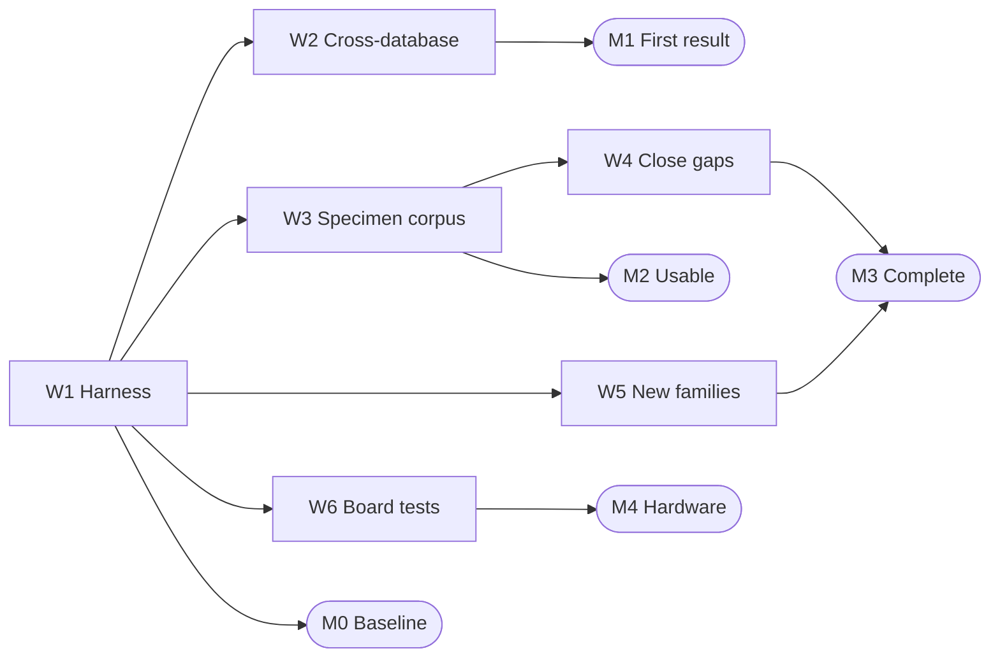

# bitstream-atlas: FPGA bitstream documentation

This item produces open, machine-readable documentation of how each off-the-shelf field-programmable gate array (FPGA) family encodes a design in its configuration [bitstream](../GUIDELINES.md#bitstream), with a public count of what is still unexplained. Open place-and-route tools, security researchers and owners of long-lived boards use it. As of 2026-10, open databases cover the 7-series and several Lattice and Gowin families; newer large families are undocumented, and nobody counts what is unexplained. AI agents fit because a machine checks every fact: the vendor's bitstream, a second database, a board.

*Status: draft 1, 2026-10-21. AI review panel: none yet. Human review: none. Questions for Tim: 4. This document was drafted and reviewed with AI agents; human review is recorded here.*

## Goal

**Deliverables.** Four public artefacts per documented field-programmable gate array (FPGA) family, each under an open licence.
- **Coverage atlas.** Per part and tile type: configuration bits, bits named by a documented feature, bits unexplained, and the tool versions behind each count; data under CC0, the Creative Commons public-domain dedication.
- **Bitstream databases.** Bit-to-feature tables, tile grids, routing graphs and timing data, contributed to the existing open-source databases in their own formats.
- **Specimen corpus.** Designs, the pinned vendor tool version and vendor-built bitstreams, where the terms allow.
- **Test suites.** Round-trip tests and board self-tests, under Apache-2.0.

**Acceptance test.** A part is documented when two counts are zero on a pinned corpus.
- Unexplained bits: every set configuration bit in every vendor-built bitstream is accounted for by a database feature.
- Round trip: decoding each vendor bitstream to [FPGA assembly](../GUIDELINES.md#fpga-assembly-fasm) (FASM, the text list of enabled features) and assembling it again gives 0 differing bits.

The corpus size per part is `Unknown (settled by: the M0 atlas and Tim's answer on scope)`. One part meets the bar already: the openXC7 Virtex-7 port reports 0 unknown and 0 differing bits on its reference designs ([openXC7 Project X-Ray](https://github.com/openXC7/prjxray), as of 2026-10).

**Framing.** This is the FPGA's [process design kit](../GUIDELINES.md#process-design-kit-pdk): the layer every open tool needs. It serves every function, because one database describes all the blocks of a chip. On the [manual-to-generator axis](../GUIDELINES.md#manual-to-generator-axis) it moves from hand-written fuzzers per tile type to a generated atlas, re-measured on every change.

**Out of scope.**
- Place and route that uses the databases: [open-pnr](open-pnr.md), the open place-and-route item.
- Scoring toolchains on documented parts: [fpga-scoreboard](fpga-scoreboard.md), the FPGA benchmarking item.
- Proving a whole tool flow correct: [flow-proofs](flow-proofs.md), the toolchain-verification item, which uses this item's round trip.
- An FPGA whose format is open from the start: [open-fabric](open-fabric.md), the open FPGA fabric item.
- Breaking bitstream encryption: no item; it is not a goal of the list.

## Why it is high value

**The pain today.** Almost every field-programmable gate array (FPGA) is programmable only through its vendor's proprietary tool. The bitstream format is sealed inside that tool. As of 2026-10 open databases cover the Xilinx 7-series, Lattice iCE40, ECP5, MachXO and Nexus, Gowin, Cyclone V and GateMate ([State of the art](#state-of-the-art)). For UltraScale+, Versal, Agilex, PolarFire and Efinix, an open toolchain stops at the netlist, so studies, long-lived products and audits depend on a tool nobody outside can read, change or run at scale.

**Why not already done.** Software developer time ran out; the method did not fail. It has worked since [Project IceStorm](https://github.com/YosysHQ/icestorm): make the vendor tool emit many small bitstreams, correlate the set bits with the enabled features, test on a board. The obstacles:
- the work grows with tile types and parts: [Project X-Ray](https://github.com/f4pga/prjxray) wrote 78 numbered fuzzers for one family (as of 2026-10);
- few maintainers: the upstream 7-series database last changed in 2021, [Project U-Ray](https://github.com/f4pga/prjuray) in 2022;
- the vendor tools are large installs under an end-user licence agreement (EULA), driven by hand-written scripts.

This matches Tim's claim that his dead ends stopped for lack of developer time, not because the idea failed (Tim's claim, 2026-10; checked: the record in [What Tim has already worked out](#what-tim-has-already-worked-out)).

**Who is waiting.** Every open FPGA tool, and every user of its missing parts. That includes three items on this list ([What success unlocks](#what-success-unlocks)), soft-error analysis ([Fibich and Lovric 2025](https://doi.org/10.1109/iolts65288.2025.11116854)) and bitstream editors such as [byteman](https://github.com/FPGA-Research-Manchester/byteman).

**Why now.** *Easy now with AI*: thousands of small units, each judged by a machine. AI agents can write and run fuzzers and compare databases without a person per tile type, and the oracles exist: the vendor bitstream, a second database such as [prjcombine](https://github.com/prjunnamed/prjcombine), and a board.

**Shots on goal.** One attempt is one specimen, built and correlated. Attempts per month and cost per attempt are `Unknown (settled by: timing one specimen per family at M0)`. A wrong attempt fails the round trip, so more attempts give more solved features.

## What success unlocks

**Needs first.**
- Nothing on the list. The method, the vendor tools and the boards exist; [open-fabric](open-fabric.md), the open field-programmable gate array (FPGA) fabric item, is an alternative route, not a prerequisite.

**Unlocks on this list.**
- [open-pnr](open-pnr.md), the open place-and-route item: a database per family lets nextpnr or Verilog to Routing target that family.
- [fpga-scoreboard](fpga-scoreboard.md), the benchmarking item: each newly documented part can be scored with open and vendor flows.
- [flow-proofs](flow-proofs.md), the verification item: the bit-to-feature map turns a bitstream back into a netlist to check.

**Cross-checks with.**
- [flow-proofs](flow-proofs.md): the netlist recovered from a bitstream against the source netlist; expected formally equivalent, as [McKendrick et al. 2023](https://doi.org/10.1109/icfpt59805.2023.00021) showed for one tool flow.
- [fpga-scoreboard](fpga-scoreboard.md): open and vendor builds of one design; expected the same self-test result.
- [open-fabric](open-fabric.md): a fabric with a published format; the correlation method must recover it exactly.

**Shared harness.** The round-trip and board self-tests live here and are reused by [flow-proofs](flow-proofs.md) and [fpga-scoreboard](fpga-scoreboard.md). Which item owns the boards is `Unknown (settled by: the open-pnr and fpga-scoreboard documents)`.

**Beyond the list.** Long-lived products that outlive vendor support, soft-error analysis, audits and teaching.

**Compounding.** The atlas re-runs on every database commit and vendor release. A changed encoding is caught the day it appears.

## Why it must be open

**The closed version.** Each vendor tool encodes every part it sells, sealed inside. [RapidWright](https://github.com/Xilinx/RapidWright), the vendor's research framework, reads its design checkpoints but ships part of its software library under a Xilinx end-user licence agreement (EULA) (as of 2026-10). Neither lets anyone outside reproduce, change or extend the encoding.

**The counterfactual.** Closed work dies with the agreement that allowed it. Without this work, open toolchains stay where volunteers left them.

**The strongest case against open.** A vendor release, or a database under a non-disclosure agreement (NDA), might be faster. It fails for this item:
- no vendor has published a complete bit-level format for its large families (`None found (searched: the 29 repositories in the source pack and the paper trackers, 2026-10-21)`);
- a database under NDA recreates the seal for every tool downstream;
- publishing helps attackers read designs out of unencrypted parts ([Klix et al. 2024](https://doi.org/10.1145/3658644.3690235)), but they reverse engineer already, so secrecy protects little.

**Why closed does not deliver.**
- **Composability (empirical).** The 7-series database is CC0, so others built on it without a deal. The openXC7 fork carried it on after upstream stopped in 2021, transplanted about 39,381 bit entries from Kintex-7 to Virtex-7, and reached an exact round trip ([openXC7 Project X-Ray](https://github.com/openXC7/prjxray), as of 2026-10).
- **Accumulation (empirical).** Open copies outlive their hosts. prjcombine left GitHub in 2026; the archived copy still carries its 40 target databases under 0BSD and Apache-2.0.
- **Reproducibility (empirical).** The openXC7 "0 unknown bits" claim can be checked because database, decoder and specimens are public.
- **AI itself (argued).** Agents act on formats they can read; a sealed format is usable only through the vendor's interface. Measured by: agents extending a database to a new tile type with no person, at [M2](#milestones), the first use outside the project.

**What open means here.**
- Licences: databases and atlas under CC0, as the existing databases are; code under the host project's licence; new code under Apache-2.0.
- Reproduce: specimens, tool version, scripts and database commit; replicate: the method written down per family.
- Public test suite: round trips, cross-database comparisons, board self-tests.
- Vendor data: nothing redistributed until a person confirms the terms allow it ([Needs beyond AI processes](#needs-beyond-ai-processes)).
- Clean room: `Not applicable (no process design kit or foundry data is involved)`.
- Look-alikes not to build on: RapidWright's EULA-licensed library; databases released without their specimens and scripts.

## State of the art

### Open-source tools and projects

Statuses are as of 2026-10, in the [status vocabulary](../GUIDELINES.md#55-status-of-tools-and-projects).

- **Project X-Ray**: inactive, as of 2026-10.
  - Licence: open-source, ISC (code); CC0 (database).
  - Can: 78 fuzzers that documented the Xilinx 7-series, including the digital signal processing (DSP) blocks, serial transceivers and PCI Express blocks.
  - Cannot: no database entries for the analog-to-digital monitor or the Zynq processor's configuration; pins Vivado 2017.2.
  - Speed: `Unknown (settled by: timing the fuzzers at M0)`; recomputes unchanged inputs: `Unknown (settled by: the same)`.
  - Quality: continuous integration on GitHub; 49 open pull requests; Developer Certificate of Origin required.
  - Build on or replace: build on, through the active fork.
- **openXC7 Project X-Ray**: active, as of 2026-10.
  - Licence: open-source, ISC (code); CC0 (database).
  - Can: 86 fuzzers; a database for 23 parts in five 7-series families; 0 unknown and 0 differing bits on Virtex-7 reference designs.
  - Cannot: its database repository takes no outside contributions, because the tools generate it.
  - Speed: `Unknown (settled by: timing one fuzzer at M0)`; recomputes unchanged inputs: `Unknown (settled by: the same)`.
  - Quality: active; board-tested demo designs.
  - Build on or replace: build on; 7-series work lands here.
- **Project U-Ray**: inactive, as of 2026-10.
  - Licence: open-source, Apache-2.0; CC0 (database).
  - Can: UltraScale+ fuzzers and correlation tools; one part (ZU3EG), whose interconnect tile has 3,778 solved lines for 3,774 listed connections.
  - Cannot: a second part ([pull request 19](https://github.com/f4pga/prjuray/pull/19)) and Kintex UltraScale (pull request 28) open since 2020.
  - Speed: `Unknown (settled by: M0)`; recomputes unchanged inputs: `Unknown (settled by: M0)`.
  - Quality: no commits since 2022.
  - Build on or replace: build on.
- **prjcombine**: moved, as of 2026-10.
  - Licence: open-source, 0BSD and Apache-2.0.
  - Can: geometry and bitstream complete for Xilinx XC2000 to Virtex-7, Spartan-6, iCE40 and three complex programmable logic device (CPLD) families (README as of 2026-03).
  - Cannot: verification "not started" for most families; UltraScale bitstream not started; regenerating it needs patched vendor tools.
  - Speed: `Unknown (settled by: M0)`; recomputes unchanged inputs: `Unknown (settled by: M0)`.
  - Quality: GitHub copy archived 2026-03-12; the new host was not reachable from the writer's sandbox.
  - Build on or replace: build on, as the independent second database.
- **Project IceStorm, Trellis, Oxide, Apicula and Peppercorn**: active, as of 2026-10.
  - Licence: open-source; ISC, MIT, ISC, MIT, ISC; Trellis database CC0.
  - Can: iCE40; ECP5 and MachXO (27 parts); Lattice Nexus; Gowin; GateMate.
  - Cannot: Oxide lists input-output, PCI Express and serial-link fuzzing as unfinished; Mistral, for Cyclone V, is inactive.
  - Speed: `Unknown (settled by: M0)`; recomputes unchanged inputs: `Unknown (settled by: M0)`.
  - Quality: each feeds a working [nextpnr](https://github.com/YosysHQ/nextpnr) back end.
  - Build on or replace: build on.
- **Bitfiltrator**: inactive, as of 2026-10.
  - Licence: open-source, MIT.
  - Can: locates lookup-table, flip-flop and block-memory bits on UltraScale(+) parts without hardware ([Kashani et al. 2022](https://doi.org/10.1109/fpl57034.2022.00039)).
  - Cannot: routing.
  - Speed: `Unknown (settled by: M0)`; recomputes unchanged inputs: no.
  - Quality: published with a paper.
  - Build on or replace: build on, as an UltraScale(+) second source.

### The bar to clear

**The limit.** Unexplained bits have a floor of zero and a ceiling fixed by silicon. A 7-series XC7A35T carries 5,408 frames of 101 32-bit words, 17,478,656 configuration bits ([Cross-checks](#cross-checks)).

**What agent-scale work needs.** Every unit judged without a person, every run repeatable. That means a round trip and an unexplained-bit count per bitstream in continuous integration, a vendor tool a person has licensed and a script can drive, and databases whose licence allows change (CC0 does).

**Dated context.** Vendor tools encode every part they sell, under end-user licence agreement s (EULAs) ([Needs beyond AI processes](#needs-beyond-ai-processes)). The vendor configuration guides (UG470 for the 7-series, TN1260 for ECP5) are public and proprietary, and describe packets and frames, not what each bit does.

### Research results

- [Note and Rannaud 2008](https://doi.org/10.1145/1344671.1344729) and [Soni, Steiner and French 2013](https://doi.org/10.1109/fccm.2013.45): early bitstream databases and generation from vendor-built fragments.
- [Shah et al. 2019](https://arxiv.org/abs/1903.10407), [Murray et al. 2020](https://doi.org/10.1109/mm.2020.2998435) and [de Vos et al. 2020](https://doi.org/10.1109/icfpt51103.2020.00033): complete open flows built on fuzzed databases.
- [Petersen et al. 2021](https://doi.org/10.1145/3431920.3439285) and [Kashani et al. 2022](https://doi.org/10.1109/fpl57034.2022.00039): routing and logic bits recovered from vendor tool data, without hardware.
- [Ender et al. 2024](https://doi.org/10.46586/tches.v2024.i2.426-450) and [Proulx et al. 2025](https://doi.org/10.1109/paine66113.2025.11320186): fuzzing the configuration engine, and machine learning for lookup-table bits.

### Past and parallel efforts

| Effort | Years | What it did | Why it stopped, or where it stands | Link |
| --- | --- | --- | --- | --- |
| Project X-Ray upstream | 2017 to 2025 | 7-series with hard blocks | Database frozen in 2021; work moved to openXC7 | [f4pga/prjxray-db](https://github.com/f4pga/prjxray-db) |
| Project U-Ray | 2019 to 2022 | One UltraScale+ part | Second part unmerged; why is Unknown (settled by: its maintainers) | [pull request 19](https://github.com/f4pga/prjuray/pull/19) |
| UltraScale+ interchange path | 2020 to 2024 | Device data via RapidWright | [FASM](../GUIDELINES.md#fpga-assembly-fasm) disabled; nextpnr dropped it | [nextpnr commit fcdaf3f8](https://github.com/YosysHQ/nextpnr/commit/fcdaf3f8) |

### What is missing

- A count of unexplained bits per part, for any family: `None found (searched: the 29 repositories and the FPGA tooling tracker, 2026-10-21)`.
- A public corpus of vendor-built bitstreams: one exists, for the Virtex-7 VC707 board ([openXC7 demo projects](https://github.com/openXC7/demo-projects/tree/virtex7-support)); none for other parts.
- UltraScale and UltraScale+: one part documented, and no tested open assembler.
- Versal, Agilex, Stratix 10, PolarFire, Efinix, Lattice Avant: no open database (`None found`, same search).
- A comparison between prjcombine and the per-family databases: `None found`, same search.

**Replace or build on.** Build on every database; replace nothing yet. The atlas and the cross-database comparison make changes safe, because a change that adds an unexplained bit or a disagreement is caught. The Python FASM assembler is the one candidate for replacement, if [M0](#milestones) profiling shows it is slow.

## What Tim has already worked out

**Documents.**
- Tim's [Project U-Ray plan](https://docs.google.com/document/d/1y_9tFoLzVC_PrZA2YIej__7LsgiXgrTN3oitTcsXEF8/edit) (read in full): fuzzers restructured on the Project Trellis model; specimens correlated with enabled features in directed runs. Frame sizes per family: 7-series 101, UltraScale 123, UltraScale+ 93 words (Tim's claim, undated; checked: the 7-series figure reproduces his sizes sheet within 0.33%).
- Tim's [transceiver plan](https://docs.google.com/document/d/1IqMAlTdAZtSV6gyj6CR-yXLAS6ycpAfeTGwLvaCwC_U/edit) (read in full): document the Artix-7 transceivers through an open DisplayPort design on a Nexys Video board, starting from a report of unknown bits (Tim's claim, undated; checked: transceiver bits entered the upstream database in 2021).
- Tim's [DSP fuzzer guide](https://docs.google.com/document/d/15MBYkL7FOoK4U5pxx7L1DLZZ_V70OdugjUZCgz5lx5I/edit) (read in full): toggling blocks in parallel locates N blocks in about log2(N) specimens (Tim's claim, undated; not checked).
- Tim's [FASM speed plan](https://docs.google.com/document/d/1F-balyceXOyuV9TdWooZexWUaP1Y2wyrS7CHV0GVrS0/edit) (read in full): about 20% of place-and-route time on large designs is the Python assembler; harness, profile, then rewrite (Tim's claim, undated; not checked: no measurement found).
- Tim's [Checking and Testing approach](https://docs.google.com/document/d/11wJUvr2aVBkUiuYYsFN07jkoYr_ccWlLLLFH8YQw8uQ/edit) (read in full): a ladder of checks, each failing step naming the faulty tool.
- Tim's [Importing FASM into Vivado](https://docs.google.com/document/d/1oAISSfNaOlb5c1PTrWhG5XfmMmG667cEQWhTLlm2NHA/edit) (read in full): load an open-flow [FASM](../GUIDELINES.md#fpga-assembly-fasm) file into the vendor tool as placed and routed cells, a vendor-side check.
- Tim's [Series 7 bitstream sizes](https://docs.google.com/spreadsheets/d/1Ym8VYGhPbtnjxdPOFiYoerwxTileuB0zkZohpDWMDRE/edit) (read in full): from 4,310,752 bits (XC7S6) to 447,337,216 bits (XC7V2000T).

**Experiments and results.** Tim tracked coverage per tile type, the model for this atlas. His [OrConf19 talk](https://docs.google.com/presentation/d/1EBpThE64ci4nNbQaO5n_Uc7QmDGpcb1Rm-iNAyd7fUw/edit) (read in full) gives the Artix-7 50T logic tile as 2,304 bits, 58 unused, 2,246 known, and says that by mid-2019 "Only DSP and GTP hard blocks remain" (Tim's claim, 2019; checked: the public tile grid gives the tile 36 frames of two 32-bit words, 2,304 bits).

**Dead ends.**
- **The FASM assembler rewrite.** Proposed, never done: the assembler is still Python in both repositories (as of 2026-10). Reason: resources (developer time); a [first task](#first-tasks).
- **Linux on Artix-7 by end of 2018.** His [Hackaday 2019 talk](https://docs.google.com/presentation/d/1YQZELnTiVDw7GGsNk-h_ojh-vMDLk23WXathY7sPudQ/edit) (read in full) moves the date to end of 2019. Reason: resources; the blocking hard blocks were documented by 2021.

**Framing inherited.** One open, pluggable flow from Verilog to bitstream for many families. Tim's talks call it the "GCC of FPGAs"; with it come the [two-ways framing](../GUIDELINES.md#two-ways-framing) and the [stepping-stones](../GUIDELINES.md#stepping-stones) view, each documented family a step for the next.

**From unpublished notes.** `Unknown (settled by: a question to Tim, 2026-10-21)`.

**Where the written record runs out.**
- What "documented" means: every bit, or enough for a working flow plus timing.
- Whether legacy families and complex programmable logic device s (CPLDs) are targets.
- Why the second U-Ray part was not merged.

## What frontier models change

**Why faster.** Thousands of independent units, each checked by a machine.
- Units: 78 upstream fuzzers for one family; 112 database files for Artix-7 alone; 40 target databases in prjcombine; 125 papers in the project's bitstream tracker.
- Oracle: the round trip and the unexplained-bit count; latency per bitstream `Unknown (settled by: timing one round trip at M0)`.
- Re-execution: the atlas re-runs on every commit and vendor release.

**Why better.** The work spans silos and is too tedious to finish. Vendor packets, six differently named databases, security research and timing are separate fields; U-Ray's second part and prjcombine's verification were left undone. People sample; an AI model compares every database with every other.

**What has to be true.**
- A vendor tool a person has licensed can be driven by script; whether its terms allow this at scale is for a person.
- Specimens can separate features that always change together; Tim's parallel toggling does so for block addresses.
- Public data suffices to start: it does, for [W1](#workstreams) and [W2](#workstreams).
- Resting on AI-model capability as of 2026-10: writing a fuzzer for a new tile type from the vendor's guide, and explaining a disagreement between databases.

**What people still do.** Accept end-user licence agreement s (EULAs), set legal posture, connect boards, author upstream changes. See [Unknowns, blockers and risks](#unknowns-blockers-and-risks) and the [plausible-but-wrong risk](../GUIDELINES.md#plausible-but-wrong-risk).

## Work plan and milestones

### Workstreams

**W1 Harness, benchmarks and tool speed.** Produces: the coverage atlas, a round-trip test harness, an assembler profile. Needed because: it measures every other workstream.
- Oracle: two counts per tile type agree; the round trip is exact on public bitstreams.
  - Stands in for: not a proxy: it checks databases against bitstreams directly.
  - Reference: frame and word counts in the tile grids; the vendor-built VC707 bitstreams.
  - Pass: counts agree; 0 differing bits.
  - Latency: Unknown (settled by: timing one round trip at M0).
  - Negative control: one flipped bit in a reference bitstream must be reported.
  - Blind spots: bits the corpus never sets.
- Access: public: databases, decoders, the openXC7 demo projects.
- Knowledge: public record.
- Units: one per part and tile type; 112 database files for Artix-7 alone.
- Binding constraint: none, because inputs are public and checks automated.
- Lands in: this project's repository, then [openXC7 Project X-Ray](https://github.com/openXC7/prjxray).
  - Contribution rules: [Project X-Ray contribution rules](https://github.com/f4pga/prjxray/blob/master/CONTRIBUTING.md).
  - Contribution gate: a Developer Certificate of Origin line, given by a person.
- Fit: A, because the binding constraint is none.
- Lead time: none.
- Depends on: nothing.
- Suite quality: share of deliberately flipped bits the harness reports, measured from M1.

**W2 Cross-database agreement.** Produces: prjcombine compared with Project X-Ray, IceStorm and Trellis, every difference explained. Needed because: no single database is trusted.
- Oracle: two independently built databases map a feature to the same bits.
  - Stands in for: not a proxy: two readings of one silicon.
  - Reference: the other database.
  - Pass: each shared feature agrees or has a written explanation.
  - Latency: Unknown (settled by: one tile type at M0).
  - Negative control: a database with one bit moved must disagree.
  - Blind spots: errors both share, for example from one vendor tool version.
- Access: public: prjcombine's archived copy.
- Knowledge: spread across silos: each project names tiles and features its own way.
- Units: 40 prjcombine databases against six per-family projects.
- Binding constraint: none, because both inputs are public.
- Lands in: this project's repository.
  - Contribution rules: this project's repository.
  - Contribution gate: Tim's review.
- Fit: A, because the binding constraint is none.
- Lead time: none.
- Depends on: W1.
- Suite quality: share of deliberately moved bits caught, measured from M1.

**W3 Vendor-built specimen corpus.** Produces: designs, tool versions, vendor bitstreams, and the unexplained-bit count on them. Needed because: only the vendor's output shows what is unexplained.
- Oracle: the vendor tool's bitstream for a known design.
  - Stands in for: not a proxy: it is the encoding itself.
  - Reference: the vendor tool, pinned to a version.
  - Pass: every corpus bitstream decoded, its count recorded.
  - Latency: Unknown (settled by: one specimen per family at M0).
  - Negative control: a specimen using a feature the database lacks must show unexplained bits.
  - Blind spots: configurations the vendor tool refuses to emit.
- Access: no-cost end-user licence agreement (EULA): the vendor's no-cost edition, installed and accepted by a person.
- Knowledge: public record.
- Units: Unknown (settled by: the M0 atlas, which lists parts and tile types).
- Binding constraint: access, because agents never accept an EULA.
- Lands in: this project's repository, if the terms allow.
  - Contribution rules: this project's repository.
  - Contribution gate: a person confirms the terms.
- Fit: B, because the binding constraint is access.
- Lead time: vendor tool licence.
- Depends on: W1.

**W4 Close gaps in documented families.** Produces: database entries for each gap W3 finds, timing data, a second UltraScale+ part. Needed because: the open families are incomplete.
- Oracle: unexplained bits fall to 0 on the corpus while the round trip stays exact.
  - Stands in for: not a proxy.
  - Reference: W3's vendor bitstreams; Bitfiltrator for UltraScale+.
  - Pass: 0 unexplained bits in the target tile types.
  - Latency: one vendor run per specimen.
  - Negative control: removing a solved feature must bring its bits back as unexplained.
  - Blind spots: features no specimen sets.
- Access: no-cost EULA; whether it covers each part is Unknown (settled by: the vendor's device list).
- Knowledge: public record: vendor primitive guides, existing fuzzers, U-Ray's open pull requests.
- Units: one per tile type with unexplained bits.
- Binding constraint: access, because specimens need the vendor tool.
- Lands in: [openXC7 Project X-Ray](https://github.com/openXC7/prjxray); [Project U-Ray](https://github.com/f4pga/prjuray).
  - Contribution rules: [Project X-Ray contribution rules](https://github.com/f4pga/prjxray/blob/master/CONTRIBUTING.md); [U-Ray contribution rules](https://github.com/f4pga/prjuray/blob/master/CONTRIBUTING.md).
  - Contribution gate: a Developer Certificate of Origin line from a person; maintainers' review.
- Fit: B, because the binding constraint is access.
- Lead time: vendor tool licence.
- Depends on: W3.

**W5 Families with no open database.** Produces: per family, the public vendor documents and the licence questions for its tools. Needed because: which family comes next is a decision.
- Oracle: a person's recorded decision on scope and legal posture.
  - Stands in for: not a proxy.
  - Reference: vendors' public documents and EULAs.
  - Pass: one decision per family.
  - Latency: Unknown (settled by: Tim's answer).
  - Negative control: an inventory claim without a public source must fail the claim audit.
  - Blind spots: terms that change after the decision.
- Access: public.
- Knowledge: unknown: the legal posture per vendor.
- Units: six families.
- Binding constraint: decision, because only a person sets legal posture.
- Lands in: this project's repository.
  - Contribution rules: this project's repository.
  - Contribution gate: Tim's review.
- Fit: C, because the binding constraint is decision.
- Lead time: none.
- Depends on: W1.

**W6 Board self-tests.** Produces: self-test designs per family, run on public boards after each database change. Needed because: only the board shows a configuration works.
- Oracle: the self-test passes on the board.
  - Stands in for: not a proxy: it is the silicon.
  - Reference: the vendor build of the same design passes the same test.
  - Pass: both builds pass.
  - Latency: Unknown (settled by: one board run at M4).
  - Negative control: a bitstream with a known-bad bit must fail.
  - Blind spots: features the self-test does not use.
- Access: on-site hardware or lab: one board per family and a host.
- Knowledge: public record.
- Units: one per family and board.
- Binding constraint: access, because boards must be bought and connected.
- Lands in: this project's repository.
  - Contribution rules: this project's repository.
  - Contribution gate: Tim's review.
- Fit: B, because the binding constraint is access.
- Lead time: board delivery.
- Depends on: W1.
- Suite quality: share of known-bad bitstreams the self-tests fail, measured from M4.

### Summary table

| # | Workstream | Oracle | Access | Units | Binding constraint | Fit |
| --- | --- | --- | --- | --- | --- | --- |
| W1 | Harness, benchmarks and tool speed | Exact round trip | public | Part and tile type | none | A |
| W2 | Cross-database agreement | Two databases agree | public | 40 databases, six projects | none | A |
| W3 | Vendor-built specimen corpus | Vendor bitstream | no-cost EULA | Unknown until M0 | access | B |
| W4 | Close gaps in documented families | Unexplained bits to 0 | no-cost EULA | Tile types with gaps | access | B |
| W5 | Families with no open database | A person's decision | public | Six families | decision | C |
| W6 | Board self-tests | Self-test on the board | on-site hardware or lab | Family and board | access | B |

### Milestones

**M0 Baseline and harness.**
- Done when: the atlas covers every part in the public 7-series, iCE40 and ECP5 databases, and the VC707 round trip is reproduced.
- Evidence: atlas data and harness in this project's repository, rebuilt by continuous integration.
- Proof: P2
- Needs: the public databases; the openXC7 demo projects.
- Completes: W1.
- Fit: A
- Gate: a second agent reproduces the atlas from a clean checkout.

**M1 First checkable result.**
- Done when: Project X-Ray and prjcombine are compared on every shared 7-series tile type, each difference explained.
- Evidence: the comparison report and scripts in this project's repository.
- Proof: P2
- Needs: M0; prjcombine's archived databases.
- Completes: W2.
- Fit: A
- Gate: continuous integration re-runs the comparison.

**M2 Usable.**
- Done when: a database change from W4 is merged upstream and used by the openXC7 place-and-route flow.
- Evidence: the merged commit and a design built with it.
- Proof: P4
- Needs: M1; a vendor tool licensed by a person; a person to author the contribution.
- Completes: W3; advances W4.
- Fit: B
- Gate: the upstream maintainers' merge.

**M3 Complete or at the bar.**
- Done when: every part in the agreed scope has 0 unexplained bits and an exact round trip on its corpus.
- Evidence: the atlas at 0 for those parts.
- Proof: P3
- Needs: M2; Tim's scope decision.
- Completes: W4, W5.
- Fit: C
- Gate: the atlas re-run with a second vendor tool version.

**M4 Proven in hardware or silicon.**
- Done when: one self-test design per documented family passes on its board from an open-flow bitstream.
- Evidence: board logs per commit.
- Proof: P5
- Needs: M3; one board per family.
- Completes: W6.
- Fit: B
- Gate: the pass repeats on two commits.
- Hardware: one public board per family, such as the Arty A7, Basys 3 and Nexys Video boards [ConFuzz](https://github.com/emsec/ConFuzz) already tests on.
- Test plan: build each design with the vendor and open flows; run one self-test on both; compare.
- What silicon returns and when: pass or fail per design in one board run; a failure points at a database entry, found with Tim's checking ladder.

**Dependencies.**

*Figure 1: Workstreams (boxes) and milestones (rounded boxes); an arrow means "needed before", from the Depends on and Completes lines. Longest chain to [M3](#milestones), the complete state: W1, W3, W4; lead time on it: the vendor tool licence.*

### Metric and baseline

- **Unexplained-bit share.**
  - Formula: set configuration bits no decoded feature accounts for, divided by all set configuration bits.
  - Unit: percent of set bits.
  - Over: every vendor-built bitstream in the corpus, per part.
  - Success: 0 bits for a part declared complete.
  - Guardrail: the round-trip difference stays 0 bits and the negative control fails.
  - Baseline: 0 unknown bits on the VC707 designs, as openXC7 reports (as of 2026-10); other parts `Unknown (settled by: M0)`.
  - Measured by: a script committed at [M0](#milestones).
  - Target: 0 for every part in scope.

### Lead times

- **Vendor tool licence.** `Unknown (settled by: a person installing the no-cost edition)`; affects [M2](#milestones).
- **Board delivery.** `Unknown (settled by: the board vendor's public listing)`; affects [M4](#milestones).
- **Upstream review.** `Unknown (settled by: the maintainers' response to a first contribution)`; affects [M2](#milestones).

### Cross-checks

**Sources and failure modes.**

| Source | Trusted for | Known failure mode | Independent check |
| --- | --- | --- | --- |
| Vendor-built bitstream | What the vendor encodes | Encoding changes between versions | Two tool versions |
| Per-family database | Bit-to-feature map | Features that always co-occur mixed up | prjcombine; boards |
| prjcombine | An independent map | Patched vendor tools; unverified | Per-family databases |
| Vendor configuration guide | Packets and frames | Undocumented behaviour | Vendor bitstreams |
| Tim's slides and plans | Method and history | 2019 snapshots | Current repositories |

**Verification ladder.**
- **XC7A35T bitstream size.**
  - Bound: 5,408 frames times 101 words times 32 bits gives 17,478,656 bits, from the part file in [openXC7/prjxray-db](https://github.com/openXC7/prjxray-db).
  - Limit: frame count and size are fixed by the silicon.
  - Second source: Tim's sizes sheet gives 17,536,096 bits; the 0.33% gap fits headers and padding.
  - Rebuild: count frame words in a real bitstream's packets.
  - Measurement: a vendor-built XC7A35T bitstream.
  - Rungs in place: bound, second source; built by: [M0](#milestones).
- **Artix-7 logic tile footprint.**
  - Bound: 36 frames times 2 words times 32 bits gives 2,304 bits.
  - Limit: the frame layout.
  - Second source: Tim's slide, 2,304 total and 2,246 known; the mask file, 2,254.
  - Rebuild: decode a specimen set and count touched bits.
  - Measurement: the [W3](#workstreams) corpus.
  - Rungs in place: bound, second source; built by: [M2](#milestones).

**Fast and accurate paths.**
- **Coverage of a part.**
  - Fast: mask bits over footprint; cost: seconds; used when: every commit.
  - Accurate: unexplained-bit share on the vendor corpus; cost: one decode per bitstream; used when: before calling a part complete.

**Effort rule.** Verification grows with the claim. A database entry gets the round trip and the cross-database check; a complete part also gets the board test.

## Needs beyond AI processes

| Kind | What exactly | Why | Who could provide it | Cost | Lead time | What can proceed without it |
| --- | --- | --- | --- | --- | --- | --- |
| Software licences | No-cost vendor tools | [W3](#workstreams), [W4](#workstreams) specimens | A person accepting the end-user licence agreement (EULA) | `Unknown (settled by: vendor pages)` | Vendor tool licence | [W1](#workstreams), [W2](#workstreams), [W5](#workstreams) |
| Compute | Parallel vendor-tool machines | Specimen runs | The project | `Unknown (settled by: M0)` | none | [W1](#workstreams), [W2](#workstreams) |
| Hardware | A board per family, a host | [W6](#workstreams) | The project | `Unknown (settled by: price lists)` | Board delivery | [W1](#workstreams) to [W5](#workstreams) |
| People | Upstream author | Upstream rules | Someone Tim names | Unknown (settled by: Tim) | Upstream review | Work stays here |
| People | Legal reviewer | EULA questions | The project | `Unknown (settled by: Tim)` | `Unknown (settled by: Tim)` | [W1](#workstreams), [W2](#workstreams) |
| Data | Vendor configuration guides | Frames, packets | Vendors, public | no cost | none | All |

**Licence questions.** Three questions per vendor's no-cost edition, stated, not answered.
- Does its EULA permit automated runs at scale?
- Does it permit publishing the bitstreams it produces as a test corpus?
- Does it permit analysing the bitstream format, and does the United States Digital Millennium Copyright Act (DMCA) interoperability exemption apply?

Existing projects drive vendor tools in public; what they do is not a legal conclusion for this item.

**Clean room.** `Not applicable (no process design kit or foundry data is involved)`.

## Unknowns, blockers and risks

### Expertise barriers

- **How each family addresses frames and tiles.**
  - Why it defeats people: spread across vendor guides, six projects' code and a few maintainers.
  - How an AI model gets through: reads them all and predicts each tile's footprint.
  - Validated by: footprint arithmetic against the tile grid.
### Hard blockers

- **Legal: vendor end-user licence agreements (EULAs) and the Digital Millennium Copyright Act (DMCA).**
  - AI cannot: accept an EULA or decide legal posture.
  - AI can: list the terms and what public projects do; prepare the questions.
  - Mitigation or question for a person: the licence questions, to a legal reviewer.
- **Physical: boards.**
  - AI cannot: connect a board.
  - AI can: write the self-tests and the farm scripts.
  - Mitigation or question for a person: buy one board per family.
- **Social: upstream maintainers.**
  - AI cannot: open an upstream pull request or give a Developer Certificate of Origin line.
  - AI can: prepare the change with its evidence.
  - Mitigation or question for a person: a named person owns contributions.

### Risks of the approach

- **The plausible-but-wrong risk: a feature solved where it always changed together with another.** The round trip stays exact on the corpus while the board is misconfigured. Check: specimens built to separate features, [W2](#workstreams) cross-database agreement, board tests.
- **A result that holds for one vendor tool version.** Check: re-run the atlas with a second version.
- **A coverage figure that counts unused bits as known.** Check: the unexplained-bit share on vendor bitstreams.

## Unanswered technical questions

1. **Do Project X-Ray and prjcombine agree on the 7-series?**
   - Settled by: the comparison of [W2](#workstreams), the cross-database workstream.
   - Blocks: none.
   - Taker: an agent with public resources.
2. **What is the XC7A35T's unexplained-bit share on a vendor corpus?**
   - Settled by: decoding the [W3](#workstreams) corpus.
   - Blocks: [W4](#workstreams).
   - Taker: an agent, once a person installs the vendor tool.
3. **Is the Python [FASM](../GUIDELINES.md#fpga-assembly-fasm) assembler 20% of place-and-route time?**
   - Settled by: profiling on the VC707 designs.
   - Blocks: none.
   - Taker: an agent with public resources.
4. **What does prjcombine's new host hold beyond the archived copy?**
   - Settled by: fetching it from a machine that reaches it.
   - Blocks: [W2](#workstreams).
   - Taker: an agent with that network access.
## Questions for Tim

1. **Q:** Does "documented" mean zero unexplained bits on a vendor corpus plus an exact round trip? **Context:** The earlier Goal said complete; no document defines it. **Assumed for now:** yes. **Changes if different:** Goal, Metric and baseline, [M3](#milestones).
2. **Q:** Are legacy Xilinx families and complex programmable logic device s (CPLDs) targets, or cross-checks only? **Context:** prjcombine marks them complete but unverified. **Assumed for now:** cross-checks only. **Changes if different:** [W2](#workstreams), [W5](#workstreams), [M3](#milestones).
3. **Q:** Are agents allowed to drive a no-cost vendor tool that a person installed, once the licence questions are read? **Context:** Every existing project drove vendor tools. **Assumed for now:** yes. **Changes if different:** [W3](#workstreams) and [W4](#workstreams) become fit C.
4. **Q:** Which comes first for new work: UltraScale+ or a family with no open database? **Context:** U-Ray is closest; the others have nothing. **Assumed for now:** UltraScale+. **Changes if different:** [W4](#workstreams), [W5](#workstreams), [M2](#milestones).

## Start here

### Agent digest

- Goal: atlas published for public databases; X-Ray and prjcombine compared; 0 unexplained bits in scope.
- First task: reproduce the VC707 round trip, then build the coverage atlas.
- Oracle: exact round trip; two counts per tile type.
- Lands in: this project's repository, then openXC7 Project X-Ray.
- Ask a person for: a licensed vendor tool; boards; upstream authorship.
- Upstream / downstream: none / [open-pnr](open-pnr.md), [fpga-scoreboard](fpga-scoreboard.md), [flow-proofs](flow-proofs.md), [open-fabric](open-fabric.md).
- Stop rule: 60 minutes of one agent run; report what ran, the counts, and where it stopped.

### Read first

1. [Project X-Ray](https://github.com/f4pga/prjxray) README (short): tools, fuzzers, quickstart.
2. [openXC7 Project X-Ray](https://github.com/openXC7/prjxray) README, Virtex-7 section (a few pages): the exact round trip.
3. Tim's [Project U-Ray plan](https://docs.google.com/document/d/1y_9tFoLzVC_PrZA2YIej__7LsgiXgrTN3oitTcsXEF8/edit) (about 15 pages): the method and the family differences.
4. Tim's [Checking and Testing approach](https://docs.google.com/document/d/11wJUvr2aVBkUiuYYsFN07jkoYr_ccWlLLLFH8YQw8uQ/edit) (two pages): the verification ladder.
5. [prjcombine](https://github.com/prjunnamed/prjcombine) README (short): the second database's coverage.
6. [Kashani et al. 2022](https://doi.org/10.1109/fpl57034.2022.00039) (8 pages): pitfalls in extracting formats.

### Reproduce first

- Source: [openXC7 demo projects](https://github.com/openXC7/demo-projects/tree/virtex7-support), the VC707 designs.
- Pin: demo projects at commit 826bbbd; [openXC7 Project X-Ray](https://github.com/openXC7/prjxray), branch virtex7-support.
- Environment: Linux, Python 3; no vendor tool.
- Flow: the VC707 README's chain, bitstream to [FASM](../GUIDELINES.md#fpga-assembly-fasm) to frames to bitstream.
- Expected value: 0 unknown bits and 0 differing bits per design, as the README reports.
- Runtime: Unknown (settled by: this run).
- Time box: 60 minutes of one agent run.
- Known-good case: the counter design; known-bad case: the same bitstream with one bit flipped, which must be reported.
- Failure report: design, step, command output, differing bit addresses.

### First tasks

1. **Reproduce the VC707 round trip.**
   - Produce: a script and log showing 0 unknown and 0 differing bits per design.
   - Oracle: comparison with the vendor-built bitstream.
   - Inputs: openXC7 demo projects and Project X-Ray, virtex7-support branches.
   - Workstream: [W1](#workstreams).
   - Fit: A.
   - Lands in: this project's repository.
2. **Build the coverage atlas.**
   - Produce: per part and tile type, footprint, mask and feature bits.
   - Oracle: tile-grid footprint against mask files.
   - Inputs: [openXC7/prjxray-db](https://github.com/openXC7/prjxray-db), [prjtrellis-db](https://github.com/YosysHQ/prjtrellis-db), [Project IceStorm](https://github.com/YosysHQ/icestorm).
   - Workstream: [W1](#workstreams).
   - Fit: A.
   - Lands in: this project's repository.
3. **Profile the FASM assembler.**
   - Produce: time split between the Python assembler and the C++ frame writer on the VC707 designs.
   - Oracle: the output bitstream stays identical.
   - Inputs: the VC707 FASM files.
   - Workstream: [W1](#workstreams).
   - Fit: A.
   - Lands in: this project's repository.
4. **Compare one tile type across databases.**
   - Produce: the 7-series logic tile in Project X-Ray against prjcombine, differences listed.
   - Oracle: agreement, or a written explanation per difference.
   - Inputs: both databases.
   - Workstream: [W2](#workstreams).
   - Fit: A.
   - Lands in: this project's repository.

### Ask a person for

- **A licensed no-cost vendor tool:** from the project owner, for [M2](#milestones).
- **Upstream authorship and the Developer Certificate of Origin line:** from a person Tim names, for [M2](#milestones).
- **Boards:** from the project owner, for [M4](#milestones).

### Known dead ends

- **The interchange path for UltraScale+.** Its tests disabled UltraScale+ FASM, and nextpnr dropped the back end ([nextpnr commit fcdaf3f8](https://github.com/YosysHQ/nextpnr/commit/fcdaf3f8)).
- **Vivado 2017.2 for Virtex-7.** Too old for the part, per the [openXC7 Project X-Ray](https://github.com/openXC7/prjxray) README.
- **Contributing to the upstream 7-series database.** It is generated and takes no contributions: [f4pga/prjxray-db](https://github.com/f4pga/prjxray-db).

### Key papers

- Kevin E. Murray, Mohamed A. Elgammal, Vaughn Betz, Tim Ansell, Keith Rothman, Alessandro Comodi, "SymbiFlow and VPR: An Open-Source Design Flow for Commercial and Novel FPGAs" (2020). [10.1109/mm.2020.2998435](https://doi.org/10.1109/mm.2020.2998435). The open flow these databases feed.
- David Shah, Eddie Hung, Clifford Wolf et al., "Yosys+nextpnr: An Open Source Framework from Verilog to Bitstream for Commercial FPGAs" (2019). [arXiv 1903.10407](https://arxiv.org/abs/1903.10407). Hardware-proven flows on iCE40 and ECP5.
- Pepijn de Vos, Michael Kirchhoff, Daniel Ziener, "A Complete Open Source Design Flow for Gowin FPGAs" (2020). [10.1109/icfpt51103.2020.00033](https://doi.org/10.1109/icfpt51103.2020.00033). Fuzzing a new family.
- Sahand Kashani, Mahyar Emami, James R. Larus, "Bitfiltrator: A general approach for reverse-engineering Xilinx bitstream formats" (2022). [10.1109/fpl57034.2022.00039](https://doi.org/10.1109/fpl57034.2022.00039). UltraScale(+) without hardware.
- Maik Ender, Felix Hahn, Marc Fyrbiak et al., "JustSTART: How to Find an RSA Authentication Bypass on Xilinx UltraScale(+) with Fuzzing" (2024). [10.46586/tches.v2024.i2.426-450](https://doi.org/10.46586/tches.v2024.i2.426-450). Undocumented configuration-engine behaviour.

### Projects and code

- [Project X-Ray](https://github.com/f4pga/prjxray): inactive, as of 2026-10.
  - Licence: open-source, ISC.
  - Contains: 7-series tools and 78 fuzzers; database in [f4pga/prjxray-db](https://github.com/f4pga/prjxray-db) (CC0, unchanged since 2021).
- [openXC7 Project X-Ray](https://github.com/openXC7/prjxray): active, as of 2026-10.
  - Licence: open-source, ISC.
  - Contains: 86 fuzzers; the Virtex-7 port; database in [openXC7/prjxray-db](https://github.com/openXC7/prjxray-db) (CC0, 23 parts).
- [openXC7 demo projects](https://github.com/openXC7/demo-projects/tree/virtex7-support): active, as of 2026-10.
  - Licence: open-source, BSD-3-Clause.
  - Contains: vendor-built VC707 bitstreams with sources.
- [Project U-Ray](https://github.com/f4pga/prjuray): inactive, as of 2026-10.
  - Licence: open-source, Apache-2.0.
  - Contains: UltraScale+ fuzzers and correlation tools; database in [prjuray-db](https://github.com/f4pga/prjuray-db) (CC0, one part).
- [prjcombine](https://github.com/prjunnamed/prjcombine): moved, as of 2026-10.
  - Licence: open-source, 0BSD and Apache-2.0.
  - Contains: 40 target databases; the README names the new host.
- [Project IceStorm](https://github.com/YosysHQ/icestorm): active, as of 2026-10.
  - Licence: open-source, ISC.
  - Contains: iCE40 database and tools.
- [Project Trellis](https://github.com/YosysHQ/prjtrellis): active, as of 2026-10.
  - Licence: open-source, MIT.
  - Contains: ECP5 and MachXO tools; database in [prjtrellis-db](https://github.com/YosysHQ/prjtrellis-db) (CC0, 27 parts).
- [Project Oxide](https://github.com/gatecat/prjoxide): active, as of 2026-10.
  - Licence: open-source, ISC.
  - Contains: Lattice Nexus tools.
- [Project Apicula](https://github.com/YosysHQ/apicula): active, as of 2026-10.
  - Licence: open-source, MIT.
  - Contains: Gowin tools.
- [Project Peppercorn](https://github.com/YosysHQ/prjpeppercorn): active, as of 2026-10.
  - Licence: open-source, ISC.
  - Contains: GateMate documentation and tools.
- [Bitfiltrator](https://github.com/epfl-vlsc/bitfiltrator): inactive, as of 2026-10.
  - Licence: open-source, MIT.
  - Contains: UltraScale(+) logic and memory bit positions.
- [ConFuzz](https://github.com/emsec/ConFuzz): active, as of 2026-10.
  - Licence: open-source, MIT.
  - Contains: configuration-engine fuzzer.
- [RapidWright](https://github.com/Xilinx/RapidWright): active, as of 2026-10.
  - Licence: source-available in part: Apache 2.0 code, with a software library partly under a Xilinx end-user licence agreement (EULA).
  - Contains: vendor checkpoint reader and writer.

## Where it sits

Layer: **PDK**. Function: **cross-cutting**. Target: **FPGA**. The FPGA's equivalent of a PDK: the device database every open FPGA tool builds on. Moves FPGA documentation from manual reverse engineering to automated fuzzing and checking.

## Resources

Loose collection of links for fleshing this item out: [resources/bitstream-atlas.md](../resources/bitstream-atlas.md).

## Related items

- [open-pnr](open-pnr.md) (FPGA Interchange and open place and route): Open place and route needs these databases to target each family.
- [fpga-scoreboard](fpga-scoreboard.md) (FPGA benchmarking): Scores open toolchains on the documented devices.
- [flow-proofs](flow-proofs.md) (Toolchain verification): Bitstream round trips check the databases are right.
- [open-fabric](open-fabric.md) (Fully open FPGA and eFPGA): An open fabric needs no reverse engineering at all.
