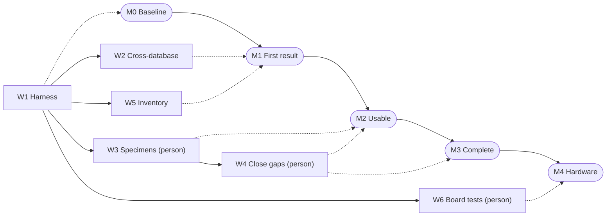

# bitstream-atlas: FPGA bitstream documentation

This item produces open, machine-readable documentation of how each off-the-shelf field-programmable gate array (FPGA) family encodes a design in its configuration [bitstream](../GUIDELINES.md#bitstream), with a public per-part count of what is still unexplained. Open place-and-route tools, security researchers and owners of long-lived boards use it. As of 2026-10, open databases cover the 7-series and several Lattice and Gowin families, the newer large families have none, and no project publishes the unexplained count per part across families. The first task needs no person: reproduce a public Virtex-7 round trip (decode a vendor bitstream to features, encode it back, compare bits). Vendor-tool runs and boards wait on a person.

*Status: draft 2, 2026-10-21. AI review panel: core panel of twelve reviews on draft 1; readability and claim audit on draft 2. Human review: none. Questions for Tim: 5. This document was drafted and reviewed with AI agents; human review is recorded here.*

## Goal

**Deliverables.** Three open artefacts per field-programmable gate array (FPGA) family, plus a corpus where allowed.
- **Coverage atlas.** One row per part and tile type, with the five columns below, the provenance of every entry and the tool versions; CC0, the Creative Commons public-domain dedication.
- **Fuzzers and database changes.** Fuzzers (scripts that make the vendor tool emit many small bitstreams and correlate set bits with enabled features), contributed to each project in its own tool.
- **Test suites.** Round-trip tests, negative controls and board self-tests.
- **Specimen corpus.** Specimens (vendor-built bitstreams of known designs) with design, tool version and options, published only where a person has confirmed the vendor's terms allow it.

**Acceptance test.** A part is documented when two counts are zero on a corpus meeting the floor.
- Floor: every tile type with a footprint appears in a specimen, and every database feature is set in one, or is listed as excluded.
- Unexplained bits 0: every set bit is named by an entry whose recorded origin is a fuzzer and a specimen pair in which the bit toggles.
- Differing bits 0: decoding to [FPGA assembly](../GUIDELINES.md#fpga-assembly-fasm) (FASM, the text list of enabled features) and assembling again gives the same bits, with no feature added by the assembler.
- Counted: frame data as Project X-Ray's `bitread` emits it, without per-frame error-correcting bits, headers and checksums; never raw bytes.

A frame is the smallest addressable unit of configuration memory; a tile is a repeated block of frame bits. Atlas columns per tile type: footprint (the bits a tile type occupies), mask (bits the database knows are used), feature-named, set in the corpus, unexplained. Entries named "default", "glue" or transplanted from another family get their own column and do not count. Example, the Artix-7 CLBLL_L logic tile: footprint 2,304, mask 2,254, feature-named 648 (as of 2026-10).

No part meets this test yet (as of 2026-10-21). The nearest is the Virtex-7 part on the VC707 board, the only part with a public corpus found (searched: the 29 repositories, 2026-10-21; [Reproduce first](#reproduce-first)).

**Framing.** This is the per-family device map open FPGA tools need. It plays the role a foundry's [process design kit](../GUIDELINES.md#process-design-kit-pdk) plays for chip tools, and moves along the [manual-to-generator axis](../GUIDELINES.md#manual-to-generator-axis) from hand-written fuzzers to a generated atlas.

**Out of scope.**
- Place and route, and timing data: [open-pnr](open-pnr.md), the open place-and-route item.
- Scoring toolchains: [fpga-scoreboard](fpga-scoreboard.md), the FPGA benchmarking item.
- Proving a flow correct: [flow-proofs](flow-proofs.md), the toolchain-verification item.
- An FPGA open from the start: [open-fabric](open-fabric.md), the open FPGA fabric item.
- Breaking encryption, and families whose tool emits only encrypted images.

## Why it is high value

**The pain today.** Almost every field-programmable gate array (FPGA) is programmable only through its vendor's proprietary tool. Open databases cover the 7-series, iCE40, ECP5, MachXO, Nexus, Gowin, Cyclone V and GateMate ([State of the art](#state-of-the-art)). UltraScale+ has one part; a tested open assembler for it, or any open bitstream path for Versal, Agilex, PolarFire and Efinix: `None found (searched: the 29 repositories in the source pack, 2026-10-21)`.

**Why not already done.** The method is known; the work is large, sequential and slow. Since [Project IceStorm](https://github.com/YosysHQ/icestorm) it has three steps: dump the vendor tool's device model (tile, wire and routing names) through its scripting interface; build specimens that toggle one feature each; correlate. The obstacles:
- volume: [Project X-Ray](https://github.com/f4pga/prjxray) has 78 fuzzers for the 7-series, chained, not independent;
- cost: 25 minutes to 1.5 hours of vendor-tool time per Virtex-7 specimen ([openXC7 README](https://github.com/openXC7/prjxray), as of 2026-10);
- few maintainers: the upstream 7-series database last changed in 2021, [Project U-Ray](https://github.com/f4pga/prjuray) in 2022.

Why Tim's own attempts stopped is `Unknown (settled by: a question to Tim, 2026-10-21)`.

**Who is waiting.** Every open FPGA tool, and every user of its missing parts. That includes three items ([What success unlocks](#what-success-unlocks)), soft-error analysis ([Fibich and Lovric 2025](https://doi.org/10.1109/iolts65288.2025.11116854)) and bitstream editors such as [byteman](https://github.com/FPGA-Research-Manchester/byteman).

**Why now.** *Easy now with AI*: many small units, each judged by a machine. Agents can write fuzzer steps and compare databases in full, against three oracles: the vendor bitstream, a second database such as [prjcombine](https://github.com/prjunnamed/prjcombine), and a board.

**Shots on goal.** One attempt is one specimen, built and correlated. Each costs one vendor run; attempts per month are `Unknown (settled by: specimens per fuzzer step, logged at M0)`. A wrong bit fails the round trip, but a wrong meaning is caught only by the cross-database check or a board.

## What success unlocks

**Needs first.**
- `Not applicable (no item on the list is a prerequisite)`. [open-fabric](open-fabric.md), the open field-programmable gate array (FPGA) fabric item, is an alternative route, not a prerequisite.

**Unlocks on this list.** Each documented family becomes a target for open place and route and a scored part.
- [open-pnr](open-pnr.md), the open place-and-route item: a nextpnr back end per family.
- [fpga-scoreboard](fpga-scoreboard.md), the benchmarking item: each new part scored with open and vendor flows.
- [flow-proofs](flow-proofs.md), the verification item: bitstreams turned back into netlists to check.

**Cross-checks with.**
- [flow-proofs](flow-proofs.md): netlists recovered from bitstreams against the source; expected to match, as [McKendrick et al. 2023](https://doi.org/10.1109/icfpt59805.2023.00021) showed for one flow.
- [fpga-scoreboard](fpga-scoreboard.md): open and vendor builds of one design; expected the same self-test result.
- [open-fabric](open-fabric.md): a fabric with a published format; the correlation method must recover it exactly.

**Shared harness.** The round-trip and board self-tests live here and are reused by [flow-proofs](flow-proofs.md) and [fpga-scoreboard](fpga-scoreboard.md). Which item owns the boards is `Unknown (settled by: the open-pnr and fpga-scoreboard documents)`.

**Beyond the list.** Long-lived products that outlive vendor support, soft-error analysis, audits and teaching.

**Compounding.** The atlas re-runs on every database commit. A new vendor release's encoding change is caught once a specimen built with it is decoded ([W3, the specimen corpus](#workstreams)).

## Why it must be open

**The closed version.** Each vendor tool encodes every part it sells, sealed inside. Even the vendor's research framework, [RapidWright](https://github.com/Xilinx/RapidWright), needs a proprietary library.

**The counterfactual.** Closed work dies with its agreement. Without this work, open toolchains stay where volunteers left them.

**The strongest case against open.** A vendor release or a database under a non-disclosure agreement (NDA) would not help.
- A published bit-level format from a vendor for its large families: `None found (searched: the 29 repositories in the source pack and the FPGA tooling tracker, 2026-10-21; vendor sites unreachable from the writer's sandbox)`.
- A database under NDA recreates the seal for every tool downstream.
- Publishing helps attackers read designs out of unencrypted parts (argued) ([Klix et al. 2024](https://doi.org/10.1145/3658644.3690235)), and attackers already reverse engineer those parts without it.

**Why closed does not deliver.**
- **Composability (empirical).** The 7-series database is CC0, so the openXC7 fork continued it after 2021 and reached a Virtex-7 board demo with about 51,000 entries transplanted from Kintex-7 ([openXC7 Project X-Ray](https://github.com/openXC7/prjxray), as of 2026-10).
- **Accumulation (argued).** prjcombine's archived copy still carries its 40 databases after the project moved.
- **Reproducibility (empirical).** The openXC7 round-trip claim could be re-run because everything is public, and it partly reproduces ([Reproduce first](#reproduce-first)).
- **AI itself (argued).** Agents act on formats they can read. Measured by: a [W4, close gaps](#workstreams) unit run with no person between specimen and proposed entry.

**What open means here.**
- Licences: atlas CC0; databases under each host's data licence; code under the host's licence ([ISC](https://spdx.org/licenses/ISC.html) for X-Ray, IceStorm and Trellis) with a Software Package Data Exchange (SPDX) line per file; Apache-2.0 here.
- Vendor data: nothing redistributed until a person confirms the terms; the harness reads vendor-built files at their pinned commit and copies none.
- Look-alikes not to build on: RapidWright's proprietary library; databases released without their specimens and scripts, including prjcombine's, whose generation needs patched vendor tools.

## State of the art

### Open-source tools and projects

Statuses as of 2026-10, in the [status vocabulary](../GUIDELINES.md#55-status-of-tools-and-projects). Speed and recomputation are `Unknown (settled by: timing at M0)` for every entry.

- **f4pga Project X-Ray**: inactive, as of 2026-10.
  - Licence: open-source, [ISC](https://spdx.org/licenses/ISC.html); database CC0.
  - Can: 78 fuzzers; the 7-series, hard blocks included.
  - Cannot: no database for the analog monitor tile (as of 2026-10).
  - Speed: see above.
  - Quality: no database change since 2021.
  - Build on or replace: build on, through openXC7.
- **openXC7 Project X-Ray**: active, as of 2026-10.
  - Licence: open-source, [ISC](https://spdx.org/licenses/ISC.html); database CC0.
  - Can: 86 fuzzers on master, 83 on virtex7-support; databases for 23 device names, round-trip tested on one.
  - Cannot: `None found (searched: its README, 2026-10-21)`. Its database's contribution rules refuse outside work, yet 40 hand-entry pull requests merged there since 2024.
  - Speed: see above.
  - Quality: board-tested demos; a `checkdb` job.
  - Build on or replace: build on; 7-series work lands here.
- **Project U-Ray**: inactive, as of 2026-10.
  - Licence: open-source, Apache-2.0; database CC0.
  - Can: UltraScale+ fuzzers; one part (ZU3EG).
  - Cannot: a second part ([pull request 19](https://github.com/f4pga/prjuray/pull/19)), open since 2020; a live fork: `None found (searched: openXC7 and f4pga by name, 2026-10-21)`.
  - Speed: see above.
  - Quality: no commits since 2022.
  - Build on or replace: build on, as a fork here.
- **prjcombine**: archived, as of 2026-10.
  - Licence: open-source, 0BSD or Apache-2.0.
  - Can: Xilinx XC2000 to Virtex-7, iCE40, complex programmable logic devices (CPLDs) and ten Lattice families, as text ([README before archiving](https://github.com/prjunnamed/prjcombine/blob/cc1791b/README.md)).
  - Cannot: verification "not started" for most; regenerating needs patched vendor tools.
  - Speed: see above.
  - Quality: archived 2026-03-12; its new host was unreachable from the writer's sandbox.
  - Build on or replace: build on, as a second reading, never the deciding one.
- **Project IceStorm, Trellis, Oxide, Apicula and Peppercorn**: active, as of 2026-10.
  - Licence: open-source; [ISC](https://spdx.org/licenses/ISC.html) except Apicula ([MIT](https://spdx.org/licenses/MIT.html)).
  - Can: iCE40; ECP5 and four MachXO families (27 devices); Nexus; Gowin; GateMate.
  - Cannot: Oxide lists input-output and serial-link fuzzing as unfinished.
  - Speed: see above.
  - Quality: each feeds a [nextpnr](https://github.com/YosysHQ/nextpnr) back end.
  - Build on or replace: build on.
- **Bitfiltrator**: inactive, as of 2026-10.
  - Licence: open-source, [MIT](https://spdx.org/licenses/MIT.html).
  - Can: logic and memory bits on UltraScale and UltraScale+ without hardware.
  - Cannot: routing.
  - Speed: several hours for its no-cost part list, per its README.
  - Quality: published with [Kashani et al. 2022](https://doi.org/10.1109/fpl57034.2022.00039).
  - Build on or replace: build on, as an UltraScale+ second source.

### The bar to clear

**The limit.** Unexplained bits have a floor of zero and a ceiling fixed by silicon. An XC7A35T carries 5,408 frames of 101 32-bit words, 17,478,656 configuration bits ([Cross-checks](#cross-checks)).

**What agent-scale work needs.** Every unit judged without a person. That means both counts per specimen in continuous integration, and a licensed vendor tool a script can drive.

**Dated context.** Vendor guides do not map features to bits (argued). UG470 and TN1260 are cited from the field-programmable gate array (FPGA) tooling tracker, not fetched.

### Research results

- [Shah et al. 2019](https://arxiv.org/abs/1903.10407), [Murray et al. 2020](https://doi.org/10.1109/mm.2020.2998435), [de Vos et al. 2020](https://doi.org/10.1109/icfpt51103.2020.00033): open flows on fuzzed databases.
- [Petersen et al. 2021](https://doi.org/10.1145/3431920.3439285): 7-series routing architecture from vendor tool data; [Kashani et al. 2022](https://doi.org/10.1109/fpl57034.2022.00039): logic and memory bits without hardware.
- [Ender et al. 2024](https://doi.org/10.46586/tches.v2024.i2.426-450) and [Proulx et al. 2025](https://doi.org/10.1109/paine66113.2025.11320186): configuration-engine fuzzing; machine learning for lookup-table bits.

### Past and parallel efforts

| Effort | Years | What it did | Why it stopped, or where it stands | Link |
| --- | --- | --- | --- | --- |
| Project U-Ray | 2019 to 2022 | One UltraScale+ part | Second part unmerged; why is `Unknown (settled by: a question to Tim, 2026-10-21)` | [pull request 19](https://github.com/f4pga/prjuray/pull/19) |

### What is missing

Each of these is `None found (searched: the 29 repositories in the source pack, the prjcombine README and the FPGA tooling tracker, 2026-10-21)`:
- a per-part, per-tile-type count of unexplained bits across families, re-run on every commit;
- a public specimen corpus for any part but the VC707 ([openXC7 demo projects](https://github.com/openXC7/demo-projects/tree/virtex7-support));
- a second documented UltraScale+ part, or a tested open UltraScale+ assembler;
- an open bitstream database for Versal, Agilex, Stratix 10, PolarFire, Efinix or Lattice Avant;
- a comparison between prjcombine and the per-family databases.

**Replace or build on.** Build on every database; replace nothing yet. If [M0](#milestones) profiling shows the Python assembler is slow, replace only its assembly step and keep openXC7's glue rules as data.

## What Tim has already worked out

Tim is the list's owner and the named publisher of the f4pga X-Ray and U-Ray databases; he presented the talks below.

**Documents.**
- [Project U-Ray plan](https://docs.google.com/document/d/1y_9tFoLzVC_PrZA2YIej__7LsgiXgrTN3oitTcsXEF8/edit) (read in full): fuzzers on the Project Trellis pattern; directed specimen runs; frame sizes per family (Tim's claim, 2026-10; checked for the 7-series in [Cross-checks](#cross-checks)).
- [DSP fuzzer guide](https://docs.google.com/document/d/15MBYkL7FOoK4U5pxx7L1DLZZ_V70OdugjUZCgz5lx5I/edit) (read in full): parallel toggling locates N blocks in about log2(N) specimens (Tim's claim, 2026-10; not checked).
- [FASM speed plan](https://docs.google.com/document/d/1F-balyceXOyuV9TdWooZexWUaP1Y2wyrS7CHV0GVrS0/edit) (read in full): the FASM-to-frames step is about 20% of place-and-route time on larger designs, unmeasured; profile, prototype, then test (Tim's claim, 2026-10; not checked).
- [Checking and Testing approach](https://docs.google.com/document/d/11wJUvr2aVBkUiuYYsFN07jkoYr_ccWlLLLFH8YQw8uQ/edit) (read in full): a ladder of checks, each failure naming the faulty tool.
- [Importing FASM into Vivado](https://docs.google.com/document/d/1oAISSfNaOlb5c1PTrWhG5XfmMmG667cEQWhTLlm2NHA/edit) (read in full): load open-flow field-programmable gate array (FPGA) assembly into the vendor tool as placed cells; a proposed tool with no recorded status (Tim's claim, 2026-10; not checked); used in [W4](#workstreams).
- [Series 7 bitstream sizes](https://docs.google.com/spreadsheets/d/1Ym8VYGhPbtnjxdPOFiYoerwxTileuB0zkZohpDWMDRE/edit) (read in full): 4,310,752 to 447,337,216 bits per part.

**Experiments and results.** Tim tracked coverage per tile type, the model for this atlas. His [OrConf19 talk](https://docs.google.com/presentation/d/1EBpThE64ci4nNbQaO5n_Uc7QmDGpcb1Rm-iNAyd7fUw/edit) gives the Artix-7 logic tile as 2,304 bits, 2,246 known (Tim's claim, 2019; checked: footprint 2,304; today's mask has 2,254, an 8-bit gap left open).

**Dead ends.**
- **The FPGA assembly (FASM) assembler rewrite.** Proposed; the assembler is still Python (as of 2026-10). Reason: `Unknown (settled by: a question to Tim, 2026-10-21)`.
- **Linux on Artix-7 by end of 2018.** His [Hackaday 2019 talk](https://docs.google.com/presentation/d/1YQZELnTiVDw7GGsNk-h_ojh-vMDLk23WXathY7sPudQ/edit) moves it a year (Tim's claim, 2019; checked: deck read). Reason: `Unknown (settled by: a question to Tim, 2026-10-21)`.

**Framing inherited.** One open, pluggable flow from Verilog to bitstream. Two 2019 talks title it "Finally the GCC of FPGAs"; this list adds the [two-ways framing](../GUIDELINES.md#two-ways-framing) and the [stepping-stones](../GUIDELINES.md#stepping-stones) view.

**From unpublished notes.** `Unknown (settled by: a question to Tim, 2026-10-21)`.

**Where the written record runs out.**
- What "documented" means.
- Who regenerates the upstream databases, and why U-Ray's second part was not merged.

## What frontier models change

**Why faster.** The work fans out within each fuzzer step.
- Units: specimens and tile types within a step run in parallel; the steps form a chain (005, then 056, 057, 071 and 034 in the fuzzer Makefile).
- Oracle latency: under a minute to decode and rebuild a VC707 specimen; one vendor run to make one.

**Why better.** An AI model compares every database with every other, exhaustively (argued). People sample: prjcombine's verification is "not started" ([README before archiving](https://github.com/prjunnamed/prjcombine/blob/cc1791b/README.md)). Measured by: the differences exhaustive comparison finds and sampling misses, on one tile type at [M1](#milestones).

**What has to be true.**
- A licensed vendor tool can be driven by script, if its terms allow.
- Co-occurring features can be separated by specimens that set one through another primitive; otherwise the pair stays one "joint" feature.
- An agent can regenerate a solved tile type: tested at [M2](#milestones) by deleting CLBLL_L's entries locally, rerunning the fuzzer and comparing.

**What people still do.** Accept end-user licence agreements (EULAs), set legal posture, connect boards, author upstream changes. See [Unknowns, blockers and risks](#unknowns-blockers-and-risks) and the [plausible-but-wrong risk](../GUIDELINES.md#plausible-but-wrong-risk).

## Work plan and milestones

### Workstreams

As a [process design kit](../GUIDELINES.md#process-design-kit-pdk) (PDK) layer item, its consistency audit is W1's footprint check plus W2; its generated docs are the atlas. Every oracle checks bits directly unless its Stands in for line says otherwise.

**W1 Harness, benchmarks and tool speed.** Produces: the atlas, a round-trip harness, two negative controls, an assembler profile. Needed because: it measures everything else.
- Oracle: footprint agreement, and both acceptance counts on the public corpus.
  - Stands in for: closure only; whether a name is right rests on W2 and W6.
  - Reference: tile grids; the VC707 specimens.
  - Pass: every named bit inside its tile's footprint; no bit named by two tile types in one column; per-design counts reproduced.
  - Latency: seconds per specimen.
  - Negative control: a flip at a named bit changes exactly one feature; a bit set at an unnamed position counts 1; a compressed bitstream is refused.
  - Blind spots: unset bits; wrong names.
- Access: public: databases, decoders, the openXC7 demo projects.
- Knowledge: public record.
- Units: one per part and tile type (Artix-7 alone has 55 mask files).
- Binding constraint: none, because inputs are public and checks automated.
- Lands in: this project's repository; the per-part count as a `checkdb` extension in [openXC7/prjxray-db](https://github.com/openXC7/prjxray-db).
  - Contribution rules: [openXC7 contribution rules](https://github.com/openXC7/prjxray/blob/master/CONTRIBUTING.md).
  - Contribution gate: a person's Signed-off-by; [ISC](https://spdx.org/licenses/ISC.html); a Software Package Data Exchange (SPDX) line per script.
- Fit: A, because the binding constraint is none.
- Lead time: none.
- Depends on: nothing.
- Suite quality: share of negative controls reported correctly, measured from M1.

**W2 Cross-database agreement.** Produces: a name map from prjcombine to each per-family database, and classed differences. Needed because: no single database is trusted.
- Oracle: one specimen decoded through both databases names the same bits for mapped features.
  - Stands in for: two readings of one silicon.
  - Reference: the other database.
  - Pass: every difference classed (one database only, grouped differently, conflicting); a conflict stays open until a specimen or board decides.
  - Latency: seconds per tile type.
  - Negative control: a database with one bit moved must produce a conflict.
  - Blind spots: errors both share; prjcombine cannot be regenerated.
- Access: public: [prjcombine](https://github.com/prjunnamed/prjcombine) at 234343d, text form.
- Knowledge: spread across silos: each project names features its own way.
- Units: five database pairs (Virtex-7, iCE40, ECP5, MachXO, MachXO2).
- Binding constraint: none, because both inputs are public.
- Lands in: this project's repository.
  - Contribution rules: this project's repository.
  - Contribution gate: Tim's review.
- Fit: A, because the binding constraint is none.
- Lead time: none.
- Depends on: W1.
- Suite quality: share of moved bits reported as conflicts, measured from M1.

**W3 Specimen corpus.** Produces: specimens per family with design, tool version, options, and both counts. Needed because: only vendor output shows what is unexplained.
- Oracle: the vendor bitstream of a known design.
  - Reference: the vendor tool, pinned; compression, checksum and encryption off.
  - Pass: a second decode with the pinned database reproduces each count.
  - Latency: one vendor run, 25 minutes to 1.5 hours on the Virtex-7 part ([openXC7 README](https://github.com/openXC7/prjxray)).
  - Negative control: a specimen using a missing feature must show unexplained bits.
  - Blind spots: what the tool will not emit.
- Access: paid licence for Virtex-7 and Kintex-7, which openXC7's continuous integration uses; no-cost end-user licence agreement (EULA) for other 7-series parts and the 34 UltraScale(+) parts in Bitfiltrator's list.
- Knowledge: public record.
- Units: `Unknown (settled by: the M0 atlas)`.
- Binding constraint: access, because only a person may accept an EULA under this list's rules.
- Lands in: this project's repository, privately until Tim rules on publication.
  - Contribution rules: this project's repository.
  - Contribution gate: a person confirms the terms.
- Fit: B, because the binding constraint is access.
- Lead time: vendor tool licence.
- Depends on: W1.

**W4 Close gaps.** Produces: fuzzer changes and database entries for each gap W3 finds; a second UltraScale+ part. Needed because: the open families are incomplete.
- Oracle: the vendor tool reads back the open-flow field-programmable gate array (FPGA) assembly and reports the same cells and routes; unexplained bits fall to 0.
  - Stands in for: the vendor read-back is a proprietary reference.
  - Reference: W3 specimens; Bitfiltrator for UltraScale+ logic.
  - Pass: 0 unexplained bits in target tile types; each new entry has a toggling specimen pair.
  - Latency: one vendor run per specimen.
  - Negative control: a feature with swapped bits is rejected by the read-back.
  - Blind spots: features no specimen sets; UltraScale+ routing before W6.
- Access: paid licence or no-cost EULA, per part, as W3.
- Knowledge: public record: primitive guides, existing fuzzers, U-Ray's open pull requests.
- Units: one per tile type with unexplained bits, fuzzer steps in chain order.
- Binding constraint: access, then compute, because specimens need the vendor tool.
- Lands in: fuzzers in [openXC7 Project X-Ray](https://github.com/openXC7/prjxray), entries in its database; Lattice fuzzers for their maintainers to regenerate; UltraScale+ in a fork of [Project U-Ray](https://github.com/f4pga/prjuray) here.
  - Contribution rules: [openXC7 contribution rules](https://github.com/openXC7/prjxray/blob/master/CONTRIBUTING.md); [U-Ray contribution rules](https://github.com/f4pga/prjuray/blob/master/CONTRIBUTING.md).
  - Contribution gate: a person's Signed-off-by; [ISC](https://spdx.org/licenses/ISC.html) (U-Ray: Apache-2.0); `checkdb` passes; a maintainer merges.
- Fit: B, because the binding constraint is access.
- Lead time: vendor tool licence.
- Depends on: W3.

**W5 Vendor documentation inventory.** Produces: per unmapped family, public documents, EULAs, device-model access, and whether plaintext data is obtainable. Needed because: Tim picks the next family from it.
- Oracle: every row links a public document; a script fetches each.
  - Reference: vendors' public documents.
  - Pass: no unsourced row.
  - Latency: seconds per link.
  - Negative control: a row without a source fails.
  - Blind spots: terms that change later.
- Access: public.
- Knowledge: public record.
- Units: six families.
- Binding constraint: none, because the documents are public.
- Lands in: this project's repository.
  - Contribution rules: this project's repository.
  - Contribution gate: Tim's review.
- Fit: A, because the binding constraint is none.
- Lead time: none.
- Depends on: W1.

**W6 Board self-tests.** Produces: self-test designs per family, run after each database change. Needed because: only a board shows a configuration works.
- Oracle: the self-test passes on the board.
  - Reference: the vendor build of the same design passes.
  - Pass: both builds pass.
  - Latency: `Unknown (settled by: one board run at M4)`.
  - Negative control: a wrong bit in a feature the test uses must fail.
  - Blind spots: features the test does not use.
- Access: remote hardware: one board per family on a host an agent drives; a person connects it once.
- Knowledge: public record.
- Units: one per family and board.
- Binding constraint: access, because boards must be bought and connected.
- Lands in: this project's repository.
  - Contribution rules: this project's repository.
  - Contribution gate: Tim's review.
- Fit: B, because the binding constraint is access.
- Lead time: board delivery.
- Depends on: W1.
- Suite quality: share of known-bad bitstreams that fail, measured from M4.

### Summary table

Fit A starts now on public data; B waits on access a person grants.

| # | Workstream | Oracle | Access | Units | Binding constraint | Fit |
| --- | --- | --- | --- | --- | --- | --- |
| W1 | Harness, benchmarks and tool speed | Both counts | public | Tile types | none | A |
| W2 | Cross-database agreement | Same bits | public | Five pairs | none | A |
| W3 | Specimen corpus | Vendor bitstream | paid licence | `Unknown (settled by: M0)` | access | B |
| W4 | Close gaps | Read-back | paid licence | Gaps | access | B |
| W5 | Vendor documentation inventory | Sourced rows | public | Six families | none | A |
| W6 | Board self-tests | Board | remote hardware | Boards | access | B |

**Start now.** W1, W2 and W5 use public data. W3, W4 (licence) and W6 (boards) wait on a person.

### Milestones

M0 to M4 run in order; M3 means both counts at 0 on every part in scope.

**M0 Baseline and harness.**
- Done when: the atlas covers every part and tile type in the X-Ray family directories, and the VC707 per-design counts are reproduced.
- Evidence: atlas and harness, rebuilt by continuous integration.
- Proof: P2
- Needs: the public databases; the openXC7 demo projects.
- Completes: W1.
- Fit: A
- Gate: a second agent reproduces the atlas from a clean checkout.

**M1 First checkable result.**
- Done when: openXC7 Project X-Ray and prjcombine are compared on logic and interconnect tiles, differences counted by class; the assembler profile and the W5 inventory are published.
- Evidence: reports and scripts.
- Proof: P2
- Needs: M0; prjcombine at 234343d.
- Completes: W2, W5.
- Fit: A
- Gate: continuous integration re-runs the comparison.

**M2 Usable.**
- Done when: a W4 change is merged in openXC7 Project X-Ray or its database and used by the openXC7 flow.
- Evidence: the merged commit and a design built with it.
- Proof: P4
- Needs: M1; a vendor tool licensed by a person; a person to author the change.
- Completes: W3 for one family; the first W4 change.
- Fit: B
- Gate: a maintainer of the target fork merges it.

**M3 Complete or at the bar.**
- Done when: every part in the agreed scope passes the acceptance test.
- Evidence: the atlas at 0, with the default, glue and transplant columns at 0.
- Proof: P3
- Needs: M2; Tim's scope decision.
- Completes: W4.
- Fit: B
- Gate: a corpus built with a second vendor tool version decodes with the unchanged database at both counts 0.

**M4 Proven in hardware or silicon.**
- Done when: one self-test per documented family passes on its board from an open-flow bitstream.
- Evidence: board logs per commit.
- Proof: P5
- Needs: M3; one board per family.
- Completes: W6.
- Fit: B
- Gate: the pass repeats on two commits.
- Hardware: one board per family in scope, such as the VC707 (Virtex-7) and Arty A7 (Artix-7) boards the openXC7 and ConFuzz projects use.
- Test plan: build each design with the vendor and open flows; run the self-test on both; compare.
- What silicon returns and when: pass or fail per design in one board run; a failure points at a database entry.

**Dependencies.**

*Figure 1: Workstreams (boxes) and milestones (rounded boxes); solid arrows mean "needed before", dashed ones "completed by"; "(person)" marks nodes a person gates. Longest chain to [M3](#milestones): W1, W3, W4 through M0, M1 and M2; the "(person)" nodes wait on the vendor tool licence or boards.*

### Metric and baseline

- **Unexplained bits per part.**
  - Formula: set bits (as counted under Acceptance test) that no fuzzer-backed entry names, summed over the corpus.
  - Unit: bits; a share divides by all set bits.
  - Over: every specimen in the corpus, per part.
  - Success: 0 for a part declared complete.
  - Guardrail: the share named only by default, glue, transplanted or injected entries; the differing-bit count; corpus coverage (mask bits seen set, over mask bits), which a thin corpus fails.
  - Baseline: VC707, openXC7/prjxray-db a8fd3f4: 0 on four of eight specimens, 1 on three, 3 on one (as of 2026-10-21); other parts `Unknown (settled by: W3)`.
  - Measured by: a script committed at [M0](#milestones).
  - Target: 0 for every part in scope.

### Lead times

- **Vendor tool licence.** `Unknown (settled by: a person obtaining the edition each part needs)`; affects [M2](#milestones).
- **Board delivery.** `Unknown (settled by: the board vendor's public listing)`; affects [M4](#milestones).
- **Upstream review.** `Unknown (settled by: the maintainers' response to a first contribution)`; affects [M2](#milestones).

### Cross-checks

**Sources and failure modes.**

| Source | Trusted for | Known failure mode | Independent check |
| --- | --- | --- | --- |
| Vendor bitstream | What is encoded | Changes by version | Second version |
| Per-family database | Bit-to-feature map | Co-occurring features; hand entries | prjcombine; boards |
| prjcombine | A second map | Verification not started | Per-family databases |
| Tim's slides and plans | Method, history | 2019 snapshots | Current repositories |

**Verification ladder.**
- **XC7A35T bitstream size.**
  - Bound: 5,408 frames of 101 32-bit words, 17,478,656 bits ([openXC7/prjxray-db](https://github.com/openXC7/prjxray-db) part file).
  - Limit: frame count and size are fixed by the silicon.
  - Second source: Tim's sizes sheet, 17,536,096 bits, 57,440 (0.33%) above the bound; whether it is the vendor's published figure is a question to Tim.
  - Rebuild: the 1,795-word gap is 404 words (four 101-word frames) of padding per clock-region row (3 rows; prjxray `configuration.h`) plus 583 words of header and trailer; the VC707 file leaves 609 words after 7 rows, consistent.
  - Measurement: a vendor-built XC7A35T bitstream.
  - Rungs in place: bound, second source, rebuild; built by: [M0](#milestones).
- **Artix-7 logic tile.**
  - Bound: 36 frames of 2 words, 2,304 bits.
  - Limit: the frame layout; logic and interconnect tiles share a column, so bits are attributed by entry, not footprint.
  - Second source: mask file 2,254; Tim's slide 2,246 known (2019).
  - Rebuild: decode a specimen set and count touched bits.
  - Measurement: the [W3](#workstreams) corpus.
  - Rungs in place: bound, second source; built by: [M2](#milestones).

**Fast and accurate paths.**
- **Coverage of a part.**
  - Fast: feature-named over mask bits, with the default, glue and transplant share; cost: seconds; used when: every commit.
  - Accurate: unexplained bits on the corpus; cost: one decode per specimen; used when: before calling a part complete.

**Effort rule.** Verification grows with the claim. An entry gets the round trip and the cross-database check; a complete part also gets the board.

## Needs beyond AI processes

| Kind | What exactly | Why | Who could provide it | Cost | Lead time | What can proceed without it |
| --- | --- | --- | --- | --- | --- | --- |
| Software licences | Paid vendor edition | Virtex-7, Kintex-7 specimens | The project | `Unknown (settled by: price list)` | Vendor tool licence | [W1](#workstreams), [W2](#workstreams), [W5](#workstreams) |
| Software licences | No-cost editions | Other specimens | A person | none | Vendor tool licence | [W1](#workstreams), [W2](#workstreams), [W5](#workstreams) |
| Compute | Vendor-tool machines | Specimens | The project | `Unknown (settled by: M0)` | none | [W1](#workstreams), [W2](#workstreams) |
| Hardware | Boards and a host | [W6](#workstreams) | The project | `Unknown (settled by: price lists)` | Board delivery | [W1](#workstreams) to [W5](#workstreams) |
| People | Upstream author | Sign-off | Someone Tim names | `Unknown (settled by: a question to Tim, 2026-10-21)` | Upstream review | Work stays here |
| People | Legal reviewer | Licence questions | The project | `Unknown (settled by: a question to Tim, 2026-10-21)` | `Unknown (settled by: a question to Tim, 2026-10-21)` | [W1](#workstreams), [W2](#workstreams), [W5](#workstreams) |

**Licence questions.** Per edition, stated, not answered: does the end-user licence agreement (EULA) permit
- automated runs at scale;
- benchmarking against open flows and publishing the result;
- publishing specimens, reports and checkpoints;
- redistributing device-model data (names, routing graph, timing);
- analysing the format, and patching the tool as prjcombine did?

And in each contributor's jurisdiction, does an anti-circumvention or decompilation rule reach any step? What other projects do is not a legal conclusion.

**Clean room.** No contributor uses vendor documentation received under a non-disclosure agreement (NDA). Each declares this to the upstream author Tim names, and anyone who has seen such material contributes no bit assignments.

## Unknowns, blockers and risks

**The biggest risk.** An entry names a bit no specimen toggles. The biggest blocker is the vendor tool licence.

### Expertise barriers

- **How each family addresses frames and tiles.**
  - Why it defeats people: spread across vendor guides and seven projects' code.
  - How an AI model gets through: reads them all and predicts each tile's footprint.
  - Validated by: footprint arithmetic against the tile grid, in [W1](#workstreams).

### Hard blockers

- **Legal: vendor end-user licence agreements (EULAs) and anti-circumvention rules.**
  - AI cannot: accept an EULA or decide legal posture.
  - AI can: list the terms and prepare the licence questions.
  - Mitigation or question for a person: the licence questions, to a legal reviewer.
- **Physical: boards.**
  - AI cannot: connect a board.
  - AI can: write the self-tests and the host scripts.
  - Mitigation or question for a person: buy and connect one board per family.
- **Social: upstream maintainers.**
  - AI cannot: open an upstream pull request or sign off a commit.
  - AI can: prepare the change with its evidence.
  - Mitigation or question for a person: a named person owns contributions.

### Risks of the approach

- **The plausible-but-wrong risk: a bit named without a specimen that toggles it,** as in the Virtex-7 transplant. Check: the default, glue and transplant share reaches 0 before [M3](#milestones).
- **Two co-occurring features solved as one.** The round trip stays exact; the board fails. Check: no open [W2](#workstreams) conflict and a [W6](#workstreams) pass per tile type.
- **Hand entries the fuzzers do not reproduce.** Check: regenerate and diff; no unexplained difference.
- **A thin corpus scoring 0.** Check: the coverage guardrail meets the floor.

## Unanswered technical questions

1. **Do Project X-Ray and prjcombine agree on the 7-series?**
   - Settled by: the comparison of [W2](#workstreams), the cross-database workstream.
   - Blocks: none.
   - Taker: an agent with public resources.
2. **Why do counter, counter_bufr and telegraph not reproduce at 0?**
   - Settled by: tracing the one I/O-bank bit and telegraph's injected bits against the README's glue rules.
   - Blocks: [M0](#milestones).
   - Taker: an agent with public resources.

## Questions for Tim

1. **Q:** May agents drive a vendor tool a person installed before the licence questions are answered? **Context:** [W3](#workstreams) and [W4](#workstreams) need it. **Assumed for now:** no; [W1](#workstreams), [W2](#workstreams) and [W5](#workstreams) proceed. **Changes if different:** [W3](#workstreams), [W4](#workstreams), [M2](#milestones).
2. **Q:** Is "documented" the Acceptance test as written, with its corpus floor? **Context:** no source defines it (searched: the source pack and the decisions file, 2026-10-21). **Assumed for now:** yes. **Changes if different:** Goal, metric, [M3](#milestones).
3. **Q:** Who regenerates the upstream databases, and should UltraScale+ work fork U-Ray? **Context:** You are their named publisher; U-Ray pull request 19 is unmerged. **Assumed for now:** upstream frozen; openXC7 is the 7-series home; U-Ray forks here. **Changes if different:** [W4](#workstreams), [M2](#milestones).
4. **Q:** Which comes first: UltraScale+, or a family with no open database? **Context:** U-Ray is closest. **Assumed for now:** UltraScale+. **Changes if different:** [W4](#workstreams), [W5](#workstreams).
5. **Q:** Does timing data belong here or in [open-pnr](open-pnr.md)? **Context:** No oracle for delays exists in this plan. **Assumed for now:** [open-pnr](open-pnr.md). **Changes if different:** Goal, [W4](#workstreams).

## Start here

### Agent digest

- Goal: atlas for the public databases; Project X-Ray and prjcombine compared; 0 unexplained and 0 differing bits for every part in scope.
- First task: reproduce the per-design VC707 counts, then build the atlas.
- Oracle: both acceptance counts per specimen; footprint agreement per tile type.
- Lands in: this project's repository, then openXC7 Project X-Ray.
- Ask a person for: a licensed vendor tool; boards; upstream authorship.
- Upstream / downstream: none / [open-pnr](open-pnr.md), [fpga-scoreboard](fpga-scoreboard.md), [flow-proofs](flow-proofs.md); cross-check: [open-fabric](open-fabric.md).
- Next: if the counts reproduce, run the two negative controls; if not, file the per-design counts and the database commit as a finding.
- Stop rule: 60 minutes of one agent run; report what ran, the counts, and where it stopped.

### Read first

1. [openXC7 Project X-Ray](https://github.com/openXC7/prjxray) README, Virtex-7 section (a few pages): the round-trip claim and its glue and transplant rules.
2. Tim's [Project U-Ray plan](https://docs.google.com/document/d/1y_9tFoLzVC_PrZA2YIej__7LsgiXgrTN3oitTcsXEF8/edit): the method and the family differences.
3. Tim's [Checking and Testing approach](https://docs.google.com/document/d/11wJUvr2aVBkUiuYYsFN07jkoYr_ccWlLLLFH8YQw8uQ/edit): the verification ladder.
4. [prjcombine README before archiving](https://github.com/prjunnamed/prjcombine/blob/cc1791b/README.md) (short): the second database's coverage.

### Reproduce first

- Source: the eight vendor-built VC707 bitstreams in the [openXC7 demo projects](https://github.com/openXC7/demo-projects/tree/virtex7-support), read in place, never copied.
- Pin: demo projects 826bbbd; [openXC7 Project X-Ray](https://github.com/openXC7/prjxray) 721ee34 (virtex7-support); [openXC7/prjxray-db](https://github.com/openXC7/prjxray-db) a8fd3f4, its `virtex7/` directory as the database root.
- Environment: Linux, CMake and a C++ compiler; `git submodule update --init` (five submodules); Python 3 with the `fasm` package and `pip install -e .` in the Project X-Ray tree; no vendor tool.
- Flow: build `bitread` and `xc7frames2bit`; for part xc7vx485tffg1761-2 run `utils/bit2fasm.py --verbose`, `utils/fasm2frames.py`, then `xc7frames2bit --part_file <db>/<part>/part.yaml`; dump both files with `bitread -part_file <db>/<part>/part.yaml -o <out> -z -y`, sort each, and count `comm -3` lines.
- Expected value (unexplained / differing bits, checked 2026-10-21): rst_to_led, counter_skewfree, counter_no_bufr, counter_sw_bufr 0 / 0; counter, counter_bufr, counter_2bufg 1 / 1; telegraph 3 / 10. The README's 0 / 0 on its four designs does not reproduce.
- Runtime: about 10 minutes to build, then under a minute per design.
- Time box: 60 minutes of one agent run.
- Known-good case: `vc707_rst_to_led/rst_to_led.bit`; known-bad case: the same file with one bit set at an unnamed position, which must count 1.
- Failure report: design, step, command output, differing bit addresses.

Files named `*_re*.fasm` are historical runs; the README's branch name "virtex7-branch" means virtex7-support.

### First tasks

1. **Reproduce the VC707 counts.**
   - Produce: a script and log with both counts per design.
   - Oracle: both acceptance counts against the table above.
   - Inputs: the pins above.
   - Workstream: [W1](#workstreams).
   - Fit: A.
   - Lands in: this project's repository.
2. **Build the atlas.**
   - Produce: per part and tile type, footprint, mask and feature-named bits, with provenance.
   - Oracle: footprint agreement.
   - Inputs: [openXC7/prjxray-db](https://github.com/openXC7/prjxray-db) tile grids, mask and segbits files.
   - Workstream: [W1](#workstreams).
   - Fit: A.
   - Lands in: this project's repository.
3. **Compare one tile type across databases.**
   - Produce: the 7-series logic tile in openXC7/prjxray-db against prjcombine's `databases/virtex7.txt`, differences classed.
   - Oracle: the same (frame, bit) pairs for mapped features.
   - Inputs: both databases, at the pinned commits.
   - Workstream: [W2](#workstreams).
   - Fit: A.
   - Lands in: this project's repository.

Profiling the assembler ([W1](#workstreams)) is independent and can run beside these.

### Ask a person for

- **A licensed vendor tool (the paid edition for Virtex-7):** from the project owner, for [M2](#milestones).
- **Upstream authorship and sign-off:** from a person Tim names, for [M2](#milestones).
- **Boards, connected to a host:** from the project owner, for [M4](#milestones).

### Known dead ends

- **The field-programmable gate array (FPGA) interchange path for UltraScale+.** Its tests disabled UltraScale+ FPGA assembly (FASM), and nextpnr dropped the back end ([nextpnr commit fcdaf3f8](https://github.com/YosysHQ/nextpnr/commit/fcdaf3f8)). The RapidWright path in openXC7's nextpnr lives on; its bitstream step is not checked here.
- **Vivado 2017.2 for Virtex-7.** Its device model lacks what the fuzzers query; the openXC7 branch pins 2020.1.
- **Editing the f4pga 7-series database by hand.** It is generated and frozen: [f4pga/prjxray-db](https://github.com/f4pga/prjxray-db).

### Key papers

- Kevin E. Murray, Mohamed A. Elgammal, Vaughn Betz et al., "SymbiFlow and VPR: An Open-Source Design Flow for Commercial and Novel FPGAs" (2020). [10.1109/mm.2020.2998435](https://doi.org/10.1109/mm.2020.2998435). The open flow these databases feed.
- David Shah, Eddie Hung, Clifford Wolf et al., "Yosys+nextpnr: An Open Source Framework from Verilog to Bitstream for Commercial FPGAs" (2019). [10.1109/fccm.2019.00010](https://doi.org/10.1109/fccm.2019.00010). Hardware-proven flows on iCE40 and ECP5.
- Pepijn de Vos, Michael Kirchhoff, Daniel Ziener, "A Complete Open Source Design Flow for Gowin FPGAs" (2020). [10.1109/icfpt51103.2020.00033](https://doi.org/10.1109/icfpt51103.2020.00033). Fuzzing a new family.
- Sahand Kashani, Mahyar Emami, James R. Larus, "Bitfiltrator: A general approach for reverse-engineering Xilinx bitstream formats" (2022). [10.1109/fpl57034.2022.00039](https://doi.org/10.1109/fpl57034.2022.00039). UltraScale(+) without hardware.
- Maik Ender, Felix Hahn, Marc Fyrbiak et al., "JustSTART: How to Find an RSA Authentication Bypass on Xilinx UltraScale(+) with Fuzzing" (2024). [10.46586/tches.v2024.i2.426-450](https://doi.org/10.46586/tches.v2024.i2.426-450). Undocumented configuration-engine behaviour.
- Jean-Baptiste Note, Éric Rannaud, "From the bitstream to the netlist" (2008). [10.1145/1344671.1344729](https://doi.org/10.1145/1344671.1344729). Bitstream to netlist for Spartan-3 and Virtex-II to Virtex-5.
- Morten Borup Petersen, Stefan Nikolić, Mirjana Stojilović, "NetCracker: A Peek into the Routing Architecture of Xilinx 7-Series FPGAs" (2021). [10.1145/3431920.3439285](https://doi.org/10.1145/3431920.3439285). Routing architecture from vendor data.
- Reilly McKendrick, Keenan Faulkner, Jeffrey B. Goeders, "Assuring Netlist-to-Bitstream Equivalence using Physical Netlist Generation and Structural Comparison" (2023). [10.1109/icfpt59805.2023.00021](https://doi.org/10.1109/icfpt59805.2023.00021). The equivalence check downstream.
- Simon Klix et al., "Stealing Maggie's Secrets-On the Challenges of IP Theft Through FPGA Reverse Engineering" (2024). [10.1145/3658644.3690235](https://doi.org/10.1145/3658644.3690235). The misuse case.

### Projects and code

- [f4pga Project X-Ray](https://github.com/f4pga/prjxray): inactive, as of 2026-10.
  - Licence: open-source, [ISC](https://spdx.org/licenses/ISC.html).
  - Contains: 7-series tools and fuzzers; database [f4pga/prjxray-db](https://github.com/f4pga/prjxray-db) (CC0, frozen).
- [openXC7 Project X-Ray](https://github.com/openXC7/prjxray): active, as of 2026-10.
  - Licence: open-source, [ISC](https://spdx.org/licenses/ISC.html).
  - Contains: the Virtex-7 port; database [openXC7/prjxray-db](https://github.com/openXC7/prjxray-db) (CC0 at the root, though its virtex7 README says [ISC](https://spdx.org/licenses/ISC.html)).
- [openXC7 demo projects](https://github.com/openXC7/demo-projects/tree/virtex7-support): active, as of 2026-10.
  - Licence: open-source in part: BSD-3-Clause sources; vendor-built reports carry the vendor's copyright line, and the bitstreams' terms are `Unknown (settled by: the licence questions)`.
  - Contains: the VC707 specimens.
- [Project U-Ray](https://github.com/f4pga/prjuray): inactive, as of 2026-10.
  - Licence: open-source, Apache-2.0.
  - Contains: UltraScale+ fuzzers; database [prjuray-db](https://github.com/f4pga/prjuray-db) (CC0).
- [prjcombine](https://github.com/prjunnamed/prjcombine): archived, as of 2026-10.
  - Licence: open-source, 0BSD or Apache-2.0.
  - Contains: 40 databases, readable in `databases/*.txt`.
- [Project IceStorm](https://github.com/YosysHQ/icestorm): active, as of 2026-10.
  - Licence: open-source, [ISC](https://spdx.org/licenses/ISC.html).
  - Contains: iCE40 database and tools.
- [Project Trellis](https://github.com/YosysHQ/prjtrellis): active, as of 2026-10.
  - Licence: open-source, [ISC](https://spdx.org/licenses/ISC.html).
  - Contains: ECP5 and MachXO tools; database [prjtrellis-db](https://github.com/YosysHQ/prjtrellis-db) (CC0).
- [Bitfiltrator](https://github.com/epfl-vlsc/bitfiltrator): inactive, as of 2026-10.
  - Licence: open-source, [MIT](https://spdx.org/licenses/MIT.html).
  - Contains: UltraScale(+) logic and memory bits; a no-cost part list.

## Where it sits

Layer: **PDK**. Function: **cross-cutting**. Target: **FPGA**. The FPGA's equivalent of a PDK: the device database every open FPGA tool builds on. Moves FPGA documentation from manual reverse engineering to automated fuzzing and checking.

## Resources

Loose collection of links for fleshing this item out: [resources/bitstream-atlas.md](../resources/bitstream-atlas.md).

## Related items

- [open-pnr](open-pnr.md) (FPGA Interchange and open place and route): Open place and route needs these databases to target each family.
- [fpga-scoreboard](fpga-scoreboard.md) (FPGA benchmarking): Scores open toolchains on the documented devices.
- [flow-proofs](flow-proofs.md) (Toolchain verification): Bitstream round trips check the databases are right.
- [open-fabric](open-fabric.md) (Fully open FPGA and eFPGA): An open fabric needs no reverse engineering at all.
