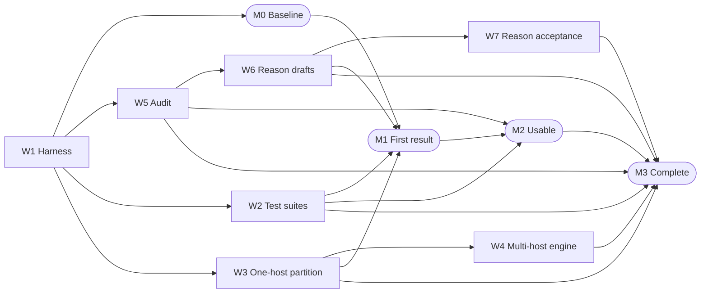

# drc-forge: Design rule checking (DRC): fast engine, exhaustive tests, explainable rules

For the open-source [process design kits](../GUIDELINES.md#process-design-kit-pdk) (PDKs) SKY130 (SkyWater, 130 nm), GF180MCU (GlobalFoundries, 180 nm) and SG13G2 (IHP-Open-PDK, 130 nm), this item builds four artefacts for PDK maintainers and [shuttle](../GUIDELINES.md#shuttle) (multi-project wafer run) prechecks. They are three test layouts per design rule, a sourced reason per rule, a [design-rule check](../GUIDELINES.md#design-rule-check-drc) (DRC) engine that splits a layout across machines, and a per-PDK consistency audit. As of 2026-10 the SKY130 precheck [rule deck](../GUIDELINES.md#rule-deck) names 272 checks and the rule document 593 identifiers; a heuristic map matches 94 of the 593. One checker run decides each test, so AI agents can write and fix tests in parallel.

*Status: draft 3, 2026-10-21. AI review panel: draft 1 reviewed by twelve personas at two model tiers; draft 2 claim-audited at two tiers. Human review: none. Questions for Tim: 5. This document was drafted and reviewed with AI agents; the AI review panel is not a human review, and the Human review entry is the only record of one.*

## Goal

**Deliverables.** Four open-source artefacts for three process design kits (PDKs), SKY130 first.
A design rule is a limit on a layout shape, with an *identifier* in the *rule document* (the foundry's published rules) and an *output name* in the *rule deck* (the checker's program). SKY130 first is the working assumption of [Questions for Tim](#questions-for-tim), question 2.
- *Per-rule test suites:* one [layout file](../GUIDELINES.md#layout-file-gds) (GDS) per test; per rule, a failing case a 5 nm grid step past the limit, passing cases at it and a step on the allowed side; Apache-2.0.
- *Reason record:* per rule, a sourced mechanism and a value-level status; CC-BY-4.0.
- *Distributed engine:* a driver running [KLayout](https://github.com/KLayout/klayout), the open-source layout editor and checker, unmodified, one program per partition; Apache-2.0.
- *PDK consistency audit:* per PDK, a table mapping every output name to an identifier or a reason it has none; scripts Apache-2.0, tables CC-BY-4.0.
- *Where it lands:* a new repository named by Tim, the list's owner ([Questions for Tim](#questions-for-tim), question 3).

**Acceptance test.** Six lines, each able to fail; numbers from [M0](#milestones), the baseline.
- *Coverage:* per (PDK, rule deck, variant, switch set), three cases per implemented identifier; counts `Unknown (settled by: M0)`.
- *Correctness:* each verdict matches the documented value, or the difference is filed with a cause; none unresolved at [M3](#milestones).
- *Suite quality:* the mutation score (broken rule-deck variants caught) at or above the [M0](#milestones) floor.
- *Engine equivalence:* per output name, merged multi-host markers and a flat run differ by an empty region within one database unit.
- *Engine runtime:* wall-clock on the largest pinned design within the ceiling set after [M0](#milestones) ([Questions for Tim](#questions-for-tim), question 1).
  - Tim's aim, single-sourced from the item page and not a measured target: a full reticle (26 x 33 mm, 858 mm², the largest 4x-scanner field) at an advanced process node in under one hour (Tim's claim, 2026-10; checked: 26 x 33 = 858).
- *Reasons:* every rule in a terminal state (sourced; measurement named; no public reason found; foundry choice); a record with no "no public reason found" entry fails review.

**Framing.** A PDK item with a tooling half; rule decks become generated.
- *Layers and axis:* PDK and tooling; on the [manual-to-generator axis](../GUIDELINES.md#manual-to-generator-axis), tests and documentation from one record.
- *Function:* a fast [proxy check](../GUIDELINES.md#proxy-check) for slow physics, relaxable only with its reason.
- *What the suite measures:* open rule decks against public rule documents, not signoff; a public comparison of the two: None found (searched: OpenAlex and alphaXiv, 2026-10-21).

**Out of scope.** Four neighbours own the rest.
- Layout-versus-schematic checks: [flow-proofs](flow-proofs.md), toolchain verification.
- Advanced-node rule decks: [shadow-pdks](shadow-pdks.md), open "almost manufacturable" PDKs.
- Physics behind design rules: [tcad-twin](tcad-twin.md), open process and device simulation.
- Readers for multi-terabyte layouts: [format-kit](format-kit.md), libraries for design-tool file formats.

## Why it is high value

**The pain today.** Shuttle prechecks run two checkers, one thread each, trusting neither.
- [Tiny Tapeout's precheck](https://github.com/TinyTapeout/tt-support-tools) runs [Magic](https://github.com/RTimothyEdwards/magic), the open-source layout editor and checker, and [KLayout](https://github.com/KLayout/klayout) with threads set to 1 "to work around a klayout bug" (as of 2026-10).
- The [wafer.space project template](https://github.com/wafer-space/gf180mcu-project-template) runs KLayout as three rule-deck sets, one thread each, and does not require Magic to pass (as of 2026-10).
- SG13G2's "Extra" rules "have not been verified or tested"; its [golden results](../GUIDELINES.md#golden-results) come from the rule deck under test.
- Rule-deck checking took 60% of one industrial process design kit (PDK) release cycle ([Tantawy et al. 2015](https://doi.org/10.1109/icecs.2015.7440385)).

**Why not already done.** Tedium, no independent oracle, unrecorded reasons.
- *Developer time:* Rule2DRC's 310 SkyWater tasks took two months by hand ([Kim et al. 2026](https://arxiv.org/abs/2605.15669)).
- *No independent [oracle](../GUIDELINES.md#oracle):* verdicts regenerated from the rule deck catch change, not error.
- *Unrecorded reasons:* rule definition is "largely unsystematic and empirical" ([Ghaida and Gupta 2012](https://doi.org/10.1109/tcad.2012.2192477)).

**Who is waiting.** Shuttle users, rule-deck maintainers and engineers.
- Shuttle submitters.
- Rule-deck maintainers at chipfoundry, the FOSSi Foundation, IHP-Open-PDK and [open_pdks](https://github.com/RTimothyEdwards/open_pdks).
- Process and design engineers.

**Why now.** One checker run decides each test, and the rule decks are public.
Each test is a unit an agent proposes, runs and fixes (as of 2026-10). Rule2DRC's agents wrote correct SkyWater rule-deck scripts in 68.3% of tasks (best-of-20, one open-weight AI model): rule-deck writing, not test writing.

**Shots on goal.** Attempts per month today: `Unknown (settled by: M0 timing)`.
- *As of 2026-10:* GF180MCU has 59 test layouts and SG13G2 43 (plus 41 goldens); SKY130 has 27 Magic violation cells (`.mag`) and one KLayout test layout; pass-fail pairs: None found (searched: open_pdks `sky130/custom/drc` and `sky130/klayout`, 2026-10-21).
- *After:* about three cases per implemented identifier (estimate), replaced at [M0](#milestones).
- *Cost per attempt:* one rule-deck run, `Unknown (settled by: M0)`.
- *Side of the trade:* more attempts; with a verifier, coverage grows with samples ([Brown et al. 2024](https://arxiv.org/abs/2407.21787)).

## What success unlocks

**Needs first.** Nothing blocks the first task; two items feed the speed goal.
- [shadow-pdks](shadow-pdks.md), open "almost manufacturable" process design kits: an advanced-node rule deck for [W4](#workstreams), the engine.
- [format-kit](format-kit.md), libraries for design-tool file formats: readers for very large layouts.
- [shuttle-program](shuttle-program.md), open multi-project wafer programs: pinned benchmark layouts.

**Unlocks on this list.** Tested rule decks for three items, questions for a fourth.
- [shadow-pdks](shadow-pdks.md): its rule decks get tests and reasons from the start.
- [flow-proofs](flow-proofs.md), toolchain verification: a tested rule deck for its design-rule check stage.
- [shuttle-program](shuttle-program.md): more than one thread, if [question 4](#unanswered-technical-questions) finds no bug.
- [tcad-twin](tcad-twin.md), open process and device simulation: the physical question per rule.

**Cross-checks with.** Four items.
- [tcad-twin](tcad-twin.md): documented limit against simulated threshold.
- [asic-scoreboard](asic-scoreboard.md), chip-design benchmarking: violation lists on its designs, equivalent after merge.
- [flow-proofs](flow-proofs.md): Magic and KLayout verdicts on the same layouts.
- [shuttle-program](shuttle-program.md): precheck verdicts against the suite's.

**Shared harness.** This item owns the suites and the verdict [harness](../GUIDELINES.md#harness).
[asic-scoreboard](asic-scoreboard.md) owns benchmarks and runtimes; [shuttle-program](shuttle-program.md) the shuttle corpus.

**Beyond the list.** Teaching material; benchmarks for AI-written rule decks.

**Compounding.** Suites re-run on every rule-deck commit and checker release.

## Why it must be open

**The closed version.** Two proprietary distributed checkers exist; the prechecks use neither.
[The resources file](../resources/drc-forge.md) names Siemens Calibre and Cadence Pegasus (as of 2026-10). Both prechecks run open-source checkers.

**The counterfactual.** Closed, the tests stay out of public prechecks; undone, shuttles keep one-thread runs.

**The strongest case against open.** Foundry insiders could record true reasons privately.
Tim's [Building a (future) open source PDK](https://docs.google.com/document/d/1Y-RbdGYOzswOI5EkUuCKZnWjdT1K9UbGQc_CbcIQ9O4/edit) says publishing rules is sensitive (Tim's claim, 2022 Q3; checked: Rule2DRC reports earlier benchmarks withheld as proprietary). It fails here: a reason read under a non-disclosure agreement (NDA) cannot be published ([clean-room rule](../GUIDELINES.md#clean-room)), and these rule decks are public.

**Why closed does not deliver.** Closed tests cannot be re-run.
- *Reproducibility (empirical), the reason record:* DRC-Coder ([Chang et al. 2025](https://doi.org/10.1145/3698364.3705347)) reported F1 1.000 on a sub-3 nm node, on data never released.
- *Replicability (empirical), the suites:* the [Chamalet (2026)](https://doi.org/10.5281/zenodo.23137757) dataset records verdicts changing across versions and checkers on Sky130A cells (metadata read).
- *Composability:* open_pdks and Tiny Tapeout take the SKY130 rule deck from different forks; tests land beside either.

**What open means here.** Licences follow each source; all inputs committed.
- *Licences:* layouts, harness, scripts and engine Apache-2.0; reason record and audit tables CC-BY-4.0; Tim's test designs Apache-2.0, his notes CC-BY-4.0 with credit ([Questions for Tim](#questions-for-tim), question 4).
- *Mutated rule-deck variants:* each keeps its source's licence: for SKY130 the header "Distributed under GNU GPLv3", no or-later clause; Apache-2.0 for GF180MCU and SG13G2.
- *The engine:* Apache-2.0 for a driver running KLayout (GPL-3.0) as a separate program; changes inside KLayout GPL-3.0; the derived-work question is under [Needs beyond AI processes](#needs-beyond-ai-processes).
- *Consent:* only what the foundries published under Apache-2.0; Rule2DRC's dataset (licence unread) and Chamalet's records are references only.
- *Clean room:* public sources only, rule text paraphrased ([5.7](../GUIDELINES.md#57-clean-room-rule-for-pdk-items)).

## State of the art

### Open-source tools and projects

Two checkers; neither has a runtime on a pinned design.
- **[KLayout](https://github.com/KLayout/klayout)**: active, as of 2026-10.
  - Licence: [open-source](../GUIDELINES.md#open-source), [GPL-3.0](https://spdx.org/licenses/GPL-3.0-only.html).
  - Can: a rule-deck language; deep (hierarchical) and tiling modes; `threads` acts in both (v0.30.12 code).
  - Cannot: keep hierarchy when tiling; border long-range operations. A multi-host mode in its documentation: None found (searched: `drc_ref_global.xml`, `drc_ref_layer.xml`, `drc_runsets.xml` at v0.30.12, 2026-10-21).
  - Speed: `Unknown (settled by: M0 timing)`; recomputes unchanged inputs: `Unknown (settled by: an M0 re-run on an unchanged layout)`.
  - Quality: v0.30.12 (2026-08-26); last commit 2026-10-18.
  - Build on or replace: build on, unmodified.
- **[Magic](https://github.com/RTimothyEdwards/magic)**: active, as of 2026-10.
  - Licence: open-source, [HPND-UC-export-US](https://spdx.org/licenses/HPND-UC-export-US.html) (file byte-identical).
  - Can: recheck only changed areas; `sky130.tech` names 176 to 178 identifiers, 20 or 21 equal to SKY130 rule-deck names, by pattern.
  - Cannot: multi-thread; no thread code in `drc/`.
  - Speed: `Unknown (settled by: M0 timing)`; recomputes unchanged inputs: no.
  - Quality: release 8.3.685 (2026-10-08).
  - Build on or replace: build on, as second checker.

### The bar to clear

The bar is the input floor and the cost model; proprietary results are context only.
- *Bound:* runtime(n) = T_read + T_global + T_local x (1 + 2h/T)² / n + T_merge. Here n is the number of parallel KLayout programs, h the longest bounded range and T the tile edge, both in µm.
- *Halo factor:* with h = 700 µm, the SKY130 density window taken as the longest range, (1 + 2h/T)² is 5.76 for 1 mm tiles and 1.11 for 26 mm.
- *Runtime follows unique geometry, not area:* the same 1.28 mm² synthetic layout, one run each.

| Unique cells | Deep-mode time (s) |
| --- | --- |
| 8 | 0.57 |
| 512 | 5.19 |

- *Limit:* input reading and the serial parts (Amdahl's bound); the local part beats n only through hierarchy ([Hsu et al. 2012](https://doi.org/10.1109/tcad.2012.2201155); [Hedenstierna and Jeppson 1993](https://doi.org/10.1109/43.205006)).
- *Agent-scale needs:* short pinned runs, no licence condition; a recorded full-chip time with design size: None found (searched: tt-support-tools, tt-gds-action, wafer-space/gf180mcu-precheck, gf180mcu-project-template, arXiv 2405.04257 and 2406.15107, 2026-10-21).
- *Proprietary context:* Calibre and Pegasus (as of 2026-10); runtimes and terms `Unknown (settled by: the vendors' public documentation)`.

### Research results

- [Wong (2005)](https://doi.org/10.1109/mdt.2005.70): design rules are a compromise between designers and high-yield manufacturing.
- [Kabeel et al. (2023)](https://doi.org/10.1117/12.2658350): industry qualifies rule manuals and rule decks with synthetic layouts.
- [Hedenstierna and Jeppson (1993)](https://doi.org/10.1109/43.205006): checking each cell once in its context is five to twenty times faster than flat.
- [Hsu et al. (2012)](https://doi.org/10.1109/tcad.2012.2201155): layout operations distributed over partitions, correct by construction.

### Past and parallel efforts

As of 2026-10.

| Effort | Years | What it did | Status |
| --- | --- | --- | --- |
| [efabless/mpw_precheck](https://github.com/efabless/mpw_precheck) | to 2024 | SKY130 and GF180MCU precheck rule decks, Apache-2.0 | Moved to chipfoundry and fossi-foundation |
| [efabless gf180mcu_fd_pv](https://github.com/efabless/globalfoundries-pdk-libs-gf180mcu_fd_pv) | 2022 to 2023 | 58 rule-deck files; 59 test layouts (43 per-table, 16 density); Apache-2.0 | Inactive; superseded by the fossi-foundation fork |
| [wafer-space/gf180mcu](https://github.com/wafer-space/gf180mcu) | to 2026 | Unified GF180MCU rule deck, Apache-2.0 | Moved: upstreamed to open_pdks |
| [google/gf180mcu-pdk](https://github.com/google/gf180mcu-pdk) | to 2023 | Documentation, no rule decks, Apache-2.0 | Archived 2026-09-23 (one page read) |
| [OpenDRC](https://github.com/opendrc/opendrc) | 2023 | Graphics-processor checker: width, space, enclosing, area; MIT | Inactive since 2023-09 |

### What is missing

- Per-rule tests with independent labels; closest: SG13G2's goldens and fd_pv's eight density pairs, each generated from its own rule deck.
- A committed SKY130 rule-deck-to-document map: None found (searched: file names in chipfoundry/mpw_precheck 6c401ed, skywater-pdk 7198cf6, open_pdks c3308bb, 2026-10-21); closest: the heuristic map and a public spreadsheet (not Tim's) mapping some rows to Magic names.
- Multi-host runs in an open-source checker; closest: KLayout tiling on one host.
- A recorded reason per rule: `Unknown (settled by: the W6 survey of public rule documents)`.

**Replace or build on.** Build on KLayout, Magic and the live rule decks.
Replacing KLayout's core waits for [W1](#workstreams) and [W2](#workstreams), the harness and the suites.

## What Tim has already worked out

**Documents.** Three of Tim's documents, read in full; public, checked 2026-10-21.
- Tim's [Design Rule Check (DRC) Testing](https://docs.google.com/document/d/18z-FBJHni6qt1WR_tF6bbRHfQydKcFMAVnuj4Ixbj90/edit) (last updated 2023 Q1, unfinished): one test per layout file; a pass case flagged is a false positive, a fail case not flagged a false negative (Tim's claim, 2023 Q1; checked: Rule2DRC also scores by running labelled pass and fail layouts).
- Tim's [Building a (future) open source PDK](https://docs.google.com/document/d/1Y-RbdGYOzswOI5EkUuCKZnWjdT1K9UbGQc_CbcIQ9O4/edit) (last updated 2022 Q3): a rule serves physics, tool limits or business, and has a reason and a check (Tim's claim, 2022 Q3; checked: Wong 2005's abstract calls rules a designer-manufacturing compromise).
- Tim's [Test and verification for ASIC designs options exploration](https://docs.google.com/document/d/1_StmqBumyTuTNVcvutiX-INbbLG7DHoGl_fe0lvQPZ8/edit) (last updated 2023 Q2): "mostly ignoring DRC" (Tim's claim, 2023 Q2; checked: the sentence read in the document).

**Experiments and results.** None found (searched: Tim's three documents, 2026-10-21).
The testing document's density example is a design, not a run: empty fails, full passes, partial depends on the limit.

**Dead ends.** None found (searched: Tim's three documents, 2026-10-21).

**Framing inherited.** Design rules are changing trade-offs between physics and economics.
Full optical simulation could remove rules guarding an approximation (Tim's claim, 2022 Q3; checked: consistent with [GUIDELINES.md principle 4](../GUIDELINES.md#21-checking)).

**From unpublished notes.** `Not applicable (this draft uses no unpublished material)`.

**Where the written record runs out.** Seven headings of the testing document are empty.
- Fuzz, torture and performance testing.
- Tap cells, decap cells, long parallel lines, "SRAM special rules".

## What frontier models change

**Why faster.** Independent layouts, each decided by one [oracle](../GUIDELINES.md#oracle) run.
- *Units:* about three cases per implemented identifier, over 272 and 533 output names and 411 SG13G2 output statements (estimate), replaced by the [M0](#milestones) mapping table.
- *Oracle:* one [KLayout](https://github.com/KLayout/klayout) run per layout; latency `Unknown (settled by: M0)`.
- *Search:* the limit and one 5 nm grid step either side; all three rule decks check a 5 nm grid.
- *Re-execution:* every checker release, since verdicts change across versions ([Chamalet 2026](https://doi.org/10.5281/zenodo.23137757)).

**Why better.** Reasons span silos: lithography, devices, tools, economics, reliability.
- *Unfinished:* Tim's empty headings; SG13G2's "Extra" rules; at most 255 SKY130 rules with a value and no rule-deck match.

**What has to be true.** Expected verdicts come from neither AI nor the rule deck.
- *Independent labels:* in Rule2DRC ([Kim et al. 2026](https://arxiv.org/abs/2605.15669)), AI-generated test labels were wrong in 15.71% to 37.60% of cases, by AI model; here each label is checked against the document and two checkers.
- *Capability check (as of 2026-10):* [M1](#milestones), the first checkable result, reports the share of agent labels overturned against a pause rate for [W2](#workstreams), the suites.

**What people still do.** People sign upstream commits and accept contested reasons; agents prepare both. [Unknowns, blockers and risks](#unknowns-blockers-and-risks) itemises the blockers and the [plausible-but-wrong risk](../GUIDELINES.md#plausible-but-wrong-risk).

## Work plan and milestones

### Workstreams

A *switch set* is the rule-deck options that turn groups of design-rule check (DRC) outputs on; a *variant* is a process design kit (PDK) option such as the metal stack. Fit follows the binding constraint ([GUIDELINES.md 4.9](../GUIDELINES.md#49-work-plan-and-milestones)); "this item's repository" is the new one Tim names.

**W1 Harness, benchmarks and tool speed.** Produces: pinned counts, tables, broken rule-deck variants, timings. Needed because: every acceptance number awaits it.
- Oracle: two methods that fail differently agree.
  - Stands in for: direct: the denominators and the baseline.
  - Reference: parser against pattern; markup against pattern.
  - Pass: exact agreement; timings as median of three runs.
  - Latency: one parse or one run.
  - Negative control: 300 raw calls counted as live is rejected.
  - Blind spots: an error both methods share.
- Access: public.
- Knowledge: public record.
- Units: three rule decks with switch sets and variants.
- Binding constraint: none, because parsing and timing are automated.
- Lands in: this item's repository.
  - Contribution gate: a second agent reproduces each count.
- Fit: A, because none binds.
- Lead time: none.
- Depends on: public repositories.

**W2 Per-rule test suites.** Produces: three layouts per implemented identifier and an expected-verdict file. Needed because: coverage counts them.
- Oracle: KLayout on the rule deck under test; Magic where mapped.
  - Stands in for: agreement with the public rule document.
  - Reference: the document row's value; hand-computed geometry.
  - Pass: the identifier flagged in the failing case only.
  - Latency: `Unknown (settled by: M0)`.
  - Negative control: a mislabelled case; the silent default switch set.
  - Blind spots: a shared misreading; the signoff rule deck.
- Access: public.
- Knowledge: public record.
- Units: about three per implemented identifier (estimate), replaced at M0.
- Binding constraint: none, because checks are automated.
- Lands in: this item's repository, then upstream.
  - Contribution rules: IHP-Open-PDK a Developer Certificate of Origin and review; fd_pv a Contributor License Agreement; the others state none.
  - Contribution gate: a person authors and signs.
- Fit: A, because none binds.
- Lead time: upstream review.
- Depends on: W1.
- Suite quality: mutation score from M1.

**W3 Partition, halo and merge on one host.** Produces: a driver over N KLayout programs on bordered tiles. Needed because: a partition model comes before any cluster.
- Oracle: the merged markers against a single-host flat run.
  - Stands in for: the foundry's signoff check on the same rule deck.
  - Reference: flat mode, one thread, no tiling.
  - Pass: per output, flatten, merge, exclusive-or empty within one database unit.
  - Latency: two runs per design and tiling.
  - Negative control: `with_area` on a wire longer than the border; border 0, which lost width markers in one experiment, to confirm at M0.
  - Blind spots: what both runs share.
- Access: public.
- Knowledge: public record.
- Units: designs x tilings; 170 bounded and 137 unbounded operation calls in the live SKY130 rule deck; 20 GF180MCU connectivity calls.
- Binding constraint: none, because one host suffices.
- Lands in: this item's repository; KLayout unmodified.
  - Contribution gate: equivalence on every pinned design.
- Fit: A, because none binds.
- Lead time: none.
- Depends on: W1.

**W4 Multi-host engine.** Produces: the driver over a cluster, costed against the model. Needed because: the engine deliverable and the runtime line.
- Oracle: W3's equivalence test plus the runtime line.
  - Stands in for: as W3.
  - Reference: the single-host runs.
  - Pass: equivalence; wall-clock within the ceiling; speed-up and halo factor reported.
  - Latency: one cluster run per design.
  - Negative control: a dropped tile, a duplicated tile, an overlap kept.
  - Blind spots: connectivity, antenna, density; multi-patterning.
- Access: a cluster.
- Knowledge: public record.
- Units: designs x host counts, with an arrayed reticle-scale benchmark.
- Binding constraint: compute, because multi-host runs need a cluster.
- Lands in: this item's repository.
  - Contribution gate: as W3, plus the runtime line.
- Fit: A, because compute is requested under Needs.
- Lead time: cluster access; advanced-node rule decks.
- Depends on: W3; [shadow-pdks](shadow-pdks.md); [format-kit](format-kit.md).

**W5 PDK consistency audit and generated docs.** Produces: per PDK, the classed rule-deck-to-document map and generated documentation. Needed because: the audit deliverable and the coverage denominator.
- Oracle: rule-deck message string against document row; a second agent re-reads every row not classed exact.
  - Stands in for: direct: whether the rule deck implements the document.
  - Reference: the pinned rule document; the rule deck's quoted values.
  - Pass: every output name and identifier classed.
  - Latency: one parse per file.
  - Negative control: an invented identifier; `*_OFFGRID` maps to `x.1b` only.
  - Blind spots: differing values behind a matching name; W2 catches those.
- Access: public.
- Knowledge: public record.
- Units: 272 and 533 output names, 411 SG13G2 output statements (names `Unknown (settled by: M0)`); 593 SKY130 identifiers.
- Binding constraint: none, because matching is automated.
- Lands in: this item's repository, then the rule-deck repositories of W2.
  - Contribution gate: as W2.
- Fit: A, because none binds.
- Lead time: upstream review.
- Depends on: W1.

**W6 Sourced reason drafts.** Produces: per rule, a mechanism and a value-level entry with citation and quote. Needed because: the reasons deliverable.
- Oracle: the citation resolves and the quote appears in the source.
  - Stands in for: the question each rule guards.
  - Reference: public papers and PDK documents; later [tcad-twin](tcad-twin.md).
  - Pass: a citation with quote, a named measurement, or a recorded empty search.
  - Latency: one resolution per entry.
  - Negative control: an invented citation; a reason swapped between rules.
  - Blind spots: a real but irrelevant source; W7 catches it.
- Access: public sources.
- Knowledge: spread across silos.
- Units: one per rule in the record.
- Binding constraint: none, because resolution is automated.
- Lands in: this item's repository.
  - Contribution gate: the resolver and the quote check pass.
- Fit: A, because none binds.
- Lead time: none.
- Depends on: W5.

**W7 Reason acceptance.** Produces: an accept or reject verdict per entry, reviewer status recorded. Needed because: a resolving citation can still be irrelevant.
- Oracle: a reviewer judges that the source states this reason.
  - Stands in for: the question the rule serves.
  - Reference: W6's quoted sentence.
  - Pass: accepted; the accepted share reported, no target.
  - Latency: one review per entry.
  - Negative control: a swapped reason is rejected.
  - Blind spots: a reviewer's own gap; two reviewers on a sample.
- Access: public sources; reviewers.
- Knowledge: spread across silos.
- Units: one per entry; an M1 pilot, size `Unknown (settled by: M0)`.
- Binding constraint: oracle, because acceptance is a person's judgement.
- Lands in: this item's repository.
  - Contribution gate: no reader under a related non-disclosure agreement ([Questions for Tim](#questions-for-tim), question 5).
- Fit: D, because the oracle is a person's judgement.
- Lead time: none.
- Depends on: W6.

### Summary table

| # | Workstream | Oracle | Access | Units | Binding constraint | Fit |
| --- | --- | --- | --- | --- | --- | --- |
| W1 | Harness, benchmarks and tool speed | Two methods agree | public | Three rule decks | none | A |
| W2 | Per-rule test suites | Rule deck against document | public | About three per identifier | none | A |
| W3 | Partition, halo and merge on one host | Equivalence with flat | public | Designs x tilings | none | A |
| W4 | Multi-host engine | Equivalence plus runtime | cluster | Designs x hosts | compute | A |
| W5 | PDK consistency audit and generated docs | Message against row | public | 805 names, 411 statements | none | A |
| W6 | Sourced reason drafts | Citation resolves | public | Rules | none | A |
| W7 | Reason acceptance | Reviewer's judgement | public | Rules | oracle | D |

### Milestones

Proof levels follow [GUIDELINES.md 4.9.1](../GUIDELINES.md#491-proof-levels).

**M0 Baseline and harness.**
- Done when: all of the following are committed.
  - Three rule decks' counts, agreeing by two methods.
  - Switch, variant and SKY130 mapping tables.
  - The broken rule-deck variant set; the reason pilot size; the pause rate.
  - A pinned public design and an arrayed reticle-scale benchmark.
  - The runtime baseline: median of three runs in flat, deep and tiled modes, 1 to 4 threads.
  - One Sky130A cell re-run across two KLayout releases.
- Evidence: harness, tables, timing logs.
- Proof: P2.
- Needs: public repositories.
- Completes: W1.
- Fit: A.
- Gate: a second agent reproduces counts and classes.

**M1 First checkable result.**
- Done when: all of the following hold.
  - Every implemented SKY130 identifier has three cases with verdicts.
  - The mutation score is at or above the M0 floor.
  - Agent labels overturned, reported against the pause rate.
  - The reason pilot set drafted and reviewed.
  - The one-host driver passes the equivalence test on the pinned design.
- Evidence: layouts, expected verdicts, reports.
- Proof: P2.
- Needs: [M0](#milestones); [gdsfactory](https://github.com/gdsfactory/gdsfactory), the open-source Python layout generator.
- Completes: advances W2, W3, W6.
- Fit: A.
- Gate: continuous integration passes twice from a clean checkout.

**M2 Usable.**
- Done when: one PDK's suite is merged upstream or run by a shuttle precheck; the partition model is chosen.
- Evidence: the merged pull request or precheck configuration.
- Proof: P4.
- Needs: [M1](#milestones); a person who authors and signs the contribution.
- Completes: advances W2, W5.
- Fit: A.
- Gate: the rule-deck or precheck owners.

**M3 Complete or at the bar.**
- Done when: all of the following hold.
  - Three PDKs covered, zero unresolved differences, every output name classed.
  - Multi-host equivalent to flat on every pinned design.
  - Wall-clock within the [M0](#milestones) ceiling, with speed-up and extrapolation.
  - Every rule in a terminal state.
- Evidence: the four reports and the reason record.
- Proof: P3.
- Needs: [M2](#milestones); a cluster; reason reviewers.
- Completes: W2, W3, W4, W5, W6, W7.
- Fit: D.
- Gate: an independent reviewer re-runs both.

**M4 Proven in hardware or silicon.** `Not applicable (silicon measurement belongs to shuttle-program and tcad-twin)`.

**Dependencies.** The longest chain to M3 runs W1, W5, W6, M1, M2, M3.

*Figure 1: Workstreams (boxes) and milestones (rounded); an arrow means "needed before". Longest chain to [M3](#milestones): W1, W5, W6, M1, M2, M3; lead time on it: upstream review.*

### Metric and baseline

The counts behind every denominator, by rule deck (as of 2026-10):

| PDK | Rule deck and commit | Output names | Output statements | Method |
| --- | --- | --- | --- | --- |
| SKY130 | chipfoundry `sky130A_mr.drc`, 6c401ed | 272 | 296 live (300 raw) | three parsers agree |
| GF180MCU | fossi-foundation `gf180mcu.drc`, a561909 | 533 | 541 live (545 raw) | two parsers agree |
| SG13G2 | IHP-Open-PDK `rule_decks/*.drc`, 5e6d592 | `Unknown (settled by: M0)` | 411 | `.output(` count |
| SKY130 document | `periphery-rules.rst`, 7198cf6 | 593 identifiers (546 by pattern) | 601 rows | markup; pattern |

Every metric is measured by an [M0](#milestones) script; baselines not shown are `Unknown (settled by: M0)`.
- **Per-rule coverage.**
  - Formula: implemented identifiers with three cases, over implemented identifiers; percent per (PDK, rule deck, variant, switch set).
  - Success: 100% at [M3](#milestones); guardrail: mutation score.
  - Baseline: SKY130 none; GF180MCU 59 test layouts; SG13G2 43.
- **Mutation score.**
  - Formula: broken variants that flip a verdict, over the set; operators: limit moved a grid step, rule deleted, layer swapped, `>=` for `>`, output renamed.
  - Success: at or above the [M0](#milestones) floor from [M1](#milestones) on; guardrail: the share of equivalent mutants.
- **Full-chip runtime.**
  - Formula: wall-clock seconds, read to merged list, per pinned design, rule deck, KLayout version and machine; later kept by [asic-scoreboard](asic-scoreboard.md), chip-design benchmarking.
  - Success: within the ceiling set after [M0](#milestones); guardrail: equivalence.
  - Baseline: `Unknown (settled by: M0, median of three runs)`. A first measurement (one run per cell, synthetic 1.64 million-box layout) is not a baseline: deep 5.19 s to 3.33 s at 1 to 4 threads, tiled 39.2 s to 9.8 s.
- **Reason coverage.**
  - Formula: rules in a terminal state, over rules in the record; percent per PDK.
  - Success: 100% at [M3](#milestones); guardrail: the [W7](#workstreams) accepted share and the count of "no public reason found" entries.

### Lead times

- **Upstream review.** `Unknown (settled by: dates of recent merged pull requests in the three rule-deck repositories)`; affects [M2](#milestones).
- **skywater-pdk review.** Last commit 2023-05-29, so rule-document fixes go to the rule-deck repositories; affects [M2](#milestones).
- **Cluster access.** `Unknown (settled by: asking the provider)`; affects [M3](#milestones).

### Cross-checks

**Sources and failure modes.** Each has an independent check.

| Source | Trusted for | Failure mode | Check |
| --- | --- | --- | --- |
| KLayout runs | Verdicts | Marker counts differ by mode | Flatten, merge, difference; Magic |
| Magic rule decks | Second verdicts | A rule-deck difference read as an engine difference | The committed map |
| Output-name counts | Denominators | Commented-out calls, 300 against 296 | Syntax-tree parse |
| Rule document | Labels | Two patterns give 546 and 593 identifiers | Both counted; the mapping table |

**Verification ladder.** Two ladders; neither has all five rungs.
- **SKY130 coverage.**
  - Bound: at most 272 checks; 94 of 593 matched.
  - Limit: geometric rules of the aluminium flow, less 20 not-checked rows.
  - Second source: 593 by markup, 546 by pattern.
  - Rebuild: the mapping table, [First tasks](#first-tasks) task 1.
  - Measurement: the suite at [M1](#milestones) and [M3](#milestones).
  - Rungs in place: bound, second source; built by: [M1](#milestones).
- **Distributed equivalence and runtime.**
  - Bound: the cost model and halo factor.
  - Limit: input floor, Amdahl.
  - Second source: Magic; the flat run.
  - Rebuild: the flat run; the operation class table.
  - Measurement: the [M3](#milestones) comparison.
  - Rungs in place: bound, limit, one synthetic experiment; built by: [M3](#milestones).

**Fast and accurate paths.** One run filters; two checkers accept.
- **Test verdict.**
  - Fast: one KLayout run; cost: one run; used when: filtering.
  - Accurate: both checkers and hand-computed geometry; cost: two runs; used when: a case enters the suite.
- **Engine equivalence.**
  - Fast: marker counts; cost: none; used when: smoke-testing.
  - Accurate: flatten, merge, difference; cost: one pass; used when: a partitioning is accepted.

**Effort rule.** Upstream cases get two checkers and a person; drafts get one run.

## Needs beyond AI processes

| Kind | What exactly | Why | Provider | Cost | Lead time | Proceeds without it |
| --- | --- | --- | --- | --- | --- | --- |
| Compute: a cluster | Hosts | [W4](#workstreams) | Sponsor | `Unknown (settled by: M0 sizing)` | `Unknown (settled by: provider)` | All else |
| Data: an advanced-node rule deck | Speed number only | [W4](#workstreams) | [shadow-pdks](shadow-pdks.md); ASAP7-class rule decks | none | `Unknown (settled by: shadow-pdks)` | 130 nm and 180 nm |
| People: a signer | Authors upstream commits | [M2](#milestones) | Ask Tim | `Unknown (settled by: staffing)` | Review | Local work |
| People: reason reviewers | No related non-disclosure agreement | [W7](#workstreams) | Process engineers | `Unknown (settled by: M1 pilot)` | `Unknown (settled by: asking)` | Drafts |

**Licence questions.** Three, stated and not answered.
- Do the Calibre and Pegasus licences permit automated runs at scale and published benchmarks? Clauses not collected (as of 2026-10).
- Is a driver on [KLayout](https://github.com/KLayout/klayout)'s scripting interface (GPL-3.0) a derived work? Put once to the KLayout maintainer by the signer.
- Does the SKY130 rule decks' GPLv3 header govern test layouts, and which licence governs open_pdks' `sky130.lydrc` (GPLv3 header, BSD-2-Clause directory)? Put to the maintainers by the signer.

**Clean room.** Values and reasons come from cited public sources; rule text is paraphrased.
A contributor of values declares no related non-disclosure agreement (NDA); no NDA-bound reader reviews ([Questions for Tim](#questions-for-tim), question 5). Internal names met in public documents are filed as errors, never copied ([5.7](../GUIDELINES.md#57-clean-room-rule-for-pdk-items)).

## Unknowns, blockers and risks

### Expertise barriers

- **Why each design rule exists.**
  - Why it defeats people: reasons span silos and are often unrecorded.
  - How an AI model gets through: reading papers and rule documents together, every reason quoted.
  - Validated by: [W7](#workstreams), reason acceptance; later [tcad-twin](tcad-twin.md), open process and device simulation.

### Hard blockers

**Three blockers.** None stops the first task.
- **Legal: upstream approval.**
  - AI cannot: sign a Developer Certificate of Origin or a Contributor License Agreement. A rule on AI-authored code: None found (searched: contribution files, READMEs and `.github` of chipfoundry/mpw_precheck, fossi-foundation/mpw_precheck, gf180mcu_fd_pv, open_pdks and IHP-Open-PDK, 2026-10-21).
  - AI can: prepare the contribution.
  - Mitigation or question for a person: a person authors each upstream commit.
- **Economic: cluster compute.**
  - AI cannot: provide machines.
  - AI can: size the run from the [M0](#milestones) baseline.
  - Mitigation or question for a person: a sponsor.
- **Physical: confirming a reason by measurement.**
  - AI cannot: measure silicon, which recovers a rule's data.
  - AI can: name the settling measurement.
  - Mitigation or question for a person: [shuttle-program](shuttle-program.md) test structures; [tcad-twin](tcad-twin.md).

### Risks of the approach

**The biggest risk.** A test label or reason that reads right and is wrong.
- **The plausible-but-wrong risk.** AI-generated test labels were wrong in 15.71% to 37.60% of Rule2DRC cases. Check: documented values, two checkers, geometry, quoted citations.
- **A miscounted denominator.** 300 raw against 296 live; 546 against 593. Check: two methods per count.

## Unanswered technical questions

1. **Which documented SKY130 rules does the rule deck implement?** A heuristic map hits 94 of 593.
   - Settled by: the mapping table, [First tasks](#first-tasks) task 1.
   - Blocks: [W2](#workstreams), [W5](#workstreams).
   - Taker: an agent.
2. **How do connectivity, antenna and density checks split across hosts?** The GF180MCU rule deck has 20 connectivity calls; KLayout's density check tiles itself; SG13G2 density uses 800 µm windows.
   - Settled by: a stitched merge against the flat run.
   - Blocks: [W4](#workstreams).
   - Taker: an agent.
3. **Which public layout is the benchmark, and how is a reticle-scale one built?** Basilisk ([Sauter et al. 2024](https://arxiv.org/abs/2405.04257)) ships no chip-level layout.
   - Settled by: the [M0](#milestones) survey; an arrayed benchmark.
   - Blocks: [W1](#workstreams).
   - Taker: an agent.
4. **Why do both prechecks run one KLayout thread, and does more change wall time or verdicts?** `threads` acts in deep mode in the code; the 0.30.9 warning concerns parallel workers, not threads.
   - Settled by: timing the SKY130 rule deck at threads 1 and 4.
   - Blocks: [W1](#workstreams).
   - Taker: an agent.

## Questions for Tim

1. **Q:** How does the one-hour reticle aim become a pass line? **Context:** no recorded full-chip runtime or open advanced-node rule deck. **Assumed for now:** baseline at [M0](#milestones), ceiling set after it, one hour kept as Tim's stated aim. **Changes if different:** Acceptance test, [W4](#workstreams).
2. **Q:** Which process design kit gets the first per-rule suite? **Context:** SKY130 has the most documented rules and no committed map. **Assumed for now:** SKY130. **Changes if different:** Goal, [M1](#milestones), First tasks.
3. **Q:** Where do this item's code and results live? **Context:** the rule decks live in others' repositories. **Assumed for now:** a new repository named by Tim. **Changes if different:** Lands in lines.
4. **Q:** Which licences do derived works carry? **Context:** the SKY130 KLayout rule decks carry a GPLv3 header, the others Apache-2.0. **Assumed for now:** variants follow their source; the rest Apache-2.0, except notes CC-BY-4.0. **Changes if different:** What open means here.
5. **Q:** Does a reader under a related non-disclosure agreement review reasons? **Context:** a verdict per reason could leak confidential answers. **Assumed for now:** no such reader. **Changes if different:** [W7](#workstreams), Clean room.

## Start here

### Agent digest

- Goal: three layouts per implemented identifier matching the document; multi-host equivalent to flat; a reason status per rule.
- First task: the SKY130 mapping table (task 1).
- Oracle: rule-deck message against document row; a second agent re-reads every non-exact row; an invented identifier stays unmatched.
- Lands in: this item's repository (name set by Tim), `audit/sky130/mapping.csv`.
- Ask a person for: a signer; a cluster; reason reviewers.
- Upstream / downstream: none / [flow-proofs](flow-proofs.md), [shuttle-program](shuttle-program.md), [asic-scoreboard](asic-scoreboard.md), [tcad-twin](tcad-twin.md); later [shadow-pdks](shadow-pdks.md), [format-kit](format-kit.md).
- Stop rule: 60 minutes per attempt; report counts by method and the stopping point.

### Read first

1. Tim's [Design Rule Check (DRC) Testing](https://docs.google.com/document/d/18z-FBJHni6qt1WR_tF6bbRHfQydKcFMAVnuj4Ixbj90/edit) (short): test principles, the density example.
2. Tim's [Building a (future) open source PDK](https://docs.google.com/document/d/1Y-RbdGYOzswOI5EkUuCKZnWjdT1K9UbGQc_CbcIQ9O4/edit) (short): why rules exist.
3. [chipfoundry/mpw_precheck](https://github.com/chipfoundry/mpw_precheck) `src/cf_precheck/drc_scripts/sky130A_mr.drc` at 6c401ed (1,808 lines): the rule deck under test; switches at lines 59 to 150.
4. [skywater-pdk](https://github.com/google/skywater-pdk) `docs/rules/periphery-rules.rst` at 7198cf6 (4,184 lines): the rule document.

### Reproduce first

- Source: [fossi-foundation gf180mcu_fd_pv](https://github.com/fossi-foundation/globalfoundries-pdk-libs-gf180mcu_fd_pv), the GF180MCU rule deck and harness.
- Pin: a561909c667ce1e8485313f5d280a7014f524e49 (2026-10-17), as open_pdks pins.
- Environment: Python 3, pytest, a `klayout` binary at v0.30.12; the pip package has no executable and no Ruby interpreter.
- Flow: the `klayout/drc/testing/` pytest run at defaults (`run_mode` deep, variant gf180mcuD).
- Corpus: `klayout/drc/testing/unit/`, 59 layouts with 59 goldens.
- Expected value: per layout, flagged output names equal the golden's; `_fail` density layouts flag their rule, `_pass` do not.
- Runtime: `Unknown (settled by: this run)`.
- Time box: 45 minutes.
- Known-good case: `density-M1_4_fail.gds` gives an `M1.4` marker, `density-M1_4_pass.gds` none; known-bad case: each checked against the other's golden fails; without the `density` deck no marker appears, so silence is not a pass.
- Failure report: KLayout version, commit, per-layout output sets, first ten differences.

### First tasks

All land in this item's repository, the new one Tim names ([Questions for Tim](#questions-for-tim), question 3).
1. **SKY130 mapping table.**
   - Produce: `audit/sky130/mapping.csv`, one row per live `.output(` call of `sky130A_mr.drc` at 6c401ed (296 rows): output name, line, switch, value, identifier, match class (exact; suffix variant; structural; value-confirmed; unmatched), document value, flags.
   - Oracle: the message string's text and value agree with the document row; a second agent re-reads every row not classed exact; negative controls: an invented identifier unmatched, `*_OFFGRID` mapped to `x.1b` only.
   - Inputs: the rule deck; `docs/rules/periphery-rules.rst` at 7198cf6: 593 identifiers in 601 rows; flags `NC` 20, `CU` 61, `AL` 32; 227 rows without a value.
   - Workstream: [W5](#workstreams).
   - Fit: A.
   - Lands in: this item's repository.
2. **Tim's density cases on the live SKY130 density rule deck.**
   - Produce: six layouts for `met_min_ca_density.lydrc` (whole-die minimum 0.4, m5 0.24), one per case of Tim's example, with [gdsfactory](https://github.com/gdsfactory/gdsfactory), the Python layout generator.
   - Oracle: the hand-computed area ratio: cases 1 and 3 flagged, 2 and 4 not; cases 5 and 6 are probes, recorded not assumed.
   - Inputs: the `.lydrc` at 6c401ed; the GF180MCU density pairs; the rule document's density rows (maxima 0.77 in 50 µm windows, minima 0.7 in 700 µm).
   - Workstream: [W2](#workstreams).
   - Fit: A.
   - Lands in: this item's repository.
3. **Grid-step cases for one SKY130 layer on two checkers.**
   - Produce: per width and spacing rule of one layer, layouts at the limit and one 5 nm step either side; `feol` or `beol` on, `offgrid` on and off; Magic where mapped.
   - Oracle: flagged past the limit, silent at it and on the allowed side; other outputs unchanged; default switches silent.
   - Inputs: the rule deck, the rule document, task 1's table.
   - Workstream: [W2](#workstreams).
   - Fit: A.
   - Lands in: this item's repository.

### Ask a person for

- **A signer:** from a named person (ask Tim) who authors upstream commits, for [M2](#milestones).
- **A cluster:** from a compute provider, for [M3](#milestones).
- **Reason reviewers:** from process engineers with no related non-disclosure agreement, for [M3](#milestones).

### Known dead ends

- **Threshold cases 1 nm off the limit fail the off-grid check.** Rule2DRC steps by 1 nm; all three rule decks check a 5 nm grid.
- **Tiny Tapeout's rule-deck update script fetches a moved path.** `checks/tech-files/` went in the 2026-03-17 restructure and returns 404; the committed copy is locally patched.

### Key papers

- Wong, "Some Thoughts on the IC Design-Manufacture Interface" (2005). [doi:10.1109/mdt.2005.70](https://doi.org/10.1109/mdt.2005.70).
- Ghaida and Gupta, "DRE: A Framework for Early Co-Evaluation of Design Rules, Technology Choices, and Layout Methodologies" (2012). [doi:10.1109/tcad.2012.2192477](https://doi.org/10.1109/tcad.2012.2192477).
- Roesch and Hamada, "Measuring IC Layout Effects on Quality and Reliability" (2008). [doi:10.1109/csics.2008.16](https://doi.org/10.1109/csics.2008.16).
- Hedenstierna and Jeppson, "The halo algorithm: an algorithm for hierarchical design of rule checking of VLSI circuits" (1993). [doi:10.1109/43.205006](https://doi.org/10.1109/43.205006).
- Hsu, Sinha, Pi and Ho, "A Hierarchy-Based Distributed Algorithm for Layout Geometry Operations" (2012). [doi:10.1109/tcad.2012.2201155](https://doi.org/10.1109/tcad.2012.2201155).
- Tantawy, Guindi, Dessouky and Al-Imam, "Parameterized test patterns methodology for layout design rule checking verification" (2015). [doi:10.1109/icecs.2015.7440385](https://doi.org/10.1109/icecs.2015.7440385).
- Kabeel et al., "Design rule manual and DRC code qualification flows empowered by high coverage synthetic layouts generation" (2023). [doi:10.1117/12.2658350](https://doi.org/10.1117/12.2658350).
- Kim, Byun, Hwang, Park and Song, "Rule2DRC: Benchmarking LLM Agents for DRC Script Synthesis with Execution-Guided Test Generation" (2026). [arXiv:2605.15669](https://arxiv.org/abs/2605.15669).
- Chang, Ho, Li, Chen and Ren, "DRC-Coder: Automated DRC Checker Code Generation Using LLM Autonomous Agent" (2025). [doi:10.1145/3698364.3705347](https://doi.org/10.1145/3698364.3705347).
- Chamalet, "Reproduction Records and Sources for Reproducibility of Open-Source DRC and LVS Verdicts for Public Sky130A Layout Cells" (2026, dataset). [doi:10.5281/zenodo.23137757](https://doi.org/10.5281/zenodo.23137757).

### Projects and code

- [fossi-foundation/mpw_precheck](https://github.com/fossi-foundation/mpw_precheck): quiet, as of 2026-10.
  - Licence: open-source, Apache-2.0; rule-deck header GPLv3.
  - Contains: the rule deck open_pdks installs.
- [gdsfactory](https://github.com/gdsfactory/gdsfactory): active, as of 2026-10.
  - Licence: open-source, MIT.
  - Contains: Python layout generation; no checker.
- [tt-support-tools](https://github.com/TinyTapeout/tt-support-tools): active, as of 2026-10.
  - Licence: open-source, Apache-2.0.
  - Contains: Tiny Tapeout's precheck with per-check timing.
- [gf180mcu-precheck](https://github.com/wafer-space/gf180mcu-precheck): active, as of 2026-10.
  - Licence: open-source, Apache-2.0 (LICENSE at 9b4e7da).
  - Contains: wafer.space's precheck; the workers-times-threads model.
- [gf180mcu-project-template](https://github.com/wafer-space/gf180mcu-project-template): active, as of 2026-10.
  - Licence: open-source, Apache-2.0.
  - Contains: the wafer.space tool flow and rule-deck settings.
- [pulp-platform/iguana](https://github.com/pulp-platform/iguana): inactive (last commit 2024-10), as of 2026-10.
  - Licence: open-source, SHL-0.51 (LICENSE file).
  - Contains: Basilisk's flow for SG13G2; no chip-level layout.

## Where it sits

Layer: **PDK and Tooling**. Function: **cross-cutting**. Target: **ASIC**. Straddles two layers: rule decks, tests and rule docs belong to the PDK, while the distributed engine is tooling.

## Resources

Loose collection of links for fleshing this item out: [resources/drc-forge.md](../resources/drc-forge.md).

## Related items

- [shadow-pdks](shadow-pdks.md) (Open "almost manufacturable" PDKs): Supplies the rule decks, tests and rule docs for every PDK.
- [tcad-twin](tcad-twin.md) (Open TCAD stack): Device physics explains some design rules; lithography, manufacturing and reliability explain others.
- [flow-proofs](flow-proofs.md) (Toolchain verification): DRC and LVS are stages in per-stage verification.
- [asic-scoreboard](asic-scoreboard.md) (ASIC benchmarking): Benchmark designs exercise the engine at scale.
- [shuttle-program](shuttle-program.md) (Open MPW tapeout programs): Shuttle designs are real-world test cases.
- [format-kit](format-kit.md) (Libraries for every EDA file format): Uses shared GDS and OASIS libraries.
- [cloud-fab](cloud-fab.md) (Virtual foundry in the cloud): Simulated process limits explain and generate design rules.
