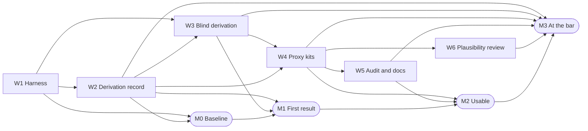

# shadow-pdks: Open "almost manufacturable" PDKs

This item builds an open process design kit (PDK) for each class of process node that has none, pre-EUV FinFET first, then 28/22 nm planar bulk. Every value comes from public literature, with its source recorded. Open-tool developers and IP-block designers then work where industry designs. Today's open kits stop at a 55 nm preview, or assume extreme ultraviolet (EUV) lithography, or need a licence for paid use. AI agents derive and cross-check the values; real open kits test the method blind.

*Status: draft 2, 2026-11-13. AI review panel: draft 1, 9 personas at 1 model tier; draft 2, claim audits at 1 model tier. Human review: none. Questions for Tim: 5. This document was drafted and reviewed with AI agents; the AI review panel is not a human review, and the Human review entry is the only record of one.*

## Goal

**Deliverables.** Two proxy kits, a derivation record and blind-test reports.
A [fake or proxy process design kit (PDK)](../GUIDELINES.md#fake-or-proxy-process-design-kit-pdk) is realistic for a node class but built from public data.
- *Pre-EUV FinFET proxy kit (16 to 12 nm class):* these views.
  - Layers: front end, middle-of-line and metal stack, with patterning per layer.
  - Rule decks: [KLayout](https://github.com/KLayout/klayout) design-rule, [layout-versus-schematic (LVS)](../GUIDELINES.md#layout-versus-schematic-lvs) and [parasitic extraction (PEX)](../GUIDELINES.md#parasitic-extraction-pex).
  - Device models: BSIM-CMG cards; process corners `Unknown (settled by: a public variability source)`.
  - Tool files: technology files for [OpenROAD](https://github.com/The-OpenROAD-Project/OpenROAD).
- *28/22 nm planar bulk proxy kit:* the same views, with BSIM4 or BSIM-BULK device models.
- *Derivation record:* one row per value, with source, method and re-deriver.
- *Blind-derivation reports:* the method applied, without looking, to four real open kits.
- *Licences:* every kit file Apache-2.0; the derivation record and documents CC-BY-4.0.

**Acceptance test.** Five checks; thresholds are [Questions for Tim](#questions-for-tim) defaults.
- *Provenance:* every value's source resolves and contains the input; a second agent re-derives a sample.
- *Published figures:* quantities the kit does not set directly match the published figures of one named reference process, within 10% (default; question 3).
  - The six-transistor memory bit-cell area.
  - A logic-density figure: `Unknown (settled by: the W4 published-figure table)`.
  - For the planar kit: `Unknown (settled by: Unanswered technical question 1)`.
- *Blind derivation:* on four real open kits, the share of derived design-rule values within tolerance; floor `Unknown (settled by: M1)`.
- *Tool flow:* every benchmark design runs from register-transfer level to layout with zero rule-check and LVS errors, and every broken layout fails.
- *Consistency audit:* all four clauses of the PDK audit of [4.9](../GUIDELINES.md#49-work-plan-and-milestones) clean on both kits.

**Framing.** The kit layer of the [two-ways framing](../GUIDELINES.md#two-ways-framing).
- *Layer:* PDK, the foundation that tools and IP blocks are built on.
- *Function:* all.
- *Axis:* along the [manual-to-generator axis](../GUIDELINES.md#manual-to-generator-axis), a kit becomes a re-runnable derivation.

**Out of scope.** Fabrication, cell generation and fab simulation.
- Per-rule test suites and a fast rule-check engine for real kits: [drc-forge](drc-forge.md).
- Device models from process and device simulation: [tcad-twin](tcad-twin.md).
- Generating and characterising cell libraries: [cell-foundry](cell-foundry.md).
- A simulated foundry that derives a kit from recipes: [cloud-fab](cloud-fab.md).
- Silicon on a real process node: [shuttle-program](shuttle-program.md).
- Extreme ultraviolet (EUV) FinFET nodes, and the FD-SOI variant ([question 4](#questions-for-tim)).

## Why it is high value

**The pain today.** No open kit sits between 55 nm and the EUV-era kits.
- [NODES.md](../NODES.md) calls pre-extreme-ultraviolet (EUV) FinFET "a big hole" (Tim's claim, 2026-10; checked: the kit lists of OpenROAD-flow-scripts and lambdapdk).
- [ASAP7](https://github.com/The-OpenROAD-Project/asap7), the predictive 7 nm kit, assumes EUV for key layers.
- ASAP7 ships its rule decks for proprietary checkers.
- FreePDK15's rule kit is under [CC BY-NC-SA 4.0](https://creativecommons.org/licenses/by-nc-sa/4.0/), which needs a separate licence for paid use.
- [ICS55](https://github.com/openecos-projects/icsprout55-pdk), the 55 nm open kit, is a preview without circuit-simulation (SPICE) models.

**Why not already done.** The data is a foundry's; rebuilding it is detail work.
- Foundry kits at these nodes sit under non-disclosure agreements (NDAs).
- Tim's [Building a (future) open source PDK](https://docs.google.com/document/d/1Y-RbdGYOzswOI5EkUuCKZnWjdT1K9UbGQc_CbcIQ9O4/edit) says publishing design rules is sensitive for a foundry (Tim's claim, 2022-09; checked: none public at 28 nm or below).
- Converting a proprietary rule deck is "manual labour" in Tim's GF12LP tooling sheet (Tim's claim, undated; not checked).
- Each earlier kit was one academic group's project and stopped at one process node.

**Who is waiting.** Open-tool developers, then items that build on a kit.
- OpenROAD developers, who cannot reproduce FinFET problems in public.
- [cell-foundry](cell-foundry.md), [asic-scoreboard](asic-scoreboard.md) and [arithmetic-zoo](arithmetic-zoo.md), which characterise per process node.

**Why now.** Easy now with AI, and it unlocks other tasks.
- *What changed:* four real open kits give a blind test of the method.
- *Also:* open simulators now load BSIM-CMG.
- *The move:* kits become a re-runnable derivation.

**Shots on goal.** A FinFET design study becomes a compute run.

| Path | Cost per try | Status |
| --- | --- | --- |
| Tape-out at 16 to 12 nm | about $1M to $5M | Tim's claim, unchecked |
| Design study on a proxy kit | compute only | argued |

Runs per month: `Unknown (settled by: M0)`. A tape-out yields a chip; a proxy run yields an estimate.

## What success unlocks

**Needs first.** Nothing; two items make the work cheaper.
- [format-kit](format-kit.md): readers for every view the audit compares.
- [drc-forge](drc-forge.md): its per-rule test method, applied to the proxy rule decks.

**Unlocks on this list.** Five items gain a node class.
- [drc-forge](drc-forge.md): an advanced-node rule deck for the engine's speed figure.
- [cell-foundry](cell-foundry.md): a FinFET and a 28 nm target for generated cell libraries.
- [asic-scoreboard](asic-scoreboard.md): power, performance and area across real and proxy kits.
- [arithmetic-zoo](arithmetic-zoo.md): arithmetic units characterised on two more classes.
- [any-angle](any-angle.md): a planar kit that states which angles it allows.

**Cross-checks with.** Three items check currents, results and references.
- [tcad-twin](tcad-twin.md): drive and leakage current per transistor, within question 3's tolerance.
- [asic-scoreboard](asic-scoreboard.md): proxy-kit results against ASAP7 and the real kits.
- [shuttle-program](shuttle-program.md): the real kits its shuttles validate are the blind-test references.

**Shared harness.** The consistency audit, split with [drc-forge](drc-forge.md).

| Audit clause | Real kits | Proxy kits |
| --- | --- | --- |
| Every view of every standard cell agrees | this item | this item |
| Rule decks match layer maps and written rules | [drc-forge](drc-forge.md) | this item |
| A reason per design rule, with source | [drc-forge](drc-forge.md) | this item |
| Documentation generated from kit data | this item | this item |

**Beyond the list.** FinFET designing taught and published openly.

**Compounding.** Each value grows the record; each released kit adds a test.

## Why it must be open

**The closed version.** Foundry kits under non-disclosure agreements (NDAs).
They cannot be shared or re-run.

**The counterfactual.** Done closed, no one else could check a proxy kit's results.
Not done, open tools stay at 55 nm and above, or on extreme ultraviolet (EUV) 7 nm kits.

**The strongest case against open.** A foundry could release its real kit.
Four foundries did, at 180, 130 and 55 nm.
- It fails here: no foundry kit at 28 nm or below is public as of 2026-11.
- A proxy needs no foundry's consent and does not stop a later release.

**Why closed does not deliver.** Three mechanisms.
- *Reproducibility (empirical):* ASAP7's decks target proprietary checkers, so its results cannot be re-run with open tools alone.
- *Legal scale (contractual):* may a company use FreePDK15's rule kit under [CC BY-NC-SA 4.0](https://creativecommons.org/licenses/by-nc-sa/4.0/)? Its page says a separate licence is needed.
- *AI itself (argued):* agents can run, check and extend only a kit they can read.

**What open means here.** Open licences, published derivation.
- *Licences:* kit files Apache-2.0; record and documents CC-BY-4.0.
- *Reproduce:* pinned commits, the kit release and the benchmarks.
- *Replicate:* the record lets another group derive the kit again.
- *Public test suite:* the blind-test harness, benchmarks and broken layouts.
- *Consent:* none needed; no foundry data enters.
- *Look-alikes:* FreePDK15's rule kit needs a licence for paid use; the decks of ASAP7 and of GT2N, a 2 nm predictive kit, run only in proprietary checkers.

## State of the art

### Open-source tools and projects

Status is from each clone's last commit.

- **ASAP7**: inactive, as of 2026-11.
  - Licence: open-source, [BSD-3-Clause](https://spdx.org/licenses/BSD-3-Clause.html).
  - Can: 7 nm predictive kit with two cell libraries and four threshold voltages.
  - Cannot: pre-EUV design rules; it assumes extreme ultraviolet (EUV) for key layers.
  - Speed: `Unknown (settled by: M0)`; recomputes unchanged inputs: `Unknown (settled by: M0)`.
  - Quality: 27 tracker papers; the open tools' benchmark kit.
  - Build on or replace: build on its derivation method.
- **FreePDK45 and the Nangate45 cells**: inactive, as of 2026-11.
  - Licence: open-source, [Apache-2.0](https://spdx.org/licenses/Apache-2.0.html), with a click-through for some files.
  - Can: a generic 45 nm kit and cell library.
  - Cannot: match any real process; "purposely non-manufacturable".
  - Speed: `Unknown (settled by: M0)`; recomputes unchanged inputs: `Unknown (settled by: M0)`.
  - Quality: 19 benchmark designs (clone at 2334114).
  - Build on or replace: reference only.
- **ICS55**: active, as of 2026-11.
  - Licence: open-source, [Apache-2.0](https://spdx.org/licenses/Apache-2.0.html).
  - Can: a real 55 nm kit with 231 named checks in its rule deck.
  - Cannot: no circuit-simulation (SPICE) models yet; its deck targets a proprietary checker.
  - Speed: `Unknown (settled by: M0)`; recomputes unchanged inputs: `Unknown (settled by: M0)`.
  - Quality: preview; first shuttle planned for 2025-12.
  - Build on or replace: a blind-test reference ([question 2](#questions-for-tim)).
- **lambdapdk**: active, as of 2026-11.
  - Licence: open-source, [Apache-2.0](https://spdx.org/licenses/Apache-2.0.html).
  - Can: packages seven kits for one tool flow.
  - Cannot: has no kit between 55 nm and 7 nm.
  - Speed: `Not applicable (packaging, no computation)`; recomputes unchanged inputs: `Not applicable (packaging)`.
  - Quality: `Unknown (settled by: reading its test suite at M0)`.
  - Build on or replace: build on; the proxy kits are packaged here.
- **BSIM-CMG with OpenVAF-reloaded and ngspice**: active, as of 2026-11.
  - Licence: open-source; BSIM-CMG [ECL-2.0](https://spdx.org/licenses/ECL-2.0.html), OpenVAF [GPL-3.0](https://spdx.org/licenses/GPL-3.0-only.html), ngspice [BSD-3-Clause](https://spdx.org/licenses/BSD-3-Clause.html) with mixed parts.
  - Can: compile the FinFET compact model and load it into ngspice.
  - Cannot: supply parameter values; those come from(#workstreams).
  - Speed: `Unknown (settled by: M0)`; recomputes unchanged inputs: `Unknown (settled by: M0)`.
  - Quality: the original compiler stopped in 2023; the reloaded fork is active.
  - Build on or replace: build on.
- **OpenROAD-flow-scripts with KLayout**: active, as of 2026-11.
  - Licence: open-source; scripts BSD-3-Clause, KLayout GPL-3.0.
  - Can: run register-transfer level to layout, with committed expected metrics for some designs.
  - Cannot: no platform between 55 nm and 7 nm.
  - Speed: `Unknown (settled by: M0)`; recomputes unchanged inputs: `Unknown (settled by: M0)`.
  - Quality: 23 ASAP7 designs, two with expected metrics (clone at 2334114).
  - Build on or replace: build on; the harness of(#workstreams).

### The bar to clear

**Physical limit.** The pitches need multiple patterning.
Multiple patterning prints one layer in two or more exposures.
- GF12LP and 14LPP are a foundry's 12 and 14 nm FinFET processes.
- The 14 nm process of Natarajan 2014 uses self-aligned double patterning.
- ASAP7 assumes multiple patterning for its non-EUV layers.

| Bound | Value | Check | Source |
| --- | --- | --- | --- |
| Metal-2 pitch | 64 nm | none | Tim's GF12LP notes |
| Cell height, 9 tracks | 576 nm | 9 × 64 nm | Tim's GF12LP notes |

**What agent-scale work needs.** A traceable kit for open tools.
Throughput: `Unknown (settled by: M0)`.

**Dated context.** None of these foundry kits is public, as of 2026-11.

### Research results

- Clark et al. (2016), [ASAP7](https://doi.org/10.1016/j.mejo.2016.04.006): design rules derived per layer from lithography and reliability estimates.
- Lo et al. (2018), [12LP](https://doi.org/10.1109/VLSIT.2018.8510632), and Natarajan et al. (2014), [14 nm logic](https://doi.org/10.1109/IEDM.2014.7046976): the target class's public figures.

### Past and parallel efforts

| Effort | Years | What it did | Where it stands |
| --- | --- | --- | --- |
| [FreePDK45](https://eda.ncsu.edu/freepdk/freepdk45/) | 2007 on | Generic 45 nm kit | Inactive |
| [FreePDK15](https://eda.ncsu.edu/freepdk/freepdk15/) | 2014 to 2015 | 15 nm FinFET kit | Rule kit needs a paid-use licence |
| [Predictive models](https://doi.org/10.1109/TED.2006.884077) | 2000 to 2006 | Planar device models | Site did not answer, 2026-11-13 |
| [ASAP7](https://github.com/The-OpenROAD-Project/asap7) | 2016 to 2025 | 7 nm kit, EUV assumed | Inactive since 2025-03 |
| [ASAP5](https://doi.org/10.1016/j.mejo.2022.105481) | 2022 | 5 nm kit | `Unknown (settled by: reading the paper)` |
| [Virtual_N2_PDK](https://doi.org/10.1109/TVLSI.2025.3529504) | 2025 | 2 nm kit from public sources | `Unknown (settled by: finding its release)` |
| [GT2N](https://github.com/The-OpenROAD-Project/OpenROAD-flow-scripts/tree/master/flow/platforms/gt2n) | 2026 | 2 nm kit, 71 cells | In OpenROAD-flow-scripts |
| [PKP](https://doi.org/10.1007/s11432-025-4805-5) | 2026 | Open compact models, nanosheet kit | `Unknown (settled by: reading the paper)` |
| [ICS55](https://github.com/openecos-projects/icsprout55-pdk) | 2025 on | Real 55 nm kit | Preview, active |

### What is missing

- A 16 to 12 nm FinFET kit without EUV; FreePDK15 needs a licence for paid use.
- A 28/22 nm planar bulk kit; None found (searched: OpenROAD-flow-scripts platforms, lambdapdk, Semantic Scholar, 2026-11-13).
- A blind test of any derivation method; None found (searched: the trackers' ASAP7 and Prediction tabs, Semantic Scholar, 2026-11-13).

**Replace or build on.** Build on all of them; replace nothing.

## What Tim has already worked out

**Documents.** Six public; one internal, in summary.

| Document | Dated | Carried into the plan |
| --- | --- | --- |
| [Building a (future) open source PDK](https://docs.google.com/document/d/1Y-RbdGYOzswOI5EkUuCKZnWjdT1K9UbGQc_CbcIQ9O4/edit) | 2022 Q3 | each design rule has a reason and a check |
| [GF12LP notes](https://docs.google.com/document/d/1gnzFKTaANRHWMMWReaZHsEo18S_SjQho1bG3IAqVGUE/edit) | undated | the target class's pitches and cell heights |
| [Understanding of ASAP7](https://docs.google.com/document/d/19DGoN5g313NgP8_2QVamzIIrrQs5nPuMUGvJHsp8CXE/edit) | 2023 Q4 | ASAP7 is the open tools' benchmark |
| [GF12LP tooling sheet](https://docs.google.com/spreadsheets/d/1QTExbPjFfVXbhVZv048JXHT_jVJiz_m0lDQs7a_3fJ4/edit) | undated | an open tool per tool-flow step |
| [FDSOI information](https://docs.google.com/document/d/1YN_hJBLliAt2WGyuUkR7Cun4su6-_Qrce34EmnM2GVs/edit) | undated | FD-SOI pitch and track tables |
| [PDK Python Tooling](https://docs.google.com/document/d/1VZIpYx0FN1oMd2KW_oWL1gsQbssSM8JEJjRJVLamNI0/edit) | 2023 Q1 | documentation generated from kit data |

All six were read in full, the sheet's first tab only.

**Figures from the GF12LP notes.** Tim's claim, read 2026-11.
Cell heights are checked by arithmetic; the rest is not checked.

| Quantity | 14LPP and 12LP |
| --- | --- |
| Fin pitch | 48 nm |
| Poly pitch | 84 nm |
| Metal-2 pitch | 64 nm |
| Cell height, 9 tracks | 576 nm |
| Cell height, 7.5 tracks | 480 nm |
| Threshold voltages | 4 |

The poly pitch has no second source; None found (searched: Crossref, 2026-11-13).

**Experiments and results.** One ASAP7 measurement (Tim's claim, 2023-12; not checked).
- A 256-bit add with regular threshold-voltage cells: about 625 ps.
- The same add with the fastest threshold-voltage cells: about 225 ps.

**Dead ends.** One, stopped for resources.
- The kit documentation tooling was started at SKY130's release and dropped for "changing priorities and available resources" (Tim's claim, 2023-01; not checked); class: resources. It is now(#workstreams)'s generated-docs clause.

**Framing inherited.** The kit layer comes first.
The process-node ladder of [NODES.md](../NODES.md) stops at pre-EUV FinFET.

**From unpublished notes.** Held until Tim approves them.

**Where the written record runs out.** No error bound is named.
- Tim could answer what error counts ([question 3](#questions-for-tim)).
- The "expected" and "experienced" transistor-behaviour sections of the build-pdk document are empty.

## What frontier models change

**Why faster.** Many independent, automatically checked units of work.
- *Units of work:* one per design-rule value and per model parameter; hundreds per kit (estimate).
- *Sizes seen:* the ASAP7 KLayout deck has 272 output calls; ICS55's deck has 231 named checks.
- *Checks:* a source fetch per value, a KLayout run per test layout, a flow run per benchmark.
- *Re-execution:* a changed input re-derives every dependent value.

**Why better.** The work spans fields few people combine.
- Lithography, transistor physics, reliability and cell layout all set values.
- ASAP7's paper shows the chain: overlay and dielectric-breakdown estimates set the back-end design rules.

**What has to be true.** Public figures suffice; no recalled values.
- Enough public figures exist per class; settled at(#milestones) by the blind test.
- A value supplied from an agent's recall is rejected, because recall can carry confidential data.
- Rests on current AI-model capability (2026-11): reading papers accurately at scale.

**What people still do.** Tolerances, plausibility, releases, upstream contributions.
[Unknowns, blockers and risks](#unknowns-blockers-and-risks) holds the blockers and the [plausible-but-wrong risk](../GUIDELINES.md#plausible-but-wrong-risk).

## Work plan and milestones

### Workstreams

**W1 Harness, benchmarks and tool speed.** Produces: pinned flow runs, timings and broken layouts. Needed because: every acceptance number waits for it.
- Oracle: committed expected metrics in OpenROAD-flow-scripts.
  - Stands in for: direct: whether the harness reproduces known results.
  - Reference: `rules-base.json` files at commit 2334114.
  - Pass: every metric meets its committed comparison.
  - Latency: one flow run per design; `Unknown (settled by: M0)`.
  - Negative control: a halved clock period fails the setup check.
  - Blind spots: designs with no committed metrics.
- Access: public.
- Knowledge: public record.
- Units: 23 ASAP7 designs, two with committed metrics (clone at 2334114).
- Binding constraint: compute, because each run is a full flow.
- Lands in: this item's repository.
  - Contribution rules: this project's repository.
  - Contribution gate: Tim's review.
- Fit: A, because compute binds.
- Lead time: none.
- Depends on: OpenROAD-flow-scripts.

**W2 Derivation record (the clean room).** Produces: one sourced, re-derived row per value. Needed because: provenance and the clean room rest on it.
- Oracle: a checker fetches each source and finds the quoted input; a second agent re-derives the value.
  - Stands in for: direct: whether each value has a public origin.
  - Reference: the cited papers, public kits and Tim's public notes.
  - Pass: every row resolves; re-derivation matches.
  - Latency: one fetch per row.
  - Negative control: an invented value, or a source lacking the input, fails.
  - Blind spots: a public source that is itself wrong; a value no source gives.
- Access: public; some papers need library access.
- Knowledge: spread across silos: lithography, transistor and reliability papers.
- Units: one per value; `Unknown (settled by: M0 count of each kit's values)`.
- Binding constraint: none, because resolution is automated.
- Lands in: this item's repository.
  - Contribution rules: this project's repository.
  - Contribution gate: Tim's review.
- Fit: A, because none binds.
- Lead time: none.
- Depends on: W1.

**W3 Blind derivation on real open kits.** Produces: an error table per real kit. Needed because: it measures how close the method gets.
- Oracle: the real kit's own values, held by a scoring agent; the deriving agent runs offline on a fixed cache of fetched papers.
  - Stands in for: how close a proxy kit is to a manufacturable one.
  - Reference: the rule decks of [SKY130](https://github.com/RTimothyEdwards/open_pdks), [GF180MCU](https://github.com/RTimothyEdwards/open_pdks), [SG13G2](https://github.com/IHP-GmbH/IHP-Open-PDK) and [ICS55](https://github.com/openecos-projects/icsprout55-pdk); each kit is left out of its own inputs.
  - Pass: share within tolerance at or above the floor set at M1.
  - Latency: one comparison per value.
  - Negative control: values derived for the wrong process node fail.
  - Blind spots: an agent that recalls the real kit; a no-source run measures recall, and ICS55, released 2025-10, is the least exposed.
- Access: public.
- Knowledge: public record.
- Units: 231 ICS55 checks; the other kits' counts at M0.
- Binding constraint: none, because the comparison is automated.
- Lands in: this item's repository.
  - Contribution rules: this project's repository.
  - Contribution gate: Tim's review.
- Fit: A, because none binds.
- Lead time: none.
- Depends on: W1, W2.

**W4 Proxy kits per node class.** Produces: the FinFET kit, then the 28/22 nm kit. Needed because: they are the deliverables.
- Oracle: the class's published figures and a clean tool flow on the benchmark designs.
  - Stands in for: whether designs on the kit would be manufacturable on a real process node of the class.
  - Reference: the papers under Research results and Tim's GF12LP notes; planar class `Unknown (settled by: W2 search)`.
  - Pass: the Acceptance test's published-figure and tool-flow lines.
  - Latency: one flow run per design.
  - Negative control: a kit with one pitch halved fails the bit-cell and flow checks.
  - Blind spots: design rules no paper constrains; reliability rules, sent to W6.
- Access: public.
- Knowledge: spread across silos: multiple patterning, FinFET transistors, cell layout.
- Units: two kits; within each, one per design rule and model parameter.
- Binding constraint: none, because each check is automated.
- Lands in: this item's repository, then lambdapdk and OpenROAD-flow-scripts.
  - Contribution rules: [lambdapdk](https://github.com/siliconcompiler/lambdapdk), [OpenROAD-flow-scripts](https://github.com/The-OpenROAD-Project/OpenROAD-flow-scripts).
  - Contribution gate: their maintainers' review.
- Fit: A, because none binds.
- Lead time: upstream review.
- Depends on: W2, W3; [cell-foundry](cell-foundry.md) for cell libraries.

**W5 Consistency audit and generated docs.** Produces: audit tables and documentation per kit. Needed because: the audit acceptance line.
- Oracle: set and value comparison across views.
  - Stands in for: direct: whether the views of a kit agree.
  - Reference: the kit's own files.
  - Pass: no unexplained difference.
  - Latency: one parse per file.
  - Negative control: a renamed pin in one view fails.
  - Blind spots: views that agree and are all wrong.
- Access: public.
- Knowledge: public record.
- Units: per kit, per cell and per view; `Unknown (settled by: M0)`.
- Binding constraint: none, because comparison is automated.
- Lands in: this item's repository.
  - Contribution rules: this project's repository.
  - Contribution gate: Tim's review.
- Fit: A, because none binds.
- Lead time: none.
- Depends on: W4; [format-kit](format-kit.md).
- Suite quality: share of injected view differences caught, from M1.
- Clauses: all four on proxy kits; cell views and generated docs on real kits; the rest is drc-forge's.

**W6 Plausibility review.** Produces: a verdict per low-confidence value. Needed because: no paper constrains some values.
- Oracle: a process engineer's judgement.
  - Stands in for: whether a foundry could build the value.
  - Reference: the derivation record.
  - Pass: every flagged value accepted or revised.
  - Latency: `Unknown (settled by: the reviewer's availability)`.
  - Negative control: a planted implausible value is rejected.
  - Blind spots: the reviewer's own experience.
- Access: partner: a process engineer; one under a related non-disclosure agreement reviews plausibility only.
- Knowledge: tacit.
- Units: flagged values only.
- Binding constraint: decision, because a person judges.
- Lands in: the derivation record.
  - Contribution rules: this project's repository.
  - Contribution gate: Tim's review.
- Fit: C, because decision binds.
- Lead time: reviewer availability.
- Depends on: W4.

### Summary table

| # | Workstream | Oracle | Access | Units | Binding constraint | Fit |
| --- | --- | --- | --- | --- | --- | --- |
| W1 | Harness, benchmarks and tool speed | Committed expected metrics | public | 23 designs | compute | A |
| W2 | Derivation record | Source resolution, re-derivation | public | one per value | none | A |
| W3 | Blind derivation on real kits | The real kit's values | public | 231 checks and more | none | A |
| W4 | Proxy kits per node class | Published figures, clean flow | public | two kits | none | A |
| W5 | Consistency audit and generated docs | Cross-view comparison | public | per cell and view | none | A |
| W6 | Plausibility review | Engineer's judgement | partner | flagged values | decision | C |

### Milestones

**M0 Baseline and harness.**
- Done when: both ASAP7 reference designs pass; the record checker rejects its controls.
- Evidence: logs and the checker in the repository.
- Proof: P2
- Needs: OpenROAD-flow-scripts at 2334114.
- Completes: W1; advances W2.
- Fit: A
- Gate: continuous integration passes twice.

**M1 First checkable result.**
- Done when: ICS55's metal design rules are derived blind and scored.
- Evidence: the error table and its record rows.
- Proof: P2
- Needs: M0; public papers; the ICS55 repository.
- Completes: advances W2 and W3.
- Fit: A
- Gate: a second agent reproduces the table.

**M2 Usable.**
- Done when: a FinFET proxy kit runs the benchmarks clean, used outside.
- Evidence: the release, flow logs and the outside use.
- Proof: P4
- Needs: M1; cell-foundry cell libraries.
- Completes: advances W4 and W5.
- Fit: A
- Gate: an outside maintainer's merge or citation.

**M3 Complete or at the bar.**
- Done when: both kits pass all five Acceptance-test lines.
- Evidence: audit tables, blind-test reports, published-figure comparison.
- Proof: P3
- Needs: M2; W6 verdicts.
- Completes: W2, W3, W4, W5, W6.
- Fit: C
- Gate: Tim's review of the reports.

**M4 Proven in hardware or silicon.** Not applicable (a proxy kit is not fabricated; [shuttle-program](shuttle-program.md) ports).

**Dependencies.** Longest chain: W1, W2, W3, W4, W6.

*Figure 1: Workstreams (boxes) and milestones (rounded); an arrow means "needed before". Lead time on the longest chain to(../GUIDELINES.md#m3-complete-or-at-the-bar): reviewer availability.*

### Metric and baseline

- **Blind-derivation agreement.**
  - Formula: values within tolerance ÷ values derived, per real kit.
  - Unit: percent.
  - Over: every design-rule value the method derives for that kit.
  - Success: at or above the floor set at(#milestones).
  - Guardrail: coverage, values derived ÷ values in the kit, which fails if only easy rules are derived.
  - Baseline: `Unknown (settled by: M1)`.
  - Measured by: a script committed at(#milestones).
  - Target: `Unknown (settled by: M1 and Questions for Tim, question 3)`.
- **Published-figure error.**
  - Formula: absolute difference ÷ published value, per derived quantity.
  - Unit: percent.
  - Over: every published figure of the class the kit does not set directly.
  - Success: at most 10% each ([question 3](#questions-for-tim)).
  - Guardrail: the Acceptance test's tool-flow line, which fails if design rules are loosened.
  - Baseline: `Unknown (settled by: M2)`.
  - Measured by: a script committed at(#milestones).
  - Target: at most 10%.
- **Provenance coverage.**
  - Formula: values with a resolving row ÷ values in the kit.
  - Unit: percent.
  - Over: every value in each kit.
  - Success: 100%.
  - Guardrail: re-derivation agreement on the sample.
  - Baseline: `Unknown (settled by: M0)`.
  - Measured by: the(#workstreams) checker.
  - Target: 100%.

### Lead times

- **Upstream review.** `Unknown (settled by: the first merge request to lambdapdk)`; affects(#milestones).
- **Reviewer availability.** `Unknown (settled by: asking for a reviewer)`; affects(#milestones).

### Cross-checks

**Sources and failure modes.** Each source has a second.

| Source | Trusted for | Known failure mode | Independent check |
| --- | --- | --- | --- |
| Conference papers | Published pitches and ratios | Marketing-rounded figures | A second paper or Tim's notes |
| Tim's GF12LP notes | Pitches, cell heights | Copied from secondary press | The original paper |
| Real open kits | Blind-test reference | Kit errors | [drc-forge](drc-forge.md)'s audit |
| An agent's derivation | A value | Recall of confidential data | Source resolution, W2 |

**Verification ladder.** Neither key result has all five [rungs](../GUIDELINES.md#verification-ladder).
- **Published-figure agreement.**
  - Bound: 9 × 64 nm = 576 nm cell height.
  - Limit: single-exposure pitch; multiple patterning below it.
  - Second source: a second paper per figure.
  - Rebuild: derive the cell from design rules, not from the published height.
  - Measurement: a real process node's silicon; not available here.
  - Rungs in place: bound; built by:(#milestones) for the rest except measurement.
- **Blind-derivation agreement.**
  - Bound: `Unknown (settled by: M1)`.
  - Limit: agreement is counted at the kit's manufacturing grid.
  - Second source: the real kit's written rules against its deck.
  - Rebuild: derive again from different papers.
  - Measurement: the real kit is the measurement.
  - Rungs in place: limit; built by:(#milestones).

**Fast and accurate paths.** Drive current has a fast lookup and an accurate simulation.
- **Transistor drive current.**
  - Fast: compare with the published current; cost: one lookup; used when: each model change.
  - Accurate: [tcad-twin](tcad-twin.md) simulation; cost: `Unknown (settled by: tcad-twin)`; used when: a release.

**Effort rule.** Values that set others get a second derivation.

## Needs beyond AI processes

| Kind | What exactly | Why | Who could provide it | Cost | Lead time | What can proceed without it |
| --- | --- | --- | --- | --- | --- | --- |
| Compute | Flow runs on benchmark designs | W1, W4 | Any cluster | `Unknown (settled by: M0)` | none | W2, W3 |
| Data | Full texts of paywalled papers | W2 | A university library | `Unknown (settled by: a library)` | none | Abstracts only |
| People | Process engineer, plausibility only | W6 | `Unknown (settled by: Tim)` | `Unknown (settled by: Tim)` | Reviewer availability | M0 to M2 |
| People | A person to author upstream contributions | W4 | Tim or a named contributor | none | none | Work in this repository |
| Access | A repository for the kits | All | Tim | none | none | Scratch repository |

**Licence questions.** Two, unanswered.
- Does FreePDK15's rule-kit licence restrict the values published in its papers, or only the kit files?
- ICS55's licence file is Apache-2.0, while its README says it is "strictly prohibited for use in any form of commercial mass production tapeout projects": a licence term or a warning?

**Clean room.** Every value has a cited public source.
No one under a related non-disclosure agreement (NDA) contributes values.
- Derivation path, in order:
  1. The class's published figures.
  2. Public predictive-kit methods.
  3. Real open kits, never the kit being scored.
  4. Fits to published curves with absolute currents.
  5. Later, [tcad-twin](tcad-twin.md).
- ICS55 is a test reference only, never a derivation input.
- Never: foundry rule documents under NDA, leaked material, or an agent's recall without a fetched source.
- Each contributor of values declares no NDA covering a related process; an NDA holder may review plausibility only.

## Unknowns, blockers and risks

### Expertise barriers

- **Multiple-patterning colour rules.**
  - Why it defeats people: spread across lithography papers, each partial.
  - How an AI model gets through: reads every public account and combines them.
  - Validated by: the bit-cell and flow checks of(#workstreams).
- **Reliability-driven spacing rules.**
  - Why it defeats people: dielectric breakdown and overlay estimates sit in separate fields.
  - How an AI model gets through: rebuilds ASAP7's chain for the target class.
  - Validated by:(#workstreams) on the real kits.

### Hard blockers

- **Legal: confidential knowledge in contributors.**
  - AI cannot: prove a person has not read a confidential kit.
  - AI can: reject every value without a fetched public source.
  - Mitigation or question for a person: the declaration of the Clean room.
- **Social: upstream acceptance.**
  - AI cannot: merge into lambdapdk or OpenROAD-flow-scripts.
  - AI can: prepare releases with tests.
  - Mitigation or question for a person: a person authors each contribution.

### Risks of the approach

- **The plausible-but-wrong risk: a design-rule value that looks right because an agent recalled it, or cites a paper that lacks it.** Check:(#workstreams)'s resolution and re-derivation.
- **Contamination through the blind test.** An agent trained on SKY130 scores well for the wrong reason. Check: a no-source control run gives the recall baseline; ICS55, released 2025-10, is scored separately.
- **A benchmark that measures the wrong thing.** A clean flow on loose design rules. Check: the published-figure guardrail.

## Unanswered technical questions

1. **Which public figures exist for 28/22 nm planar bulk?**
   - Settled by: a search of conference proceedings.
   - Blocks:(#workstreams).
   - Taker: an agent with public resources.
2. **How many values does each kit hold?**
   - Settled by: a count at(#milestones).
   - Blocks:(#workstreams),(#workstreams).
   - Taker: an agent with public resources.
3. **Can ICS55's rule deck be read without its proprietary checker?**
   - Settled by: parsing its values at(#milestones).
   - Blocks:(#workstreams).
   - Taker: an agent with public resources.
4. **Can BSIM-CMG be fitted to published FinFET curves alone?**
   - Settled by: a fit in(#workstreams).
   - Blocks:(#workstreams).
   - Taker: an agent with public resources.
5. **Which public papers give 55 nm process figures for the ICS55 blind test?**
   - Settled by: a search of conference proceedings; None found (searched: Semantic Scholar, Crossref, 2026-11-13).
   - Blocks:(#milestones).
   - Taker: an agent with library access.

## Questions for Tim

1. **Q:** Which class of process node first? **Context:** NODES.md calls pre-EUV FinFET the biggest hole. **Assumed for now:** FinFET first, then 28/22 nm. **Changes if different:** Goal,(#workstreams),(#milestones).
2. **Q:** With ICS55 public, is a 55/45 nm proxy still wanted? **Context:** ICS55 is a preview real kit. **Assumed for now:** no; ICS55 calibrates the method. **Changes if different:** Goal,(#workstreams).
3. **Q:** What error against published figures counts as almost manufacturable? **Context:** no document states one. **Assumed for now:** 10% per figure. **Changes if different:** Acceptance test, Metric.
4. **Q:** Is the FD-SOI variant in scope before(#milestones)? **Context:** NODES.md names it; no plan. **Assumed for now:** no. **Changes if different:** Goal,(#workstreams).
5. **Q:** May the proxy kits be named by class only, never by a foundry process? **Context:** a foundry's name could imply affiliation. **Assumed for now:** yes, class names only. **Changes if different:** Goal,(#workstreams).

## Start here

### Agent digest

- Goal: a blind-scored derivation method; two fully sourced proxy kits.
- First task: build the derivation-record checker and its negative controls.
- Oracle: negative controls fail; real rows resolve.
- Lands in: a scratch repository until Tim names one.
- Ask a person for: a plausibility reviewer.
- Upstream / downstream: [format-kit](format-kit.md), [drc-forge](drc-forge.md) / [drc-forge](drc-forge.md), [cell-foundry](cell-foundry.md), [asic-scoreboard](asic-scoreboard.md), [arithmetic-zoo](arithmetic-zoo.md).
- Stop rule: 120 minutes; report the table so far.

### Read first

1. [NODES.md](../NODES.md) (about 3,000 words): why these classes.
2. Clark et al. (2016), [ASAP7](https://doi.org/10.1016/j.mejo.2016.04.006) (journal paper): how design rules are derived.
3. Bhanushali et al. (2020), [FreePDK15](https://arxiv.org/abs/2009.04600) (preprint): a FinFET stack from public data.
4. Tim's [Building a (future) open source PDK](https://docs.google.com/document/d/1Y-RbdGYOzswOI5EkUuCKZnWjdT1K9UbGQc_CbcIQ9O4/edit) (short): why design rules need reasons.

### Reproduce first

- Source: [OpenROAD-flow-scripts](https://github.com/The-OpenROAD-Project/OpenROAD-flow-scripts).
- Pin: 2334114 (2026-11-12).
- Environment: the repository's Dockerfile at 2334114; a commit tag for the published image `openroad/orfs` is `Unknown (settled by: the first run)`.
- Flow: its [README](https://github.com/The-OpenROAD-Project/OpenROAD-flow-scripts/blob/master/README.md).
- Corpus: `flow/designs/asap7/*/rules-base.json` at 2334114; two designs, both run.
- Expected value: every metric in each design's `rules-base.json` meets its comparison.
- Runtime: `Unknown (settled by: the first run)`.
- Time box: 120 minutes.
- Known-good case: picorv32 as committed; known-bad case: picorv32 with its clock period halved.
- Failure report: the metric, its value and the log line.

### First tasks

1. **Derivation-record checker.**
   - Produce: the schema and a checker that fetches each source.
   - Oracle: negative-control rows fail.
   - Inputs: Clark 2016, Bhanushali 2020.
   - Workstream:(#workstreams).
   - Fit: A.
   - Lands in: a scratch repository.
2. **Blind ICS55 metal rules.**
   - Produce: derived metal and via design rules, then the error table.
   - Oracle: ICS55's deck.
   - Inputs: `Unknown (settled by: Unanswered technical question 5)`.
   - Workstream:(#workstreams).
   - Fit: A.
   - Lands in: this item's repository.
3. **Published-figure table for the FinFET class.**
   - Produce: every public figure with its quote.
   - Oracle: a second agent's re-extraction.
   - Inputs: Lo 2018, Natarajan 2014, Sell 2017, Tim's GF12LP notes.
   - Workstream:(#workstreams).
   - Fit: A.
   - Lands in: this item's repository.
4. **SKY130 cell-view audit.**
   - Produce: per cell, pin lists across the netlist, timing, abstract and layout views.
   - Oracle: set comparison; an injected renamed pin is caught.
   - Inputs: the SKY130 repository.
   - Workstream:(#workstreams).
   - Fit: A.
   - Lands in: this item's repository.

### Ask a person for

- **A plausibility reviewer:** a process-integration engineer, for(#milestones).
- **Library access to paywalled papers:** from a university library, for(#milestones).

### Known dead ends

- **ASAP7's own rule decks need a proprietary checker.** Use the KLayout deck in [OpenROAD-flow-scripts](https://github.com/The-OpenROAD-Project/OpenROAD-flow-scripts/tree/master/flow/platforms/asap7).
- **The original OpenVAF is unmaintained.** Use [OpenVAF-reloaded](https://github.com/arpadbuermen/OpenVAF).

### Key papers

- Clark, Vashishtha, Shifren et al., "ASAP7: A 7-nm finFET predictive process design kit" (2016). [10.1016/j.mejo.2016.04.006](https://doi.org/10.1016/j.mejo.2016.04.006). The derivation method.
- Bhanushali, Tembe, Davis, "Development of a Predictive Process Design kit for15-nm FinFETs: FreePDK15" (2020). [arXiv:2009.04600](https://arxiv.org/abs/2009.04600). Its stack and rules.
- Lo, Choi, Hu et al., "A 12nm FinFET Technology Featuring 2nd Generation FinFET for Low Power and High Performance Applications" (2018). [10.1109/VLSIT.2018.8510632](https://doi.org/10.1109/VLSIT.2018.8510632). 12LP figures.
- Sell, Bigwood, Cha et al., "22FFL: A high performance and ultra low power FinFET technology for mobile and RF applications" (2017). [10.1109/IEDM.2017.8268475](https://doi.org/10.1109/IEDM.2017.8268475). A 22 nm FinFET reference.
- Liu, Yin, Zhou et al., "Virtual_N2_PDK: A Predictive Process Design Kit for 2-nm Nanosheet FET Technology" (2025). [10.1109/TVLSI.2025.3529504](https://doi.org/10.1109/TVLSI.2025.3529504). Public-source precedent.

### Projects and code

- [ASAP7](https://github.com/The-OpenROAD-Project/asap7): inactive, as of 2026-11.
  - Licence: open-source, BSD-3-Clause.
  - Contains: 7 nm kit, cell libraries, memories.
- [ICS55](https://github.com/openecos-projects/icsprout55-pdk): active, as of 2026-11.
  - Licence: open-source, Apache-2.0.
  - Contains: 55 nm design rules, pad cells and standard cells; preview.
- [OpenROAD-flow-scripts](https://github.com/The-OpenROAD-Project/OpenROAD-flow-scripts): active, as of 2026-11.
  - Licence: open-source, BSD-3-Clause scripts.
  - Contains: flows, platforms, benchmark designs.
- [IHP-Open-PDK](https://github.com/IHP-GmbH/IHP-Open-PDK): active, as of 2026-11.
  - Licence: open-source, Apache-2.0.
  - Contains: SG13G2 kit.
- [open_pdks](https://github.com/RTimothyEdwards/open_pdks): active, as of 2026-11.
  - Licence: open-source, Apache-2.0.
  - Contains: installers for SKY130 and GF180MCU.

## Where it sits

Layer: **PDK**. Function: **cross-cutting**. Target: **ASIC**. The foundation layer: open PDKs come first because they make open tools and open IP possible. Covers bulk and FinFET nodes.

## Resources

Loose collection of links for fleshing this item out: [resources/shadow-pdks.md](../resources/shadow-pdks.md).

## Related items

- [drc-forge](drc-forge.md) (Design rule checking (DRC)): Each PDK needs a rule deck, its tests and generated rule docs.
- [tcad-twin](tcad-twin.md) (Open TCAD stack): TCAD generates and validates the device models.
- [cell-foundry](cell-foundry.md) (Standard cell generation): Cell libraries make a PDK usable for digital design.
- [arithmetic-zoo](arithmetic-zoo.md) (Adder and multiplier exploration): Arithmetic units are characterised on each node.
- [asic-scoreboard](asic-scoreboard.md) (ASIC benchmarking): Benchmarks compare PPA across real and fake nodes.
- [shuttle-program](shuttle-program.md) (Open MPW tapeout programs): Shuttles validate the real PDKs the fake ones are modelled on.
- [format-kit](format-kit.md) (Libraries for every EDA file format): Audits rely on correct readers for every view.
- [cloud-fab](cloud-fab.md) (Virtual foundry in the cloud): A virtual foundry can derive each fake PDK from a stated process.
- [any-angle](any-angle.md) (Non-rectilinear layout tooling): A fake PDK can carry non-Manhattan rules for new tools to target.
