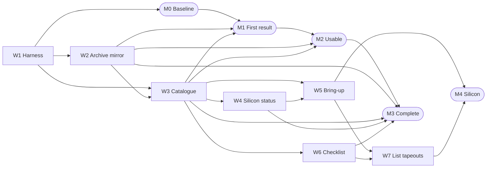

# shuttle-program: Open MPW tapeout programs

This item builds the open record of every open [shuttle](../GUIDELINES.md#shuttle) design: a hash-checked mirror, a catalogue record each, and measured silicon status; it also tapes out this list's designs. Designers and benchmark builders use it. As of 2026-11, the Efabless platform is gone, 41 mirror repositories are empty, and Tiny Tapeout lists 24% of TT04 to TT08 projects as tested and working. Archive checks are automated, so AI agents can work in parallel; [bring-up](../GUIDELINES.md#bring-up) needs hardware.

*Status: draft 2, 2026-11-13. AI review panel: draft 1, 9 personas at one model tier; draft 2, claim audits at one tier. Human review: none. Questions for Tim: 5. This document was drafted and reviewed with AI agents; the AI review panel is not a human review, and the Human review entry is the only record of one.*

## Goal

**Deliverables.** Six open artefacts covering three shuttle programs' designs.
A *design* here is one submitted project: a slot on an Open multi-project wafer (MPW) shuttle, a Tiny Tapeout project or a wafer.space slot.
- *Shuttle corpus mirror:* every enumerated design's repository at its submitted commit, and its [layout file](../GUIDELINES.md#layout-file-gds) where published, each checked against the program's published hash; each design keeps its own licence.
- *Design catalogue:* one record per design: program, shuttle, slot, repository, commit, [process design kit](../GUIDELINES.md#process-design-kit-pdk) (PDK), licence, hash, tool versions where recorded; facts and links only, no copied descriptions; [CC0](../GUIDELINES.md#cc0).
- *Silicon status record:* per manufactured design, one of working, partly working, failed, untested or `Unknown`, each with an evidence link; CC0.
- *Bring-up harness:* pytest tests run on returned chips through remote boards, following Tim's testing notes; Apache-2.0.
- *Submission checklist:* licence file, test and record fields proposed to the Tiny Tapeout and wafer.space templates; Apache-2.0.
- *List tapeouts:* test structures and cells from other items on this list, on existing shuttles.
- *Where it lands:* a new repository Tim names ([Questions for Tim](#questions-for-tim), question 1).

**Acceptance test.** Every design has a record; every reachable one, a hash-checked copy.
- Open MPW: 360 slots on nine shuttles, from the foss-eda-tools mirror.
- Tiny Tapeout: 4,937 projects in tinytapeout-index's per-shuttle files at b4bf499; its summary field says 4,921.
- wafer.space Run 1: 30 public manifest rows at 5660c84.
- Each copy's hash equals the manifest's SHA1 or SHA256, or its commit equals the pinned one.
- Each design with no reachable copy names the searches that ran.
- Each manufactured design has a status with evidence; a second agent re-checks 50 records and agrees on all.
- One list design is taped out and its measurements published ([M4](#milestones)).

**Framing.** Proof-in-silicon layer, serving every function.
It gives process design kits, tools and IP blocks measured results. On the manual-to-generator axis it moves shuttle bookkeeping from hand-kept spreadsheets to a record regenerated after every shuttle.

**Out of scope.** This item archives and records; others run flows and build tools.
- Re-running flows on the corpus and ranking tools: [asic-scoreboard](asic-scoreboard.md).
- The [precheck](../GUIDELINES.md#precheck) engine and per-rule tests: [drc-forge](drc-forge.md).
- PDKs for nodes with no open kit: [shadow-pdks](shadow-pdks.md).
- Generated cell libraries: [cell-foundry](cell-foundry.md).
- Device models fitted to measured test structures: [tcad-twin](tcad-twin.md).
- Operating a new shuttle line: the existing programs, Tiny Tapeout and wafer.space (question 4).

## Why it is high value

**The pain today.** Designs are losing their sources, and silicon status is mostly unrecorded.
- platform.efabless.com does not answer; ChipFoundry states it acquired Efabless's assets.
- 6 of 96 upstream repositories named in Open multi-project wafer (MPW) `info.yaml` files are gone.
- 3 of those 6 are not in Software Heritage and survive only in the mirror.
- 41 GFMPW-1 mirror repositories exist but hold nothing.
- Of 11 MPW-1 slots hashed, slot-011's layout differs from its manifest.
- Tim's Open MPW descriptions carry no commit, process design kit, tool version or silicon status.
- MPW-4 and MPW-5 silicon is marked "On Hold" in Tim's run summaries, read 2026-11.
- Tiny Tapeout lists 194 of 810 TT04 to TT08 projects as silicon-proven.

**Why not already done.** Each program kept its own records; the largest closed.
Collating thousands of repositories is tedious and no one's job. Silicon status needs someone with a chip and a board, so most results go unreported.

**Who is waiting.** Five items here, and benchmark builders.
- [asic-scoreboard](asic-scoreboard.md), [drc-forge](drc-forge.md): the corpus and real layouts.
- [tcad-twin](tcad-twin.md): measured test structures.
- [cell-foundry](cell-foundry.md), [open-links](open-links.md): silicon proof of their blocks.
- NotSoTiny and SGAnalog build benchmarks from Tiny Tapeout designs.
- Over 40% of tapeouts come from first-time designers (Tim's claim, 2026-11; checked: not checked).

**Why now.** The record is still mostly reachable, and every archive check is automated.
This is "easy now with AI" and "unlocks other tasks". The shift from per-run spreadsheets to a generated record needs one agent per design, which was the obstacle; AI agents remove it. Today 90 of 96 Open MPW upstreams and 141 of 145 sampled Tiny Tapeout repositories answer.

**Shots on goal.** One archive attempt per design; 11 Tiny Tapeout runs in 2026.
- Archive: 5,327 designs in the three enumerators, one clone and one hash each.
- Tiny Tapeout runs closing in 2026: 11, riding 7 foundry shuttles.
- Planned runs, March 2027 to January 2028: 8.
- Cost per tapeout attempt: a wafer.space quarter slot at $3,000 list; a Tiny Tapeout tile `Unknown (settled by: the Tiny Tapeout app's price page)`.

## What success unlocks

**Needs first.** Nothing blocks the archive; tapeouts need three items' designs.
- [cell-foundry](cell-foundry.md), generated standard-cell libraries: cells to tape out at [M4](#milestones).
- [tcad-twin](tcad-twin.md), open process and device simulation: test structures to tape out.
- [drc-forge](drc-forge.md), design-rule checking: a precheck the list tapeouts pass.

**Unlocks on this list.** The corpus unlocks the scoreboard; measured silicon unlocks four more.
- [asic-scoreboard](asic-scoreboard.md), chip-design benchmarking: an enumerated, pinned, licence-checked corpus to run flows on.
- [tcad-twin](tcad-twin.md): measured test structures to fit models against.
- [cell-foundry](cell-foundry.md): silicon status of its cells.
- [open-links](open-links.md), open high-speed link blocks: silicon proof of its physical-layer circuits.
- [shadow-pdks](shadow-pdks.md), almost-manufacturable process design kits: measured real-node results to model on.

**Cross-checks with.** Two items check this item's counts and verdicts.
- [asic-scoreboard](asic-scoreboard.md): its design count per shuttle equals this catalogue's.
- [drc-forge](drc-forge.md): its verdicts on archived layouts agree with each program's precheck.

**Shared harness.** This item owns the corpus; the scoreboard owns flow runs.
The enumerator and liveness [harness](../GUIDELINES.md#harness) of [W1](#workstreams) is what [asic-scoreboard](asic-scoreboard.md) reads.

**Beyond the list.** Teaching material and benchmark sets.

**Compounding.** Each shuttle adds designs, then silicon results.

## Why it must be open

**The closed version.** Program platforms held the records, and one closed with them.
The Efabless platform held project pages and its assets passed in an acquisition. Paid multi-project wafer services require a [non-disclosure agreement](../GUIDELINES.md#non-disclosure-agreement-nda) and publish no designs.

**The counterfactual.** Without an open record, designs vanish when their hosts do.
Three designs from the free multi-project wafer (MPW) shuttles already survive only in one mirror. Silicon results would stay in issue threads and talks.

**The strongest case against open.** Designers may not want failed chips on record.
It fails here: the designs were submitted to open programs whose precheck required an approved licence. The record states facts about public designs, and a failure record saves the next designer a shuttle. The record names no person; it links each repository as published.

**Why closed does not deliver.** Closed records die with their platforms.
Closed corpora also cannot feed open benchmarks.
Four mechanisms from [GUIDELINES.md 4.5](../GUIDELINES.md#45-why-it-must-be-open) apply.
- *Reproducibility (empirical):* re-running a design needs its exact commit and tool versions, which Tim's viewer notes require.
- *Accumulation (empirical):* a closed platform's record ended with it.
- *AI itself (empirical):* benchmarks built from Tiny Tapeout need an enumerable, licence-checked corpus.
- *Legal scale (contractual):* programs under a non-disclosure agreement cannot share designs.

**What open means here.** Every artefact is public, and nothing from a foundry is used.
- Catalogue and status record: CC0.
- Scripts and harness: Apache-2.0.
- Mirror: each design under its own licence. The Open MPW precheck, as documented at 0941bdc, requires an approved licence file and licence headers in source files; 40 of 40 sampled slots carry a licence file.
- Mirror or record only: a copy is kept only where a licence file permits redistribution; otherwise the record links the source.
- To reproduce: enumerator commits, manifests, hash list; to replicate: the scripts on live hosts.
- Public test suite: the bring-up tests per design.
- No [foundry](../GUIDELINES.md#foundry) data: no lot-split, e-test or mask data.
- Look-alike licences: None found (searched: 40 mirror slots, 29 Tiny Tapeout repositories, 2026-11-13).

## State of the art

### Open-source tools and projects

- **foss-eda-tools shuttle mirror**: inactive, as of 2026-11.
  - Licence: open-source, each slot's own.
  - Can: hold 368 answering repositories for nine Open multi-project wafer (MPW) shuttles.
  - Cannot: hold GFMPW-1, or record status or tools.
  - Speed: `Unknown (settled by: M0)`; recomputes unchanged inputs: not applicable.
  - Quality: no catalogue or tests.
  - Build on or replace: build on; it is the reference copy.
- **tinytapeout-index**: active, as of 2026-11.
  - Licence: source-available, no licence file at b4bf499.
  - Can: list 29 shuttles and every project with repository and commit.
  - Cannot: record silicon status.
  - Speed: one index file read; recomputes unchanged inputs: yes.
  - Quality: generated by the program.
  - Build on or replace: build on; question 1 covers its licence.

### The bar to clear

**The bound.** Complete coverage: every design has a verified copy or a search record.
- Designs in the three enumerators: 5,327.
- Manufactured Open MPW designs: 478 SKY130 and 80 GF180MCU (Tim's claim, 2026-11; checked: not checked).
- *Manufactured* means wafers returned, per a named source for each run; the per-run list is `Unknown (settled by: M0, from Tim's run summaries)`.

Agent-scale work needs no login, pinned commits and one clone per design; all three enumerators qualify.

**Running a shuttle of its own.** One run costs $300k to $450k, by NODES.md's figures.
- 180nm: $300k a run, about $7.5k a slot.
- 130nm: $450k a run, about $11k a slot.
- wafer.space full slot, 180nm: $8,000; 40 slots make $320,000.
- All open shuttles so far ran on 200mm legacy bulk lines.

Dated context, the closed alternatives:
- Efabless platform: needed a login; closed in 2025 Q1.
- Europractice and two other paid services: a non-disclosure agreement required (Tim's claim, 2026-11; checked: not checked).

### Research results

- Venn (2024) described Tiny Tapeout, the shared-die platform.
- Shah, Ternes and Koch (2023): an open eFPGA on Open MPW silicon.
- Rodriguez-Ferrandez and others (2023): an MPW-2 chip as a reliability vehicle.
- Blocklove and others: a conversationally written design, taped out and checked on silicon.
- Ghorab and others (2025) built a benchmark from 1,572 Tiny Tapeout projects.
- Li and Ding (2026) built a licence-checked analog benchmark from open tapeouts.

### Past and parallel efforts

| Effort | Years | What it did | Where it stands | Link |
| --- | --- | --- | --- | --- |
| Google and Efabless Open MPW | 2020 to 2023 | Free SKY130 and GF180MCU shuttles | Platform gone | [mirror](https://foss-eda-tools.googlesource.com/third_party/shuttle/) |
| Efabless chipIgnite | 2021 to 2025 | Paid shuttles | Assets acquired by ChipFoundry | [ChipFoundry](https://chipfoundry.io/efabless) |
| Tiny Tapeout | 2022 onward | Shared dies, many projects | Active | [chips](https://tinytapeout.com/chips/) |
| wafer.space | 2025 onward | GF180MCU slots on 200mm | Active | [price](https://wafer.space/price) |
| SG13G2 open-source shuttles | 2024 onward | Free runs in Europe | Active, chips on loan | [FAQ](https://docs.google.com/document/d/12KPutDPBst7FF0ncB1qyxErDYeATmXoQLGjRq38dfjU/edit) |

### What is missing

- A catalogue across programs: the closest is tinytapeout-index, which covers one program.
- A verified Open MPW mirror: the mirror has no hash check run against it.
- A silicon status record: the closest is the silicon-proven page, which lists working projects only.
- A copy of GFMPW-1: `Unknown (settled by: asking Tim and the GF180MCU program's operators; not reached: other hosts)`.

**Replace or build on.** Build on all three enumerators and the mirror; replace nothing.

## What Tim has already worked out

**Documents.** Twelve documents read; the viewer requirements carry into the plan.
All were read in full except the mask document, read in part. The documents date from 2022 to 2026; each claim's month below is the month it was read, 2026-11.
- Tim's [Open MPW viewer website requirements](https://docs.google.com/document/d/1YcVW-sLxFwhEJWe4EfJhXq-fRu_f41RE3cu2z58iaD0/edit) (Tim's claim, 2026-11; checked: not checked):
  - rebuild each design with the exact tool versions of its call;
  - store extracted data externally;
  - manufactured designs first.
- Tim's [Testing environments and CI for open hardware projects](https://docs.google.com/document/d/1YgJ-MUC-r9-Stl1M98xjTq8Qf-YQy6LNu38Ov5K5pt0/edit) (Tim's claim, 2026-11; checked: 40 slots a shuttle):
  - a lab of about 500 multi-project wafer (MPW) chips;
  - tests in pytest;
  - power control and reset.
- Tim's [Open MPW Run Manifests Summaries](https://docs.google.com/spreadsheets/d/1NcoXWil-ZV8IoG6bKRmdKJUiu8JE8rPTwlNxm9Xqa1Q/edit): close and silicon dates per run (checked: against the manifest repositories).
- Tim's [Open MPW Repository Descriptions](https://docs.google.com/spreadsheets/d/1vQvdCUJYlQLEy8GNejeW40l78nyi3y9FJvmltSPb2gY/edit): 360 slot descriptions (checked: matches the mirror).
- Tim's [Automated mask generation for MPW program](https://docs.google.com/document/d/1_sW4njzL95Yoh6OiwKNr8pAHJdx4vTp6jPxxg7cSs2E/edit): mask data within 24 hours of the layout (Tim's claim, 2026-11; checked: not checked).
- Tim's [SKY130 MPW-2 databook](https://docs.google.com/presentation/d/1kJDnAJO9Hn9BBqmS3DAyG3dsW0f_l0_cfq7RB0tdZw0/edit): bring-up reports per project.
- The [wafer.space - Hack-A-Day Europe 2026](https://docs.google.com/presentation/d/19B_h0WY9UAcuUAcgJF6T_YBWIk7LCmVd9yK6ZmSfHk4/edit) deck in Tim's resources: design and manufactured counts.
- Tim's [SKY130 MPW-I test tile notes](https://docs.google.com/document/d/16xyYe0Xu4ScDvNsoOG2TUB5iSQCWn7VryFxZxZh4ihI/edit): raw measurements in a public repository.
**Experiments and results.** Tim's two tools enumerate the corpus; neither checks it.
- mpw-tools fetches `info.yaml` and manifests from the mirror.
- tinytapeout-project-search indexes every Tiny Tapeout shuttle.

**Dead ends.** Automated mask generation stopped for resources, not because the idea failed.
Its proposal named a proprietary mask tool, and the program it served ended.

**Framing inherited.** Manufactured designs first, rebuilt with their own tool versions.

**From unpublished notes.** `Unknown (settled by: Tim's sign-off of two sentences listed for him, 2026-11-13)`.

**Where the written record runs out.** No record says which manufactured Open MPW designs work.
- Which of the 478 manufactured SKY130 designs were tested, and how: Tim and the designers.

## What frontier models change

**Why faster.** One agent per design makes 5,327 parallel units with exact oracles.
Each unit is a clone, a hash and a schema check.
- Oracle latency: 30 to 72 seconds to stream and hash one MPW-1 slot, 11 measured.
- Record size: one `info.yaml` or index entry per design.

**Why better.** Agents read silos people skip: issue threads, talks, papers and READMEs.
An agent collects each status claim with its evidence link; a second agent re-checks it.

**What has to be true.** Hosts must stay reachable, and status evidence must be public.
- The mirror, GitHub and the indexes answer anonymous clones (true 2026-11-13).
- Reading evidence and judging whether it states a status rests on current model capability.
- Fit: [W1](#workstreams) to [W3](#workstreams) are A; [W4](#workstreams) and [W6](#workstreams) are C; [W5](#workstreams) and [W7](#workstreams) are B.

**What people still do.** People plug in boards, choose tapeouts and pay for slots.
The blockers and the [plausible-but-wrong risk](../GUIDELINES.md#plausible-but-wrong-risk) are in [Unknowns, blockers and risks](#unknowns-blockers-and-risks).

## Work plan and milestones

### Workstreams

"This item's repository" is the new one Tim names (question 1). Fit follows the binding constraint ([GUIDELINES.md 4.9](../GUIDELINES.md#49-work-plan-and-milestones)).

**W1 Harness, benchmarks and tool speed.** Produces: the enumerator and hash harness, and baselines. Needed because: every count in the acceptance test comes from it.
- Oracle: two methods that fail differently agree.
  - Stands in for: direct: the denominators and baselines.
  - Reference: index field against per-shuttle files; listing against ls-remote.
  - Pass: exact agreement, or a named difference such as the 16 Tiny Tapeout projects.
  - Latency: one listing or one ls-remote per repository.
  - Negative control: a made-up repository name on a real host counts as gone.
  - Blind spots: an error both methods share.
- Access: public.
- Knowledge: public record.
- Units: three enumerators.
- Binding constraint: none, because every check is automated.
- Lands in: this item's repository.
  - Contribution gate: a second agent reproduces each count.
- Fit: A, because none binds.
- Lead time: none.
- Depends on: the three enumerators.

**W2 Archive rescue and mirror.** Produces: a hash-checked copy of every reachable design. Needed because: sources are disappearing.
- Oracle: the program's published hash or pinned commit.
  - Stands in for: direct: the copy is what was submitted.
  - Reference: manifest SHA1, wafer.space SHA256, Tiny Tapeout commit.
  - Pass: exact match.
  - Latency: one download and one hash.
  - Negative control: a one-byte change fails.
  - Blind spots: a design changed before the manifest was written; changes after submission, such as fill.
- Access: public.
- Knowledge: public record.
- Units: 5,327 designs and 96 upstreams named in multi-project wafer (MPW) slots.
  - Open MPW and wafer.space: one layout hash per slot.
  - Tiny Tapeout: one commit fetch per project; projects share a shuttle layout.
- Binding constraint: compute, because storage and bandwidth set the pace.
- Lands in: this item's repository, with Software Heritage as a second copy.
  - Contribution rules: Software Heritage's "save code now" form.
  - Contribution gate: none for public origins.
- Fit: A, because compute binds.
- Lead time: none.
- Depends on: W1.

**W3 Design catalogue.** Produces: one record per design. Needed because: no cross-program catalogue exists.
- Oracle: schema validation plus agreement with the enumerator.
  - Stands in for: direct: the record matches its sources.
  - Reference: the manifest row, `info.yaml`, index entry.
  - Pass: every field validates and matches.
  - Latency: one record.
  - Negative control: a record with a wrong commit fails.
  - Blind spots: a source that is itself wrong.
- Access: public.
- Knowledge: public record.
- Units: 5,327 records.
- Binding constraint: none, because checks are automated.
- Lands in: this item's repository.
  - Contribution gate: a second agent re-derives a sample.
- Fit: A, because none binds.
- Lead time: none.
- Depends on: W1, W2.
- Suite quality: share of seeded wrong records caught, from [M1](#milestones).

**W4 Silicon status collation.** Produces: the status record with evidence links. Needed because: status is unrecorded.
- Oracle: the evidence link states the status.
  - Stands in for: whether the chip works.
  - Reference: the silicon-proven page, papers, databooks, issues.
  - Pass: a second agent reads the same evidence cold and agrees.
  - Latency: one evidence read.
  - Negative control: a record citing a page that does not mention the design fails.
  - Blind spots: tests nobody published.
- Access: public.
- Knowledge: spread across silos: issue threads, talks, papers.
- Units: manufactured designs; 558 Open MPW (Tim's claim, 2026-11; checked: not checked).
- Binding constraint: knowledge, because most results are unpublished.
- Lands in: this item's repository.
  - Contribution gate: evidence link per record.
- Fit: C, because knowledge binds.
- Lead time: none.
- Depends on: W3.
- Suite quality: share of seeded wrong records caught, such as a page that never names the design, from [M1](#milestones).

**W5 Bring-up on returned silicon.** Produces: pytest results per design on returned chips. Needed because: most manufactured designs are untested.
- Oracle: the design's own test on a remote board.
  - Stands in for: direct: the chip's behaviour.
  - Reference: the design's testbench and documentation.
  - Pass: the test passes on two parts, which needs two tiles' parts or two dies.
  - Latency: one test run.
  - Negative control: a design the MPW-2 databook reports as not working fails.
  - Blind spots: analog behaviour the test does not measure.
- Access: remote hardware. On 2026-11-13 tinytapeout.fpgas.online listed every chip board as not connected; its emulation boards answer. Whether Tim's lab of returned chips exists today is question 5.
- Knowledge: public record for Tiny Tapeout; tacit for Open MPW boards.
- Units: designs with a hardware test and a part; `Unknown (settled by: M0 count of test directories)`. A simulation test needs porting to drive a board.
- Binding constraint: access, because chips must be on boards.
- Lands in: this item's repository.
  - Contribution gate: logs and board identity per run.
- Fit: B, because access binds.
- Lead time: shuttle return.
- Depends on: W3, W4.
- Suite quality: share of known-failed designs the tests catch, from [M1](#milestones).

**W6 Submission checklist.** Produces: checklist items and template changes. Needed because: index and manifest repositories carry no licence file.
- Oracle: the program's maintainers accept the change.
  - Stands in for: whether future designs are reusable.
  - Reference: the catalogue's gaps.
  - Pass: merged.
  - Latency: one review.
  - Negative control: a template without a licence file fails the checklist.
  - Blind spots: designs outside the templates.
- Access: public.
- Knowledge: public record.
- Units: two programs' templates.
- Binding constraint: decision, because maintainers decide.
- Lands in: Tiny Tapeout and wafer.space template repositories.
  - Contribution rules: none stated; both template repositories carry a licence file and no contributing file.
  - Contribution gate: maintainer review.
- Fit: C, because a decision binds.
- Lead time: maintainer review.
- Depends on: W3.

**W7 List tapeouts.** Produces: designs from this list on existing shuttles, measured. Needed because: silicon is the final proof.
- Oracle: measurements on returned chips.
  - Stands in for: direct: silicon behaviour.
  - Reference: the design's simulation.
  - Pass: measured within the design's stated limits.
  - Latency: one shuttle cycle.
  - Negative control: a deliberately broken structure measures as broken.
  - Blind spots: one lot, few dies.
- Access: money: slots on existing shuttles.
- Knowledge: public record.
- Units: one design per slot.
- Binding constraint: access, because slots cost money.
- Lands in: the shuttle program, then this item's repository.
  - Contribution gate: the program's precheck.
- Fit: B, because access binds.
- Lead time: shuttle cycle.
- Depends on: W5, W6, cell-foundry, tcad-twin.

### Summary table

| # | Workstream | Oracle | Access | Units | Binding constraint | Fit |
| --- | --- | --- | --- | --- | --- | --- |
| W1 | Harness, benchmarks and tool speed | Two methods agree | public | Three enumerators | none | A |
| W2 | Archive rescue and mirror | Published hash or commit | public | 5,327 designs | compute | A |
| W3 | Design catalogue | Schema and source agree | public | 5,327 records | none | A |
| W4 | Silicon status collation | Evidence states status | public | 558 Open MPW designs | knowledge | C |
| W5 | Bring-up on returned silicon | Test on remote board | remote hardware | Designs with tests | access | B |
| W6 | Submission checklist | Maintainers merge | public | Two templates | decision | C |
| W7 | List tapeouts | Measured silicon | money | One per slot | access | B |

### Milestones

Proof levels follow [GUIDELINES.md 4.9.1](../GUIDELINES.md#491-proof-levels).

**M0 Baseline and harness.**
- Done when: the harness reproduces the [baselines](#metric-and-baseline) from a clean checkout.
  - 368 of 416 mirror repositories answer.
  - 90 of 96 upstreams answer.
  - The 16-project Tiny Tapeout gap is explained.
  - MPW-1 slot-001 matches its manifest SHA1.
- Evidence: harness, logs, pinned counts.
- Proof: P2.
- Needs: public hosts.
- Completes: W1.
- Fit: A.
- Gate: a second agent reproduces every count.

**M1 First checkable result.**
- Done when: MPW-1's 40 slots are hash-checked by streaming, and catalogued.
- Evidence: 40 records and 40 hash matches; no copy is kept.
- Proof: P2.
- Needs: M0; public hosts only.
- Completes: W2, W3 for MPW-1.
- Fit: A.
- Gate: a second agent re-derives 10 records.

**M2 Usable.**
- Done when: copies are stored and an outside project reads the catalogue.
- Evidence: the outside project's commit citing the catalogue.
- Proof: P4.
- Needs: M1 across all three enumerators; the archive's home (question 1).
- Completes: W2, W3.
- Fit: A.
- Gate: the outside user's run reproduces the design count.

**M3 Complete or at the bar.**
- Done when: every design has a record; every manufactured one, a status.
- Evidence: the catalogue, the status record, and the cross-check report.
- Proof: P3.
- Needs: M2; W4.
- Completes: W2, W3, W4, W6.
- Fit: C.
- Gate: totals agree with the silicon-proven page and Tim's counts, or the difference is explained.

**M4 Proven in hardware or silicon.**
- Done when: one list design is taped out, returned and measured.
- Evidence: measurement logs and the design's record.
- Proof: P5.
- Needs: a slot; cells or test structures from other items.
- Completes: W5, W7.
- Fit: B.
- Gate: measured within the design's stated limits on two chips.
- Hardware: a Tiny Tapeout board, or wafer.space dies with the packaging add-on, which needs the default pad ring.
- Test plan: five steps, in order.
  - supply current against the design's limit;
  - clock and reset;
  - input-output loop-back;
  - the design's pytest suite;
  - parametric checks on a bench, with instruments listed in Needs.
- What silicon returns and when: 1,000 dies per wafer.space slot; for current runs, chips are expected 138 to 176 days after close.

**Dependencies.** The longest chain to M3 runs W1, W2, W3, M1, M2, M3.

*Figure 1: Workstreams (boxes, the work) and milestones (rounded boxes, the states the work reaches); an arrow means "needed before", taken from the Depends on and Completes lines. Longest chain to [M3, Complete or at the bar](../GUIDELINES.md#m3-complete-or-at-the-bar): W1, W2, W3, M1, M2, M3; lead time on it: none.*

### Metric and baseline

Both metrics are measured by an [M0](#milestones) script.
- **Archive coverage.**
  - Formula: designs with a hash-checked copy, over enumerated designs.
  - Unit: percent, per program.
  - Over: 360 Open MPW slots, 4,937 Tiny Tapeout projects, 30 wafer.space rows.
  - Success: 100% of designs whose source answers anywhere.
  - Guardrail: copies failing a second agent's re-hash on a 50-copy sample; must be 0.
  - Baseline: 0 copies checked by this item; source liveness below.
  - Measured by: the [W1](#workstreams) harness.
  - Target: 100% at [M3](#milestones).
- **Silicon-status coverage.**
  - Formula: manufactured designs with an evidence-linked status, over manufactured designs.
  - Unit: percent, per shuttle.
  - Over: manufactured designs, wafers returned per a named source.
  - Success: 100%, with untested and `Unknown` counted as statuses.
  - Guardrail: the unsupported rate on a 50-record re-check; must be 0.
  - Baseline: 194 of 810 TT04 to TT08 projects listed silicon-proven.
  - Measured by: the [W1](#workstreams) harness.
  - Target: 100% at [M3](#milestones).

Source liveness today, which the archive coverage baseline starts from:

| Source | Answering | Checked | Method |
| --- | --- | --- | --- |
| Open MPW mirror repositories | 368 | 416 | ls-remote |
| Open MPW upstreams | 90 | 96 | ls-remote |
| Open MPW upstreams in Software Heritage | 86 | 96 | archive query |
| Tiny Tapeout repositories, sample | 141 | 145 | ls-remote, seed 20261113 |
| Tiny Tapeout pinned commits, sample | 86 | 87 | fetch by commit |
| wafer.space Run 1 repositories | 25 | 25 | ls-remote |

### Lead times

- **Tiny Tapeout close to shipped, history.** Median 259 days, range 228 to 451, TT02 to TT08; affects [M4](#milestones).
- **Next Tiny Tapeout SKY130 run.** Closes 2026-11-30; chips expected 2027-05-25; shipping estimated 2027-06-25; affects [M4](#milestones).
- **wafer.space Run #3.** Slot deadline 16 December 2026; parts shipped Q2 2027; affects [M4](#milestones).
- **Maintainer review.** `Unknown (settled by: dates of recent merged changes in the template repositories)`; affects [M3](#milestones).

### Cross-checks

**Sources and failure modes.** Each source has an independent check.

| Source | Trusted for | Known failure mode | Independent check |
| --- | --- | --- | --- |
| Mirror manifests | Slot identity and hash | GFMPW-1 empty | Upstream commit, Software Heritage |
| tinytapeout-index | Project list | Field and files differ by 16 | Shuttle repositories |
| Silicon-proven page | Working projects | Omits failed and untested | Papers, issues, bring-up |
| Tim's counts | Manufactured totals | Counting rules unstated | Catalogue sums |

**Verification ladder.** One ladder has all five rungs; one has three.
- **Open MPW slot count.**
  - Bound: 9 shuttles of 40 slots, 360.
  - Limit: 40 slot rows in each of the three manifests read.
  - Second source: Tim's 360 descriptions.
  - Rebuild: the manifests, shuttle by shuttle.
  - Measurement: hash match per slot.
  - Rungs in place: all five; built by: [M1](#milestones).
- **Silicon status of manufactured designs.**
  - Bound: at most 558 Open MPW designs.
  - Limit: designs on returned wafers.
  - Second source: silicon-proven page, tracker papers.
  - Rebuild: not applicable.
  - Measurement: [W5](#workstreams) bring-up.
  - Rungs in place: bound, second source; built by: [M3](#milestones).

**Fast and accurate paths.** Liveness is fast; a hash match is accurate.
- **Copy validity.**
  - Fast: ls-remote; cost: one request; used when: surveying.
  - Accurate: fetch and hash; cost: one download; used when: a copy enters the mirror.
- **Silicon status.**
  - Fast: the silicon-proven page; cost: one read; used when: seeding.
  - Accurate: a test on a remote board; cost: one run; used when: a status is "working".

**Effort rule.** Every record gets automated checks; status records get a second agent.

## Needs beyond AI processes

| Kind | What exactly | Why | Who could provide it | Cost | Lead time | What can proceed without it |
| --- | --- | --- | --- | --- | --- | --- |
| Compute | Storage for layouts | Mirror | Any public host | `Unknown (settled by: M0 size sum)` | none | Streamed checks, catalogue |
| Access | GFMPW-1 designs | Gap in mirror | Program operators | `Unknown (settled by: question 2)` | unknown | Everything else |
| Hardware | Boards with returned chips | Bring-up | Tiny Tapeout, Tim's lab | `Unknown (settled by: question 5)` | none | Archive and catalogue |
| Hardware | Packaging add-on for wafer.space dies | Bring-up | wafer.space | $1,500 a slot | Shuttle cycle | Tiny Tapeout route |
| Hardware | Source-measure unit and probes | Test structures | A lab | `Unknown (settled by: question 3)` | none | Digital tests |
| Money | Two parts per design | List tapeouts | Tim | $3,000 a quarter slot | Shuttle cycle | All but tapeouts |
| Decision | Archive's home | Lands in | Tim | none | none | Scratch copy |

Notes on the table:
- Storage: about 200 gigabytes for 360 slots (estimate); the [M0](#milestones) size sum replaces it.
- Prices: list prices from [wafer.space's price page](https://wafer.space/price), read 2026-11-13.

**Licence questions.** Two indexes and two sampled slots lack a clear licence.
- tinytapeout-index and ws-run1 have no licence file; the catalogue copies facts, not their text.
- 2 of 40 sampled slots start their licence file with a copyright line only; `Unknown (settled by: reading both files in full at M0)`.

**Clean room.** `Not applicable (no PDK work; no foundry data used)`.

## Unknowns, blockers and risks

### Expertise barriers

- **Bringing up a multi-project wafer (MPW) harness chip.**
  - Why it defeats people: board, firmware and per-slot selection differ by run.
  - How an AI model gets through: reading the harness repository and databook reports.
  - Validated by: a known-working design passes on the board.

### Hard blockers

- **Legal: redistributing a design without a clear licence.**
  - AI cannot: grant a licence.
  - AI can: list each such design and its search record.
  - Mitigation or question for a person: ask the designer; until then, record and link without a copy.
- **Physical: returned chips sit in drawers.**
  - AI cannot: plug in a board.
  - AI can: write the tests and the board list.
  - Mitigation or question for a person: question 5.
- **Economic: a list tapeout needs a paid slot.**
  - AI cannot: pay.
  - AI can: prepare and precheck the design.
  - Mitigation or question for a person: question 3.

### Risks of the approach

- **The plausible-but-wrong risk: a status record cites evidence that does not say the design works.** Check: a second agent reads the evidence cold; the unsupported rate guardrail.
- **A hash matches but the copy is the wrong design.** Check: slot and project name against the manifest row.

## Unanswered technical questions

1. **Why does MPW-1 slot-011 differ from its manifest hash?**
   - Settled by: hashing every file in the slot and the manifest's history.
   - Blocks: [W2](#workstreams) for that slot.
   - Taker: an agent with public resources.
2. **Does any public copy of the GFMPW-1 designs exist?**
   - Settled by: searching other hosts and asking the operators.
   - Blocks: [W2](#workstreams) for GFMPW-1.
   - Taker: an agent with public resources, then Tim.
3. **What does the 16-project gap in tinytapeout-index mean?**
   - Settled by: diffing the index field against the per-shuttle files.
   - Blocks: [W1](#workstreams).
   - Taker: an agent with public resources.
4. **Which multi-project wafer (MPW) boards can still run, and where are they?**
   - Settled by: an inventory of Tim's lab.
   - Blocks: [W5](#workstreams) for Open MPW.
   - Taker: Tim.

## Questions for Tim

1. **Q:** Where does the archive land? **Context:** no repository is named. **Assumed for now:** a new repository Tim names; records CC0, scripts Apache-2.0. **Changes if different:** Lands in lines.
2. **Q:** Does a public GFMPW-1 copy exist? **Context:** 41 mirror repositories are empty. **Assumed for now:** no; recorded as not mirrored. **Changes if different:** [W2](#workstreams).
3. **Q:** Which list designs go on the first tapeout? **Context:** [cell-foundry](cell-foundry.md) and [tcad-twin](tcad-twin.md) both need silicon. **Assumed for now:** a test-structure tile and cells on a wafer.space quarter slot. **Changes if different:** [W7](#workstreams), [M4](#milestones).
4. **Q:** Does this item run shuttles of its own? **Context:** one run costs $300k to $450k. **Assumed for now:** existing programs only. **Changes if different:** Goal, Needs.
5. **Q:** Which returned chips and boards does your lab hold today? **Context:** a 2023 document names about 500 chips; the remote chip boards are not connected. **Assumed for now:** no lab; new parts only. **Changes if different:** [W5](#workstreams), Needs.

## Start here

### Agent digest

- Goal: every design recorded, reachable ones hash-checked, manufactured ones with a status.
- First task: hash-check and catalogue MPW-1 (task 1).
- Oracle: manifest SHA1 of the decompressed layout.
- Lands in: a repository Tim names; until then, the run report.
- Ask a person for: storage, boards, slot money.
- Upstream / downstream: [cell-foundry](cell-foundry.md), [tcad-twin](tcad-twin.md) / [asic-scoreboard](asic-scoreboard.md), [drc-forge](drc-forge.md).
- Stop rule: 60 minutes; report counts and where it stopped.

### Read first

1. Tim's [Open MPW viewer website requirements](https://docs.google.com/document/d/1YcVW-sLxFwhEJWe4EfJhXq-fRu_f41RE3cu2z58iaD0/edit) (short): what a per-design record needs.
2. Tim's [Testing environments and CI for open hardware projects](https://docs.google.com/document/d/1YgJ-MUC-r9-Stl1M98xjTq8Qf-YQy6LNu38Ov5K5pt0/edit) (short): bring-up as tests.
3. [mithro/mpw-tools](https://github.com/mithro/mpw-tools) (small): how the mirror is read.
4. [TinyTapeout/tinytapeout-index](https://github.com/TinyTapeout/tinytapeout-index) `index/index.json`: the Tiny Tapeout enumerator.

### Reproduce first

- Source: the [foss-eda-tools shuttle mirror](https://foss-eda-tools.googlesource.com/third_party/shuttle/), MPW-1 manifest.
- Pin: manifest repository `sky130/mpw-001/foundry` at 89012e0 (2023-01-04).
- Environment: curl, base64, gzip, sha1sum.
- Flow: the download command in the manifest's row A1.
- Corpus: the 40 rows of `manifest-mpw-001.csv`; run all 40.
- Expected value: SHA1 of the decompressed layout equals the manifest's hash column; slot-001 gives f4a4b80c.
- Runtime: `Unknown (settled by: this run)`; slot-001 is 587 megabytes compressed.
- Time box: 60 minutes.
- Known-good case: slot-001; known-bad case: the compressed file's SHA1 differs, so hashing the wrong form fails.
- Failure report: slot, bytes received, both hashes.

### First tasks

All land in this item's repository (question 1); until it exists, results go with the run report.
1. **MPW-1 hash check and catalogue.**
   - Produce: 40 streamed hash results and `catalogue.jsonl`, one row per slot, keyed by program, shuttle and slot, with the fields of the design catalogue.
   - Oracle: manifest SHA1.
   - Inputs: the MPW-1 manifest at 89012e0.
   - Workstream: [W2](#workstreams).
   - Fit: A.
   - Lands in: this item's repository.
2. **Upstream liveness report.**
   - Produce: the 96 upstream addresses with answer, Software Heritage presence and mirror slot.
   - Oracle: ls-remote and the archive's query interface agree with [Metric and baseline](#metric-and-baseline).
   - Inputs: `info.yaml` files from the mirror.
   - Workstream: [W1](#workstreams).
   - Fit: A.
   - Lands in: this item's repository.
3. **Save the mirror copies of the three unarchived upstreams.**
   - Produce: Software Heritage save requests for the mirror slot repositories whose upstream is gone and unarchived.
   - Oracle: the archive's query interface lists the origin.
   - Inputs: task 2's list.
   - Workstream: [W2](#workstreams).
   - Fit: A.
   - Lands in: Software Heritage.

### Ask a person for

- **The archive's home:** from Tim, for [M1](#milestones).
- **Boards with returned chips:** from Tim and Tiny Tapeout, for [M4](#milestones).
- **Slot money:** from Tim, for [M4](#milestones).

### Known dead ends

- **platform.efabless.com.** It no longer answers; use the mirror.
- **Hashing the compressed layout.** The MPW-1 manifest's SHA1 is of the decompressed file ([Reproduce first](#reproduce-first)).

### Key papers

- Venn, "Tiny Tapeout: A shared silicon tape out platform accessible to everyone" (2024). [doi:10.1109/MSSC.2024.3381097](https://doi.org/10.1109/MSSC.2024.3381097).
- Shah, Ternes and Koch, "FABulous Demo: Open Source FPGA on Sky130" (2023). [doi:10.1109/fpl60245.2023.00070](https://doi.org/10.1109/fpl60245.2023.00070).
- Rodriguez-Ferrandez, Kosmidis, Tali and Steenari, "Space Shuttle: A Test Vehicle for the Reliability of the SkyWater 130nm PDK for Future Space Processors" (2023). [doi:10.1109/iolts59296.2023.10224899](https://doi.org/10.1109/iolts59296.2023.10224899).
- Blocklove, Garg, Karri and Pearce, "Chip-Chat: Challenges and Opportunities in Conversational Hardware Design" (2023). [doi:10.1109/MLCAD58807.2023.10299874](https://doi.org/10.1109/MLCAD58807.2023.10299874).
- Blocklove, Garg, Karri and Pearce, "Evaluating LLMs for Hardware Design and Test" (2024). [doi:10.1109/lad62341.2024.10691811](https://doi.org/10.1109/lad62341.2024.10691811).
- Ghorab and others, "NotSoTiny: A Large, Living Benchmark for RTL Code Generation" (2025). [arXiv:2512.20823](https://arxiv.org/abs/2512.20823).
- Li and Ding, "SGAnalog: An End-to-End Circuit Benchmark from Open-Source Silicon Tapeouts" (2026). [arXiv:2610.03934](https://arxiv.org/abs/2610.03934).
- Li and others, with Ansell, "Rapid Prototyping of Laser-Induced Graphene Sensors With Open-Source Silicon" (2024). [doi:10.1109/mssc.2024.3380586](https://doi.org/10.1109/mssc.2024.3380586).

### Projects and code

- [foss-eda-tools shuttle mirror](https://foss-eda-tools.googlesource.com/third_party/shuttle/): inactive, as of 2026-11.
  - Licence: open-source, each slot's own.
  - Contains: every multi-project wafer (MPW) slot repository and the manifests.
- [TinyTapeout/tinytapeout-index](https://github.com/TinyTapeout/tinytapeout-index): active, as of 2026-11.
  - Licence: source-available, no licence file at b4bf499.
  - Contains: shuttles and projects with repository and commit.
- [wafer-space/ws-run1](https://github.com/wafer-space/ws-run1): active, as of 2026-11.
  - Licence: source-available, no licence file at 5660c84.
  - Contains: Run 1 manifest with SHA256 per layout.
- [mithro/mpw-tools](https://github.com/mithro/mpw-tools): inactive, as of 2026-11.
  - Licence: open-source, Apache-2.0.
  - Contains: mirror download scripts.
- [mithro/tinytapeout-project-search](https://github.com/mithro/tinytapeout-project-search): active, as of 2026-11.
  - Licence: open-source, Apache-2.0.
  - Contains: keyword search over Tiny Tapeout projects.
- [chipfoundry/caravel_user_project](https://github.com/chipfoundry/caravel_user_project): quiet, as of 2026-11.
  - Licence: open-source, Apache-2.0.
  - Contains: the successor user-project template.
- [Software Heritage](https://archive.softwareheritage.org/): active, as of 2026-11.
  - Licence: `Not applicable (used as a public service, through its query interface)`.
  - Contains: archived source origins.

## Where it sits

Layer: **Proof in silicon**. Function: **cross-cutting**. Target: **ASIC**. Sits outside the three layers: real silicon is the proof that the PDK, tooling and IP layers work.

## Resources

Loose collection of links for fleshing this item out: [resources/shuttle-program.md](../resources/shuttle-program.md).

## Related items

- [asic-scoreboard](asic-scoreboard.md) (ASIC benchmarking): Every shuttle design joins the benchmark corpus.
- [shadow-pdks](shadow-pdks.md) (Open "almost manufacturable" PDKs): Validates the open PDKs.
- [cell-foundry](cell-foundry.md) (Standard cell generation): Proves cell libraries in silicon.
- [open-links](open-links.md) (Open high-speed connectivity IP): Proves connectivity PHYs in silicon.
- [tcad-twin](tcad-twin.md) (Open TCAD stack): Measured silicon validates TCAD.
- [drc-forge](drc-forge.md) (Design rule checking (DRC)): Every shuttle submission passes the design rule check precheck.
